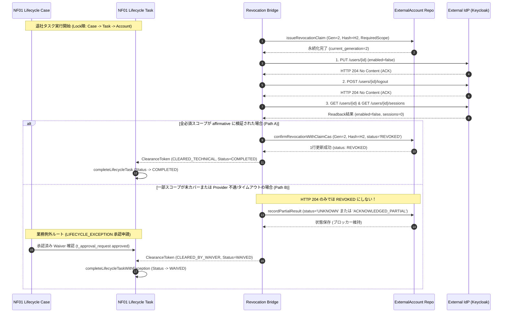

# NF01 ↔ NF09 退社ライフサイクル・外部アカウント撤権連携設計書 (Lifecycle Revocation Bridge Plan)

## 1. 目的と背景

本設計書は、NF01（Engineer Lifecycle Workflow / 退社オフボーディング）と NF09（Enterprise Identity & External Account Reference / 外部アカウント管理）の間における、安全かつ厳格な撤権連携インターフェース仕様を定義する。

現行の `ExternalAccountRevokeConfirmationService.confirm(referenceId, attribution)` は、単に対象レコードの現行 `version` を読み取って楽観排他（CAS）更新を行っている。しかし、非同期リクエストや再試行が発生する外部 IdP（Keycloak 等）連携においては、以下の深刻な整合性課題が存在する：
- 旧世代の要求（generation / claim）に基づく遅延応答や古いコールバックが、後から起票された新しい撤権試行の CAS を通過し、古い結果で新しい状態を誤認確定してしまう問題（ABA 問題・遅延確定競合）。
- 外部 Provider からの「HTTP 204 ACK」「ユーザー無効化（enabled=false）」「アクティブセッション数 0」という個別観測結果を、全スコープ（オフラインセッション、既発行 JWT、下流 SaaS 等）の完全撤権（`REVOKED`）と短絡し、退社ブロッカーを不当に解除してしまう問題。
- 技術的未解決（`UNKNOWN` / `FAILED`）と、業務上のリスク受容・例外承認（`Waiver`）が混同され、技術状態が虚偽に `REVOKED` へ改ざんされるリスク。

本契約はこれらを排除し、暗号論的検証・不変識別子・世代管理（Fence Token）・固定ロック順序・TOCTOU 漂移防止を備えた最小設計を規定する。

---

## 2. 信頼できるコンテキストと呼び出し主体 (Trusted Context & Principal Source)

### 2.1 テナントおよび法人帰属の信頼できる解決
リクエストボディや非認証パラメータに含まれる `tenantId` や `legalEntityId` は一切信用しない。

1. **人間ユーザー（HUMAN）による操作時**:
   - `tenantId`: `LegalEntityContextService.requireTenantId()` を用いて、`SecurityContextHolder` の認証済み Principal（`LoginUser` / `OidcLoginUser`）から解決する。
   - `legalEntityId`: `LegalEntityContextService.requireCurrentLegalEntityId()` を用いて、ユーザーの有効組織マッピング（`AttendanceScopeMapper`）から一意に解決する。
   - 呼び出し主体の真正性検証: `attribution.actorType() == ActorType.HUMAN` の場合、クライアントから渡された `attribution.humanUserId()` が現在の認証済みユーザー ID（`SecurityUtils.currentUserId()`）と完全に一致することをサーバー側で強制検証する。単に DTO に有効な ID を詰めただけでは本人確認とみなさない。
2. **システムバッチ・スケジューラ（SYSTEM）実行時**:
   - バックグラウンド実行時は `SecurityContextHolder` に人間セッションが存在しない。
   - 対象エンティティ（`t_lifecycle_case`）の永続化された `tenant_id` および `legal_entity_id` を信頼できる起点とし、内部実行コンテキスト（`ExecutionActorContext`）を通じてシステム認可を確立する。
   - `attribution.humanUserId()` は厳格に `null` であることを強制する。
3. **外部プロバイダコールバック（PROVIDER）受信時**:
   - 署名検証フィルタ（`ExternalApiAuthenticationFilter` 等）により、送信元 IP、HMAC 署名、または mTLS クライアント証明書が正当に検証された `ExternalApiPrincipal` からテナント境界を解決する。
   - `attribution.humanUserId()` は厳格に `null` であることを強制する。

### 2.2 既存 ActorAttribution 閉集合ペアの厳格適用
監査・確認主体は、既存の `com.ses.common.audit.ActorAttribution` が規定する以下の closed pair 規約のみを受け付ける。独自の区分（例: `HUMAN_ADMIN`, `SYSTEM_SCHEDULER` 等）を新設してはならない。

| 主体区分 (`ActorType`) | 確認チャネル (`ConfirmationSource`) | 人間ユーザーID (`humanUserId`) | 想定ユースケース |
|---|---|---|---|
| `HUMAN` | `MANUAL_API` | 必須（> 0 かつ認証IDと一致） | 管理画面等での管理者・担当者による明示的な確認・承認操作 |
| `SYSTEM` | `SCHEDULER_POLL` | 禁止（null 必須） | 定周期バッチ、内部リトライスケジューラによるポーリング処理 |
| `PROVIDER` | `PROVIDER_SYNC` または `PROVIDER_CALLBACK` | 禁止（null 必須） | 外部 IdP との同期処理、または検証済み署名付き Webhook コールバック |
| `LEGACY_UNRESOLVED` | `LEGACY_UNRESOLVED` | 禁止（null 必須） | V182 以前の未解決レガシー監査データ（新規生成禁止） |

---

## 3. 不変識別子と要求範囲の固定 (Immutable Target & Revocation Scope)

### 3.1 外部アカウントの不変バインディング
撤権対象は、可変なユーザー名（username）やメールアドレスではなく、作成時に固定された以下の不変属性と厳密に結合する：
- `system_identifier`: 外部 IdP 種別（例: `KEYCLOAK_SYSTEM_INTERNAL`）
- `realm`: 対象レルム名（RFC 3986 準拠の厳格セグメント）
- `external_subject_id`: 外部 IdP における不変内部主キー（Keycloak におけるユーザー UUID）
- `bound_account_reference_id`: `t_external_account_reference.id`
- `legal_entity_id` / `tenant_id`: 帰属組織

### 3.2 凍結された必須スコープ (Required Scope) と完了条件
撤権操作が「技術的に完全撤権された（`REVOKED`）」と判定されるためには、契約で凍結された以下の必須スコープ（`RequiredScope`）のすべてに対して確証証跡が存在しなければならない。

| スコープ識別子 | 必須検証証跡 (Verification Evidence) | 未充足・未カバー時の扱い |
|---|---|---|
| `USER_DISABLE` | `PUT /users/{id}` (204 ACK) かつその後の `GET /users/{id}` で `enabled == false` を確認 | 未確認時は `UNKNOWN`、撤権未完了 |
| `ACTIVE_SESSIONS` | `POST /users/{id}/logout` (204 ACK) かつその後の `GET /users/{id}/sessions` でアクティブセッション数が 0 であることを確認 | 未確認時は `UNKNOWN`、撤権未完了 |
| `OFFLINE_SESSIONS` | 全クライアントのオフラインセッション無効化の個別確認（またはシステム方針でオフライン無効が証明されていること） | **Keycloak標準APIでは全クライアント網羅が困難であり、未カバー（UNCOVERED）となる** |
| `DOWNSTREAM_TOKENS` | 既発行ステートレス JWT の失効（Token Revocation / Introspection エンドポイントでの無効化確認） | **IdP 外部の SaaS セッションは証明不能（UNCOVERED）** |

> **完了条件の統一**:
> 要求スコープに `OFFLINE_SESSIONS` や `DOWNSTREAM_TOKENS` 等の未カバー領域が含まれる場合、Provider からの HTTP 204 ACK や個別リードバックが成功しても、**技術状態は `REVOKED` には到達できず、`ACKNOWLEDGED_PARTIAL` または `UNKNOWN` に留まる**。
> この場合、退社タスクを前進させる唯一の経路は、後述の **区分 B（LIFECYCLE_EXCEPTION 承認に基づく WAIVED 完了）** のみとなる。

---

## 4. Operation Identity、Generation / Fence Token、Request Hash

### 4.1 サーバー側永続化操作レコード (Persistent Operation Record)
旧証跡と新要求の混同を防止するため、要求起票時にサーバー側テーブル（例: `t_external_account_revocation_claim`）へ以下の不変属性を永続化する：
- `claim_id`: 試行ごとに発行される一意な UUIDv4。
- `generation`: 単調増加する 64bit 整数（Fence Token）。
- `request_hash`: 要求先 URL、HTTP メソッド、外部 Subject ID、要求スコープ一覧の UTF-8 SHA-256 ダイジェスト。
- `tenant_id` / `legal_entity_id`: 認証済み組織識別子。
- `system_identifier` / `realm` / `external_subject_id`: 不変ターゲット情報。
- `lifecycle_case_id`: 紐づく退社案件 ID。
- `required_scopes`: 要求されたスコープ集合（カンマ区切り文字列）。
- `status`: 初期状態 `PENDING`。

### 4.2 証跡検証と旧 confirm 経路の完全廃絶
Provider から証跡を受領した際、サーバーは永続化された上記レコードと証跡の `claim_id`, `generation`, `request_hash`, `external_subject_id` を直接照合する。呼び出し側が勝手に新しい generation や hash を旧証跡に結びつけることはできない。

**旧 `confirm(referenceId, attribution)` の廃絶**:
従来の `confirm(id, attribution)` は `(id, version)` のみで更新するため、本ブリッジではこの旧メソッドを**完全に廃止（非推奨化）し、検証後に旧メソッドを呼び出す委譲を行わない**。
新設される `confirmRevocationWithClaimCas` は、以下の SQL 述語を直接アトミックに実行する：

```sql
UPDATE t_external_account_reference
   SET status = :finalStatus,
       revoke_confirmed_at = :confirmedAt,
       revoke_confirmed_by = :humanUserId,
       actor_type = :actorType,
       confirmation_source = :confirmationSource,
       version = version + 1
 WHERE id = :referenceId
   AND tenant_id = :tenantId
   AND legal_entity_id = :legalEntityId
   AND version = :expectedVersion
   AND current_generation = :evidenceGeneration
   AND current_claim_id = :evidenceClaimId
   AND expected_request_hash = :evidenceRequestHash;
```
更新件数が 0 行の場合、古い世代の遅延応答または競合として検知され、トランザクションは直ちにロールバックされる。

---

## 5. 固定ロック順序と並行アカウント逃逸防止

### 5.1 デッドロックを防止する固定ロック順序
複数エンティティを跨ぐ退社完了・確認トランザクションでは、必ず以下の昇順で `SELECT ... FOR UPDATE` を取得する：
1. `t_lifecycle_case` (主キー `id` 昇順)
2. `t_lifecycle_task` (主キー `id` 昇順)
3. `t_approval_request` / `t_asset_offboarding_waiver` (主キー `id` 昇順)
4. `t_external_account_reference` (主キー `id` 昇順)

### 5.2 並行新增アカウントのブロッカー逃逸防止 (Blocker Escape Prevention)
退社手続き進行中に、並行して別管理者が対象エンジニアへ新規外部アカウントを紐づけてしまい、退社検査をすり抜ける問題を以下の 2 重防壁で遮断する：

1. **退社進行中の新規紐づけ遮断 (Case State Barrier)**:
   `ExternalAccountService.assignAccount(...)` 実行時、対象エンジニアに紐づく進行中の退社案件（`status IN ('ACTIVE', 'IN_PROGRESS')`）が存在するかを `t_lifecycle_case` の行ロック下で確認する。退社中案件が存在する場合、新規アカウント割り当ては直ちに `409 CONFLICT`（`OFFBOARDING_IN_PROGRESS`）で拒否される。
2. **完了トランザクション内の全量再走査 (Atomic Set Re-evaluation)**:
   `completeLifecycleTask` 実行時、`t_lifecycle_case` の行ロックを保持したまま、当該エンジニアに紐づく全外部アカウントを再走査する：
   ```sql
   SELECT COUNT(*)
     FROM t_external_account_reference
    WHERE assignee_type = 'ENGINEER'
      AND assignee_id = :engineerId
      AND status NOT IN ('REVOKED')
      AND deleted_flag = 0;
   ```
   有効な未失効アカウントが 1 件でも存在し、かつ正当な承認済み Waiver でカバーされていない場合、タスク完了はアトミックに阻害される。

---

## 6. 時序設計：技術撤権 (Path A) と業務例外 (Path B)



---

## 7. 統一 ClearanceToken 定義と既存例外経路の再利用

### 7.1 ClearanceToken 定義
ClearanceToken は単なるフラグではなく、検証時点のスナップショットを改ざん不能に固定する値オブジェクトである。

```java
public record ClearanceToken(
        Long lifecycleCaseId,
        Integer lifecycleCaseVersion,
        Long lifecycleTaskId,
        Integer lifecycleTaskVersion,
        Long accountReferenceId,
        Integer accountReferenceVersion,
        Long generation,
        String requestHash,
        ClearanceType clearanceType, // TECHNICAL_REVOCATION または BUSINESS_EXCEPTION_WAIVER
        Long approvalRequestId,      // BUSINESS_EXCEPTION_WAIVER の場合必須
        Instant evaluatedAt,
        Instant expiresAt,
        String tokenSignature) { }
```

### 7.2 既存 LIFECYCLE_EXCEPTION 承認経路の完全再利用
業務例外（Path B）は勝手なパラメータで完了させるのではなく、既存の承認ワークフローテーブル `t_approval_request` および `t_asset_offboarding_waiver` を再利用する。

- 承認申請種別: `request_type = 'LIFECYCLE_EXCEPTION'`
- 承認状態: `LOWER(status) = 'approved'`
- 対象タスク: `t_asset_offboarding_waiver.lifecycle_task_id` と一致
- 完了時タスクステータス: 既存エンティティ `LifecycleTask.java` に定義済みの **`WAIVED`** を使用する（新奇ステータスを無断追加しない）。

### 7.3 免除台帳（Waiver）の既存フィールドと擬拡張フィールドの明示
既存の `t_asset_offboarding_waiver` スキーマと、将来外部アカウント連携専用に検討する擬拡張フィールドを明確に峻別する。**擬拡張フィールドは現行 DB に存在せず、本設計で実装済みと詐称してはならない**。

| フィールド名 | 現行スキーマ状態 | 型 / 定義 | 説明 |
|---|---|---|---|
| `id` | **既存実装済** | BIGINT AUTO_INCREMENT | 主キー |
| `engineer_id` | **既存実装済** | BIGINT NOT NULL | 対象エンジニア ID |
| `lifecycle_case_id` | **既存実装済** | BIGINT NOT NULL | 退社案件 ID |
| `lifecycle_task_id` | **既存実装済** | BIGINT NOT NULL | 退社タスク ID |
| `approval_request_id` | **既存実装済** | BIGINT NOT NULL | 承認申請 ID (`LIFECYCLE_EXCEPTION`) |
| `reason` | **既存実装済** | VARCHAR NOT NULL | 例外申請理由 |
| `approved_by` | **既存実装済** | BIGINT NOT NULL | 承認者ユーザー ID |
| `approved_at` | **既存実装済** | DATETIME NOT NULL | 承認日時 |
| `external_account_reference_id` | **擬拡張 (未実装)** | BIGINT NULL | 紐づく外部アカウント参照 ID（次期採番マイグレーションで提案） |
| `target_scope` | **擬拡張 (未実装)** | VARCHAR(100) NULL | 例外適用された未カバー失効スコープ |
| `risk_acceptance_note` | **擬拡張 (未実装)** | VARCHAR(500) NULL | 許容残余リスク詳細 |
| `waiver_expiry_date` | **擬拡張 (未実装)** | DATE NULL | 例外有効期限 |

### 7.4 ステータス名称の統一と新旧対照

| エンティティ / 領域 | 現行定義値 (Existing) | 擬導入・候補値 (Proposed) | 備考 |
|---|---|---|---|
| `t_lifecycle_task.status` | `PENDING`, `IN_PROGRESS`, `ON_HOLD`, `COMPLETED`, `WAIVED` | なし（既存値をそのまま使用） | 例外完了時は既存の `WAIVED` に遷移 |
| `t_external_account_reference.status` | `ASSIGNED`, `REVOKED`, `CONFLICT_REPAIR` | `UNRESOLVED_PENDING` (候補) | 技術未決時は `REVOKED` にせず既存 `ASSIGNED` または未決状態を維持 |
| Provider / In-Memory Dispatch | なし | `NOT_STARTED`, `ACKNOWLEDGED`, `MAY_HAVE_BEEN_SENT`, `UNKNOWN` | 通信クライアントのメモリ内暫定状態（非永続） |

---

## 8. 検証・検収テストケースマトリクス

本設計の全不変条件について、正常系・負向系・並行系の検収用例を定義する。

| 用例 ID | カテゴリ | テスト条件 | 期待される動作・結果 |
|---|---|---|---|
| `TC-BR-01` | 正常系 | 全必須スコープ（Disable, Logout, Readback 0）が完全充足 | `confirmRevocationWithClaimCas` 成功、アカウント `status='REVOKED'`、ClearanceToken `CLEARED_TECHNICAL`、タスク `COMPLETED`。 |
| `TC-BR-02` | 正常系 | Provider タイムアウト・未カバー領域あり、承認済み Waiver 提示 | アカウント `status` は UNKNOWN のまま維持（REVOKED 偽装なし）、ClearanceToken `CLEARED_BY_WAIVER`、タスク `WAIVED`。 |
| `TC-BR-03` | 負向系 | HTTP 204 ACK のみ受領し、未カバー領域がある状態で技術完了を試行 | アカウントの `REVOKED` 遷移を拒否。タスク完了をブロック。 |
| `TC-BR-04` | 負向系 | 旧世代（Gen 1）の遅延応答が、新世代（Gen 2）発行後のアカウントに到達 | CAS 条件（`current_generation = 1`）不一致により 0 件更新。トランザクションロールバック。 |
| `TC-BR-05` | 負向系 | 異なる要求ハッシュを持つ改ざん証跡を提示 | `expected_request_hash` 不一致により CAS 失敗。 |
| `TC-BR-06` | 負向系 | 呼び出し元が `ActorAttribution.human(999L)` を偽造して提示（未認証ID） | サーバー認証コンテキスト（`currentUserId`）不一致により `403 FORBIDDEN`。 |
| `TC-BR-07` | 負向系 | トークン発行後、タスク完了前にアカウントが別操作で更新されバージョン進展 (TOCTOU) | タスク完了時にバージョン不一致検知、`409 CONFLICT`（`CLEARANCE_TOKEN_STALE`）。 |
| `TC-BR-08` | 並行系 | 2 スレッドが同一アカウントに対して同時に撤権 Claim を起票 | 先行が `current_generation = G1` で成功、後続は楽観ロック競合または `G2` へ直列化され、互いの証跡が混同されない。 |
| `TC-BR-09` | 並行系 | 退社処理中のエンジニアに対して別トランザクションが新規外部アカウントを紐づけ試行 | Case 状態バリアにより `409 CONFLICT` で新規割り当て拒否。ブロッカー逃逸 0 件。 |

---

## 9. 残余リスクと後続依存

1. **DB スキーマ変更の保留**: 世代管理用カラム（`current_generation` 等）および Waiver 拡張カラムは現行マイグレーションに未反映であり、総責任者の統一採番（V185 は NF10 専用のため不可）を待つ。
2. **Keycloak 26.7.4 沙箱検証**: 実 IdP 環境でのオフラインセッション無効化振る舞いは、後続の Dockerized 沙箱環境にて検証する。
