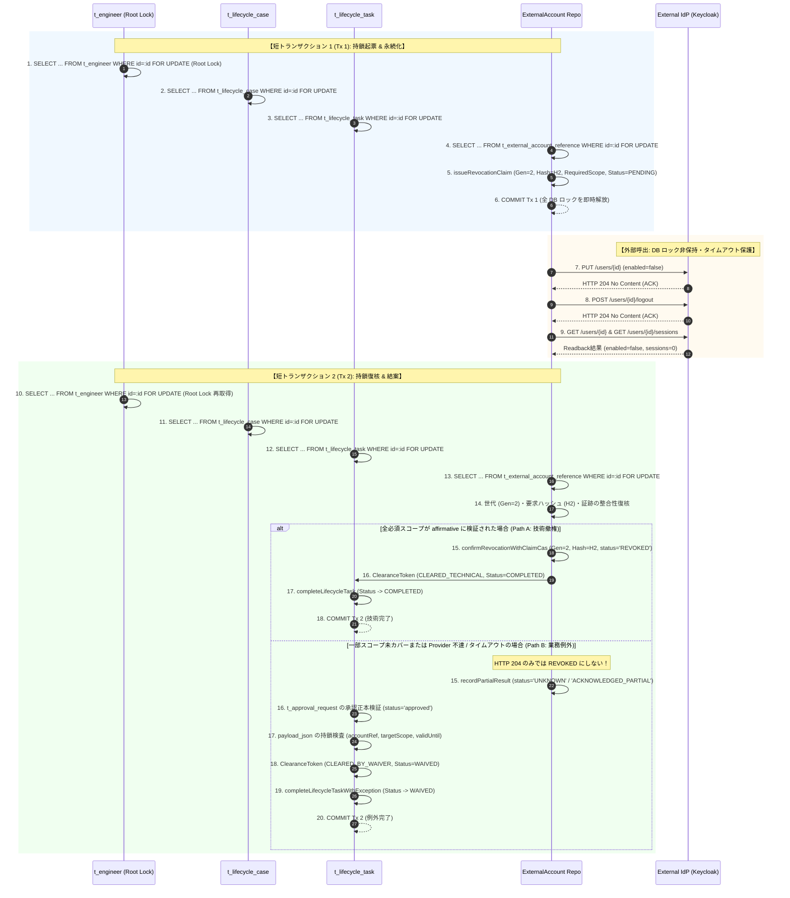

# NF01 ↔ NF09 退社ライフサイクル・外部アカウント撤権連携設計書 (Lifecycle Revocation Bridge Plan)

## 1. 目的と背景

本設計書は、NF01（Engineer Lifecycle Workflow / 退社オフボーディング）と NF09（Enterprise Identity & External Account Reference / 外部アカウント管理）の間における、安全かつ厳格な撤権連携インターフェース仕様を定義する。

現行の `ExternalAccountRevokeConfirmationService.confirm(referenceId, attribution)` は、単に対象レコードの現行 `version` を読み取って楽観排他（CAS）更新を行っている。しかし、非同期リクエストや再試行が発生する外部 IdP（Keycloak 等）連携においては、以下の深刻な整合性課題が存在する：
- 旧世代の要求（generation / claim）に基づく遅延応答や古いコールバックが、後から起票された新しい撤権試行の CAS を通過し、古い結果で新しい状態を誤認確定してしまう問題（ABA 問題・遅延確定競合）。
- 外部 Provider からの「HTTP 204 ACK」「ユーザー無効化（enabled=false）」「アクティブセッション数 0」という個別観測結果を、全スコープ（オフラインセッション、既発行 JWT、下流 SaaS 等）の完全撤権（`REVOKED`）と短絡し、退社ブロッカーを不当に解除してしまう問題。
- 技術的未解決（`UNKNOWN` / `FAILED`）と、業務上のリスク受容・例外承認（`Waiver`）が混同され、技術状態が虚偽に `REVOKED` へ改ざんされるリスク。
- 退社プロセス進行中や退社完了後に、並行して外部アカウントが新規割り当てされ、退社ブロッカーから逃逸する問題。

本契約はこれらを排除し、安定した要員ルートロック・暗号論的検証・不変識別子・世代管理（Fence Token）・固定ロック順序・TOCTOU 漂移防止、および短トランザクション境界を備えた最小設計を規定する。

---

## 2. 信頼できるコンテキストと呼び出し主体 (Trusted Context & Principal Source)

### 2.1 テナントおよび法人帰属の信頼できる解決
リクエストボディや非認証パラメータに含まれる `tenantId` や `legalEntityId` は一切信用しない。

1. **人間ユーザー（HUMAN）による操作時**:
   - `tenantId`: `LegalEntityContextService.requireTenantId()` を用いて、`SecurityContextHolder` の認証済み Principal（`LoginUser` / `OidcLoginUser`）から解決する。
   - `legalEntityId`: `LegalEntityContextService.requireCurrentLegalEntityId()` を用いて、ユーザーの有効組織マッピング（`AttendanceScopeMapper`）から一意に解決する。
   - 呼び出し主体の真正性検証: `attribution.actorType() == ActorType.HUMAN` の場合、クライアントから渡された `attribution.humanUserId()` が現在の認証済みユーザー ID（`SecurityUtils.currentUserId()`）と完全に一致することをサーバー側で強制検証する。単に DTO に有効な ID を詰めただけでは本人確認とみなさない。
2. **システムバッチ・スケジューラ（SYSTEM）実行時**:
   - バックグラウンド実行時は `SecurityContextHolder` に人間セッションが存在しない。
   - 対象エンティティ（`t_lifecycle_case`）の永続化された `tenant_id` および `legal_entity_id` を信頼できる起点とし、内部実行コンテキスト（`ExecutionActorContext`）を通じてシステム認可を確立する。
   - `attribution.humanUserId()` は厳格に `null` であることを強制する。
3. **外部プロバイダコールバック（PROVIDER）受信時**:
   - 署名検証フィルタ（`ExternalApiAuthenticationFilter` 等）により、送信元 IP、HMAC 署名、または mTLS クライアント証明書が正当に検証された `ExternalApiPrincipal` からテナント境界を解決する。
   - `attribution.humanUserId()` は厳格に `null` であることを強制する。

### 2.2 既存 ActorAttribution 閉集合ペアの厳格適用
監査・確認主体は、既存の `com.ses.common.audit.ActorAttribution` が規定する以下の closed pair 規約のみを受け付ける。独自の区分（例: `HUMAN_ADMIN`, `SYSTEM_SCHEDULER` 等）を新設してはならない。

| 主体区分 (`ActorType`) | 確認チャネル (`ConfirmationSource`) | 人間ユーザーID (`humanUserId`) | 想定ユースケース |
|---|---|---|---|
| `HUMAN` | `MANUAL_API` | 必須（> 0 かつ認証IDと一致） | 管理画面等での管理者・担当者による明示的な確認・承認操作 |
| `SYSTEM` | `SCHEDULER_POLL` | 禁止（null 必須） | 定周期バッチ、内部リトライスケジューラによるポーリング処理 |
| `PROVIDER` | `PROVIDER_SYNC` または `PROVIDER_CALLBACK` | 禁止（null 必須） | 外部 IdP との同期処理、または検証済み署名付き Webhook コールバック |
| `LEGACY_UNRESOLVED` | `LEGACY_UNRESOLVED` | 禁止（null 必須） | V182 以前の未解決レガシー監査データ（新規生成禁止） |

---

## 3. 不変識別子と要求範囲の固定 (Immutable Target & Revocation Scope)

### 3.1 外部アカウントの不変バインディング
撤権対象は、可変なユーザー名（username）やメールアドレスではなく、作成時に固定された以下の不変属性と厳密に結合する：
- `system_identifier`: 外部 IdP 種別（例: `KEYCLOAK_SYSTEM_INTERNAL`）
- `realm`: 対象レルム名（RFC 3986 準拠の厳格セグメント）
- `external_subject_id`: 外部 IdP における不変内部主キー（Keycloak におけるユーザー UUID）
- `bound_account_reference_id`: `t_external_account_reference.id`
- `legal_entity_id` / `tenant_id`: 帰属組織

### 3.2 凍結された必須スコープ (Required Scope) と完了条件
撤権操作が「技術的に完全撤権された（`REVOKED`）」と判定されるためには、契約で凍結された以下の必須スコープ（`RequiredScope`）のすべてに対して確証証跡が存在しなければならない。

| スコープ識別子 | 必須検証証跡 (Verification Evidence) | 未充足・未カバー時の扱い |
|---|---|---|
| `USER_DISABLE` | `PUT /users/{id}` (204 ACK) かつその後の `GET /users/{id}` で `enabled == false` を確認 | 未確認時は `UNKNOWN`、撤権未完了 |
| `ACTIVE_SESSIONS` | `POST /users/{id}/logout` (204 ACK) かつその後の `GET /users/{id}/sessions` でアクティブセッション数が 0 であることを確認 | 未確認時は `UNKNOWN`、撤権未完了 |
| `OFFLINE_SESSIONS` | 全クライアントのオフラインセッション無効化の個別確認（またはシステム方針でオフライン無効が証明されていること） | **Keycloak標準APIでは全クライアント網羅が困難であり、未カバー（UNCOVERED）となる** |
| `DOWNSTREAM_TOKENS` | 既発行ステートレス JWT の失効（Token Revocation / Introspection エンドポイントでの無効化確認） | **IdP 外部の SaaS セッションは証明不能（UNCOVERED）** |

> **完了条件の統一**:
> 要求スコープに `OFFLINE_SESSIONS` や `DOWNSTREAM_TOKENS` 等の未カバー領域が含まれる場合、Provider からの HTTP 204 ACK や個別リードバックが成功しても、**技術状態は `REVOKED` には到達できず、`ACKNOWLEDGED_PARTIAL` または `UNKNOWN` に留まる**。
> この場合、退社タスクを前進させる唯一の経路は、後述の **区分 B（LIFECYCLE_EXCEPTION 承認に基づく WAIVED 完了）** のみとなる。

---

## 4. Operation Identity、Generation / Fence Token、Request Hash

### 4.1 サーバー側永続化操作レコード (Persistent Operation Record)
旧証跡と新要求の混同を防止するため、要求起票時にサーバー側テーブル（例: `t_external_account_revocation_claim`）へ以下の不変属性を永続化する：
- `claim_id`: 試行ごとに発行される一意な UUIDv4。
- `generation`: 単調増加する 64bit 整数（Fence Token）。
- `request_hash`: 要求先 URL、HTTP メソッド、外部 Subject ID、要求スコープ一覧の UTF-8 SHA-256 ダイジェスト。
- `tenant_id` / `legal_entity_id`: 認証済み組織識別子。
- `system_identifier` / `realm` / `external_subject_id`: 不変ターゲット情報。
- `lifecycle_case_id`: 紐づく退社案件 ID。
- `required_scopes`: 要求されたスコープ集合（カンマ区切り文字列）。
- `status`: 初期状態 `PENDING`。

### 4.2 証跡検証と旧 confirm 経路の完全廃絶
Provider から証跡を受領した際、サーバーは永続化された上記レコードと証跡の `claim_id`, `generation`, `request_hash`, `external_subject_id` を直接照合する。呼び出し側が勝手に新しい generation や hash を旧証跡に結びつけることはできない。

**旧 `confirm(referenceId, attribution)` の廃絶**:
従来の `confirm(id, attribution)` は `(id, version)` のみで更新するため、本ブリッジではこの旧メソッドを**完全に廃止（非推奨化）し、検証後に旧メソッドを呼び出す委譲を行わない**。
新設される `confirmRevocationWithClaimCas` は、以下の SQL 述語を直接アトミックに実行する：

```sql
UPDATE t_external_account_reference
   SET status = :finalStatus,
       revoke_confirmed_at = :confirmedAt,
       revoke_confirmed_by = :humanUserId,
       actor_type = :actorType,
       confirmation_source = :confirmationSource,
       version = version + 1
 WHERE id = :referenceId
   AND tenant_id = :tenantId
   AND legal_entity_id = :legalEntityId
   AND version = :expectedVersion
   AND current_generation = :evidenceGeneration
   AND current_claim_id = :evidenceClaimId
   AND expected_request_hash = :evidenceRequestHash;
```
更新件数が 0 行の場合、古い世代の遅延応答または競合として検知され、トランザクションは直ちにロールバックされる。

---

## 5. 固定ロック順序と要員ルートロック (Fixed Lock Order & Stable Root Lock)

### 5.1 安定した要員ルートロック（Stable Engineer Root Lock）の必須化
単に「検索で見つかった ACTIVE な退職 Case」を行ロックするだけでは、以下の競合を防ぐことができない：
- Case がまだ作成されていない（無 Case）、または `DRAFT` 状態である瞬間に、別トランザクションの `assignAccount` が「ACTIVE な退職 Case なし」と判断してアカウントを発行し、その直後に Case が `ACTIVE` 化される競合。
- Case が `ON_HOLD`（保留中）の間に、アカウントが新規発行されてしまう競合。
- Case が `COMPLETED`（退職完了後）となった後、Case が `ACTIVE` でなくなったことを口実に退職者へ誤ってアカウントが割り当てられる競合。

したがって、以下の 3 系統の操作は、**必ず共通して安定した要員行（`t_engineer WHERE id = :engineerId FOR UPDATE`）を最初にロックする**：
1. アカウント新規割り当て (`assignAccount`)
2. 退職案件の起票・アクティブ化 (`createCase` / `activateCase`)
3. 退職タスク・案件の完了 (`completeLifecycleTask` / `completeCase`)

### 5.2 階層ロック順序
デッドロックを防止するため、全トランザクションは以下の昇順でロックを取得する：
1. `t_engineer` (`id = :engineerId` FOR UPDATE)
2. `t_lifecycle_case` (`engineer_id = :engineerId`、主キー `id` 昇順 FOR UPDATE)
3. `t_lifecycle_task` (`case_id = :caseId`、主キー `id` 昇順 FOR UPDATE)
4. `t_approval_request` / `t_asset_offboarding_waiver` (主キー `id` 昇順 FOR UPDATE)
5. `t_external_account_reference` (主キー `id` 昇順 FOR UPDATE)

### 5.3 実 Case ステータス別の `assignAccount` 処理規則

データベースの実スキーマにおいて、`t_engineer.status` は稼動状態を表す ENUM（`'稼動中'`, `'退場予定'`, `'Bench'`, `'提案中'`）であり、`ACTIVE` や `RESIGNED` といった架空の在籍値は存在しない。
したがって、アカウント新規割り当ての可否は、要員の稼動ステータスのみに依存してはならず、**退職案件（`t_lifecycle_case` where `lifecycle_type = 'RESIGNATION'`）の実ステータスおよびその後の正当な復職事実の有無に基づき、`t_engineer` のルート行ロック下で厳格に判定しなければならない**。

特に、**退職案件が `COMPLETED`（退職完了）となった要員は、たとえ `t_engineer.status` が `Bench` であっても、通常のアカウント割り当ては永久に拒否される**。退職案件が ACTIVE でなくなったからといって、退職者が自動的にアカウントを取得できる状態に戻ることは絶対に許容されない。

| 退職案件ステータス (`lifecycle_type = 'RESIGNATION'`) | 後続有効復職案件の有無 (`REINSTATEMENT` / `JOIN`) | `assignAccount` 処理方針 | エラーコード / 理由 |
|---|---|---|---|
| **無 Case** (退職手続未起票) | なし (通常在職中) | **許可** | 通常業務のアカウント付与。ロック下で安全に実行。 |
| **`DRAFT`** (退職案件下書き中) | なし | **拒否 (`409 CONFLICT`)** | `RESIGNATION_DRAFT_EXISTS`: 退職手続が起票されているため新規割り当てを即時遮断。 |
| **`ACTIVE`** (退職案件進行中) | なし | **拒否 (`409 CONFLICT`)** | `OFFBOARDING_IN_PROGRESS`: 退社オフボーディング実行中のため新規割り当てを完全遮断。 |
| **`ON_HOLD`** (退職案件一時保留中) | なし | **拒否 (`409 CONFLICT`)** | `OFFBOARDING_ON_HOLD`: 保留中であっても退社対象要員であり、逃逸防止のため新規割り当て遮断。 |
| **`COMPLETED`** (退職手続完了済) | **なし** (要員が `Bench` であっても) | **拒否 (`403 FORBIDDEN`)** | `ENGINEER_RESIGNED_NO_REINSTATEMENT`: **案件が非ACTIVE化しても、正当な復職がない限り通常割り当ては永久拒否**。 |
| **`COMPLETED`** (退職手続完了済) | **あり** (`COMPLETED` かつ `completed_at > resignation.completed_at`) | **許可** | `REINSTATED`: 正式な再雇用・復職が確定したため新規割り当てを許可。 |
| **`CANCELLED`** (退職案件正式取消) | 不要 (在職継続) | **許可** | `RESIGNATION_CANCELLED`: 退職案件が正式に取り消され、通常在職へ復帰したため許可。 |

> **完了前全アカウント核対（Pre-Completion Full Account Audit）の必須化**:
> 退職案件のタスク完了（`completeLifecycleTask`）および案件完了（`completeCase`）の確定前には、`t_engineer` の行ロック下において、**当該要員に紐づくすべての外部アカウント参照（`t_external_account_reference WHERE assignee_type = 'ENGINEER' AND assignee_id = :engineerId`）を網羅照合する**。
> `status = 'REVOKED'` または正当に承認された Waiver でカバーされていないアカウントが 1 件でも残存している場合、案件・タスクの完了を拒否し、ブロッカー逃逸をゼロとする。

---

## 6. 時序設計：短トランザクション境界と二段階結案 (Short Transaction Boundaries)

外部 IdP（Keycloak 等）との通信において、データベースの排他ロックを保持したまま外部 HTTP 呼び出しを行ってはならない（接続プールの枯渇、ロック競合、タイムアウトによるリソース占有を防止するため）。
本連携は、明確に分離された **2 つの短トランザクション（Tx 1 / Tx 2）** と、その間の **ロック非保持外部呼び出し** として構成する。



---

## 7. 統一 ClearanceToken 定義と免除（Waiver）の不可変検証

### 7.1 ClearanceToken 定義
ClearanceToken は単なるフラグではなく、検証時点のスナップショットを改ざん不能に固定する値オブジェクトである。

```java
public record ClearanceToken(
        Long lifecycleCaseId,
        Integer lifecycleCaseVersion,
        Long lifecycleTaskId,
        Integer lifecycleTaskVersion,
        Long accountReferenceId,
        Integer accountReferenceVersion,
        Long generation,
        String requestHash,
        ClearanceType clearanceType, // TECHNICAL_REVOCATION または BUSINESS_EXCEPTION_WAIVER
        Long approvalRequestId,      // BUSINESS_EXCEPTION_WAIVER の場合必須
        Instant evaluatedAt,
        Instant expiresAt,           // Waiver有効期限を超えてはならない
        String tokenSignature) { }
```

### 7.2 免除（Waiver）の承認正本（payload_json）と持鎖検査

業務例外（Path B）を成立させるための承認正本は、クライアントからの任意引数や非認証パラメーターではなく、**正式に承認された `t_approval_request`（`request_type = 'LIFECYCLE_EXCEPTION'`, `status = 'approved'`）の不可変スナップショット JSON（`payload_json`）を唯一の正本とする**。

> **承認状態検証の厳格規約**:
> 既存スキーマにおいて、免除台帳 `t_asset_offboarding_waiver` には `status` カラムは存在しない（`approved_by`, `approved_at` 等のみ）。したがって、承認が有効であるかの判定は、必ず親レコードである **`t_approval_request.status = 'approved'` を直接検証しなければならず、存在しない `waiver.status` を照会してはならない**。

#### 7.2.1 `LifecycleExceptionApprovalAdapter` の将来拡張とフィールド規約
現行の `LifecycleExceptionApprovalAdapter` は、タスク免除申請の作成時（`snapshot()`）および申請前検証時（`validateBeforeRequest()`）において、`taskId`, `reason`, `riskOwner`, `remedyDeadline` のみを扱っている。
外部アカウント撤権の例外免除に対応するため、今後の改修において `payload_json` に以下の 3 つの必須フィールドを正式に追加・拡張する：
1. `accountReferenceId`: 免除対象の外部アカウント参照 ID (`t_external_account_reference.id`)
2. `targetScope`: 例外免除を認める未カバー失効スコープ識別子（カンマ区切りまたはリスト）
3. `validUntil`: 例外認可の厳格な有効期限（ISO-8601 UTC 日時）

> **`remedyDeadline` の非代替性（厳格規約）**:
> 既存の `remedyDeadline`（是正完了期日）は、運用上の事後是正目標日に過ぎず、**未定義のまま認可有効期限（`validUntil`）とみなして代用することは固く禁止する**。認可有効期限は明示的な `validUntil` の指定を必須とする。

#### 7.2.2 レガシー承認（旧承認）の Fail-Closed 扱い
過去に起票・承認された既存の承認申請レコードにおいて、`payload_json` 内に `accountReferenceId`, `targetScope`, `validUntil` が欠落している場合、システムはこれを有効な外部アカウント免除承認とみなさず、持鎖検査で直ちに **`BLOCKED (APPROVAL_PAYLOAD_INCOMPLETE)`** としてタスク完了を拒否する。推測による救済は行わない。

#### 7.2.3 短トランザクション 2（Tx 2）における持鎖検査（Holding Lock Verification）
Tx 2 のロック下において、以下の 6 つの条件をすべて検証する：
1. **承認状態確認**: 当該 Case / Task に紐づく `t_approval_request` が存在し、`request_type = 'LIFECYCLE_EXCEPTION'` かつ `status = 'approved'` であること。
2. **アカウント一致確認**: `payload_json` の `accountReferenceId` が、撤権対象の `t_external_account_reference.id` と完全に一致すること。
3. **スコープ網羅確認**: Provider 側で技術的確証が得られなかった Required Scope の全項目が、`payload_json` の `targetScope` に漏れなく含まれていること。未解決のスコープが残存する場合は **`BLOCKED (SCOPE_UNCOVERED)`**。
4. **有効期限確認**: `payload_json` の承認有効期限 `validUntil` が現在時刻（`Instant.now()`）以降であること。期限切れの場合は **`BLOCKED (WAIVER_EXPIRED)`**。
5. **Token 有効期限の厳格制約**:
   ClearanceToken の有効期限 `expiresAt` は、**Waiver の承認有効期限 `validUntil` を超えてはならない**。
   `expiresAt = min(evaluatedAt + TOKEN_TTL, validUntil)`
6. **消費時（completeLifecycleTask）の再検証**:
   Token を消費してタスクを完了する瞬間にも、再度ロック下で `t_approval_request` の `status = 'approved'`、および未期限切れを再照合する。**単に DTO に HUMAN パラメータや文字列 "approved" を詰めただけでこれらの条件を代替することは一切禁止する**。

### 7.3 免除台帳（Waiver）の既存フィールドと擬拡張フィールドの明示
既存の `t_asset_offboarding_waiver` スキーマと、将来外部アカウント連携専用に検討する擬拡張フィールドを明確に峻別する。**擬拡張フィールドは現行 DB に存在せず、本設計で実装済みと詐称してはならない**。

| フィールド名 | 現行スキーマ状態 | 型 / 定義 | 説明 |
|---|---|---|---|
| `id` | **既存実装済** | BIGINT AUTO_INCREMENT | 主キー |
| `engineer_id` | **既存実装済** | BIGINT NOT NULL | 対象エンジニア ID |
| `lifecycle_case_id` | **既存実装済** | BIGINT NOT NULL | 退社案件 ID |
| `lifecycle_task_id` | **既存実装済** | BIGINT NOT NULL | 退社タスク ID |
| `approval_request_id` | **既存実装済** | BIGINT NOT NULL | 承認申請 ID (`LIFECYCLE_EXCEPTION`) |
| `reason` | **既存実装済** | VARCHAR NOT NULL | 例外申請理由 |
| `approved_by` | **既存実装済** | BIGINT NOT NULL | 承認者ユーザー ID |
| `approved_at` | **既存実装済** | DATETIME NOT NULL | 承認日時 |
| `external_account_reference_id` | **擬拡張 (未実装)** | BIGINT NULL | 紐づく外部アカウント参照 ID（次期採番マイグレーションで提案） |
| `target_scope` | **擬拡張 (未実装)** | VARCHAR(100) NULL | 例外適用された未カバー失効スコープ |
| `risk_acceptance_note` | **擬拡張 (未実装)** | VARCHAR(500) NULL | 許容残余リスク詳細 |
| `waiver_expiry_date` | **擬拡張 (未実装)** | DATE NULL | 例外有効期限 |

### 7.4 ステータス名称の統一と新旧対照

| エンティティ / 領域 | 現行定義値 (Existing) | 擬導入・候補値 (Proposed) | 備考 |
|---|---|---|---|
| `t_lifecycle_task.status` | `PENDING`, `IN_PROGRESS`, `ON_HOLD`, `COMPLETED`, `WAIVED` | なし（既存値をそのまま使用） | 例外完了時は既存の `WAIVED` に遷移 |
| `t_external_account_reference.status` | `ASSIGNED`, `REVOKED`, `CONFLICT_REPAIR` | `UNRESOLVED_PENDING` (候補) | 技術未決時は `REVOKED` にせず既存 `ASSIGNED` または未決状態を維持 |
| Provider / In-Memory Dispatch | なし | `NOT_STARTED`, `ACKNOWLEDGED`, `MAY_HAVE_BEEN_SENT`, `UNKNOWN` | 通信クライアントのメモリ内暫定状態（非永続） |

---

## 8. 検証・検収テストケースマトリクス

本設計の全不変条件について、正常系・負向系・並行系の検収用例を定義する。

| 用例 ID | カテゴリ | テスト条件 | 期待される動作・結果 |
|---|---|---|---|
| `TC-BR-01` | 正常系 | 全必須スコープ（Disable, Logout, Readback 0）が完全充足 | `confirmRevocationWithClaimCas` 成功、アカウント `status='REVOKED'`、ClearanceToken `CLEARED_TECHNICAL`、タスク `COMPLETED`。 |
| `TC-BR-02` | 正常系 | Provider 未カバー領域あり、有効期限内の承認済み Waiver 結合 | アカウント `status` は UNKNOWN のまま維持（REVOKED 偽装なし）、ClearanceToken `CLEARED_BY_WAIVER`、タスク `WAIVED`。 |
| `TC-BR-03` | 负向系 | HTTP 204 ACK のみ受領し、未カバー領域がある状態で技術完了を試行 | アカウントの `REVOKED` 遷移を拒否。タスク完了をブロック。 |
| `TC-BR-04` | 负向系 | 旧世代（Gen 1）の遅延応答が、新世代（Gen 2）発行後のアカウントに到達 | CAS 条件（`current_generation = 1`）不一致により 0 件更新。トランザクションロールバック。 |
| `TC-BR-05` | 负向系 | 異なる要求ハッシュを持つ改ざん証跡を提示 | `expected_request_hash` 不一致により CAS 失敗。 |
| `TC-BR-06` | 负向系 | 呼び出し元が `ActorAttribution.human(999L)` を偽造して提示（未認証ID） | サーバー認証コンテキスト（`currentUserId`）不一致により `403 FORBIDDEN`。 |
| `TC-BR-07` | 负向系 | トークン発行後、タスク完了前にアカウントが別操作で更新されバージョン進展 (TOCTOU) | タスク完了時にバージョン不一致検知、`409 CONFLICT`（`CLEARANCE_TOKEN_STALE`）。 |
| `TC-BR-08` | 负向系 | `payload_json` の承認有効期限切れ（`validUntil < now`）でタスク完了を試行 | 持鎖検査で検知され `BLOCKED (WAIVER_EXPIRED)`。タスク完了拒否。 |
| `TC-BR-09` | 负向系 | `payload_json` がカバーしていない未解決必須スコープが残存した状態で完了試行 | スコープ網羅チェックで検知され `BLOCKED (SCOPE_UNCOVERED)`。 |
| `TC-BR-10` | 负向系 | 退職案件が `COMPLETED` となった要員に対し、有効復職案件がない状態で通常のアカウント割り当てを試行 | `t_engineer` ロック下で退職完了を検知し `403 FORBIDDEN (ENGINEER_RESIGNED_NO_REINSTATEMENT)`。要員が `Bench` であっても拒否。 |
| `TC-BR-11` | 並行系 | `assignAccount` と `createCase (DRAFT)` の並行競合 | `t_engineer` ロックにより直列化。DRAFT 作成後は `409 CONFLICT (RESIGNATION_DRAFT_EXISTS)` で割り当て拒否。 |
| `TC-BR-12` | 並行系 | `assignAccount` と `activateCase (DRAFT -> ACTIVE)` の並行競合 | `t_engineer` ロックにより直列化。ACTIVE 化後は `409 CONFLICT (OFFBOARDING_IN_PROGRESS)` で割り当て拒否。 |
| `TC-BR-13` | 並行系 | 退職案件が `ON_HOLD` 中の要員に対する `assignAccount` 試行 | `t_engineer` ロック下で保留状態を検知し `409 CONFLICT (OFFBOARDING_ON_HOLD)` で厳格拒否。逃逸 0 件。 |
| `TC-BR-14` | 並行系 | `assignAccount` と `completeLifecycleTask` の並行競合 | `t_engineer` ロックにより直列化。退職完了後は退職完了ステータスにより拒否。ブロッカーすり抜け 0 件。 |
| `TC-BR-15` | 並行系 | 2 スレッドが同一アカウントに対して同時に撤権 Claim を起票 | 先行が `current_generation = G1` で成功、後続は楽観ロック競合または `G2` へ直列化され、互いの証跡が混同されない。 |
| `TC-BR-16` | 负向系 | 旧承認申請で `payload_json` に `accountReferenceId`, `targetScope`, `validUntil` が欠落 | 持鎖検査で検知され `BLOCKED (APPROVAL_PAYLOAD_INCOMPLETE)`。救済なしで拒否。 |
| `TC-BR-17` | 负向系 | 退社タスク・案件完了確定時、未撤権・未免除の外部アカウントが残存 | 完了前全アカウント核対により検知され `409 CONFLICT (UNREVOKED_ACCOUNTS_REMAIN)`。完了完全ブロック。 |

---

## 9. 残余リスクと後続依存

1. **DB スキーマ変更の保留**: 世代管理用カラム（`current_generation` 等）および Waiver 拡張カラムは現行マイグレーションに未反映であり、総責任者の統一採番（V185 は NF10 専用のため不可）を待つ。
2. **Keycloak 26.7.4 沙箱検証**: 実 IdP 環境でのオフラインセッション無効化振る舞いは、後続の Dockerized 沙箱環境にて検証する。
