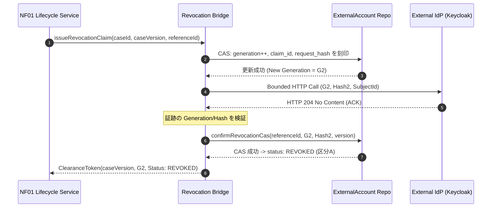
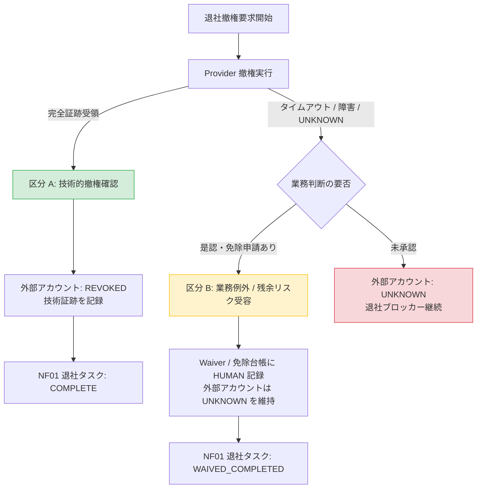

# NF01 ↔ NF09 退社ライフサイクル・外部アカウント撤権連携設計書 (Lifecycle Revocation Bridge Plan)

## 1. 目的と背景

本設計書は、NF01（Engineer Lifecycle Workflow / 退社オフボーディング）と NF09（Enterprise Identity & External Account Reference / 外部アカウント管理）の間における、安全かつ厳格な撤権連携インターフェース仕様を定義する。

現行の `ExternalAccountRevokeConfirmationService.confirm(referenceId, attribution)` は、単に対象レコードの現行 `version` を読み取って楽観排他（CAS）更新を行っている。しかし、非同期リクエストや再試行が発生する外部 IdP（Keycloak 等）連携においては、以下の深刻な整合性課題が存在する：
- 旧世代の要求（generation / claim）に基づく遅延応答や古いコールバックが、後から起票された新しい撤権試行の CAS を通過し、古い結果で新しい状態を誤認確定してしまう問題（ABA 問題・遅延確定競合）。
- 外部 Provider からの「HTTP 204 ACK」「ユーザー無効化（enabled=false）」「アクティブセッション数 0」という個別観測結果を、全スコープ（オフラインセッション、既発行 JWT、下流 SaaS 等）の完全撤権（`CONFIRMED` / `REVOKED`）と短絡し、退社ブロッカーを不当に解除してしまう問題。
- 技術的失敗・未決（`UNKNOWN` / `FAILED`）と、業務上のリスク受容・例外承認（`Waiver`）が混同され、技術状態が虚偽に `REVOKED` へ改ざんされるリスク。

本契約はこれらを排除し、暗号論的検証・不変識別子・世代管理（Fence Token）・TOCTOU 漂移防止を備えた最小設計を規定する。

---

## 2. 信頼できるコンテキストと呼び出し主体 (Trusted Context & Principal Source)

### 2.1 テナントおよび法人帰属の単一正本
リクエストボディや非認証パラメータに含まれる `tenantId` や `legalEntityId` は一切信用しない。
- テナント識別子: `AccountingTenantContextHolder.requireTenantContext()` により、認証済みセッション / JWT から解決された値を必須とする。
- 法人識別子: `LegalEntityContextService.requireLegalEntityContext()` により検証された値を必須とする。
- いかなる場合も、 cross-tenant または cross-legal-entity のアカウント参照やライフサイクルケースへの操作は `403 FORBIDDEN` または `404 NOT FOUND`（情報漏洩防止のため同一エラー表現）として即時拒否する。

### 2.2 既存 ActorAttribution 閉集合ペアの厳格適用
監査・確認主体は、既存の `com.ses.common.audit.ActorAttribution` が規定する以下の closed pair 規約のみを受け付ける。独自の区分（例: `HUMAN_ADMIN`, `SYSTEM_SCHEDULER` 等）を新設してはならない。

| 主体区分 (`ActorType`) | 確認チャネル (`ConfirmationSource`) | 人間ユーザーID (`humanUserId`) | 想定ユースケース |
|---|---|---|---|
| `HUMAN` | `MANUAL_API` | 必須（> 0） | 管理画面等での管理者・担当者による明示的な確認・承認操作 |
| `SYSTEM` | `SCHEDULER_POLL` | 禁止（null 必須） | 定周期バッチ、内部リトライスケジューラによるポーリング処理 |
| `PROVIDER` | `PROVIDER_SYNC` または `PROVIDER_CALLBACK` | 禁止（null 必須） | 外部 IdP との同期処理、または検証済み署名付き Webhook コールバック |
| `LEGACY_UNRESOLVED` | `LEGACY_UNRESOLVED` | 禁止（null 必須） | V182 以前の未解決レガシー監査データ（新規生成禁止） |

### 2.3 3つの主体の明確な分離
1. **要求起票主体 (Requester)**: 退社タスクまたは撤権ジョブをキックした主体（通常は人事担当 `HUMAN` または退社期日トリガーの `SYSTEM`）。
2. **証跡提供主体 (Evidence Source)**: 外部 IdP との通信結果またはコールバックを受信した主体（`PROVIDER`）。
3. **最終確認主体 (Confirmer)**: 証跡を検証し、または業務例外を判断してステータス遷移を確定させた主体（`HUMAN` または照合 `SYSTEM`）。

---

## 3. 不変識別子と要求範囲の固定 (Immutable Target & Revocation Scope)

### 3.1 外部アカウントの不変バインディング
撤権対象は、可変なユーザー名（username）やメールアドレスではなく、作成時に固定された以下の不変属性と厳密に結合する：
- `system_identifier`: 外部 IdP 種別（例: `KEYCLOAK_SYSTEM_INTERNAL`）
- `realm`: 対象レルム名（RFC 3986 準拠の厳格セグメント）
- `external_subject_id`: 外部 IdP における不変内部主キー（Keycloak におけるユーザー UUID）
- `bound_account_reference_id`: `t_external_account_reference.id`
- `legal_entity_id` / `tenant_id`: 帰属組織

### 3.2 撤回要求範囲 (Revocation Scope Boundary)
外部 IdP に要求する失効範囲を明示的に定義する：
1. **USER_DISABLE**: ユーザーのログイン無効化（`enabled=false`）。
2. **ACTIVE_SESSIONS_LOGOUT**: サーバー側で管理されているアクティブな User Session の全破棄。
3. **OFFLINE_SESSIONS_REVOCATION**: （特定クライアント連携時）オフラインセッションの失効。
4. **CREDENTIAL_RESET**: 登録済みパスワード・OTP 資格情報の無効化。

> **重要不変則**:
> Keycloak API の `PUT /admin/realms/{realm}/users/{id}` (204) および `POST /admin/realms/{realm}/users/{id}/logout` (204) を受信したとしても、それは単に **「Provider が操作を受理した (ACKNOWLEDGED)」** ことを示すに過ぎない。
> 既に発行されたアクセストークン（Stateless JWT）の有効期限内利用、クライアント側ローカルキャッシュ、下流 SaaS の独自セッションまでは失効が証明されないため、**HTTP 204 やアクティブセッション数 0 の観測のみで全範囲の `CONFIRMED` / `REVOKED` を生成してはならない**。

---

## 4. Operation Identity、Generation / Fence Token、Request Hash

旧結果が新要求を上書きする ABA 競合を防止するため、要求から確認に至るライフサイクルに世代制御を導入する。



### 4.1 世代管理フィールド
撤権試行ごとに以下を刻印する：
- `claim_id`: 試行ごとに一意な UUIDv4。
- `generation`: 単調増加する 64bit 整数（Fence Token）。再試行や再要求のたびにインクリメントされる。
- `request_hash`: 要求先 URL、HTTP メソッド、外部 Subject ID、要求パラメータの UTF-8 SHA-256 ダイジェスト。
- `lifecycle_case_id`: 紐づく退社案件 ID。
- `lifecycle_case_version`: 起票時点の退社案件楽観ロックバージョン。

### 4.2 証跡検証と CAS 更新条件
証跡受領時の最終書き戻しは、従来の `id = :id AND version = :version` だけでは不十分であり、**要求世代と要求ハッシュの完全一致** を必須条件とする：

```sql
UPDATE t_external_account_reference
   SET status = 'REVOKED',
       revoke_confirmed_at = :confirmedAt,
       revoke_confirmed_by = :humanUserId,
       actor_type = :actorType,
       confirmation_source = :confirmationSource,
       version = version + 1
 WHERE id = :referenceId
   AND tenant_id = :tenantId
   AND legal_entity_id = :legalEntityId
   AND version = :version
   AND current_generation = :evidenceGeneration
   AND current_claim_id = :evidenceClaimId
   AND expected_request_hash = :evidenceRequestHash;
```
もし外部 IdP からの遅延応答（G1）が届いた時点で、テーブル側の `current_generation` が G2 へ進んでいた場合、更新件数は 0 となり、古い証跡による誤確定は確実に防がれる。

---

## 5. 区分 A（技術撤権）と区分 B（業務例外）の厳格分離

退社プロセスにおける「外部アカウントの処理完了」には、本質的に異なる 2 つの終端が存在する。これらを同一のフラグや同一のコードで扱ってはならない。



### 5.1 区分 A: 技術撤権の完全確認 (Technical Revocation Confirmed)
- **条件**:
  - 対象 generation に対し、外部 IdP から正当な確認応答が得られた。
  - または、厳格な日次/定周期の双方向対帳（Reconciliation）バッチにより、外部 IdP 側に当該ユーザーおよびアクティブセッション・資格情報が存在しないことが暗号論的・識別子的に実証された。
- **データ更新**:
  - `t_external_account_reference.status` -> `'REVOKED'`
  - `actor_type` / `confirmation_source`: `PROVIDER` (`PROVIDER_SYNC` / `PROVIDER_CALLBACK`) または `SYSTEM` (`SCHEDULER_POLL`)。
- **退社タスク影響**: NF01 のアカウント返却・失効タスクは正規完了（`COMPLETED`）となる。

### 5.2 区分 B: 業務例外・残余リスク受容 (Business Risk Acceptance / Manual Waiver)
- **条件**:
  - 外部 IdP がネットワーク障害、サービス終了、アカウントロック、または API 仕様未対応（SaaS 側トークン即時失効不能など）により、技術的撤権が完了しない（状態が `UNKNOWN`, `TIMEOUT`, `FAILED` のまま留まる）。
  - 退職期日を迎えたため、権限ある責任者（情報システム部門長、コンプライアンス責任者等）が残余リスクを受容し、業務手続きとしての進行を特批した。
- **絶対禁止事項**:
  - **Provider UNKNOWN の状態を、技術ステータス `REVOKED` へ改ざんしてはならない。**
  - **技術的確認が存在しないにもかかわらず、`confirmation_source = PROVIDER_SYNC` 等の虚偽の証跡レコードを作成してはならない。**
- **データ更新**:
  - `t_external_account_reference.status` は `'UNKNOWN'` または `'UNRESOLVED_PENDING'` のまま維持する（将来の監査、手動是正、対帳の対象として残存させる）。
  - NF01 側の免除テーブル `t_asset_offboarding_waiver` に、正当な `HUMAN` 承認者による署名・理由・期限を刻印したレコードを作成する。
  - NF01 の退社タスクは、通常完了ではなく **免除完了（`WAIVED`）** としてクローズする。

---

## 6. TOCTOU（Time-of-Check to Time-of-Use）漂移防止規約

NF01 が退社可否を判定（Check）してから、退社タスクを完了（Use）するまでの間に、外部アカウントの状態が変化する競合を防止する。

### 6.1 ClearanceToken による検証
`evaluateClearance` は単純な boolean を返さず、以下の不可変トークンを生成する：

```java
public record ClearanceToken(
        Long lifecycleCaseId,
        Integer lifecycleCaseVersion,
        Long accountReferenceId,
        Integer accountReferenceVersion,
        Long generation,
        ClearanceStatus status, // CLEARED_TECHNICAL, CLEARED_BY_WAIVER, BLOCKED
        Instant evaluatedAt,
        String tokenSignature) { }
```

### 6.2 タスク完了時のアトミック検証
NF01 が `completeLifecycleTask` を実行する際、`ClearanceToken` を引数として渡し、トランザクション内で以下を再検証する：
1. `t_lifecycle_case.id = :caseId AND version = :caseVersion` であること。
2. `t_external_account_reference.id = :refId AND version = :accountVersion AND current_generation = :generation` であること。
3. トークン発行時刻から一定時間（例: 60秒）以内であること。
もしこの間に別プロセスによって外部アカウントの再同期や再試行が行われ、バージョンまたは世代が進んでいた場合は、直ちに `409 CONFLICT`（`CLEARANCE_TOKEN_STALE`）を返し、タスク完了を阻止して再評価を要求する。

---

## 7. 連携インターフェース定義 (Java 17 最小ドラフト)

```java
package com.ses.service.provider.bridge;

import com.ses.common.audit.ActorAttribution;
import java.time.Instant;

/**
 * NF01 ↔ NF09 ライフサイクル撤権連携インターフェース。
 * Spring Bean としては登録せず、独立 Review 用の最小契約ドラフトとして定義する。
 */
public interface LifecycleRevocationBridge {

    /**
     * 外部アカウントの撤権試行を開始し、新しい世代（Fence Token）を発行する。
     */
    RevocationClaim issueRevocationClaim(
            Long lifecycleCaseId,
            Integer lifecycleCaseVersion,
            Long accountReferenceId,
            ActorAttribution requester);

    /**
     * Provider から受領した証跡を検証し、世代・ハッシュが一致する場合のみ CAS 確定する。
     */
    RevocationCommitResult commitRevocationEvidence(
            Long accountReferenceId,
            Long expectedGeneration,
            String expectedRequestHash,
            ProviderEvidence evidence,
            ActorAttribution confirmer);

    /**
     * 業務例外（Waiver）を登録する。技術ステータスは書き換えない。
     */
    WaiverCommitResult recordBusinessWaiver(
            Long lifecycleCaseId,
            Long accountReferenceId,
            String waiverReason,
            ActorAttribution humanApprover);

    /**
     * 退社判定用の ClearanceToken を発行する。
     */
    ClearanceToken evaluateClearance(Long lifecycleCaseId, Long accountReferenceId);

    // DTO / Value Objects
    record RevocationClaim(
            Long accountReferenceId,
            Long generation,
            String claimId,
            String requestHash,
            Instant issuedAt) { }

    record ProviderEvidence(
            int httpStatus,
            String providerRequestId,
            String responseDigest,
            Instant receivedAt) { }

    record RevocationCommitResult(
            boolean committed,
            String finalStatus,
            Long finalGeneration) { }

    record WaiverCommitResult(
            boolean recorded,
            Long waiverId,
            String technicalStatusPreserved) { }

    enum ClearanceStatus { CLEARED_TECHNICAL, CLEARED_BY_WAIVER, BLOCKED }

    record ClearanceToken(
            Long lifecycleCaseId,
            Integer lifecycleCaseVersion,
            Long accountReferenceId,
            Integer accountReferenceVersion,
            Long generation,
            ClearanceStatus status,
            Instant evaluatedAt) { }
}
```

---

## 8. 未完了事項と残余リスク

1. **DB スキーマ変更の保留**: 本設計が要求する `current_generation`, `current_claim_id`, `expected_request_hash` カラムは、現行マイグレーション（V182〜V184）には存在しない。新マイグレーションの採番は総責任者の統括下にあり、本設計の承認後に最小スキーマ差分として別途申請する。
2. **Keycloak 26.7.4 固有エラー応答の型化**: 外部 IdP が返す詳細なエラー JSON や特定ステータスコードに応じたリトライ可否判定は、後続の沙箱統合検証にて確定する。
3. **退社側タスクテーブルへの Token カラム追加**: NF01 側の `t_lifecycle_task` における `clearance_token` 保存設計は、AI-6 との合同 Review を経て確定させる。
