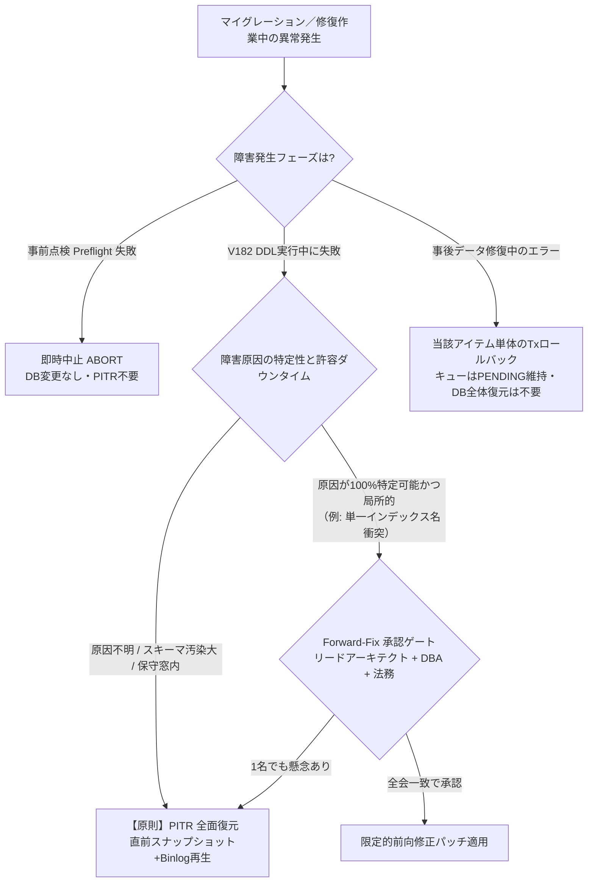

# V182 本番マイグレーションおよびデータ修復 実行運用手順書（Runbook Draft）

## 1. 文書概要・目的・安全統制規則 (Overview, Objectives & Safety Rules)

### 1.1 目的と適用範囲
本書は、`V182__nf09_tenant_scope_hardening.sql` の本番データベース適用、およびマイグレーション適用直後に生成される `t_nf09_scope_repair_queue`（NF09 tenant・法人帰属修復キュー）に隔離された未解決行を安全かつ確実に解消するための**実行運用手順書草案（Runbook Draft）**である。

### 1.2 安全絶対規範（Red Lines）
1. **本番 DB への直接 Ad-hoc 更新の絶対禁止**:
   GUI ツールや手動の単発 `UPDATE` 文を本番 DB に直接発行することを固く禁ずる。すべてのデータ修復は、本書に規定されたトランザクション境界、CAS（Compare-And-Swap）、ロック順序、および監査ログ記録に準拠したスクリプト／API 経由でのみ実行する。
2. **未知行の任意・デフォルトテナント割当の絶対禁止**:
   所属テナントや法人が判定できないレコード（孤立インボイス、所有者未確定アカウント等）に対し、**便宜上適当なデフォルトテナントや管理用テナントを推測で割り当てて解決とすることは固く禁止する**。必ず第 7 節に規定する正当な証憑調査および業務 Owner の確認・決裁を得て解決する。
3. **合成 HUMAN サインオフの非代替性**:
   リハーサル演練で用いられた `resolved_by = 1001L` 等の合成値は、技術的 CAS 検証のためのダミー値に過ぎず、**業務 Owner、財務統括責任者、法務・コンプライアンス責任者の実サインオフを法的に代替するものでは決してない**。
4. **本番 Owner 承認ステータス**:
   本書の作成時点において、本番適用および実データ修復に関する各業務 Owner（財務、営業、EDI、人事、インフラ）の正式サインオフは **PENDING（未承認）** として保持する。独立 Plan Review（Astra）および関連統括責任者の承認完了後に本番運用承認へ移行する。

---

## 2. 事前準備・バックアップ・PITR 要件 (Prerequisites: Backup, Restore & PITR)

本番マイグレーション実行前に、以下の前置条件がすべて満たされていることを確認しなければならない。

### 2.1 フルバックアップとポイントインタイムリカバリ（PITR）要件
1. **直前フルスナップショットの取得**:
   - マイグレーション作業ウィンドウ開始直前に、RDS/Aurora の物理クラスタスナップショット、または整合性のある論理バックアップ（mysqldump / Percona XtraBackup）を取得し、ステータスが `available` であることを確認する。
2. **Binlog（バイナリログ）保持と PITR 境界点の記録**:
   - MySQL のバイナリログが有効（`log_bin = ON`, `binlog_format = ROW`）であり、最低 7 日間以上の保持期間が設定されていること。
   - マイグレーション直前のバイナリログファイル名およびポジション（`SHOW MASTER STATUS` または `SHOW BINARY LOG STATUS`）、および正確な JST タイムスタンプ（秒単位）を記録・固定する。
3. **リストア演練実績の確認**:
   - 直近 30 日以内に、同一構成の別インスタンスに対しスナップショットからのリストアおよび PITR ロールフォワード演練が成功していること（RTO: 60分以内、RPO: 0秒）。

### 2.2 アプリケーション保守モードとトラフィック遮断
- V182 は複数のテーブル定義変更（`ALTER TABLE`）とインデックス再構築を伴うため、実行中にメタデータロック（MDL）競合が発生するリスクがある。
- マイグレーション実施中は、SES Manager Pro の全バックエンドインスタンスを**保守モード（Maintenance Mode: 書込 API 遮断、スケジューラジョブ完全停止、Web 画面は 503 保守案内）**に移行させ、アクティブな DB コネクションを完全にドレイン（排水）する。

---

## 3. 事前点検（Preflight）読取専用 SQL 仕様 (Preflight Read-Only Inspection)

マイグレーション実行の「Go / No-Go」を判断するため、以下の読取専用クエリを実行し、すべての期待結果を満たすことを確認する。1件でも期待に反する場合は直ちに実行を中止（ABORT）する。

### Preflight SQL-01: Flyway スキーマ履歴ベースラインの確認
- **目的**: 直前のマイグレーションが正常完了しており、V182 が未適用であることを確認する。
```sql
SELECT installed_rank, version, description, type, script, success, installed_on
  FROM flyway_schema_history
 WHERE version IN ('181', '182', '183', '184')
 ORDER BY installed_rank DESC;
```
- **期待結果**:
  - `version = '181'` のレコードが 1 件のみ存在し、`success = 1` であること。
  - `version IN ('182', '183', '184')` の行が存在しないこと。

### Preflight SQL-02: 対象 4 テーブルの存在確認
- **目的**: V182 が変更対象とするテーブルがすべて存在することを確認する。
```sql
SELECT table_name
  FROM information_schema.tables
 WHERE table_schema = DATABASE()
   AND table_name IN ('t_peppol_participant', 't_digital_invoice', 't_digital_invoice_event', 't_external_account_reference');
```
- **期待結果**: 正確に 4 行返却されること。

### Preflight SQL-03: 追加予定列の非存在確認（冪等性担保）
- **目的**: 既存テーブルに `tenant_id` 等の対象列が重複して存在しないことを確認する（MySQL の `ADD COLUMN` 重複エラー 1060 を未然に防止）。
```sql
SELECT table_name, column_name
  FROM information_schema.columns
 WHERE table_schema = DATABASE()
   AND table_name IN ('t_peppol_participant', 't_digital_invoice', 't_digital_invoice_event', 't_external_account_reference')
   AND column_name IN ('tenant_id', 'legal_entity_id', 'callback_active_slot');
```
- **期待結果**: **0 行**（1 行も存在しないこと）。

### Preflight SQL-04: 修復キューテーブルの非存在確認
- **目的**: 新規作成テーブル `t_nf09_scope_repair_queue` が未作成であることを確認する。
```sql
SELECT table_name
  FROM information_schema.tables
 WHERE table_schema = DATABASE()
   AND table_name = 't_nf09_scope_repair_queue';
```
- **期待結果**: **0 行**。

### Preflight SQL-05: 顧客マスタスコープ健全性と未解決候補の事前把握
- **目的**: 回填の基点となる `m_customer` において、`tenant_id` または `legal_entity_id` が未設定のレコード件数を把握する。
```sql
SELECT COUNT(*) AS total_active_customers,
       SUM(CASE WHEN tenant_id IS NULL OR tenant_id = '' OR legal_entity_id IS NULL THEN 1 ELSE 0 END) AS unassigned_scope_customers
  FROM m_customer
 WHERE deleted_flag = 0;
```
- **期待結果**: クエリが正常完了すること。`unassigned_scope_customers` の件数は事後点検時のインボイス／Peppol キュー投入想定数と整合性を照合するために記録する。

### Preflight SQL-06: Peppol 重複コールバック識別子の事前検知
- **目的**: マイグレーション実行時に `__ses_v182_peppol_identity_conflicts` により `CONFLICT_REPAIR` に隔離される重複 Peppol レコードを事前特定する。
```sql
SELECT provider, scheme_id, participant_id, COUNT(*) AS duplicate_verified_count
  FROM t_peppol_participant
 WHERE deleted_flag = 0 AND status = 'VERIFIED'
 GROUP BY provider, scheme_id, participant_id
HAVING COUNT(*) > 1;
```
- **期待結果**: クエリが正常完了すること。抽出されたグループ数・レコード件数を記録する（Postflight でのキュー登録数と厳密に一致することを確認）。

### Preflight SQL-07: 不正な監査主体（Actor Pair）レコードの事前検知
- **目的**: V182 の正規化処理により `LEGACY_UNRESOLVED` に置換されるレコード件数を事前把握する。
```sql
SELECT COUNT(*) AS legacy_unresolved_candidate_invoices
  FROM t_digital_invoice
 WHERE actor_type IS NULL OR confirmation_source IS NULL
    OR NOT (
        (actor_type = 'HUMAN' AND confirmation_source = 'MANUAL_API' AND human_user_id IS NOT NULL AND human_user_id > 0)
        OR (actor_type = 'SYSTEM' AND confirmation_source = 'SCHEDULER_POLL' AND human_user_id IS NULL)
        OR (actor_type = 'PROVIDER' AND confirmation_source IN ('PROVIDER_SYNC', 'PROVIDER_CALLBACK') AND human_user_id IS NULL)
        OR (actor_type = 'LEGACY_UNRESOLVED' AND confirmation_source = 'LEGACY_UNRESOLVED' AND human_user_id IS NULL)
    );
```
- **期待結果**: クエリが正常完了し、件数が記録されること。

---

## 4. 本番マイグレーション実行手順（V182 Schema Migration Execution）

### 4.1 実行ステップ
1. **保守モード突入確認**: 全トラフィック遮断および DB アイドル状態の確認。
2. **Flyway マイグレーション実行**:
   Flyway CLI または専用デプロイジョブを用い、`target = 182` を指定して実行する。
   ```bash
   # 例: Flyway CLI 実行コマンド
   flyway -target=182 migrate
   ```
3. **実行ログの保全**: 標準出力および標準エラー出力を `v182_migration_production_$(date +%Y%m%d_%H%M%S).log` として永続ストレージに記録。

---

## 5. 事後点検（Postflight）読取専用 SQL 仕様 (Postflight Read-Only Verification)

マイグレーション実行直後、修復作業に着手する前に以下の検証クエリを実行し、スキーマ・制約・キュー隔離が完全に成立していることを検証する。

### Postflight SQL-01: Flyway 適用成功確認
- **目的**: V182 が `success = 1` で正常完了したことを確認する。
```sql
SELECT installed_rank, version, description, script, checksum, installed_on, execution_time, success
  FROM flyway_schema_history
 WHERE version = '182';
```
- **期待結果**: `version = '182'`、`success = 1` の行が 1 件返却されること。

### Postflight SQL-02: 追加列および型・NULL許容性の検証
- **目的**: 対象 4 テーブルに `tenant_id` と `legal_entity_id` が定義通り追加されたことを確認する。
```sql
SELECT table_name, column_name, data_type, character_maximum_length, is_nullable
  FROM information_schema.columns
 WHERE table_schema = DATABASE()
   AND table_name IN ('t_peppol_participant', 't_digital_invoice', 't_digital_invoice_event', 't_external_account_reference')
   AND column_name IN ('tenant_id', 'legal_entity_id')
 ORDER BY table_name, column_name;
```
- **期待結果**: 正確に 8 行。`tenant_id` は `varchar(100)`、`legal_entity_id` は `bigint`、すべて `is_nullable = 'YES'`。

### Postflight SQL-03: Peppol 仮想生成列の検証
- **目的**: `callback_active_slot` が VIRTUAL GENERATED 列として正しく作成されていることを確認する。
```sql
SELECT table_name, column_name, data_type, extra, generation_expression
  FROM information_schema.columns
 WHERE table_schema = DATABASE()
   AND table_name = 't_peppol_participant'
   AND column_name = 'callback_active_slot';
```
- **期待結果**: 1 行返却。`extra` に `VIRTUAL GENERATED` が含まれ、`generation_expression` が `case when ((deleted_flag = 0) and (status = 'VERIFIED')) then 1 else NULL end` と一致すること。

### Postflight SQL-04: 制約（CHECK・外部キー・一意インデックス）の検証
- **目的**: V182 で追加された複合 FK、CHECK 制約、複合一意インデックスがすべて有効化されていることを確認する。
```sql
-- CHECK 制約の検証
SELECT constraint_name, table_name, check_clause
  FROM information_schema.check_constraints
 WHERE constraint_schema = DATABASE()
   AND constraint_name IN ('ck_digital_invoice_actor_pair', 'ck_digital_invoice_event_actor_pair');

-- 3列複合外部キーの検証
SELECT constraint_name, table_name, referenced_table_name
  FROM information_schema.referential_constraints
 WHERE constraint_schema = DATABASE()
   AND constraint_name = 'fk_digital_invoice_event_scope';

-- 複合一意インデックスの検証
SELECT table_name, index_name, non_unique, GROUP_CONCAT(column_name ORDER BY seq_in_index) AS indexed_columns
  FROM information_schema.statistics
 WHERE table_schema = DATABASE()
   AND index_name IN (
       'uk_digital_invoice_scope_message',
       'uk_digital_invoice_scope_send',
       'uk_digital_invoice_scope_id',
       'uk_peppol_scope_owner',
       'uk_peppol_callback_active',
       'uq_ext_scope_idempotency',
       'uk_nf09_scope_repair_entity'
   )
 GROUP BY table_name, index_name, non_unique;
```
- **期待結果**: すべての制約・インデックスが存在し、`non_unique = 0` であること。

### Postflight SQL-05: 修復キュー初期隔離件数の内訳確認
- **目的**: V182 の実行によって `t_nf09_scope_repair_queue` に投入された未解決行の内訳を把握する。
```sql
SELECT entity_type, reason, status, COUNT(*) AS queue_count
  FROM t_nf09_scope_repair_queue
 GROUP BY entity_type, reason, status
 ORDER BY entity_type, reason;
```
- **期待結果**: 全レコードの `status` が `'PENDING'` であること。Preflight SQL-06 で検知した重複 Peppol 件数と `CALLBACK_IDENTITY_CONFLICT` 件数が合致すること。

### Postflight SQL-06: 未解決行の完全隔離性検証（漏れゼロの確認）
- **目的**: 業務テーブル上で `tenant_id` または `legal_entity_id` が NULL のレコードが、**例外なくすべて修復キューに PENDING で収容されていること**を検証する。
```sql
-- 1. 電子インボイスの未収容チェック
SELECT COUNT(*) AS unisolated_invoice_count
  FROM t_digital_invoice d
  LEFT JOIN t_nf09_scope_repair_queue q
    ON q.entity_type = 'DIGITAL_INVOICE' AND q.entity_id = d.id
 WHERE (d.tenant_id IS NULL OR d.legal_entity_id IS NULL)
   AND (q.id IS NULL OR q.status <> 'PENDING');

-- 2. イベントの未収容チェック
SELECT COUNT(*) AS unisolated_event_count
  FROM t_digital_invoice_event e
  LEFT JOIN t_nf09_scope_repair_queue q
    ON q.entity_type = 'DIGITAL_INVOICE_EVENT' AND q.entity_id = e.id
 WHERE (e.tenant_id IS NULL OR e.legal_entity_id IS NULL)
   AND (q.id IS NULL OR q.status <> 'PENDING');

-- 3. Peppol参加者の未収容チェック
SELECT COUNT(*) AS unisolated_peppol_count
  FROM t_peppol_participant p
  LEFT JOIN t_nf09_scope_repair_queue q
    ON q.entity_type = 'PEPPOL_PARTICIPANT' AND q.entity_id = p.id
 WHERE (p.tenant_id IS NULL OR p.legal_entity_id IS NULL)
   AND (q.id IS NULL OR q.status <> 'PENDING');

-- 4. 外部アカウント参照の未収容チェック
SELECT COUNT(*) AS unisolated_account_count
  FROM t_external_account_reference a
  LEFT JOIN t_nf09_scope_repair_queue q
    ON q.entity_type = 'EXTERNAL_ACCOUNT' AND q.entity_id = a.id
 WHERE (a.tenant_id IS NULL OR a.legal_entity_id IS NULL)
   AND (q.id IS NULL OR q.status <> 'PENDING');
```
- **期待結果**: 上記 4 クエリの件数がすべて **0 件** であること（1 件でもあれば未収容の野良 NULL レコードが存在するため異常と判定）。

---

## 6. 未解決行（PENDING / 未確定行）の厳密な解消口径 (Strict Resolution Criteria)

データ修復フェーズの完了条件である「`PENDING = 0`」および「未確定行 = 0」の口径を厳密に定義する。

### 6.1 修復キューの結案口径
- `t_nf09_scope_repair_queue` において、`status = 'PENDING'` の行が **0 件**（全件 `status = 'RESOLVED'`）であること。

### 6.2 業務テーブルのスコープ確定口径
以下の 4 クエリがすべて **0 件** を返却すること：
```sql
SELECT COUNT(*) FROM t_digital_invoice WHERE tenant_id IS NULL OR legal_entity_id IS NULL;
SELECT COUNT(*) FROM t_digital_invoice_event WHERE tenant_id IS NULL OR legal_entity_id IS NULL;
SELECT COUNT(*) FROM t_peppol_participant WHERE tenant_id IS NULL OR legal_entity_id IS NULL;
SELECT COUNT(*) FROM t_external_account_reference WHERE tenant_id IS NULL OR legal_entity_id IS NULL;
```

### 6.3 論理削除行（`deleted_flag = 1`）の扱い
- **除外の禁止**: `deleted_flag = 1` の論理削除レコードであっても、監査ログや過去データ集計の整合性を保つため、**スコープが NULL のまま放置することは認められない**。
- **解決方針**:
  - 削除前に紐づいていた顧客／要員／組織情報から正当な `(tenant_id, legal_entity_id)` を特定して回填・結案する。
  - 実体が完全に消滅して特定不能なテストデータ残骸等である場合は、業務 Owner および法務コンプライアンス責任者の承認を得た上で、正規の廃止手順として処理する（決して任意のテナントを埋めない）。

### 6.4 Peppol 重複コールバック活性化（`callback_active_slot`）の境界と MySQL 1062 制御
- `t_peppol_participant` における `CALLBACK_IDENTITY_CONFLICT` の修復においては、以下の境界を厳格に順守する：
  1. 同一 `(provider, scheme_id, participant_id)` を持つ重複レコード群に対し、**正当と確認された唯一の 1 件のみを `status = 'VERIFIED'`, `deleted_flag = 0` に更新**する。これにより DB 仮想生成列 `callback_active_slot = 1` が自動算出される。
  2. **重複する他の全レコードは、明示的に `status = 'DUPLICATE_DEPRECATED'` または `deleted_flag = 1` に更新**する。これにより当該行の `callback_active_slot` は `NULL` となる。
  3. **重複活性化の禁止（MySQL 1062 Guard）**:
     複合一意インデックス `uk_peppol_callback_active` は `(provider, scheme_id, participant_id, callback_active_slot)` で張られており、複数の `VERIFIED` 行が存在すると MySQL エラー `1062 (Duplicate entry '...' for key 'uk_peppol_callback_active')` が発生する。手動・スクリプトを問わず、2件以上を同時に `VERIFIED` とすることは物理的に拒否される。

---

## 7. データ修復（Data Repair）の合法帰属判定・承認権限規程 (Attribution & Sign-Off)

データ修復にあたり、未知行を推測や便宜的デフォルト値で埋めることを防ぐため、カテゴリごとの特定調査手法および確認・承認権限者を以下のように定める。

| エンティティ | 隔離理由（Reason） | 発生要因 | 合法帰属の特定調査手法 | 正規承認権限者（実サインオフ） |
|---|---|---|---|---|
| `DIGITAL_INVOICE` | `SCOPE_CONFLICT` | 請求書（`t_invoice`）、発注書（`t_sales_order`）、契約書（`t_contract`）間で参照している顧客の所属法人が相違している | 取引基本契約書、発注書、納品検収書の実電子文書原本を照合し、真の契約締結法人・請求先法人を特定 | **財務管理責任者 (Finance Manager)** ＋ **顧客担当営業責任者** |
| `DIGITAL_INVOICE` | `SCOPE_UNRESOLVED` | 請求・発注・契約の全親行が存在しない孤立レコード | インボイス XML/PDF の事業者登録番号（T番号）、受領先口座、銀行振込入金照合ログから帰属法人を特定 | **財務統括責任者 (Finance Director)** ＋ **システム管理責任者** |
| `DIGITAL_INVOICE_EVENT` | `PARENT_SCOPE_UNRESOLVED` | 親インボイスが未解決のためスコープ未設定 | 親 `t_digital_invoice` の修復完了後、親の `(tenant_id, legal_entity_id)` を連動回填（単独での別テナント付与は禁止） | 親インボイスの承認に準拠 |
| `PEPPOL_PARTICIPANT` | `SCOPE_UNRESOLVED` | `owner_type != 'CUSTOMER'` または顧客のスコープが未確定 | 顧客マスタ `m_customer` の法人番号・契約書照合、または社内利用アカウントであるかの事実確認 | **営業管理責任者** ＋ **顧客アカウントOwner** |
| `PEPPOL_PARTICIPANT` | `CALLBACK_IDENTITY_CONFLICT` | 同一 Peppol ID が複数顧客／組織で重複登録されている | Peppol サービスプロバイダ（OpenPeppol / SMP ディレクトリ）の正式登録企業名・契約書を照合し、正当な 1 社を特定 | **EDI 統括リード** ＋ **法務コンプライアンス責任者** |
| `EXTERNAL_ACCOUNT` | `SCOPE_UNRESOLVED` | `assignee_type = 'USER'` で組織所属が曖昧、または要員未紐付け | 人事発令台帳、社内 SSO アカウント（Keycloak/IdP）の所属組織コード、業務委託基本契約書を照合 | **人事労務責任者** ＋ **社内情シス責任者 (Corporate IT)** |

### 監査ログ・サインオフ記録要件
- 修復を実行する際、`t_nf09_scope_repair_queue` の更新項目として以下を必須とする：
  - `resolved_by`: 実際に修復操作を実施した担当者の `sys_user.id`（正の整数値、NULL や 0 は不可）。
  - `resolution_note`: **承認起票番号（Ticket ID）、承認者役職・氏名、特定根拠となった証拠文書名・日付**を明記（例: `[APPR-20261026-0042] 財務責任者(山田)承認済。契約番号CNT-2026-089原本に基づき法人ID:501に決定`）。

---

## 8. 修復トランザクション・CAS・ロック順序・障害保全 (Transaction, CAS, Locking & Fail-Stop)

データ修復処理は、1 件ずつ独立したトランザクション（`@Transactional`）内で実行し、データの整合性と並行安全性を担保する。

### 8.1 デッドロック防止のための厳格なロック獲得順序
競合トランザクションによるデッドロック（MySQL 1213）を回避するため、リソースのロック順序は常に以下に固定する：
1. **親マスタ行の参照・ロック**: 必要に応じて `m_customer` 等を主キーで確認。
2. **被修復業務データ行のロック**: `t_digital_invoice` 等を `WHERE id = :id FOR UPDATE` でロック。複数の競合行を扱う場合（Peppol 等）は、必ず **`id` の昇順（ASC）** でロックを獲得する。
3. **修復キュー行のロック**: `t_nf09_scope_repair_queue` を **`id` の昇順（ASC）** でロック。

### 8.2 楽観的排他制御（CAS: Compare-And-Swap）
二重更新および競合更新を防止するため、業務テーブルおよびキューテーブルの双方で `version` 列を用いた CAS を実施する。
```sql
-- Step 1: 業務データの修復 (version 条件付き)
UPDATE t_digital_invoice
   SET tenant_id = :resolvedTenantId,
       legal_entity_id = :resolvedLegalEntityId,
       version = version + 1
 WHERE id = :invoiceId
   AND tenant_id IS NULL
   AND version = :expectedInvoiceVersion;
-- 更新行数 == 1 を検証。0 件の場合は即座に例外をスローしてロールバック。

-- Step 2: キュー行の結案 (version 条件付き)
UPDATE t_nf09_scope_repair_queue
   SET status = 'RESOLVED',
       resolved_at = NOW(),
       resolved_by = :humanUserId,
       resolution_note = :resolutionNote,
       version = version + 1
 WHERE id = :queueId
   AND status = 'PENDING'
   AND version = :expectedQueueVersion;
-- 更新行数 == 1 を検証。0 件の場合は即座に例外をスローしてロールバック。
```

### 8.3 失敗時のフェイルストップ（Fail-Stop）と現場証拠保全
- 処理中に以下のいずれかが発生した場合、トランザクションは直ちに**完全ロールバック（ROLLBACK）**する：
  1. 業務データまたはキューの CAS 更新行数が 0 行（他トランザクションによる更新競合）。
  2. ロック待ちタイムアウト（MySQL エラー 1205）またはデッドロック（MySQL エラー 1213）。
  3. 複合外部キーや一意インデックス違反（MySQL エラー 1062 等）。
- **処置**:
  - 当該レコードの修復を中断し、キュー行を `PENDING` に維持する。
  - エラーコード、SQLState、対象 ID、スタックトレース、および直前の `information_schema.innodb_trx` / `performance_schema.data_lock_waits` 診断ログを保全ファイルに退避する。

---

## 9. 異常時対応：ロールバック（PITR）と前向修正（Forward-Fix）の判断分岐 (Rollback vs Forward-Fix)

### 9.1 MySQL DDL の暗黙コミット（Implicit Commit）という技術的現実
MySQL 8.0（InnoDB）において、`ALTER TABLE` などの DDL は実行時に暗黙のコミットを引き起こす。したがって、**V182 マイグレーションスクリプトが途中でエラー停止した場合、途中で実行された `ALTER TABLE` は自動ロールバックされず、中途半端に変更が残存する**。

### 9.2 障害発生時の意思決定ツリー（Decision Tree）



### 9.3 PITR 全面復元（Point-In-Time Recovery）の発動基準
以下のいずれかに該当する場合、**直ちに PITR 全面復元を発動**する：
1. V182 の DDL 適用途中で予期せぬ構文エラー、ディスク満杯、またはクラッシュが発生し、中途停止した場合。
2. スキーマ変更後の整合性検証（Postflight）において、予期しないデータ欠損や野良 NULL レコード（未収容行）が検知された場合。
3. 保守時間枠内に原因究明が完了しない場合。

### 9.4 前向修正（Forward-Fix）の限定要件と承認ゲート
前向修正（Flyway の修正版再実行や中途状態に対する差分パッチ適用）は原則禁止とし、以下の全条件を満たす極めて例外的な場合に限り、事前承認を経て適用できる：
1. **原因の完全確定**: 既存データの一意性違反や予期せぬ制約名重複など、失敗原因が完全に特定され、かつデータの物理的破損・消失が一切ないこと。
2. **ステージング環境での再現・修正検証**: 本番適用前に、同一エラーを再現させたステージング検証環境で差分パッチの安全性が 100% 実証されていること。
3. **承認ゲート（3者全会一致）**:
   - リードアーキテクト（技術責任者）
   - データベース管理者（DBA）
   - 法務・コンプライアンス統括責任者

---

## 10. ステージング演練（Staging Rehearsal）と本番実行（Production Execution）の差異一覧 (Differences Matrix)

リハーサル演練で実証された前提と、本番環境における固有の制約・差異を正しく理解し、過信を排除する。

| 比較項目 | 使い捨て検証演練（Disposable Rehearsal） | 本番環境実行（Production Execution） |
|---|---|---|
| **DB 環境** | Docker コンテナ内使い捨て `mysql:8.0`（tmpfs マウント） | Multi-AZ マネージド MySQL 8 / Amazon Aurora クラスタ（EBS/共有ストレージ） |
| **データ規模** | 合成テストデータ数十〜数百件 | 数万〜数百万円規模の実ビジネスレコード、数年分の履歴データ |
| **実行所要時間** | DDL・DML ともに数秒で完了 | 数分〜数十分の所要時間（テーブルサイズに応じた I/O およびバッファ負荷） |
| **排他・MDL** | 競合プロセス皆無（メタデータロック待ちなし） | 保守モード下でも残存コネクションやバックグラウンドタスクによる MDL 競合リスクあり |
| **監査主体** | 合成ダミー値（`resolved_by = 1001L`、固定メモ） | 本人確認済みの実オペレータ SSO ユーザー ID、正式承認決裁番号・証憑引用 |
| **障害発生時** | コンテナ即時破棄・ローカルディスクへのログ退避 | インシデントコール招集、P1 障害宣言、PITR 発動、事業影響報告・再発防止策 |
| **外部通信** | Provider 通信なし（モック / 無効化） | 外部 Peppol サービスプロバイダや IdP とのネットワーク接続（本マイグレーション時は未接続を維持） |

---

## 11. シナリオ 5 の正確な位置づけと限定表明 (Scenario 5 Scoping & Explicit Disclaimer)

### 11.1 シナリオ 5 の実態
`V182TenantScopeHardeningRehearsalMySqlTest` の第 5 節（`scenario5_faultEvidencePreservation_verifiesErrorCapturedBeforeTeardown`）は、**「マイグレーション失敗時にコンテナが破棄される前に、実行ログ・スキーマ定義・履歴テーブル・修復キュー・SHA-256 マニフェストをディスクに確実に落盤・保全できること」を検証した証拠保全演練（Evidence Preservation Rehearsal）**である。

### 11.2 限定表明（明確な非対象事項）
1. **部分失敗からの自動回復の非検証**:
   シナリオ 5 は、障害注入によって `ALTER TABLE` が MySQL の暗黙コミットにより永続化された現場を保全・確認したものであり、**「本番 V182 が部分的に失敗した後に、自動的または安全に旧スキーマへロールバックできること」を実証したものでは決してない**。
2. **本番自動修復の否定**:
   MySQL のアーキテクチャ上、部分マイグレーション失敗の自動ロールバックは不可能であり、本番環境での安全担保は、本書第 2 節に定めた **「直前フルバックアップと Binlog による PITR 全面復元体制」**、および第 9 節の **「ロールバック／前向修正の厳格な意思決定規程」** にのみ依拠する。

---

## 12. 署名・承認記録（Sign-Off Register）

本運用手順書案は、以下の関係責任者による内容合意および正式サインオフをもって発効する。現時点ではすべての署名は **PENDING（保留）** である。

| 承認役職 | 氏名 | 承認ステータス | 承認日 | 承認コメント / 決裁番号 |
|---|---|---|---|---|
| **技術統括責任者 / リードアーキテクト** | (未定) | **PENDING** | - | 本番 Runbook 技術妥当性確認中 |
| **データベース管理者 (DBA)** | (未定) | **PENDING** | - | PITR 手順およびロック・実行計画検証中 |
| **財務管理責任者 (Finance Manager)** | (未定) | **PENDING** | - | インボイス帰属判定基準合意確認中 |
| **法務・コンプライアンス統括責任者** | (未定) | **PENDING** | - | テナント分離・監査証跡要件確認中 |
| **独立 Reviewer (Astra)** | Astra | **PLAN REVIEW PENDING** | - | 本文書提出後の独立 Plan Review 待ち |
