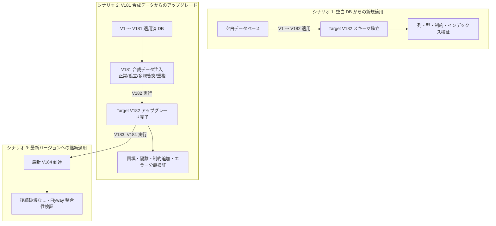
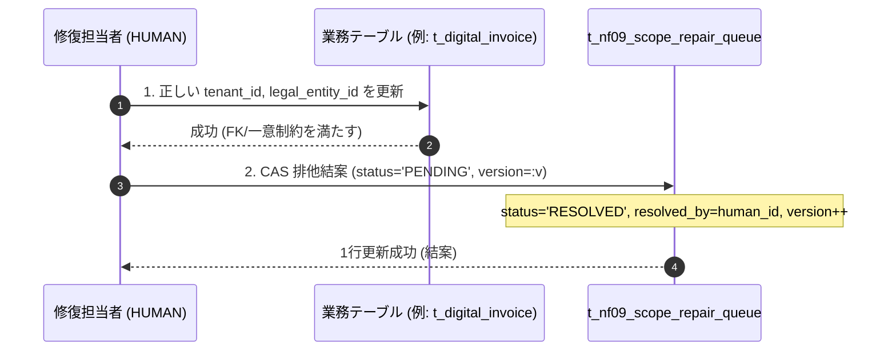

# V182 マイグレーション・スコープ固定および修復演練验收契約書 (V182 Rehearsal Contract)

## 1. 目的と安全規範

本契約書は、`V182__nf09_tenant_scope_hardening.sql` の安全な本番適用可能性を事前に実証するための、完全使い捨て（Disposable）実 MySQL 8 環境におけるリハーサル検証計画および验收基準を規定する。

### 1.1 安全絶対規範（レッドライン）
1. **本番環境接続および本番データ直接操作の絶対禁止**: 本番データベース、ステージング永続 DB への直接接続・マイグレーション・修復実行は固く禁止する。
2. **実クレデンシャルの読み取り・使用の絶対禁止**: 本番・ステージングのシークレット、実運用アカウントのアクセス情報は一切読み込まず、合成テスト環境（Synthetic Test Fixture）に限定する。
3. **合成 HUMAN 記録の厳格な位置づけ**: リハーサル中に記録される `actor_type = 'HUMAN'` や `resolved_by = 1` は、マイグレーション SQL および CAS ロジックの技術的整合性を確認するためのダミー監査値に過ぎず、**業務 Owner、セキュリティ部門、法務・コンプライアンス責任者の実サインオフを代替するものでは決してない**。

---

## 2. 実行環境と基線固定仕様 (Pinning Preconditions)

本リハーサルは、H2 互換モードではなく、実際の MySQL 8 ダイアレクトと Flyway エンジンを用いて実施する。

| 項目 | 固定仕様 |
|---|---|
| 実装 Worktree | `C:\work\ses-nf09-system-actor-attribution` (branch: `codex/snf-prod-nf09-local-keycloak`) |
| 固定 HEAD SHA | `7a9115414ea00f58c601beef5673461b601d6415` (ドキュメント追加後の新 SHA は AI-7 へ通知) |
| DB エンジン | Docker Disposable `mysql:8.0` (tmpfs マウント、照合順序: `utf8mb4_unicode_ci`) |
| Flyway 適用ツール | Flyway Community Edition (Maven `flyway-maven-plugin` または Spring Boot 組み込み Flyway) |
| 対象ファイル | `src/main/resources/db/migration/V182__nf09_tenant_scope_hardening.sql` |
| V182 スクリプト SHA-256 | `BB9EBDEABF3E1CE9DAD42525551E3F594D2DC4D10F103AF8AFA7BBBA159A0DA7` |
| 最終ターゲットバージョン | `V184__create_import_metadata_foundation.sql` (本候補ブランチの最新マイグレーション) |

---

## 3. 3つの演練シナリオ設計 (Three Rehearsal Scenarios)



### 3.1 シナリオ 1: 空白 DB からの新規適用 (Fresh Rehearsal to Target V182)
- **手順**:
  1. 一時 MySQL コンテナを起動し、空の `ses_manager_db` を作成。
  2. Flyway の `target` を `182` に設定し、`flyway:migrate` を実行。
- **検証項目**:
  - `flyway_schema_history` において V1 〜 V182 の全スクリプトが `success = 1` で終了すること。
  - `t_peppol_participant`, `t_digital_invoice`, `t_digital_invoice_event`, `t_external_account_reference` に `tenant_id` (VARCHAR(100)) および `legal_entity_id` (BIGINT) 列が NULL 許可で追加されていること。
  - `t_nf09_scope_repair_queue` が正しく作成され、インデックスおよび主キーが設定されていること。
  - DDL の実行順序・構文エラーが存在しないこと。

### 3.2 シナリオ 2: V181 合成データからのアップグレード (Upgrade Rehearsal from V181 to V182)
- **手順**:
  1. 空白 DB に対し、まず V1 〜 V181 を適用。
  2. 後述の「第 4 節: 合成テストデータ・マトリクス」に従い、V182 の全分岐を網羅する合成レコードを各テーブルへ `INSERT`。
  3. `target = 182` として V182 を実行。
- **検証項目**:
  - 正常行、衝突行、孤立行が SQL の意図通りに回填または隔離されること。
  - 一意インデックス、複合外部キー、CHECK 制約の追加がデータ違反なく完了すること。

### 3.3 シナリオ 3: 本候補最新バージョンへの継続アップグレード (Upgrade to Latest Candidate V184)
- **手順**:
  1. シナリオ 2 の完了状態から、`target` の上限を撤廃し、現行候補ブランチの最新（V184）まで `flyway:migrate` を続行。
- **検証項目**:
  - `V183__lifecycle_case_sequence.sql` および `V184__create_import_metadata_foundation.sql` がエラーなく適用されること。
  - V182 で作成されたテーブル・列・制約が後続マイグレーションと衝突・破損しないこと。

---

## 4. 実際の SQL 分岐と合成データ検証マトリクス

V182 内の各 SQL 句に対応するテストケースを以下のように定義し、全分岐を網羅する。

### 4.1 電子インボイス (`t_digital_invoice`) のスコープ解決と隔離
V182 は一時テーブル `__ses_v182_digital_scope_candidates` を用いて、請求書（`t_invoice`）・発注（`t_sales_order`）・契約（`t_contract`）の 3 系統から候補スコープを収集する。

| ケース ID | 入力データ状態 | 期待される回填結果 | 期待される修復キュー (`t_nf09_scope_repair_queue`) |
|---|---|---|---|
| `INV_SINGLE_OK` | 顧客に紐づく `t_invoice` 1件のみと関連 | 顧客の `tenant_id` / `legal_entity_id` が回填される | キュー登録なし |
| `INV_MULTI_SAME_OK` | `t_invoice` と `t_sales_order` の両方に関連し、双方が同一の `(tenant_id, legal_entity_id)` | 一致したスコープが回填される (`COUNT(*) = 1` 判定) | キュー登録なし |
| `INV_CONFLICT` | `t_invoice` (法人A) と `t_contract` (法人B) で異なるスコープを持つ | `tenant_id`, `legal_entity_id` は NULL のまま維持 | `entity_type='DIGITAL_INVOICE'`, `reason='SCOPE_CONFLICT'` でキュー登録 |
| `INV_UNRESOLVED` | 関連する請求・発注・契約がすべて削除済みまたは存在しない孤立レコード | `tenant_id`, `legal_entity_id` は NULL のまま維持 | `entity_type='DIGITAL_INVOICE'`, `reason='SCOPE_UNRESOLVED'` でキュー登録 |

### 4.2 インボイスイベント (`t_digital_invoice_event`) の親スコープ継承
| ケース ID | 入力データ状態 | 期待される回填結果 | 期待される修復キュー |
|---|---|---|---|
| `EVT_PARENT_OK` | 親 `t_digital_invoice` が正常に回填されたイベント | 親と同じスコープが回填される | キュー登録なし |
| `EVT_PARENT_UNRESOLVED` | 親 `t_digital_invoice` が未解決または衝突して NULL のイベント | イベントのスコープも NULL のまま維持 | `entity_type='DIGITAL_INVOICE_EVENT'`, `reason='PARENT_SCOPE_UNRESOLVED'` でキュー登録 |

### 4.3 Peppol 参加者 (`t_peppol_participant`) の顧客所有回填と重複コールバック隔離
| ケース ID | 入力データ状態 | 期待される回填結果 | 期待される修復キューとステータス変更 |
|---|---|---|---|
| `PEP_CUSTOMER_OK` | `owner_type='CUSTOMER'` で有効な顧客に紐づく | 顧客のスコープが回填される | キュー登録なし |
| `PEP_OTHER_UNRESOLVED` | `owner_type='USER'` 等の顧客以外の所有レコード | スコープは NULL のまま維持 | `entity_type='PEPPOL_PARTICIPANT'`, `reason='SCOPE_UNRESOLVED'` でキュー登録 |
| `PEP_CALLBACK_CONFLICT` | 同一 `(provider, scheme_id, participant_id)` で `status='VERIFIED'` の行が 2 件以上存在 | スコープは元のまま | **重複する全件** がキューへ `reason='CALLBACK_IDENTITY_CONFLICT'` で隔離。<br/>**全件** `status='CONFLICT_REPAIR'`、`verified_at = NULL` に強制リセットされる（勝者を任意に選ばない）。 |

### 4.4 外部アカウント参照 (`t_external_account_reference`) の技術境界
| ケース ID | 入力データ状態 | 期待される回填結果 | 期待される修復キュー |
|---|---|---|---|
| `ACC_ENGINEER_OK` | `assignee_type='ENGINEER'` で有効なエンジニアに紐づく | エンジニアのスコープが回填される | キュー登録なし |
| `ACC_USER_LEGACY` | `assignee_type='USER'` のレガシーアカウントレコード | スコープは回填されず NULL を維持（組織所属曖昧性） | `entity_type='EXTERNAL_ACCOUNT'`, `reason='SCOPE_UNRESOLVED'` でキュー登録 |

### 4.5 監査主体 (Actor Attribution) の閉集合正規化と制約
- `t_digital_invoice` および `t_digital_invoice_event` の既存レコードにおいて、`actor_type` や `confirmation_source` が NULL、または closed pair 以外の組み合わせである場合：
  - `actor_type = 'LEGACY_UNRESOLVED'`
  - `confirmation_source = 'LEGACY_UNRESOLVED'`
  - `human_user_id = NULL`
  に正規化されること。
- その後追加される `ck_digital_invoice_actor_pair` および `ck_digital_invoice_event_actor_pair` CHECK 制約に違反せず通過すること。

### 4.6 制約とインデックス境界の検証
1. **3列複合外部キー (`fk_digital_invoice_event_scope`)**:
   `t_digital_invoice_event (tenant_id, legal_entity_id, digital_invoice_id)` が `t_digital_invoice (tenant_id, legal_entity_id, id)` を参照する。親と子のスコープが完全に一致しない不正な更新・挿入が MySQL エンジンレベルで `RESTRICT` 拒否されることを確認する。
2. **生成列仮想スロットと一意インデックス (`uk_peppol_callback_active`)**:
   `callback_active_slot` は `deleted_flag = 0 AND status = 'VERIFIED'` の場合のみ `1`、それ以外は `NULL` となる生成列。MySQL の一意インデックスにおいて NULL は重複とみなされない特性を利用し、`VERIFIED` 状態のアクティブなコールバック識別子の一意性を担保しつつ、`CONFLICT_REPAIR` や論理削除行が共存できることを確認する。
3. **NULL 許容スコープと複合一意インデックス**:
   未解決行（`tenant_id IS NULL`）がキューに隔離されている間、一意制約が阻害されないことを確認する。

---

## 5. MySQL DDL 非トランザクション性と障害復旧・前向修正契約 (MySQL DDL Non-Atomicity & Forward-Fix Contract)

### 5.1 暗黙のコミット（Implicit Commit）の技術的現実
MySQL 8.0 の InnoDB ストレージエンジンにおいて、`ALTER TABLE`、`CREATE TABLE`、`DROP TABLE` などの DDL 文は実行直前に**暗黙のトランザクションコミット**をトリガーする。
そのため、V182 のように複数の DDL と DML が混在するスクリプトは、**障害発生時に全体が自動で単一トランザクションとしてロールバックされない**。

```
[V182 実行途中の失敗モデル]
ALTER TABLE t_digital_invoice ADD COLUMN ... (成功・暗黙コミット)
  ↓
UPDATE t_digital_invoice ... (実行完了)
  ↓
ALTER TABLE t_digital_invoice ADD CONSTRAINT ... (データ違反で失敗！)
  ↓
結果: 前段の列追加・データ更新はコミットされたまま残り、Flyway は success=0 で異常終了する。
```

### 5.2 障害時リカバリおよび前向修正（Forward-Fix）手順
リハーサルおよび将来の本番適用において、マイグレーションが途中で失敗した場合の対応規約を以下のように固定する：

1. **使い捨てリハーサル環境での復旧**:
   - 失敗が発生したコンテナは直ちに破棄（Drop / Kill）する。
   - スクリプト内のデータ想定や DDL のバグを特定し、コード側で修正してから空 DB よりクリーンにリプレイ（Clean Replay）する。
2. **本番前向修正（Forward-Fix）契約**:
   - スキーマ変更が中途コミットされたデータベースに対し、手作業でアドホックにテーブル定義を削除（`DROP COLUMN` 等）することは禁止する。
   - 失敗原因となったデータ（例: 予期せぬ外部キー不整合）を特定し、該当テーブルを安全な状態へ整流化した上で、Flyway の `repair` コマンドにより失敗履歴を整理し、未適用の DDL を前向修正（Roll-Forward）パッチとして適用する手順を事前に策定・承認する。

---

## 6. キュー修復（Repair Queue）演練契約

`t_nf09_scope_repair_queue` に隔離された未解決行を解消するプロセスを演練する。

### 6.1 二段階修復の原則（業務データ先行）
キューレコードの `status` を単独で `RESOLVED` に変更することは厳禁とする。必ず以下の順序で処理する：



1. **ステップ 1: 業務実体データの修復**
   管理者が正当な所属（テナント・法人）を特定し、まず業務テーブル（`t_digital_invoice`, `t_external_account_reference` 等）の `tenant_id` および `legal_entity_id` を正規の値に更新する。この際、親エンティティとの複合外部キー制約に違反しないことを確認する。
2. **ステップ 2: キューレコードの CAS 結案**
   業務実体データの更新がコミットされた同一（または直後）のトランザクションで、キュー行を排他更新する：
   ```sql
   UPDATE t_nf09_scope_repair_queue
      SET status = 'RESOLVED',
          resolved_at = NOW(),
          resolved_by = :humanUserId,
          resolution_note = :note,
          version = version + 1
    WHERE id = :queueId
      AND status = 'PENDING'
      AND version = :expectedVersion;
   ```

### 6.2 演練で必須とする異常系ケース
1. **跨テナント（Cross-Tenant）修復の拒否**: テナント A の修復担当者がテナント B のキュー行を更新しようとした場合、認可層で拒否されること。
2. **並行修復の排他競合 (CAS 競合)**: 2 人の担当者が同時に同一キュー行を更新した場合、片方が 1 行更新成功、他方は 0 行更新となり `409 CONFLICT` でロールバックされること。
3. **実体データ更新失敗時のロールバック**: 業務テーブル側の更新が一意制約や外部キー違反で失敗した場合、キューの `status = 'RESOLVED'` への更新もロールバックされ、`PENDING` のまま残ること。

---

## 7. 演練完了判定基準 (Acceptance Criteria)

以下のすべての条件が満たされた場合のみ、本リハーサルを `PASS` と判定する：

1. **Zero Errors / Zero Warnings**: シナリオ 1, 2, 3 の全マイグレーション実行において、Flyway エラーが 0 であること。
2. **完全データ整合**: 第 4 節の全テストデータ（正常、孤立、多親衝突、重複 Peppol、USER レガシー）が、仕様通りに正確に回填またはキュー隔離されていること。
3. **制約有効性実証**: 意図的に挿入した跨スコープのイベント（親と異なる tenant_id を持つ行）が複合外部キー制約により `RESTRICT` されること。
4. **二段階修復の完遂**: 隔離されたキュー行に対し、業務テーブル更新 -> キュー CAS 結案のフローが正常系・異常系ともに仕様通り動作すること。
5. **固定証跡の保存**: 実行時のログ、`flyway_schema_history` の完全ダンプ、各テーブルのレコード件数・ハッシュ値が独立した検証証拠ディレクトリに保存されること。
