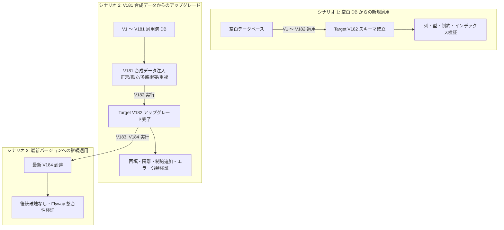

# V182 マイグレーション・スコープ固定および修復演練検証契約書 (V182 Rehearsal Contract)

## 1. 目的と安全規範

本契約書は、`V182__nf09_tenant_scope_hardening.sql` の安全な本番適用可能性を事前に実証するための、完全使い捨て（Disposable）実 MySQL 8 環境におけるリハーサル検証計画および検収基準を規定する。

### 1.1 安全絶対規範（レッドライン）
1. **本番環境接続および本番データ直接操作の絶対禁止**: 本番データベース、ステージング永続 DB への直接接続・マイグレーション・修復実行は固く禁止する。
2. **実クレデンシャルの読み取り・使用の絶対禁止**: 本番・ステージングのシークレット、実運用アカウントのアクセス情報は一切読み込まず、合成テスト環境（Synthetic Test Fixture）に限定する。
3. **合成 HUMAN 記録の厳格な位置づけ**: リハーサル中に記録される `actor_type = 'HUMAN'` や `resolved_by = 1` は、マイグレーション SQL および CAS ロジックの技術的整合性を確認するためのダミー監査値に過ぎず、**業務 Owner、セキュリティ部門、法務・コンプライアンス責任者の実サインオフを代替するものでは決してない**。

---

## 2. 実行環境と基線固定仕様 (Pinning Preconditions)

本リハーサルは、H2 互換モードではなく、実際の MySQL 8 ダイアレクトと Flyway エンジンを用いて実施する。

| 項目 | 固定仕様 |
|---|---|
| 実装 Worktree | `C:\work\ses-nf09-system-actor-attribution` (branch: `codex/snf-prod-nf09-local-keycloak`) |
| 固定 HEAD SHA | `96be4e9f79f6bcd8638b6856f9b60c1684ce844a` (本ドキュメント改定後の新 SHA は AI-7 へ通知) |
| DB エンジン | Docker Disposable `mysql:8.0` (tmpfs マウント、照合順序: `utf8mb4_unicode_ci`) |
| Flyway 適用ツール | Flyway Community Edition (Maven `flyway-maven-plugin` または Spring Boot 組み込み Flyway) |
| 対象マイグレーション | `src/main/resources/db/migration/V182__nf09_tenant_scope_hardening.sql` |
| V182 スクリプト SHA-256 | `BB9EBDEABF3E1CE9DAD42525551E3F594D2DC4D10F103AF8AFA7BBBA159A0DA7` |
| 最終ターゲットバージョン | **V184** (`V184__create_import_metadata_foundation.sql`)。NF10 専用の V185 は含めない。 |

---

## 3. 3つの演練シナリオ設計 (Three Rehearsal Scenarios)



### 3.1 シナリオ 1: 空白 DB からの新規適用 (Fresh Rehearsal to Target V182)
- **手順**:
  1. 一時 MySQL コンテナを起動し、空の `ses_manager_db` を作成。
  2. Flyway の `target` を `182` に設定し、`flyway:migrate` を実行。
- **検証項目**:
  - `flyway_schema_history` において V1 〜 V182 の全スクリプトが `success = 1` で終了すること。
  - `t_peppol_participant`, `t_digital_invoice`, `t_digital_invoice_event`, `t_external_account_reference` に `tenant_id` (VARCHAR(100)) および `legal_entity_id` (BIGINT) 列が NULL 許可で追加されていること。
  - `t_nf09_scope_repair_queue` が正しく作成され、インデックスおよび主キーが設定されていること。
  - DDL の実行順序・構文エラーが存在しないこと。

### 3.2 シナリオ 2: V181 合成データからのアップグレード (Upgrade Rehearsal from V181 to V182)
- **手順**:
  1. 空白 DB に対し、まず V1 〜 V181 を適用。
  2. 後述の「第 4 節: 合成テストデータ・マトリクス」に従い、V182 の全分岐を網羅する合成レコードを各テーブルへ `INSERT`。
  3. `target = 182` として V182 を実行。
- **検証項目**:
  - 正常行、衝突行、孤立行が SQL の意図通りに回填または隔離されること。
  - 一意インデックス、複合外部キー、CHECK 制約の追加がデータ違反なく完了すること。

### 3.3 シナリオ 3: 本候補最新バージョンへの継続アップグレード (Upgrade to Latest Candidate V184)
- **手順**:
  1. シナリオ 2 の完了状態から、`target` を `184` に設定し、`flyway:migrate` を続行。
  2. **V185 の除外**: NF10 専用に予約されている V185 は本演練には一切導入しない。
- **検証項目**:
  - `V183__lifecycle_case_sequence.sql` および `V184__create_import_metadata_foundation.sql` がエラーなく適用されること。
  - V182 で作成されたテーブル・列・制約が後続マイグレーションと衝突・破損しないこと。

---

## 4. 実際の SQL 分岐と合成データ検証マトリクス

V182 内の各 SQL 句に対応するテストケースを以下のように定義し、全分岐を網羅する。

### 4.1 電子インボイス (`t_digital_invoice`) のスコープ解決と隔離
V182 は一時テーブル `__ses_v182_digital_scope_candidates` を用いて、請求書（`t_invoice`）・発注（`t_sales_order`）・契約（`t_contract`）の 3 系統から候補スコープを収集する。

| ケース ID | 入力データ状態 | 期待される回填結果 | 期待される修復キュー (`t_nf09_scope_repair_queue`) |
|---|---|---|---|
| `INV_SINGLE_OK` | 顧客に紐づく `t_invoice` 1件のみと関連 | 顧客の `tenant_id` / `legal_entity_id` が回填される | キュー登録なし |
| `INV_MULTI_SAME_OK` | `t_invoice` と `t_sales_order` の両方に関連し、双方が同一の `(tenant_id, legal_entity_id)` | 一致したスコープが回填される (`COUNT(*) = 1` 判定) | キュー登録なし |
| `INV_CONFLICT` | `t_invoice` (法人A) と `t_contract` (法人B) で異なるスコープを持つ | `tenant_id`, `legal_entity_id` は NULL のまま維持 | `entity_type='DIGITAL_INVOICE'`, `reason='SCOPE_CONFLICT'` でキュー登録 |
| `INV_UNRESOLVED` | 関連する請求・発注・契約がすべて削除済みまたは存在しない孤立レコード | `tenant_id`, `legal_entity_id` は NULL のまま維持 | `entity_type='DIGITAL_INVOICE'`, `reason='SCOPE_UNRESOLVED'` でキュー登録 |

### 4.2 インボイスイベント (`t_digital_invoice_event`) の親スコープ継承
| ケース ID | 入力データ状態 | 期待される回填結果 | 期待される修復キュー |
|---|---|---|---|
| `EVT_PARENT_OK` | 親 `t_digital_invoice` が正常に回填されたイベント | 親と同じスコープが回填される | キュー登録なし |
| `EVT_PARENT_UNRESOLVED` | 親 `t_digital_invoice` が未解決または衝突して NULL のイベント | イベントのスコープも NULL のまま維持 | `entity_type='DIGITAL_INVOICE_EVENT'`, `reason='PARENT_SCOPE_UNRESOLVED'` でキュー登録 |

### 4.3 Peppol 参加者 (`t_peppol_participant`) の顧客所有回填と重複コールバック隔離
| ケース ID | 入力データ状態 | 期待される回填結果 | 期待される修復キューとステータス変更 |
|---|---|---|---|
| `PEP_CUSTOMER_OK` | `owner_type='CUSTOMER'` で有効な顧客に紐づく | 顧客のスコープが回填される | キュー登録なし |
| `PEP_OTHER_UNRESOLVED` | `owner_type='USER'` 等の顧客以外の所有レコード | スコープは NULL のまま維持 | `entity_type='PEPPOL_PARTICIPANT'`, `reason='SCOPE_UNRESOLVED'` でキュー登録 |
| `PEP_CALLBACK_CONFLICT` | 同一 `(provider, scheme_id, participant_id)` で `status='VERIFIED'` の行が 2 件以上存在 | スコープは元のまま | **重複する全件** がキューへ `reason='CALLBACK_IDENTITY_CONFLICT'` で隔離。<br/>**全件** `status='CONFLICT_REPAIR'`、`verified_at = NULL` に強制リセットされる（勝者を任意に選ばない）。 |

### 4.4 外部アカウント参照 (`t_external_account_reference`) の技術境界
| ケース ID | 入力データ状態 | 期待される回填結果 | 期待される修復キュー |
|---|---|---|---|
| `ACC_ENGINEER_OK` | `assignee_type='ENGINEER'` で有効なエンジニアに紐づく | エンジニアのスコープが回填される | キュー登録なし |
| `ACC_USER_LEGACY` | `assignee_type='USER'` のレガシーアカウントレコード | スコープは回填されず NULL を維持（組織所属曖昧性） | `entity_type='EXTERNAL_ACCOUNT'`, `reason='SCOPE_UNRESOLVED'` でキュー登録 |

### 4.5 監査主体 (Actor Attribution) の閉集合正規化と制約
- `t_digital_invoice` および `t_digital_invoice_event` の既存レコードにおいて、`actor_type` や `confirmation_source` が NULL、または closed pair 以外の組み合わせである場合：
  - `actor_type = 'LEGACY_UNRESOLVED'`
  - `confirmation_source = 'LEGACY_UNRESOLVED'`
  - `human_user_id = NULL`
  に正規化されること。
- その後追加される `ck_digital_invoice_actor_pair` および `ck_digital_invoice_event_actor_pair` CHECK 制約に違反せず通過すること。

### 4.6 制約とインデックス境界の検証
1. **3列複合外部キー (`fk_digital_invoice_event_scope`)**:
   `t_digital_invoice_event (tenant_id, legal_entity_id, digital_invoice_id)` が `t_digital_invoice (tenant_id, legal_entity_id, id)` を参照する。親と子のスコープが完全に一致しない不正な更新・挿入が MySQL エンジンレベルで `RESTRICT` 拒否されることを確認する。
2. **生成列仮想スロットと一意インデックス (`uk_peppol_callback_active`)**:
   `callback_active_slot` は `deleted_flag = 0 AND status = 'VERIFIED'` の場合のみ `1`、それ以外は `NULL` となる生成列。MySQL の一意インデックスにおいて NULL は重複とみなされない特性を利用し、`VERIFIED` 状態のアクティブなコールバック識別子の一意性を担保しつつ、`CONFLICT_REPAIR` や論理削除行が共存できることを確認する。
3. **NULL 許容スコープと複合一意インデックス**:
   未解決行（`tenant_id IS NULL`）がキューに隔離されている間、一意制約が阻害されないことを確認する。

---

## 5. MySQL DDL 非トランザクション性と障害復旧契約 (MySQL DDL Non-Atomicity)

### 5.1 暗黙のコミット（Implicit Commit）の技術的現実
MySQL 8.0 の InnoDB ストレージエンジンにおいて、`ALTER TABLE`、`CREATE TABLE`、`DROP TABLE` などの DDL 文は実行直前に**暗黙のトランザクションコミット**をトリガーする。
そのため、V182 のように複数の DDL と DML が混在するスクリプトは、**障害発生時に全体が自動で単一トランザクションとしてロールバックされない**。

### 5.2 失敗時の証拠保全とコンテナ破棄手順
リハーサル中にマイグレーションエラーが発生した場合、直ちにコンテナを破棄してはならない。以下の順序を厳格に遵守する：

1. **実行の即時停止**: 追加の更新や手動 SQL 投入を行わず、プロセスを停止する。
2. **証拠の完全退避**:
   - Flyway のコンソールログおよび Surefire 実行ログ
   - `flyway_schema_history` テーブルの完全ダンプ (`SELECT * FROM flyway_schema_history`)
   - 変更対象全テーブルの現在のスキーマ定義 (`SHOW CREATE TABLE`)
   - 各テーブルの件数、NULL 件数、および `t_nf09_scope_repair_queue` のダンプ
   - 上記ログ・ダンプファイルの SHA-256 チェックサムマニフェスト
3. **コンテナの破棄**: 証拠が完全に隔離保存されたことを確認した後に限り、一時コンテナを破棄する。

### 5.3 クリーンリプレイと部分マイグレーション回復の分離
- **クリーンリプレイ (Clean Replay)**: 空白 DB から修正版スクリプトを再実行して整合性を確認する検証。
- **部分マイグレーション回復 (Partial Migration Recovery)**: 中途コミットされた破損状態から修復パッチを適用して回復する検証。
両者は**全く異なる検証スコープであり、クリーンリプレイの成功をもって部分マイグレーション回復が確認されたと混称してはならない**。

### 5.4 本番前向修正（Forward-Fix）のステータス
本番環境での万が一のマイグレーション中断に対する「前向修正（Forward-Fix）パッチおよび手順」は、**現時点では未設計・未承認の課題として保持する**。本リハーサルバッチは Disposable コンテナでのクリーンアップ検証に限定され、本番 forward-fix 手順を検証済みと主張しない。

---

## 6. キュー修復（Repair Queue）演練契約

`t_nf09_scope_repair_queue` に隔離された未解決行を解消するプロセスを演練する。

### 6.1 同一トランザクション内での二段階修復と CAS
業務データ修復とキュー行の結案は、**同一のデータベーストランザクション（`@Transactional`）内で実行しなければならない**。

```sql
-- 同一トランザクション内:
-- 1. 業務実体データの修復
UPDATE t_digital_invoice
   SET tenant_id = :resolvedTenantId,
       legal_entity_id = :resolvedLegalEntityId,
       version = version + 1
 WHERE id = :invoiceId
   AND tenant_id IS NULL
   AND version = :expectedInvoiceVersion;
-- (更新件数が 1 でなければ即座に例外をスローしてロールバック)

-- 2. キュー行の CAS 結案
UPDATE t_nf09_scope_repair_queue
   SET status = 'RESOLVED',
       resolved_at = NOW(),
       resolved_by = :humanUserId,
       resolution_note = :note,
       version = version + 1
 WHERE id = :queueId
   AND status = 'PENDING'
   AND version = :expectedQueueVersion;
-- (更新件数が 1 でなければ即座に例外をスローしてロールバック)
```

**競合テストにおける敗者アサーション**:
2 スレッドが同一キュー行および同一業務データを競合修復した場合、勝者のみがコミットされ、**敗者のトランザクションは例外により全ロールバックされる。テストコードでは、敗者の業務エンティティ更新（tenant_id 等）が DB に一切残存していない（dirty な部分更新がない）ことを厳格にアサートする**。

### 6.2 CALLBACK_IDENTITY_CONFLICT 独立修復演練
`t_peppol_participant` における `CALLBACK_IDENTITY_CONFLICT` は、スクリプトの `ON DUPLICATE KEY UPDATE` により、**元の `SCOPE_UNRESOLVED` を上書きして記録されている可能性がある**。したがって、「この理由は重複衝突だからスコープは既に解決している」と推測してはならない。

修復結案時には、以下の **3重条件** をすべて検証しなければならない：

1. **スコープ完全性検証**: 当該参加者レコードの `tenant_id` および `legal_entity_id` が NULL でなく、正当な顧客に紐づいていること。
2. **重複アイデンティティの完全処置**: 同一 `(provider, scheme_id, participant_id)` を持つ競合レコード群に対し、**正当な 1 件のみを `status = 'VERIFIED'`（`callback_active_slot = 1`）とし、他の全重複行を明示的に `status = 'DUPLICATE_DEPRECATED'`, `deleted_flag = 1`, `callback_active_slot = NULL` に更新・無効化すること**。
3. **アクティブコールバックの一意性実証**: 正当な 1 件を `VERIFIED` に更新した際、複合一意インデックス `uk_peppol_callback_active` がエラーなく成立すること。

スコープが未確定、または重複レコードの無効化が不完全である場合、**キュー行は結案せず `PENDING` のまま維持しなければならない**。実外部 Provider への API 接続は一切行わない。

---

## 7. 検証・検収テストケースマトリクス

| 用例 ID | カテゴリ | テスト条件 | 期待される動作・結果 |
|---|---|---|---|
| `TC-REP-01` | 正常系 | 孤立インボイスの正しいスコープを特定し同一Txで修復結案 | インボイスの `tenant_id` 更新成功、キュー行 `status='RESOLVED'`, `version` 加算。 |
| `TC-REP-02` | 正常系 | 重複 Peppol のスコープ解決と 1 件のみ有効化（他方を論理削除） | 唯一の行が `VERIFIED`（slot=1）となり、一意制約成立。キュー行結案。 |
| `TC-REP-03` | 負向系 | 他テナントの担当者が別テナントのキュー行の修復を試行 | 認可境界違反により更新拒否（`403 FORBIDDEN`）。 |
| `TC-REP-04` | 負向系 | 重複 Peppol でスコープが未解決（NULL）のまま結案を試行 | スコープ完全性チェック違反により拒否。キューは `PENDING` を維持。 |
| `TC-REP-05` | 負向系 | 業務テーブル更新後、キュー行の CAS がバージョン不一致で失敗（0件） | トランザクション全体がロールバックされ、業務テーブルの変更も取り消される。 |
| `TC-REP-06` | 並行系 | 2 スレッドが同一キュー行および同一インボイスを同時に修復実行 | 先行スレッドのみ成功。敗者スレッドは例外終了し、インボイスに敗者の更新痕跡が残らない。 |
| `TC-REP-07` | 異常系 | マイグレーション中に意図的な DDL エラーを注入 | 移行が直ちに停止し、ログ・スキーマ・history が退避され、検証証拠として固定される。 |

---

## 8. 残余リスクと未完成事項

1. **本番 Forward-Fix パッチ未設計**: 本番環境で障害が発生した際のロールフォワード手順は本バッチでは設計・検証しておらず、本番適用承認前に独立した運用承認を必要とする。
2. **V185 マイグレーション非対象**: NF10 用に予約されている V185 の検証は本契約のスコープ外である。
3. **合成 HUMAN サインオフの非代替性**: 本リハーサルで記録される監査 ID は、実際の業務部門・セキュリティ部門の承認を法的に代替しない。
