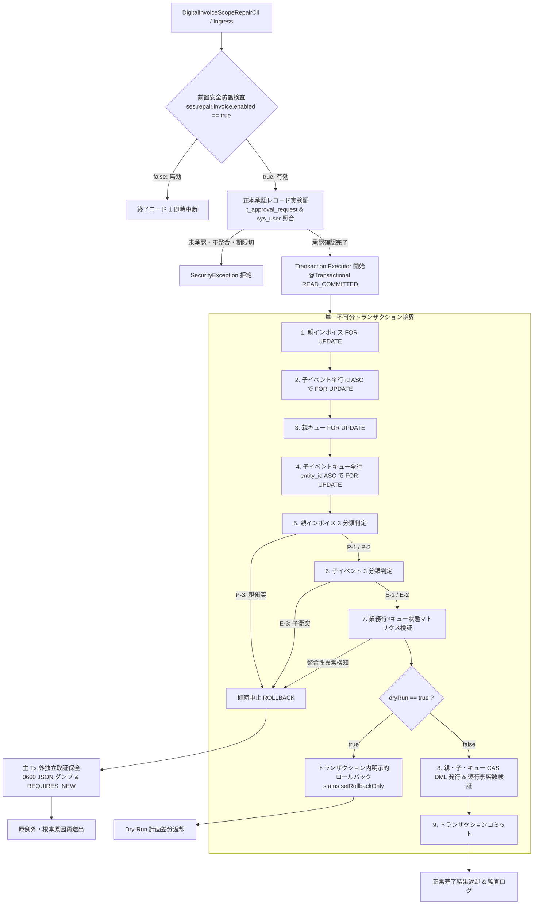
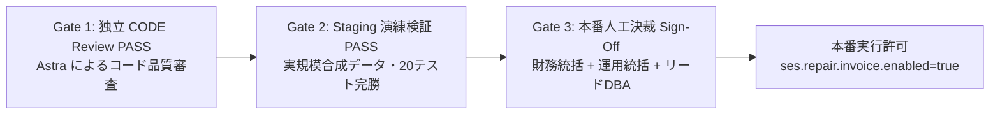

# V182 修復エグゼキュータ 境界 A（電子インボイス集約）最小実装計画書 (Repair Executor Boundary A Plan)

> [!IMPORTANT]
> **本計画書のステータス**: **PLAN REVIEW PENDING（独立計画レビュー待ち）**
> 本計画書は、V182 本番運用手順書（`v182-production-runbook-draft.md`）第 8 節に規定されたトランザクション境界「境界 A（電子インボイス集約）」に対する**最初の最小コード実装切片（First Minimal Implementation Slice）**の技術計画を定義する。
> 本切片において**Java コード・テストコードの実装は一切開始せず、Peppol・外部アカウント・本番デプロイへの拡張も行わない**。Astra による独立 Plan Review の承認完了後に実装フェーズへ移行する。

---

## 1. 目的・適用範囲・演練ヘルパーとの厳格な区分 (Objectives, Scope & Distinction)

### 1.1 目的
`V182__nf09_tenant_scope_hardening.sql` の適用直後に生成される `t_nf09_scope_repair_queue` のうち、`entity_type = 'DIGITAL_INVOICE'` および `entity_type = 'DIGITAL_INVOICE_EVENT'` に隔離された未解決レコード群を、データ欠損や外鍵違反を起こさずに安全・不可分に解消するための**本番対応修復エグゼキュータ（Production Repair Executor for Boundary A）**の最小実装設計を確定する。

### 1.2 適用範囲（境界 A に厳格限定）
- **対象エンティティ**:
  1. 親デジタルインボイス: `t_digital_invoice`（BIGINT `version` 列保有）
  2. 紐づく子イベント: `t_digital_invoice_event`（`version` 列なし、3列複合外鍵 `fk_digital_invoice_event_scope` 拘束）
  3. 親インボイス修復キュー: `t_nf09_scope_repair_queue` (`entity_type = 'DIGITAL_INVOICE'`)
  4. 子イベント修復キュー: `t_nf09_scope_repair_queue` (`entity_type = 'DIGITAL_INVOICE_EVENT'`)
- **本切片の対象外（非スコープ）**:
  - `t_peppol_participant`（境界 B）および `t_external_account_reference`（境界 C）の修復
  - 本番環境への実適用・自動実行スケジューリング・CI/CD パイプラインへの組み込み

### 1.3 テスト用演練ヘルパーと本番修復エグゼキュータの厳格な区分
過去の演練テスト（`V182TenantScopeHardeningRehearsalMySqlTest`）内の `repairInvoiceInTransaction(...)` は、使い捨て（Disposable）MySQL コンテナ上での Flyway 動作検証を目的に作られた**テスト専用ヘルパーに過ぎず、本番修復エグゼキュータとしては未完成・未承認**である。

| 比較項目 | 演練テストヘルパー (`repairInvoiceInTransaction`) | 本計画で策定する本番修復エグゼキュータ |
|---|---|---|
| **実装位置** | `src/test/java/.../V182TenantScopeHardeningRehearsalMySqlTest.java` (private) | `src/main/java/com/ses/service/repair/` (正式プロダクション層) |
| **子イベント (`t_digital_invoice_event`)** | **未実装（完全無視）**。親行のみ更新し、子イベントの外鍵検査を回避。 | **完全集約実装**。親と全子イベントを同一 Tx 内でアトミックにロック・3分類・更新。 |
| **親インボイス状態判定** | 単純な NULL 更新のみ。 | 親インボイス自身の 3 分類判定（既一致・欠落回填・衝突拒絶）と精密原値比較。 |
| **外鍵整合性 (`RESTRICT`)** | 子イベントが存在しない合成データでのみ成立。 | MySQL 8 の即時文単位 RESTRICT 検査を充足する精密な原値比較 UPDATE を実装。 |
| **承認検証** | 呼出引数 `callerTenant` の単純な文字列一致のみ。 | `t_approval_request` 正本照合（Ticket ID、役職、版、日時、権限ロール）の実照合。 |
| **障害現場保全** | ロールバック時にエラーログをコンソール出力するのみ。 | ロールバックに巻き込まれない独立 Tx / 外部ファイルへの完全診断保全（原例外保持）。 |
| **ステータス** | テスト検証完了済 (Rehearsal Fact) | **新規最小実装計画中 (PLAN REVIEW PENDING)** |

---

## 2. 呼出入口・トランザクション境界・実行フロー (Ingress, Transaction Boundary & Execution Flow)

### 2.1 エンドツーエンド呼出フロー
修復処理は、CLI や Web 等の入口から厳格に統制されたゲートウェイを経由し、単一の不可分トランザクション内で実行された後、結果または障害現場証拠を独立保全する。



### 2.2 単一トランザクション境界（`@Transactional`）
- **コアサービスインターフェース**:
  ```java
  public interface DigitalInvoiceScopeRepairService {
      RepairResult repairInvoiceAggregate(RepairInvoiceAggregateCommand command);
  }
  ```
- 親インボイス、紐づく全子イベント、親キュー、および全子イベントキューのすべての読み取り・ロック・更新は、単一のデータベース接続・単一の `@Transactional(rollbackFor = Exception.class, isolation = Isolation.READ_COMMITTED)` 境界内で不可分に実行される。
- 中間状態で外部キー違反や部分更新が発生する余地を完全に排除し、処理途中で異常が検知された場合は例外をスローしてデータベース側で完全ロールバックする。

### 2.3 トランザクション内部での Dry-Run 判定と明示的ロールバック
Spring の `@Transactional` はメソッドが例外なく正常終了した場合、自動的にコミットを発行する。
そのため、Dry-Run を「メソッド正常終了後に外部でロールバックする」という設計は Spring のトランザクション制御下では**永続化コミット漏れを引き起こす致命的欠陥**となる。
本計画では、Dry-Run の判定を**必ずトランザクション内部で完結**させる：
```java
if (command.dryRun()) {
    // 計画された差分および影響行数を収集
    RepairResult dryRunResult = buildDryRunSimulationResult(invoice, events, parentQueue, eventQueues);
    // トランザクションを明示的にロールバックへマーク
    TransactionAspectSupport.currentTransactionStatus().setRollbackOnly();
    log.info("[DRY-RUN] トランザクション内ロールバックを実行しました。invoiceId={}", command.invoiceId());
    return dryRunResult;
}
```
これにより、データベース接続レベルで確実に `ROLLBACK` が発行され、データ不変性が物理的に保証される。

### 2.4 Service 直呼出に対する同一防護の強制
CLI 経由のみならず、将来的な内部ジョブや管理 API から `DigitalInvoiceScopeRepairService` が直接呼び出された場合でも、同一の承認検証および有効化前置検査を強制する。
Service 実装の先頭で必ず承認検証ゲートウェイを呼び出し、未承認呼出に対する抜け道（Backdoor）を一切設けない。

### 2.5 保守ウィンドウと書込排空（Write-Drain）の必須前提
後述の固定ロック順序（親 $\to$ 子 $\to$ 親キュー $\to$ 子キュー）は、本修復エグゼキュータの並行ワーカー同士におけるデッドロックを防止する。
しかし、外部の通常業務トランザクション（インボイス編集、入金消込、外部連携バッチ等）が別順序でテーブルにアクセスする場合、データベースエンジンレベルでの交差デッドロック（MySQL 1213）を完全に排除することは数学的に不可能である。
したがって、本エグゼキュータの本番実行は以下の環境前提を必須とする：
1. **計画保守ウィンドウの確保**: 一般利用者のアクセスおよび業務 API トラフィックが遮断されていること。
2. **書込排空（Write-Drain）の完了**: インボイスおよびイベントに関連する非同期メッセージキュー、スケジュールタスクが完全に停止し、未処理トランザクションがゼロ（Drained）であることを確認していること。

---

## 3. 厳格な人工承認検証と信頼できる検証起原 (Strict Approval Verification & Authoritative Source)

### 3.1 単純な真偽値（`approved = true`）やバイパスフラグの物理的排除
呼出元が `approved = true` や `bypassApproval = true` などの安易なフラグを渡すことによる修復実行は**アーキテクチャレベルで物理的に拒絶（Compile / Validation Error）**する。修復コマンドには、改ざん不能な構造化承認証跡オブジェクト `ScopeRepairApprovalEvidence` の同封を必須とする。

### 3.2 構造化承認証跡（`ScopeRepairApprovalEvidence`）仕様
未実装の HMAC フィールド（`digitalSignatureDigest`）は削除し、リポジトリ正本データベース（`t_approval_request`, `t_approval_action`, `sys_user`）の実在行と直接突き合わせる実体照合設計を採用する。

```java
public record ScopeRepairApprovalEvidence(
    String approvalTicketId,       // 正式起票決裁番号（例: "APPR-20261026-INV-0089"、t_approval_request.request_no と照合）
    Long operatorUserId,           // 実行操作者 sys_user.id（正の整数値、監査実行主体）
    Long approverUserId,           // 承認責任者 sys_user.id（正の整数値、決裁主体）
    String approverRole,           // 承認時ロール（"管理者"、"財務統括責任者" 等）
    String approvedTenantId,       // 承認対象テナント ID（command.targetTenantId と完全一致必須）
    Long approvedLegalEntityId,    // 承認対象法人 ID（command.targetLegalEntityId と完全一致必須）
    Long approvedInvoiceVersion,   // 申請時点の親インボイス version（command.expectedInvoiceVersion と完全一致必須）
    Instant approvalTimestamp,     // 承認確定日時（t_approval_request.finalized_at と照合）
    String justificationSummary    // 帰属決定の証拠原本（例: "基本契約書CNT-2026-089および課税事業者番号照合済"）
) {}
```

### 3.3 信頼できる正本データベース照合（Authoritative DB Verification）
「連携時」「存在する場合」といった曖昧な仮定表現を全廃し、修復実行前に以下の厳格な正本クエリを発行して照合する。いずれか 1 項目でも不整合または照合不能である場合は、直ちに `SecurityException` または `ApprovalRequiredException` をスローして実行を拒絶する。

1. **決裁申請レコードの存在・終端ステータス検証**:
   - `ApprovalRequestMapper` により `t_approval_request WHERE request_no = :approvalTicketId` を照合。
   - `status` が厳密に `'approved'`（小文字固定）であること。未決裁（`requested`, `in_review`）や却下（`rejected`）、差戻し（`returned`）行は即座に拒絶。
2. **対象インボイス ID およびバージョンの拘束検証（Replay 防護）**:
   - `target_type` が厳密に `'DIGITAL_INVOICE'` であること。
   - `target_id` がコマンドの `invoiceId` と完全一致すること（**別インボイスの承認流用・クロスリプレイの絶対禁止**）。
   - `target_version` がコマンドの `expectedInvoiceVersion` と完全一致すること（**申請後にインボイスが更新された場合の無効化・データ変更後リプレイの絶対禁止**）。
3. **承認先スコープの完全一致検証**:
   - `payload_json` をパースし、承認された `targetTenantId` および `targetLegalEntityId` が、コマンドで指定された修復先スコープと**1 文字の狂いもなく完全一致**すること。
4. **承認有効期限の検証（提案値 / PENDING）**:
   - `approvalTimestamp` および DB の `finalized_at` からの経過時間を検証。
   - 提案有効期限: **承認確定後 7 日以内（168 時間: `PT168H`）**。未来日時または期限切れの承認は拒絶。
   > [!NOTE]
   > 有効期限「7 日間」は現時点の設計提案値であり、本番運用決裁（PENDING）において正式な SLA として確定される。
5. **承認者アカウントおよび権限ロールの正本検証**:
   - `SysUserMapper` により `sys_user WHERE id = :approverUserId AND status = 1 AND deleted_flag = 0` を照合。
   - `t_approval_action` において、該当チケットに対する `action = 'APPROVE'` を発行した実際の操作者が `approverUserId` と一致すること。
   - `v182-production-runbook-draft.md` に規定された修復理由に応じた**必須承認者組合せ**を検証：
     - **未解決回填（`SCOPE_UNRESOLVED`）**: 財務統括責任者（Finance Director）＋ システム管理者（`管理者` / `ROLE_ADMIN`）。
     - **衝突再判定（`SCOPE_CONFLICT`）**: 財務統括責任者（Finance Director）＋ 営業主管（Sales Rep Lead）。

### 3.4 テスト用フィクスチャの本番バックドア化防止
テスト実行で使用される合成承認フィクスチャ（例: `ticketId = "TEST-MOCK-APPR-001"`）は、Spring プロファイルが `@Profile("test")` である環境においてのみ有効なモック検証器として分離する。
本番プロファイル（`prod`）においては、モックフィクスチャは完全に無効化され、データベース上の正式な `t_approval_request` 行の存在を例外なく要求する。

---

## 4. ロック階層・親インボイスおよび子イベントの 3 分類・精密更新 (Locking, 3-Way Classification & Precision Updates)

### 4.1 決定論的ロック階層順序（Deterministic Lock Ordering）
並行する修復ワーカー間のデッドロック（MySQL 1213）を防止するため、全プロセスで以下のロック階層順序を厳格に順守する：

```
階層 1: t_digital_invoice (単一行 FOR UPDATE)
   ↓
階層 2: t_digital_invoice_event (digital_invoice_id 指定、必ず id ASC で FOR UPDATE)
   ↓
階層 3: t_nf09_scope_repair_queue (親インボイスキュー行 FOR UPDATE)
   ↓
階層 4: t_nf09_scope_repair_queue (子イベントキュー全行、必ず entity_id ASC で FOR UPDATE)
```

### 4.2 親インボイスの 3 分類（Parent Invoice 3-Way Classification）
ロック取得した `t_digital_invoice`（取得原値: `lockedParentTenantId`, `lockedParentLegalEntityId`, `lockedParentVersion`）に対し、承認済親スコープ `(:targetTenantId, :targetLegalEntityId)` に照らして 3 分類を実施する：

1. **分類 P-1（完全一致・検証済 / Fully Consistent）**:
   - 条件: `lockedParentTenantId == targetTenantId && lockedParentLegalEntityId == targetLegalEntityId`
   - 処置: **親インボイスへの UPDATE は発行しない（バージョンもインクリメントしない）**。親スキップフラグを立て、子イベントの検査・回填へ進む。
2. **分類 P-2（欠落回填・非衝突 / Missing Backfill, Consistent）**:
   - 条件: `(lockedParentTenantId == null || lockedParentLegalEntityId == null)` かつ
     `(lockedParentTenantId == null || lockedParentTenantId.equals(targetTenantId))` かつ
     `(lockedParentLegalEntityId == null || lockedParentLegalEntityId.equals(targetLegalEntityId))`
   - 網羅例:
     - `tenant_id`・`legal_entity_id` 共に NULL
     - `tenant_id` は一致、`legal_entity_id` のみ NULL
     - `tenant_id` のみ NULL、`legal_entity_id` は一致
   - 処置: 後述 4.4 (1) の CAS UPDATE を発行し、欠落分量を回填する。
3. **分類 P-3（非空分量衝突・フェイルストップ / Non-null Component Conflict）**:
   - 条件: `(lockedParentTenantId != null && !lockedParentTenantId.equals(targetTenantId)) || (lockedParentLegalEntityId != null && !lockedParentLegalEntityId.equals(targetLegalEntityId))`
   - 処置: **直ちに `ConflictException` をスローしてトランザクション全体を ROLLBACK**。未解決キューを `PENDING` に維持し、現場診断を保全する。

### 4.3 子イベントの 3 分類（Child Events 3-Way Classification）
ロック取得された全子イベント（$M$ 件）をループし、承認済親スコープに対して逐項分類する：

1. **分類 E-1（完全一致・検証済）**:
   - 条件: `event.tenant_id == targetTenantId && event.legal_entity_id == targetLegalEntityId`
   - 処置: 既に整合しているため UPDATE は発行しない。カウント $N_1$ を加算。
2. **分類 E-2（欠落回填・非衝突）**:
   - 条件: `(event.tenant_id == null || event.legal_entity_id == null)` かつ非 NULL 分量がターゲットと一致。
   - 処置: 回填対象リストに追加。カウント $N_2$ を加算。
3. **分類 E-3（非空分量衝突・フェイルストップ）**:
   - 条件: 非 NULL 分量がターゲット親スコープと相違・矛盾している。
   - 処置: **直ちに `ConflictException` をスローしてトランザクション全体を ROLLBACK**。

### 4.4 実スキーマ準拠の更新 SQL と NULL-Safe 原値比較・逐行影響数検証

#### (1) 親インボイスの version CAS 更新（分類 P-2 の場合のみ発行）
```sql
UPDATE t_digital_invoice
   SET tenant_id = :targetTenantId,
       legal_entity_id = :targetLegalEntityId,
       version = version + 1
 WHERE id = :invoiceId
   AND version = :expectedInvoiceVersion
   AND tenant_id <=> :lockedParentTenantId
   AND legal_entity_id <=> :lockedParentLegalEntityId;
```
- **検証**: 更新行数が厳密に `1` であること。`0` の場合は他トランザクションによる更新とみなし、即座に `OptimisticLockingFailureException` をスローしてロールバック。
- 分類 P-1 の場合は SQL 発行自体をスキップする。

#### (2) 分類 E-2 子イベントの精密原値比較 UPDATE
MySQL 8 の複合外部キー `fk_digital_invoice_event_scope` は文単位で即時 RESTRICT 評価される。親インボイスが整合状態にあることを前提に、分類 E-2 のイベントを 1 行ずつ実行する：
```sql
UPDATE t_digital_invoice_event
   SET tenant_id = :targetTenantId,
       legal_entity_id = :targetLegalEntityId
 WHERE id = :eventId
   AND digital_invoice_id = :invoiceId
   AND tenant_id <=> :lockedEventTenantId
   AND legal_entity_id <=> :lockedEventLegalEntityId;
```
- **検証**: 各文の更新行数が厳密に `1` であること。分類 E-2 の全 $N_2$ 件にわたり合計影響行数が厳密に $N_2$ 行であることを検証する。

#### (3) 親キューの version CAS 結案（PENDING の場合）
```sql
UPDATE t_nf09_scope_repair_queue
   SET status = 'RESOLVED',
       resolved_at = NOW(),
       resolved_by = :approverUserId,
       resolution_note = :resolutionNote,
       version = version + 1
 WHERE id = :parentQueueId
   AND status = 'PENDING'
   AND version = :expectedParentQueueVersion;
```
- **検証**: 更新行数 == 1。

#### (4) 子イベントキュー全行の version CAS 結案（PENDING の場合）
各子イベントキュー行に対し：
```sql
UPDATE t_nf09_scope_repair_queue
   SET status = 'RESOLVED',
       resolved_at = NOW(),
       resolved_by = :approverUserId,
       resolution_note = :resolutionNote,
       version = version + 1
 WHERE id = :eventQueueId
   AND status = 'PENDING'
   AND version = :expectedEventQueueVersion;
```
- **検証**: 各行更新行数 == 1。

---

## 5. 業務行と修復キューの状態遷移マトリクス・エッジケース (Business Row vs Queue State Matrix & Edge Cases)

各エンティティ（親インボイスまたは子イベント）について、業務行のスコープ状態と修復キューの状態の組み合わせを以下のように厳密に統制する。
バインディング関係は `(entity_type, entity_id)` およびコマンド契約で指定された `expectedVersion` により検証する。

### 5.1 状態組み合わせマトリクス

| 業務行スコープ状態 | キュー状態 (`t_nf09_scope_repair_queue`) | エグゼキュータの確定動作 | 整合性保護理由 |
|---|---|---|---|
| **MISSING_SCOPE** (欠落あり) | **NO_QUEUE** (キュー不在) | **即時 REJECT (`IllegalStateException`)** | V182 初期隔離から漏れた異常孤立行。データ整合性障害として手動調査を強制。 |
| **MISSING_SCOPE** (欠落あり) | **PENDING** | **CAS UPDATE 実行** | 正当な修復対象。前提条件（承認・分類）成立後に親・子・キューを更新。 |
| **MISSING_SCOPE** (欠落あり) | **RESOLVED** | **即時 REJECT (`IllegalStateException`)** | キューは解決済みなのに実データが未解決という矛盾。障害として即時中断。 |
| **CONSISTENT_SCOPE** (完全一致) | **NO_QUEUE** (キュー不在) | **LEGAL SKIP (正当スキップ)** | 健全レコード。元々修復不要でありキューが存在しないことが正常。DML なし。 |
| **CONSISTENT_SCOPE** (完全一致) | **PENDING** | **キューのみ CAS 結案 (`[IDEMPOTENT_CLOSE]`)** | データは既に整合。親/子 DML をスキップし、キューのみ PENDING $\to$ RESOLVED へ進める。 |
| **CONSISTENT_SCOPE** (完全一致) | **RESOLVED** | **結案内容検証後スキップ** | 解決済み内容がターゲットと一致していれば `SKIPPED_ALREADY_RESOLVED`。相違時は REJECT。 |
| **CONFLICT_SCOPE** (非空衝突) | 任意 (NO_QUEUE / PENDING / RESOLVED) | **即時 REJECT (`ConflictException`)** | 非 NULL スコープの再帰属は本境界で禁止。Fail-Stop し全量ロールバック。 |
| 任意 | **UNKNOWN_STATUS** (PENDING/RESOLVED 以外) | **即時 REJECT (`IllegalStateException`)** | 不正なキュー状態。予期せぬデータ破壊を防ぐため即時停止。 |

### 5.2 混合状態および不整合の処置規約
1. **グループ内混合状態（Mixed States）**:
   - 例: 親インボイスは `PENDING`、子イベント 1 は既に `RESOLVED`（データ一致）、子イベント 2 は `PENDING`。
   - 処置: 各行を上記マトリクスに従って評価。子イベント 1 の既解決性が確認できれば、親および子イベント 2 のみを更新してグループ全体を完了させる。グループ内の一部でも不正（例: 孤立欠落行）が存在する場合は**グループ全体を全量ロールバック**する。
2. **バインディング誤り（Mismatched Binding）**:
   - キューの `entity_type` と `entity_id` が対象テーブルのレコードと結合できない場合、直ちに `IllegalStateException` で拒絶。
3. **過期バージョン（Stale Version）**:
   - コマンドで指定された `expectedVersion` と DB の現在 `version` が異なる場合、CAS UPDATE の影響行数が 0 件となり `OptimisticLockingFailureException` を送出してロールバック。

---

## 6. トランザクション全量ロールバックと現場取証設計 (Atomic Rollback & Forensic Evidence Design)

### 6.1 トランザクション全量ロールバック（All-or-Nothing）
処理途中でいかなる例外（ロック待ちタイムアウト 1205、デッドロック 1213、CAS 更新行数 0 件、分類 P-3/E-3 衝突、外部キー違反 1452）が発生した場合も、Spring の `@Transactional` によりデータベース接続は即座に `ROLLBACK` される。
親インボイス、全子イベント、および親・子キューテーブルの状態は、処理開始前の状態へと完全に復元される（部分結案ゼロの物理的保証）。

### 6.2 既有機能と新規設計機能の厳格な区分
現場取証において、既存のサービスと本切片で新設するコンポーネントの責務を厳格に区分する：

| 区分 | コンポーネント・メソッド | 状態 | 責務・トランザクション境界 |
|---|---|---|---|
| **既有** | `SysUserMapper.selectById(...)` | 既存 | 承認者・操作者アカウントの検索 |
| **既有** | `ApprovalRequestMapper.selectOne(...)` | 既存 | 正本承認レコード（`t_approval_request`）の検索 |
| **既有** | `AuditLogService.record(...)` | 既存 | API 監査ログのベストエフォート記録（例外握りつぶし型） |
| **新規** | `DigitalInvoiceScopeRepairForensicsService` | **新設** | **主 Tx 外で動作する障害現場証拠保全サービス** |
| **新規** | `recordFailureEvidence(...)` | **新設** | 0600 JSON 出力および `Propagation.REQUIRES_NEW` 監査記録 |

### 6.3 主トランザクション外での独立証拠保全と例外伝播規約
1. **主 Tx ロールバック後の独立取証**:
   - 障害現場の保全は、主トランザクションがロールバックされた後、外側の catch ブロックにおいて独立して実行される。
2. **例外伝播と根本原因保全の鉄則**:
   - 取証処理（ファイル書き込みや独立監査ログ永続化）の内部で万一例外（Disk Full、Permission Denied 等）が発生した場合でも、**元の業務例外・根本原因（Root Cause）を絶対に隠蔽・握りつぶしてはならない**。
   - 取証処理自体の失敗例外は、元の例外オブジェクトへ `suppressedException.addSuppressed(...)` として付加して再スローする。
   - 呼出元に対して成功ステータス（`200 OK` 等）を偽装して返却することは厳格に禁止する。

### 6.4 実行主体・承認責任者・承認単据の明確な分離記録
現場証跡には、以下の 3 つの異なる主体を混同せずに明確に記録する：
- `executorUserId`: 実際に CLI や API を操作して修復コマンドを発行した操作者（`sys_user.id`）。
- `approverUserId`: 決裁申請を承認した責任者（`sys_user.id`）。
- `approvalTicketId`: 承認の根拠となった正本決裁番号（`t_approval_request.request_no`）。

### 6.5 現場証跡ファイル仕様・ファイル権限・機微情報脱敏
1. **出力ファイル仕様**:
   - 出力パス: `${ses.repair.evidence-dir:logs/repair-evidence}/repair-failure-INV-{invoiceId}-{timestamp}.json`
   - ファイルパーミッション: **POSIX `0600`（所有者のみ読み書き可能、グループ・他者アクセス禁止）**。ディレクトリは `0700`。Windows 環境では実行サービスアカウントおよび Administrators のみに制限された ACL を設定。
2. **記録最小フィールドセット**:
   ```json
   {
     "evidenceId": "550e8400-e29b-41d4-a716-446655440000",
     "timestamp": "2026-10-26T17:30:00Z",
     "invoiceId": 10089,
     "executorUserId": 1,
     "approverUserId": 42,
     "approvalTicketId": "APPR-20261026-INV-0089",
     "commandExpectedVersion": 0,
     "dbCurrentVersion": 0,
     "lockedParentScope": { "tenantId": null, "legalEntityId": null },
     "classificationSummary": {
       "parentClassification": "P_2_MISSING_BACKFILL",
       "childClassificationCounts": { "E_1": 1, "E_2": 1, "E_3": 1 }
     },
     "failurePhase": "CLASSIFICATION_CONFLICT",
     "sqlErrorCode": null,
     "sqlState": null,
     "exceptionClass": "com.ses.common.exception.ConflictException",
     "errorMessage": "子イベント 2005 のスコープ (tenant-2) がターゲット (tenant-1) と衝突しています",
     "sanitizedStackTrace": "com.ses.common.exception.ConflictException: ..."
   }
   ```
3. **機微情報脱敏（Data Sanitization）**:
   - 顧客の売上金額（`total_amount`）、税額、品目名、銀行口座番号、顧客担当者氏名・電話番号・メールアドレス等の**業務上の秘密・個人情報（PII）は一切 JSON に出力しない**。
   - 記録対象はスコープ識別子（`tenant_id`, `legal_entity_id`）、主キー ID、バージョン番号、および技術的診断トレースのみとする。

---

## 7. 検証テストマトリクス・MySQL 割当・AI-1 引渡規約 (Test Matrix, MySQL Shard Allocation & AI-1 Queue)

### 7.1 包括的テストマトリクス（全 20 シナリオ）

| テスト ID | シナリオ概要 | 入力・対象データ条件 | 期待結果・検証アサーション | 実行環境・担当区分 |
|---|---|---|---|---|
| **TC-REP-BND-01** | 正常系・完全回填 | 親 NULL (ver=0) + 子 2 件 NULL + キュー 3 件 PENDING | 親・子ともに回填完了、親 ver=1、全キュー RESOLVED、影響行数合致 | Fast H2 & MySQL (両方) |
| **TC-REP-BND-02** | 正常系・親 legal_entity 単独欠落回填 | 親: `tenant-1`, `null`。子: `tenant-1`, `null` | 分類 P-2 / E-2。`legal_entity=100` のみ回填、親 ver=1、全キュー RESOLVED | Fast H2 & MySQL (両方) |
| **TC-REP-BND-03** | 正常系・親 tenant_id 単独欠落回填 | 親: `null`, `100`。子: `null`, `100` | 分類 P-2 / E-2。`tenant-1` のみ回填、親 ver=1、全キュー RESOLVED | Fast H2 & MySQL (両方) |
| **TC-REP-BND-04** | 正常系・親既一致かつ子回填要 | 親: `tenant-1`, `100`。子 1: 一致。子 2: NULL | 分類 P-1（親 UPDATE なし、ver=0 維持）。子 2 のみ回填、キュー適切結案 | Fast H2 & MySQL (両方) |
| **TC-REP-BND-05** | 正常系・重複実行の冪等スキップ | TC-REP-BND-01 完了済みインボイスに同一スコープ再実行 | `SKIPPED_ALREADY_RESOLVED` 返却。DML 発行ゼロ、バージョン不変 | Fast H2 & MySQL (両方) |
| **TC-REP-BND-06** | 正常系・無需修復行のキュー単独結案 | 親・子ともに既一致だがキューが PENDING 残存 | 親・子 DML ゼロ件。キューのみ CAS で結案（`[IDEMPOTENT_CLOSE]`） | Fast H2 & MySQL (両方) |
| **TC-REP-BND-07** | 正常系・ドライラン不変性検証 | `dryRun = true` で実行 | トランザクション内ロールバック実行。DB 変更ゼロ件、計画差分返却 | Fast H2 & MySQL (両方) |
| **TC-REP-BND-08** | 異常系・親インボイス非空衝突拒絶 | 親 `tenant_id = 'tenant-2'`（ターゲットと相違） | 分類 P-3 検知。即時 Fail-Stop、Tx ロールバック、キュー PENDING 維持 | Fast H2 & MySQL (両方) |
| **TC-REP-BND-09** | 異常系・子イベント非空衝突拒絶 | 親 NULL。子 1 は NULL。子 2 は `tenant-2` | 分類 E-3 検知。即時 Fail-Stop、Tx ロールバック、現場証拠出力 | Fast H2 & MySQL (両方) |
| **TC-REP-BND-10** | 異常系・未承認 / 承認欠落拒絶 | コマンドに承認証跡なし、または DB にチケット不在 | `ApprovalRequiredException` 送出。Tx 開始前に即時拒絶 | Fast H2 & MySQL (両方) |
| **TC-REP-BND-11** | 異常系・承認スコープ相違拒絶 | チケットの承認先が `(tenant-9, entity-900)` | `SecurityException` 送出。ターゲット相違を検知して即時拒絶 | Fast H2 & MySQL (両方) |
| **TC-REP-BND-12** | 異常系・期限切れ承認拒絶 | チケットの `finalized_at` が 8 日前（7 日超過） | `ApprovalExpiredException` 送出。有効期限切れを検知して拒絶 | Fast H2 & MySQL (両方) |
| **TC-REP-BND-13** | 異常系・跨発注 / 異インボイス重放拒絶 | 別インボイス番号 `target_id = 9999` の承認チケットを使用 | `target_id` 不一致を検知して即時拒絶 | Fast H2 & MySQL (両方) |
| **TC-REP-BND-14** | 異常系・データ変更後重放拒絶 | 申請後に対象インボイスの `version` が更新された | `target_version` 不一致を検知して即時拒絶 | Fast H2 & MySQL (両方) |
| **TC-REP-BND-15** | 異常系・キュー欠落（野良 NULL 孤立行）拒絶 | 親スコープ NULL であるにもかかわらずキュー不在 | `MISSING_SCOPE_NO_QUEUE` を検知、`IllegalStateException` で停止 | Fast H2 & MySQL (両方) |
| **TC-REP-BND-16** | 異常系・親インボイス CAS バージョン競合 | `expectedInvoiceVersion = 0` に対し実値 `version = 1` | 更新行数 0 件、`OptimisticLockingFailureException`、全量ロールバック | Fast H2 & MySQL (両方) |
| **TC-REP-BND-17** | 異常系・MySQL 外部キー RESTRICT 拒絶 | 子イベントを親と異なるスコープで更新試行 | MySQL エラー 1452 発生。即時ロールバック、現場証跡保全 | **Real MySQL 必須（Docker / AI-1 排隊）** |
| **TC-REP-BND-18** | 異常系・行ロック競合タイムアウト | 別接続が親インボイスをロック保持 | MySQL 1205 タイムアウト検知。即時ロールバック、現場証跡保全 | **Real MySQL 必須（Docker / AI-1 排隊）** |
| **TC-REP-BND-19** | 異常系・整組不可分ロールバック検証 | 子イベントキュー結案時のみ意図的例外発生 | 親・全子・全キューの全更新が取り消され、完全ロールバック確認 | Fast H2 & MySQL (両方) |
| **TC-REP-BND-20** | 異常系・取証書き込み失敗時の原例外保全 | 取証ファイル書き込み時に意図的に IOException 発生 | 元の業務例外を root cause、取証失敗を suppressed で送出 | Fast H2 & MySQL (両方) |

### 7.2 テストクラス設計と環境責務
- **Fast Feedback 単体テスト**:
  - クラス名: `DigitalInvoiceScopeRepairServiceTest`
  - 対象: Spring H2 テスト環境において、TC-REP-BND-01〜04, 07〜16, 19〜20 を高速回帰テストとして実行。
- **Real MySQL 統合テスト**:
  - クラス名: `DigitalInvoiceScopeRepairMySqlTest`
  - 配置先: `src/test/java/com/ses/repair/DigitalInvoiceScopeRepairMySqlTest.java`
  - テストタグ: `@Tag("mysql")`
  - 対象: Docker tmpfs 上の MySQL 8 コンテナを用い、MySQL 固有の即時 RESTRICT（TC-REP-BND-17）および InnoDB 行ロック待ち診断（TC-REP-BND-18）を含む全シナリオを実証。

### 7.3 MySQL シャード登録と AI-1 への明確な引き渡し
`MySqlTestShardInventoryTest` の整合性を維持するため、本計画で策定する `DigitalInvoiceScopeRepairMySqlTest` は、以下の単一シャードファイルへ登録することを確定する：
- **割当シャード**: `scripts/test-suites/mysql-shard-1.txt`（末尾追加）
- **AI-1 への引き渡し表明**:
  本計画策定フェーズにおいて Java / Test コードの実装およびテスト実行（Maven / Docker）は一切行わない。実装完了後の実 MySQL 実行・CI ゲート通過は、**AI-1 の実行キューへ排隊（Queued for AI-1）**として引き渡す。

---

## 8. 実行エントリポイントの本番安全防護と有効化ゲート (Execution Ingress Safety & Activation Gates)

### 8.1 デフォルト安全防護（Safety by Default）
誤操作や未承認実行による本番障害を物理的に防止するため、CLI バッチツール `DigitalInvoiceScopeRepairCli` に以下の多重インターロックを組み込む：

1. **本番無効化プロパティ（Feature Toggle）**:
   - `application.yml` の既定値: `ses.repair.invoice.enabled: false`
   - `false` の状態で実行された場合、CLI は直ちに終了コード `1` で停止し、標準エラー出力へ印字して停止する：
     ```text
     [FATAL] 修復エグゼキュータは安全のため本番無効化されています。
     実行には明示的な有効化プロパティ (ses.repair.invoice.enabled=true) と正式な承認証跡が必要です。
     ```
2. **ドライラン既定有効（Dry-Run by Default）**:
   - `--dry-run` オプションの既定値は `true`。
   - 明示的に `--dry-run=false` が渡されない限り、前述 2.3 節のトランザクション内ロールバックが必ず作動する。

### 8.2 本番実有効化の 3 大前置ゲート (Production Activation Gates)
本エグゼキュータを本番環境で実行可能とするためには、以下の 3 つの承認ゲートをすべて通過しなければならない：



1. **Gate 1: 独立 CODE Review PASS（Astra）**:
   - 本計画に基づく Java 実装・Mapper・CLI・テストコードが、Astra による独立コードレビューにおいて `CODE REVIEW PASS` を獲得すること。
2. **Gate 2: Staging 演練検証 PASS**:
   - Staging 環境において、合成データを用いた TC-REP-BND-01〜20 がすべて PASS し、Postflight SQL-06（野良 NULL ゼロ件）が実証されること。
3. **Gate 3: 本番人工決裁サインオフ（実決裁完了）**:
   - 財務統括責任者（インボイス帰属の業務承認）
   - 運用統括責任者（保守ウィンドウ確保およびトラフィック遮断承認）
   - リード DBA（PITR 準備完了・Binlog 保持確認）
   - 上記 3 名による正式な書面／電子決裁が完了すること。

---

## 9. 署名・承認記録 (Sign-Off Register)

| レビュー役職 | 氏名 | 承認ステータス | 承認日 | 承認コメント / 判定 |
|---|---|---|---|---|
| **独立 Reviewer** | Astra | **PLAN REVIEW PENDING** | - | 境界 A 最小実装計画書の独立審査待ち |
| **技術仕様担当 / 執筆者** | AI-3 (gpt-6-luna) | **SUBMITTED** | 2026-10-26 | 境界 A 最小実装計画書（厳格承認・親3分類・状態行列・取証設計反映版）を策定・提出 |
