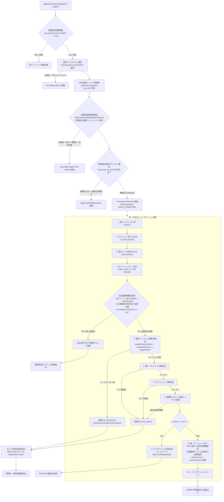
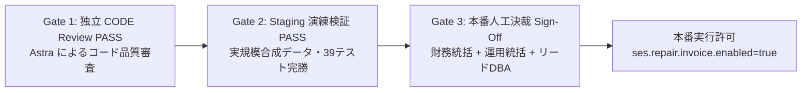

# V182 修復エグゼキュータ 境界 A（電子インボイス集約）最小実装計画書 (Repair Executor Boundary A Plan)

> [!IMPORTANT]
> **本計画書のステータス**: **PLAN REVIEW PENDING（独立計画レビュー待ち）**
> 本計画書は、V182 本番運用手順書（`v182-production-runbook-draft.md`）第 8 節に規定されたトランザクション境界「境界 A（電子インボイス集約）」に対する**最初の最小コード実装切片（First Minimal Implementation Slice）**の技術計画を定義する。
> 本切片において**Java コード・テストコードの実装は一切開始せず、Peppol・外部アカウント・本番デプロイへの拡張も行わない**。Astra による独立 Plan Review の承認完了後に実装フェーズへ移行する。

---

## 1. 目的・適用範囲・演練ヘルパーとの厳格な区分 (Objectives, Scope & Distinction)

### 1.1 目的
`V182__nf09_tenant_scope_hardening.sql` の適用直後に生成される `t_nf09_scope_repair_queue` のうち、`entity_type = 'DIGITAL_INVOICE'` および `entity_type = 'DIGITAL_INVOICE_EVENT'` に隔離された未解決レコード群を、データ欠損や外鍵違反を起こさずに安全・不可分に解消するための**本番対応修復エグゼキュータ（Production Repair Executor for Boundary A）**の最小実装設計を確定する。

### 1.2 適用範囲（境界 A に厳格限定）
- **対象エンティティ**:
  1. 親デジタルインボイス: `t_digital_invoice`（BIGINT `version` 列保有）
  2. 紐づく子イベント: `t_digital_invoice_event`（`version` 列なし、3列複合外鍵 `fk_digital_invoice_event_scope` 拘束）
  3. 親インボイス修復キュー: `t_nf09_scope_repair_queue` (`entity_type = 'DIGITAL_INVOICE'`)
  4. 子イベント修復キュー: `t_nf09_scope_repair_queue` (`entity_type = 'DIGITAL_INVOICE_EVENT'`)
- **本切片の対象外（非スコープ）**:
  - `t_peppol_participant`（境界 B）および `t_external_account_reference`（境界 C）の修復
  - 本番環境への実適用・自動実行スケジューリング・CI/CD パイプラインへの組み込み

### 1.3 テスト用演練ヘルパーと本番修復エグゼキュータの厳格な区分
過去の演練テスト（`V182TenantScopeHardeningRehearsalMySqlTest`）内の `repairInvoiceInTransaction(...)` は、使い捨て（Disposable）MySQL コンテナ上での Flyway 動作検証を目的に作られた**テスト専用ヘルパーに過ぎず、本番修復エグゼキュータとしては未完成・未承認**である。

| 比較項目 | 演練テストヘルパー (`repairInvoiceInTransaction`) | 本計画で策定する本番修復エグゼキュータ |
|---|---|---|
| **実装位置** | `src/test/java/.../V182TenantScopeHardeningRehearsalMySqlTest.java` (private) | `src/main/java/com/ses/service/repair/` (正式プロダクション層) |
| **子イベント (`t_digital_invoice_event`)** | **未実装（完全無視）**。親行のみ更新し、子イベントの外鍵検査を回避。 | **完全集約実装**。親と全子イベントを同一 Tx 内でアトミックにロック・3分類・更新。 |
| **親インボイス状態判定** | 単純な NULL 更新のみ。 | 親行ロック直後の無条件バージョン検証、親 3 分類判定、および受信完了証跡に基づく已完成冪等重試の独立判定。 |
| **外鍵整合性 (`RESTRICT`)** | 子イベントが存在しない合成データでのみ成立。 | MySQL 8 の即時文単位 RESTRICT 検査を充足する精密な原値比較 UPDATE を実装。 |
| **承認検証** | 呼出引数 `callerTenant` の単純な文字列一致のみ。 | `t_approval_request` および `t_approval_action` 正本照合（用途・テナント・現在輪次充足・2名承認者・実資格）の実照合。 |
| **資格照合とフェイルクローズ** | ロール判定なし（無条件通過）。 | `RepairApprovalQualificationService` による厳格照合。未登録・失効・照会失敗は一律 Fail-Closed（管理者の財務自動フォールバック禁止）。 |
| **完成証跡の格納** | なし（コンソールログのみ）。 | 現行 `t_nf09_scope_repair_queue.resolution_note`（VARCHAR(500)）を代表載体とし、SHA-256 圧縮ハッシュによる定長コンパクト証跡を同一 Tx 内で不可分永続化。 |
| **操作者と承認者の分離** | 呼出引数をそのまま更新者として使用。 | 実行操作者（`executorUserId`）を認証コンテキストから取得して `resolved_by` に記録し、承認責任者・決裁票番号と明確に分離。 |
| **障害現場保全** | ロールバック時にエラーログをコンソール出力するのみ。 | ロールバックに巻き込まれない独立 Tx / 外部ファイルへの完全診断保全（原例外保持・suppressed 付加）。 |
| **ステータス** | テスト検証完了済 (Rehearsal Fact) | **新規最小実装計画中 (PLAN REVIEW PENDING)** |

---

## 2. 呼出入口・トランザクション境界・実行フロー (Ingress, Transaction Boundary & Execution Flow)

### 2.1 エンドツーエンド呼出フロー
修復処理は、CLI や Web 等の入口から厳格に統制されたゲートウェイを経由し、単一の不可分トランザクション内で実行された後、結果または障害現場証拠を独立保全する。



### 2.2 単一トランザクション境界（`@Transactional`）
- **コアサービスインターフェース**:
  ```java
  public interface DigitalInvoiceScopeRepairService {
      RepairResult repairInvoiceAggregate(RepairInvoiceAggregateCommand command);
  }
  ```
- 親インボイス、紐づく全子イベント、親キュー（存在する場合）、および全子イベントキューのすべての読み取り・ロック・更新・完了証跡永続化は、単一のデータベース接続・単一の `@Transactional(rollbackFor = Exception.class, isolation = Isolation.READ_COMMITTED)` 境界内で不可分に実行される。
- 中間状態で外部キー違反や部分更新が発生する余地を完全に排除し、処理途中で異常が検知された場合は例外をスローしてデータベース側で完全ロールバックする。

### 2.3 トランザクション内部での Dry-Run 判定と明示的ロールバック
Spring の `@Transactional` はメソッドが例外なく正常終了した場合、自動的にコミットを発行する。
そのため、Dry-Run を「メソッド正常終了後に外部でロールバックする」という設計は Spring のトランザクション制御下では**永続化コミット漏れを引き起こす致命的欠陥**となる。
本計画では、Dry-Run の判定を**必ずトランザクション内部で完結**させる：
```java
if (command.dryRun()) {
    // 計画された差分および影響行数を収集
    RepairResult dryRunResult = buildDryRunSimulationResult(invoice, events, parentQueue, eventQueues);
    // トランザクションを明示的にロールバックへマーク
    TransactionAspectSupport.currentTransactionStatus().setRollbackOnly();
    log.info("[DRY-RUN] トランザクション内ロールバックを実行しました。invoiceId={}", command.invoiceId());
    return dryRunResult;
}
```
これにより、データベース接続レベルで確実に `ROLLBACK` が発行され、データ不変性が物理的に保証される。

### 2.4 Service 直呼出に対する同一防護の強制
CLI 経由のみならず、将来的な内部ジョブや管理 API から `DigitalInvoiceScopeRepairService` が直接呼び出された場合でも、同一の認証コンテキスト検証、承認検証、資格検証、および有効化前置検査を強制する。
Service 実装の先頭で必ず承認検証ゲートウェイを呼び出し、未承認呼出に対する抜け道（Backdoor）を一切設けない。

### 2.5 保守ウィンドウと書込排空（Write-Drain）の必須前提
後述の固定ロック順序（親 $\to$ 子 $\to$ 親キュー $\to$ 子キュー）は、本修復エグゼキュータの並行ワーカー同士におけるデッドロックを防止する。
しかし、外部の通常業務トランザクション（インボイス編集、入金消込、外部連携バッチ等）が別順序でテーブルにアクセスする場合、データベースエンジンレベルでの交差デッドロック（MySQL 1213）を完全に排除することは数学的に不可能である。
したがって、本エグゼキュータの本番実行は以下の環境前提を必須とする：
1. **計画保守ウィンドウの確保**: 一般利用者のアクセスおよび業務 API トラフィックが遮断されていること。
2. **書込排空（Write-Drain）の完了**: インボイスおよびイベントに関連する非同期メッセージキュー、スケジュールタスクが完全に停止し、未処理トランザクションがゼロ（Drained）であることを確認していること。

---

## 3. 厳格な人工承認検証と信頼できる検証起原 (Strict Approval Verification & Authoritative Source)

### 3.1 単純な真偽値（`approved = true`）や呼出元自称ロールの物理的排除
呼出元が `approved = true` や `bypassApproval = true` などの安易なフラグを渡すことによる修復実行は**アーキテクチャレベルで物理的に拒絶（Compile / Validation Error）**する。
また、呼出元が DTO 等で自称する「役職名（`approverRole`）」や「実行操作者 ID（`executorUserId`）」は一切信用せず、認証コンテキスト、正本データベース、および資格検証サービスから直接判定する。

### 3.2 コマンド DTO および構造化承認証跡（DTO 仕様）
呼出元引数から改変可能な操作者 ID や役職自称を排除した DTO 構成とする：

```java
public record RepairInvoiceAggregateCommand(
    Long invoiceId,
    String targetTenantId,
    Long targetLegalEntityId,
    Long expectedInvoiceVersion,
    boolean dryRun,
    ScopeRepairApprovalEvidence approvalEvidence
) {}

public record ScopeRepairApprovalEvidence(
    String approvalTicketId,       // 正式起票決裁番号（例: "APPR-20261026-INV-0089"、t_approval_request.request_no と照合）
    Long approverUserId1,          // 承認責任者 1（sys_user.id、正の整数値、決裁主体 1）
    Long approverUserId2,          // 承認責任者 2（sys_user.id、正の整数値、決裁主体 2、approverUserId1 と異なること）
    String targetTenantId,         // 承認対象テナント ID（command.targetTenantId と完全一致必須）
    Long targetLegalEntityId,      // 承認対象法人 ID（command.targetLegalEntityId と完全一致必須）
    Long targetInvoiceVersion,     // 申請時点の親インボイス version（command.expectedInvoiceVersion と完全一致必須）
    Instant approvalTimestamp,     // 承認確定日時（t_approval_request.finalized_at と照合）
    String justificationSummary    // 帰属決定の証拠原本（例: "基本契約書CNT-2026-089および課税事業者番号照合済"）
) {}
```

### 3.3 信頼できる正本データベース照合（Authoritative DB Verification）
「連携時」「存在する場合」といった曖昧な仮定表現を全廃し、修復実行前に以下の厳格な正本クエリおよび資格照合を実行する。いずれか 1 項目でも不整合または照合不能である場合は、直ちに `SecurityException` または `ApprovalRequiredException` をスローして実行を拒絶する。

1. **申請レコードの用途・テナント・対象・版・終端ステータス検証 (`t_approval_request`)**:
   - `ApprovalRequestMapper` により `t_approval_request WHERE request_no = :evidence.approvalTicketId` を照合。
   - `request_type` が厳密に `'DIGITAL_INVOICE_SCOPE_REPAIR'` であること（修復用途への厳格バインド）。
   - `tenant_id` がコマンドの `targetTenantId` と完全一致すること（テナント境界への厳格バインド）。
   - `target_type` が厳密に `'DIGITAL_INVOICE'` であること。
   - `target_id` がコマンドの `invoiceId` と完全一致すること（**別インボイスの承認流用・クロスリプレイの絶対禁止**）。
   - `target_version` がコマンドの `expectedInvoiceVersion` と完全一致すること（**申請後にインボイスが更新された場合の無効化・データ変更後リプレイの絶対禁止**）。
   - `status` が厳密に `'approved'`（小文字固定）であること。未決裁（`requested`, `in_review`）や却下（`rejected`）、差戻し（`returned`）行は即座に拒絶。
   - `round_no` を取得し、現在の申請有効輪次 `currentRoundNo` として確定。
   - `payload_json` をパースし、承認された `targetTenantId` および `targetLegalEntityId` が、コマンド指定スコープと**1 文字の狂いもなく完全一致**すること。
2. **現在輪次アクションの選択と旧輪次履歴の分離扱い (`t_approval_action`)**:
   - `ApprovalActionMapper` により、申請レコードの現在輪次に厳密に合致する承認アクションのみを選択抽出する：
     ```sql
     SELECT * FROM t_approval_action
      WHERE request_id = :req.id
        AND round_no = :req.round_no
        AND action = 'APPROVE';
     ```
   - **旧輪次履歴の扱い**: 差戻し等による過去輪次（`action.round_no < req.round_no`）のアクション行は、監査履歴としてデータベース上に正当に残存するが、**現輪次の承認成立判定からは完全に除外・無視**する。過去のアクションが存在すること自体を理由として拒絶してはならない。
   - **現輪次充足の検証**: 現在輪次（`round_no == req.round_no`）のアクションのみを用いて、申請レコードの承認ルートスナップショット（`route_snapshot_json`）に規定された全必要スロットが漏れなく充足されているかを検証する。
   - **旧輪次流用補填の絶対拒絶**: 現輪次の承認枠が 1 名分でも不足している場合に、過去輪次の承認アクションを流用・継ぎ接ぎして承認枠を穴埋めしようとする試みは、直ちに `ApprovalInvalidException` で拒絶する。
3. **業務承認資格プロバイダと Fail-Closed 原則 (`RepairApprovalQualificationService`)**:
   - 承認者 2 名（`approverUserId1` および `approverUserId2`）が互いに異なる実在ユーザーであること（`approverUserId1 != approverUserId2`）。
   - 現輪次の有効な `t_approval_action` において、`approverUserId1` および `approverUserId2` が実際に承認アクションを発行していること。
   - **一般ロール（`sys_user.role`）は十分条件ではない**:
     単に `sys_user.role` が `管理者` や `マネージャー` であることのみを根拠として業務承認資格を認めてはならない。
   - **管理者の財務資格フォールバック絶対禁止**:
     「管理者ロール（`ROLE_管理者`）を保有しているから財務統括責任者資格を代行・兼務可能である」とする安易なフォールバックは物理的に禁止する。財務統括責任者としての明示的な資格付与が必要である。
   - **可信資格プロバイダ契約**:
     以下のサービス契約を定義し、厳格に照合する：
     ```java
     public interface RepairApprovalQualificationService {
         QualificationValidationResult validateQualification(
             Long userId,
             RepairQualificationType requiredQualification, // FINANCE_DIRECTOR, SALES_DIRECTOR, SYSTEM_ADMIN
             String tenantId,
             Instant evaluationTime
         );
     }
     ```
   - **Fail-Closed 判定規約**:
     以下のいずれかに該当する場合、いかなる例外も認めず直ちに `SecurityException` で Fail-Closed 拒絶する：
     1. 資格マッピングにユーザーが未設定・未登録
     2. 人工サインオフ（職務任命決裁原本参照）が未完了
     3. 資格が取り消されている（`revokedFlag == true`）
     4. 評価時点が有効期間外（`evaluationTime < effectiveFrom` または `evaluationTime > effectiveTo`）
     5. 資格の適用テナント管轄が一致しない（他テナント向け資格の流用）
     6. 資格プロバイダの呼出失敗・接続タイムアウト
   - **本番資格名簿のステータス**:
     資格判定の技術的契約はコードで確定するが、本番環境において誰が `FINANCE_DIRECTOR` や `SALES_DIRECTOR` の資格を持つかの実員名簿および任命決裁は **HUMAN PENDING（人工資格決裁待ち）** として管理する。
4. **承認有効期限の検証（提案値 / PENDING）**:
   - `approvalTimestamp` および DB の `finalized_at` からの経過時間を検証。
   - 提案有効期限: **承認確定後 7 日以内（168 時間: `PT168H`）**。未来日時または期限切れの承認は拒絶。
   > [!NOTE]
   > 有効期限「7 日間」は現時点の設計提案値であり、本番運用決裁（PENDING）において正式な SLA として確定される。
5. **実行操作者（Executor）の認証コンテキストからの取得**:
   - コマンド引数による操作者指定を廃止し、`SecurityContextHolder.getContext().getAuthentication()`（`SecurityUtils.currentUserId()`）から認証済みユーザー ID を直接取得する。
   - 認証コンテキストが存在しない、または無効な場合は直ちに `AuthenticationCredentialsNotFoundException` で拒絶。
6. **キュー結案時の `resolved_by` と構造化完了証跡の記録**:
   - `t_nf09_scope_repair_queue` の更新時、`resolved_by` には**実際にコマンドを実行した操作者（`executorUserId`）**を記録する。
   - 代表載体キューの `resolution_note` には後述 4.2 節に規定する定長コンパクトな構造化受信完了証跡 JSON を格納し、承認責任者・決裁番号・輪次・修復前後バージョン・参加キュー集合ダイジェストを不可分に記録する。

### 3.4 テスト用フィクスチャの本番バックドア化防止
テスト実行で使用される合成承認フィクスチャ（例: `ticketId = "TEST-MOCK-APPR-001"`）およびモック資格プロバイダは、Spring プロファイルが `@Profile("test")` である環境においてのみ有効なモック検証器として分離する。
本番プロファイル（`prod`）においては、モックフィクスチャは完全に無効化され、データベース上の正式な `t_approval_request` 行および本番資格プロバイダの存在を例外なく要求する。

---

## 4. ロック階層・親インボイスおよび子イベントの 3 分類・精密更新 (Locking, 3-Way Classification & Precision Updates)

### 4.1 決定論的ロック階層順序（Deterministic Lock Ordering）
並行する修復ワーカー間のデッドロック（MySQL 1213）を防止するため、全プロセスで以下のロック階層順序を厳格に順守する：

```
階層 1: t_digital_invoice (単一行 FOR UPDATE)
   ↓
階層 2: t_digital_invoice_event (digital_invoice_id 指定、必ず id ASC で FOR UPDATE)
   ↓
階層 3: t_nf09_scope_repair_queue (親インボイスキュー行が存在する場合のみ FOR UPDATE)
   ↓
階層 4: t_nf09_scope_repair_queue (子イベントキュー全行、必ず entity_id ASC で FOR UPDATE)
```

### 4.2 完成証跡格納・代表載体決定・已完成冪等重試の独立判定

#### (1) 完成証跡格納の課題と確定載体設計 (Carrier Architecture for VARCHAR(500))
`t_nf09_scope_repair_queue.resolution_note` は `VARCHAR(500) NULL` であるため、無界のキュー ID 配列（例: 50 件以上の子イベント ID）をそのまま平文格納すると容易に 500 文字を超過し、データ切り捨てまたは SQL エラー（Data truncation）を招く。
本計画では、新たなマイグレーションやテーブル追加（V185 等の不正採番）を行わず、現行スキーマの `resolution_note` を唯一の確定載体として以下の設計により完全に閉環する：

1. **定長コンパクトなシリアライズフォーマット (Bounded Compact JSON)**:
   無界な ID 配列の平文格納を廃止し、参加キュー件数 `qc` と、ソート済み参加キュー ID 列の SHA-256 ダイジェスト `qh`（64 文字の小文字 16 進数）による暗号学的集合要約を採用する：
   ```json
   {
     "v": 1,
     "type": "REP_COMPL",
     "ticket": "APPR-20261026-INV-0089",
     "round": 1,
     "invId": 10089,
     "tenant": "tenant-1",
     "legalEntity": 100,
     "pCls": "P2",
     "vBf": 0,
     "vAf": 1,
     "qc": 5,
     "qh": "e3b0c44298fc1c149afbf4c8996fb92427ae41e4649b934ca495991b7852b855",
     "by": 1,
     "at": "2026-10-28T16:30:00Z"
   }
   ```
   - **容量・サイズ分析**:
     - `ticket`: 最大 32 文字
     - `tenant`: 最大 50 文字
     - `qh`: 厳密に 64 文字
     - 固定構文・数値項目: 約 100 文字
     - **通常長**: 約 230 文字（最大入力時でも約 280 文字）。
     - 子イベント数が 1 件でも 10,000 件でも、文字列長は $O(1)$ であり **VARCHAR(500) の容量上限（500 文字）内に常に安全に収まる**。
   - **境界検証と截断禁止**:
     更新発行前に Java 側で `serializedNote.length() <= 500` を厳格検証。万一 500 文字を超過した場合は**決して截断（Truncation）せず、直ちに `IllegalStateException` を送出して全量ロールバック**する。
   - **集合精密検証の担保**:
     重試判定時、対象インボイスに属する参加キュー群の ID をソートして `sha256(ids.join(","))` を計算し、`qh` および件数 `qc` と完全一致することを検証。これにより、1 要素の脱落・改ざんも許容しない暗号学的一致性を保証する。

2. **代表載体決定規約 (Deterministic Carrier Selection Rule)**:
   親キューおよび子キューの存在状態に応じ、完了証跡を永続化・照会する「代表載体キュー（`carrierQueue`）」を一意・決定論的に定義する：
   $$\text{carrierQueue} = \begin{cases}
   q_{\text{parent}} & \text{if } q_{\text{parent}} \text{ が存在し、かつ } q_{\text{parent}}.\text{status} == \text{'PENDING'} \\
   \min_{q \in Q_{\text{child\_participating}}} (q.\text{id}) & \text{if } q_{\text{parent}} \text{ が NO\_QUEUE または } q_{\text{parent}}.\text{status} == \text{'RESOLVED'}
   \end{cases}$$
   - **親 PENDING 時**: 親キュー自身が主代表載体となる。
   - **父 NO_QUEUE ＋ 子 PENDING 時**: 親キューが存在しないため、本トランザクションで結案される**最小 ID の子イベントキュー `min(child_queue.id)` が代表載体**となる。
   - **父 RESOLVED ＋ 子 PENDING 時**: 親キューは既に過去の決裁（Ticket-Old）で結案済であり、既存の `resolution_note` は**過去の監査証跡として一切改変・上書きせず現状保持**する。今回の修復（Ticket-New）の完了証跡は、本トランザクションで結案される**最小 ID の子イベントキュー `min(child_queue.id)` に格納**する。
   - **他参加子キューの処置**:
     代表載体以外の子キューには、コンパクトな参照メモ（例: `"[CHILD_RESOLVED] carrierId=" + carrierQueueId + " ticket=" + ticket`、約 60 文字）を記録する。

#### (2) 独立判定: 受信完了証跡に基づく已完成冪等重試
親行ロック取得後、直ちに代表載体キューの受信完了証跡を評価し、同一チケットによる過去の完了事実を独立判定する：

- **判定手順**:
  1. 代表載体候補を特定：
     - 親キューが存在し、その `resolution_note` が本承認チケット番号（`approval.requestNo`）を含むかを確認。
     - 親キューが不在、または親キューが他チケットで結案済の場合は、本インボイスに紐づく子イベントキューのうち最小の `min(child_queue.id)` を代表載体として検査。
  2. 代表載体キューの `status == 'RESOLVED'` であり、`resolution_note` が正常な完了証跡 JSON としてパースできること。
  3. 完了証跡内の各項目が現在の呼出パラメータと完全一致すること：
     - `ticket == approval.requestNo`, `round == approval.roundNo`
     - `invId == command.invoiceId`
     - `tenant == command.targetTenantId`, `legalEntity == command.targetLegalEntityId`
     - `vBf == approval.targetVersion`
  4. **修復分類に応じた精密バージョン整合**:
     親行の現在 DB 実バージョン `lockedParentVersion` が、完了証跡の `vAf`（`parentVersionAfter`）と厳密に一致すること：
     - **P-2（親行回填済）の場合**: 親行が UPDATE されたため `vAf == approval.targetVersion + 1` であり、`lockedParentVersion == approval.targetVersion + 1` であること。
     - **P-1（親行既一致・子回填またはキュー結案のみ）の場合**: 親行は UPDATE されていないため `vAf == approval.targetVersion` であり、`lockedParentVersion == approval.targetVersion`（変化量 +0）であること。
  5. **外部版改変の拒絶**:
     もし `lockedParentVersion != vAf`（例: `lockedParentVersion > vAf`、修復完了後に別業務トランザクションによってインボイスが更新された場合）は、**已完成冪等重試とは認めず、直ちに `OptimisticLockingFailureException` を送出して全量ロールバック**する。
  6. **参加集合暗号学的照合**:
     現在 DB 上の該当キュー集合から計算した件数および `sha256` ハッシュが、証跡の `qc` および `qh` と完全一致すること。
     また、V182 マイグレーション時点で元々健全でありキューが生成されなかった行（合法 `NO_QUEUE` 行）は、キュー不在のままターゲットスコープを保持していることを確認する。
  7. 親インボイスおよび全子イベントがターゲットスコープを完全に保持していること。

- **処置**:
  - 上記条件をすべて満たす場合、`ALREADY_COMPLETED_IDEMPOTENT_RETRY` と認定する。
  - **DML は一切発行せず（0 発行）**、親・子・キュー・バージョンのいずれも変更しない。
  - `RepairResult.skippedAlreadyResolved(invoiceId, lockedParentVersion, "本決裁チケットによる修復は既に完了しています（冪等スキップ）")` を返却して正常終了する。

#### (3) 通常実行経路（初回実行・Dry-Run・非本次改変）における無条件バージョン合致検証
上記 (2) の已完成冪等重試に該当しない場合、親インボイスの 3 分類判定へ進む前に、以下のバージョン合致を**無条件に検証**する：

$$\text{lockedParentVersion} == \text{command.expectedInvoiceVersion} == \text{approval.targetVersion}$$

- **検証ルール**:
  - `lockedParentVersion != command.expectedInvoiceVersion` または `lockedParentVersion != approval.targetVersion` の場合、いかなる場合も例外なく**直ちに `OptimisticLockingFailureException`（または `StaleVersionException`）を送出して全量ロールバック**する。
- **保護の対象と意義**:
  - **P-2（欠落回填）**: 申請後に他処理によってデータが更新された場合の Lost Update を防止。
  - **P-1（スコープ既一致・初回結案）**:
    スコープ値がターゲットと一致している場合であっても、DB 実バージョンが申請版や期待版と異なる場合（何者かによってインボイスが更新されている場合）は**陳旧バージョンとして確実に拒絶**する（P-1 陳旧バージョン負例の担保）。
  - **Dry-Run**: ドライラン時も同一の無条件バージョン検査を通過させることで、実版不一致時の擬似成功報告を物理的に排除。

#### (4) 親インボイスの 3 分類（Parent Invoice 3-Way Classification）
上記 (3) のバージョン合致をパスしたレコードに対し、承認済親スコープ `(:targetTenantId, :targetLegalEntityId)` に照らして 3 分類を実施する：

1. **分類 P-1（完全一致・検証済 / Fully Consistent）**:
   - 条件: `lockedParentTenantId == targetTenantId && lockedParentLegalEntityId == targetLegalEntityId`
   - 処置: **親インボイスへの UPDATE は発行しない（バージョンもインクリメントしない、変化量 +0）**。親スキップフラグを立て、子イベントの検査・回填へ進む。
2. **分類 P-2（欠落回填・非衝突 / Missing Backfill, Consistent）**:
   - 条件: `(lockedParentTenantId == null || lockedParentLegalEntityId == null)` かつ
     `(lockedParentTenantId == null || lockedParentTenantId.equals(targetTenantId))` かつ
     `(lockedParentLegalEntityId == null || lockedParentLegalEntityId.equals(targetLegalEntityId))`
   - 網羅例:
     - `tenant_id`・`legal_entity_id` 共に NULL
     - `tenant_id` は一致、`legal_entity_id` のみ NULL
     - `tenant_id` のみ NULL、`legal_entity_id` は一致
   - 処置: 後述 4.5 (1) の CAS UPDATE を発行し、欠落分量を回填する（バージョン変化量 +1）。
3. **分類 P-3（非空分量衝突・フェイルストップ / Non-null Component Conflict）**:
   - 条件: `(lockedParentTenantId != null && !lockedParentTenantId.equals(targetTenantId)) || (lockedParentLegalEntityId != null && !lockedParentLegalEntityId.equals(targetLegalEntityId))`
   - 処置: **直ちに `ConflictException` をスローしてトランザクション全体を ROLLBACK**。未解決キューを `PENDING` に維持し、現場診断を保全する。

### 4.3 子イベントの 3 分類（Child Events 3-Way Classification）
ロック取得された全子イベント（$M$ 件）をループし、承認済親スコープに対して逐項分類する：

1. **分類 E-1（完全一致・検証済）**:
   - 条件: `event.tenant_id == targetTenantId && event.legal_entity_id == targetLegalEntityId`
   - 処置: 既に整合しているため UPDATE は発行しない。カウント $N_1$ を加算。
2. **分類 E-2（欠落回填・非衝突）**:
   - 条件: `(event.tenant_id == null || event.legal_entity_id == null)` かつ非 NULL 分量がターゲットと一致。
   - 処置: 回填対象リストに追加。カウント $N_2$ を加算。
3. **分類 E-3（非空分量衝突・フェイルストップ）**:
   - 条件: 非 NULL 分量がターゲット親スコープと相違・矛盾している。
   - 処置: **直ちに `ConflictException` をスローしてトランザクション全体を ROLLBACK**。

### 4.4 トランザクション原子性と完了証跡の不可分コミット規約
1. **業務 DML と完了証跡の不可分性**:
   - 親インボイスの更新（P-2 時）、分類 E-2 子イベントの更新、および代表載体キュー・子キューへの完了証跡書き込みは、**単一のデータベーストランザクション内で不可分にコミット**される。
   - 完了証跡の JSON 生成失敗、文字列長 500 超過、キュー CAS 更新行数 0 件、DB 障害等のいかなる異常においても、トランザクション全体がロールバックされ、データ・キュー共に処理開始前の状態へ完全復元される。
2. **外部ファイルによる代替の禁止**:
   - データベース外のログファイルや JSON ダンプは障害時の事後診断用であり、**トランザクション内完了証跡の代替として使用することは厳格に禁止**する。

### 4.5 実スキーマ準拠の更新 SQL と NULL-Safe 原値比較・逐行影響数検証

#### (1) 親インボイスの version CAS 更新（分類 P-2 の場合のみ発行）
```sql
UPDATE t_digital_invoice
   SET tenant_id = :targetTenantId,
       legal_entity_id = :targetLegalEntityId,
       version = version + 1
 WHERE id = :invoiceId
   AND version = :expectedInvoiceVersion
   AND tenant_id <=> :lockedParentTenantId
   AND legal_entity_id <=> :lockedParentLegalEntityId;
```
- **検証**: 更新行数が厳密に `1` であること。`0` の場合は他トランザクションによる更新とみなし、即座に `OptimisticLockingFailureException` をスローしてロールバック。
- 分類 P-1 の場合は SQL 発行自体をスキップする。

#### (2) 分類 E-2 子イベントの精密原値比較 UPDATE
MySQL 8 の複合外部キー `fk_digital_invoice_event_scope` は文単位で即時 RESTRICT 評価される。親インボイスが整合状態にあることを前提に、分類 E-2 のイベントを 1 行ずつ実行する：
```sql
UPDATE t_digital_invoice_event
   SET tenant_id = :targetTenantId,
       legal_entity_id = :targetLegalEntityId
 WHERE id = :eventId
   AND digital_invoice_id = :invoiceId
   AND tenant_id <=> :lockedEventTenantId
   AND legal_entity_id <=> :lockedEventLegalEntityId;
```
- **検証**: 各文の更新行数が厳密に `1` であること。分類 E-2 の全 $N_2$ 件にわたり合計影響行数が厳密に $N_2$ 行であることを検証する。

#### (3) 代表載体キューの CAS 結案および定長完了証跡格納
前述 4.2 (1) 節で決定された代表載体キュー（親キュー、または親が NO_QUEUE/RESOLVED の場合は `min(child_queue.id)`）に対し：
```sql
UPDATE t_nf09_scope_repair_queue
   SET status = 'RESOLVED',
       resolved_at = NOW(),
       resolved_by = :executorUserId,
       resolution_note = :compactCompletionJson,
       version = version + 1
 WHERE id = :carrierQueueId
   AND status = 'PENDING'
   AND version = :expectedCarrierQueueVersion;
```
- **検証**: 更新行数 == 1。
- `:compactCompletionJson` の文字列長 $\le 500$ であることを事前検証。

#### (4) その他の参加キュー全行の CAS 結案
代表載体以外で本トランザクションにて結案される各キュー行に対し：
```sql
UPDATE t_nf09_scope_repair_queue
   SET status = 'RESOLVED',
       resolved_at = NOW(),
       resolved_by = :executorUserId,
       resolution_note = :referenceNote,
       version = version + 1
 WHERE id = :participatingQueueId
   AND status = 'PENDING'
   AND version = :expectedQueueVersion;
```
- **検証**: 各行更新行数 == 1。

---

## 5. 業務行と修復キューの状態遷移マトリクス・エッジケース (Business Row vs Queue State Matrix & Edge Cases)

各エンティティ（親インボイスまたは子イベント）について、業務行のスコープ状態と修復キューの状態の組み合わせを以下のように厳密に統制する。
バインディング関係は `(entity_type, entity_id)` およびコマンド契約で指定された `expectedVersion` により検証する。

### 5.1 状態組み合わせマトリクス

| 業務行スコープ状態 | キュー状態 (`t_nf09_scope_repair_queue`) | エグゼキュータの確定動作 | 整合性保護理由 |
|---|---|---|---|
| **MISSING_SCOPE** (欠落あり) | **NO_QUEUE** (キュー不在) | **即時 REJECT (`IllegalStateException`)** | V182 初期隔離から漏れた異常孤立行。データ整合性障害として手動調査を強制。 |
| **MISSING_SCOPE** (欠落あり) | **PENDING** | **CAS UPDATE 実行** | 正当な修復対象。前提条件（承認・資格・バージョン・分類）成立後に親・子・キューを更新。 |
| **MISSING_SCOPE** (欠落あり) | **RESOLVED** | **即時 REJECT (`IllegalStateException`)** | キューは解決済みなのに実データが未解決という矛盾。障害として即時中断。 |
| **CONSISTENT_SCOPE** (完全一致) | **NO_QUEUE** (キュー不在) | **LEGAL SKIP (正当スキップ)** | 健全レコード。元々修復不要でありキューが存在しないことが正常。DML なし。 |
| **CONSISTENT_SCOPE** (完全一致) | **PENDING** | **キューのみ CAS 結案 (`[IDEMPOTENT_CLOSE]`)** | バージョン合致前提。親/子 DML をスキップし、キューのみ PENDING $\to$ RESOLVED へ進める。※版不一致時は即 REJECT。 |
| **CONSISTENT_SCOPE** (完全一致) | **RESOLVED** | **已完成冪等重試または REJECT** | 同一チケット・代表載体完了証跡・版（P-2: +1, P-1: +0）完全合致時は合法スキップ。それ以外（不整合・別チケット・外部版改変）は REJECT。 |
| **CONFLICT_SCOPE** (非空衝突) | 任意 (NO_QUEUE / PENDING / RESOLVED) | **即時 REJECT (`ConflictException`)** | 非 NULL スコープの再帰属は本境界で禁止。Fail-Stop し全量ロールバック。 |
| 任意 | **UNKNOWN_STATUS** (PENDING/RESOLVED 以外) | **即時 REJECT (`IllegalStateException`)** | 不正なキュー状態。予期せぬデータ破壊を防ぐため即時停止。 |

### 5.2 混合状態および特殊シナリオの処置規約
1. **父 NO_QUEUE ＋ 子 PENDING**:
   - 親インボイスは元々健全（スコープ完備）のためキュー不在。
   - 子イベントのみが修復対象。親行 UPDATE は発行せず（親バージョン変化量 +0）、分類 E-2 子イベントを更新。
   - 代表載体として `min(child_queue.id)` に完了証跡（`pCls = "P1"`, `vBf = vAf = lockedParentVersion`）を格納。
2. **父 RESOLVED ＋ 子 PENDING**:
   - 親インボイスは過去の修復等で既に `RESOLVED` であり、その監査証跡が親キューに格納済。
   - 親キューの既存証跡を保護するため、親キューには一切上書きしない。
   - 子イベントのみを更新し、代表載体として `min(child_queue.id)` に今回の完了証跡を格納。
3. **バインディング誤り（Mismatched Binding）**:
   - キューの `entity_type` と `entity_id` が対象テーブルのレコードと結合できない場合、直ちに `IllegalStateException` で拒絶。
4. **過期バージョン（Stale Version）**:
   - コマンドで指定された `expectedVersion` または `approval.targetVersion` と DB の現在 `version` が異なる場合、親行ロック直後の無条件検証または CAS UPDATE で検知され `OptimisticLockingFailureException` を送出してロールバック。

---

## 6. トランザクション全量ロールバックと現場取証設計 (Atomic Rollback & Forensic Evidence Design)

### 6.1 トランザクション全量ロールバック（All-or-Nothing）
処理途中でいかなる例外（ロック待ちタイムアウト 1205、デッドロック 1213、CAS 更新行数 0 件、分類 P-3/E-3 衝突、外部キー違反 1452、無条件バージョン不一致、資格検証失敗、証跡長 500 文字超過）が発生した場合も、Spring の `@Transactional` によりデータベース接続は即座に `ROLLBACK` される。
親インボイス、全子イベント、および親・子キューテーブルの状態は、処理開始前の状態へと完全に復元される（部分結案ゼロの物理的保証）。

### 6.2 既有機能と新規設計機能の厳格な区分
現場取証および検証において、既存サービスと本切片で新設するコンポーネントの責務を厳格に区分する：

| 区分 | コンポーネント・メソッド | 状態 | 責務・トランザクション境界 |
|---|---|---|---|
| **既有** | `SysUserMapper.selectById(...)` | 既存 | 承認者・操作者アカウントの検索・実ロール確認 |
| **既有** | `ApprovalRequestMapper.selectOne(...)` | 既存 | 正本承認レコード（`t_approval_request`）の検索 |
| **既有** | `ApprovalActionMapper.selectList(...)` | 既存 | 承認アクション（`t_approval_action`）の検索 |
| **既有** | `AuditLogService.record(...)` | 既存 | API 監査ログのベストエフォート記録（例外握りつぶし型） |
| **新規** | `RepairApprovalQualificationService` | **新設** | **業務承認資格の検証（Fail-Closed・管理者の財務フォールバック禁止）** |
| **新規** | `DigitalInvoiceScopeRepairForensicsService` | **新設** | **主 Tx 外で動作する障害現場証拠保全サービス** |
| **新規** | `recordFailureEvidence(...)` | **新設** | 0600 JSON 出力および `Propagation.REQUIRES_NEW` 監査記録 |

### 6.3 主トランザクション外での独立証拠保全と例外伝播規約
1. **主 Tx ロールバック後の独立取証**:
   - 障害現場の保全は、主トランザクションがロールバックされた後、外側の catch ブロックにおいて独立して実行される。
2. **例外伝播と根本原因保全の鉄則**:
   - 取証処理（ファイル書き込みや独立監査ログ永続化）の内部で万一例外（Disk Full、Permission Denied 等）が発生した場合でも、**元の業務例外・根本原因（Root Cause）を絶対に隠蔽・握りつぶしてはならない**。
   - 取証処理自体の失敗例外は、元の例外オブジェクトへ `suppressedException.addSuppressed(...)` として付加して再スローする。
   - 呼出元に対して成功ステータス（`200 OK` 等）を偽装して返却することは厳格に禁止する。

### 6.4 実行主体・承認責任者・承認単据の明確な分離記録
現場証跡には、以下の主体を混同せずに明確に分離して記録する：
- `executorUserId`: 認証コンテキストから取得された実際のコマンド実行操作者（`sys_user.id`）。
- `approverUserIds`: 決裁申請を現輪次で正式承認した責任者一覧（`List<Long>`、例: `[42, 43]`）。
- `approvalTicketId`: 承認の根拠となった正本決裁番号（`t_approval_request.request_no`）。
- `approvalRoundNo`: 承認が成立した現在有効輪次番号（`t_approval_request.round_no`）。

### 6.5 現場証跡ファイル仕様・ファイル権限・機微情報脱敏
1. **出力ファイル仕様**:
   - 出力パス: `${ses.repair.evidence-dir:logs/repair-evidence}/repair-failure-INV-{invoiceId}-{timestamp}.json`
   - ファイルパーミッション: **POSIX `0600`（所有者のみ読み書き可能、グループ・他者アクセス禁止）**。ディレクトリは `0700`。Windows 環境では実行サービスアカウントおよび Administrators のみに制限された ACL を設定。
2. **記録最小フィールドセット**:
   ```json
   {
     "evidenceId": "550e8400-e29b-41d4-a716-446655440000",
     "timestamp": "2026-10-28T16:30:00Z",
     "invoiceId": 10089,
     "executorUserId": 1,
     "approverUserIds": [42, 43],
     "approvalTicketId": "APPR-20261026-INV-0089",
     "approvalRoundNo": 1,
     "commandExpectedVersion": 0,
     "dbCurrentVersion": 0,
     "lockedParentScope": { "tenantId": null, "legalEntityId": null },
     "classificationSummary": {
       "parentClassification": "P_2_MISSING_BACKFILL",
       "childClassificationCounts": { "E_1": 1, "E_2": 1, "E_3": 1 }
     },
     "failurePhase": "CLASSIFICATION_CONFLICT",
     "sqlErrorCode": null,
     "sqlState": null,
     "exceptionClass": "com.ses.common.exception.ConflictException",
     "errorMessage": "子イベント 2005 のスコープ (tenant-2) がターゲット (tenant-1) と衝突しています",
     "sanitizedStackTrace": "com.ses.common.exception.ConflictException: ..."
   }
   ```
3. **機微情報脱敏（Data Sanitization）**:
   - 顧客の売上金額（`total_amount`）、税額、品目名、銀行口座番号、顧客担当者氏名・電話番号・メールアドレス等の**業務上の秘密・個人情報（PII）は一切 JSON に出力しない**。
   - 記録対象はスコープ識別子（`tenant_id`, `legal_entity_id`）、主キー ID、バージョン番号、および技術的診断トレースのみとする。

---

## 7. 検証テストマトリクス・MySQL 割当・AI-1 引渡規約 (Test Matrix, MySQL Shard Allocation & AI-1 Queue)

### 7.1 包括的テストマトリクス（全 39 シナリオ）

| テスト ID | シナリオ概要 | 入力・対象データ条件 | 期待結果・検証アサーション | 実行環境・担当区分 |
|---|---|---|---|---|
| **TC-REP-BND-01** | 正常系・完全回填 (P-2) | 親 NULL (ver=0) + 子 2 件 NULL + キュー 3 件 PENDING | 親・子ともに回填完了、親 ver=1 (+1)、完了証跡保存、全キュー RESOLVED、`resolved_by = executor` | Fast H2 & MySQL (両方) |
| **TC-REP-BND-02** | 正常系・親 legal_entity 単独欠落回填 (P-2) | 親: `tenant-1`, `null`。子: `tenant-1`, `null` | 分類 P-2 / E-2。`legal_entity=100` 回填、親 ver=1 (+1)、完了証跡保存、全キュー RESOLVED | Fast H2 & MySQL (両方) |
| **TC-REP-BND-03** | 正常系・親 tenant_id 単独欠落回填 (P-2) | 親: `null`, `100`。子: `null`, `100` | 分類 P-2 / E-2。`tenant-1` 回填、親 ver=1 (+1)、完了証跡保存、全キュー RESOLVED | Fast H2 & MySQL (両方) |
| **TC-REP-BND-04** | 正常系・親既一致かつ子回填要 (P-1) | 親: `tenant-1`, `100` (ver=0)。子 1: 一致。子 2: NULL | 分類 P-1（親 UPDATE なし、ver=0 維持・変化量 +0）。子 2 のみ回填、完了証跡保存 | Fast H2 & MySQL (両方) |
| **TC-REP-BND-05a** | 正常系・TC01 (P-2) 完了後同票再実行 | TC-REP-BND-01 完了済、同一 ticket、親 ver=1 (=verBefore+1) | 構造化完了証跡完全合致。DML=0、`SKIPPED_ALREADY_RESOLVED` 返却 | Fast H2 & MySQL (両方) |
| **TC-REP-BND-05b** | 正常系・TC04 (P-1) 完了後同票再実行 | TC-REP-BND-04 完了済、同一 ticket、親 ver=0 (=verBefore+0) | 構造化完了証跡完全合致。DML=0、`SKIPPED_ALREADY_RESOLVED` 返却 | Fast H2 & MySQL (両方) |
| **TC-REP-BND-05c** | 正常系・TC06 (P-1 結案のみ) 完了後同票再実行 | TC-REP-BND-06 完了済、同一 ticket、親 ver=0 (=verBefore+0) | 構造化完了証跡完全合致。DML=0、`SKIPPED_ALREADY_RESOLVED` 返却 | Fast H2 & MySQL (両方) |
| **TC-REP-BND-05d** | 正常系・合法無キュー混在行完了後再実行 | 健全子行が NO_QUEUE を維持、参加キューのみ結案済 | 構造化完了証跡合致。DML=0、`SKIPPED_ALREADY_RESOLVED` 返却 | Fast H2 & MySQL (両方) |
| **TC-REP-BND-05e** | 異常系・完了証跡存在後の外部版改変拒絶 | 完了証跡は存在するが、DB 実バージョンが `parentVersionAfter` より大きい | 外部改変検知。`OptimisticLockingFailureException` 送出、全量ロールバック | Fast H2 & MySQL (両方) |
| **TC-REP-BND-06** | 正常系・无需修復行のキュー単独結案 (P-1) | 親・子既一致 (ver=0) だがキュー PENDING | バージョン合致。親・子 DML ゼロ件 (親 ver=0 維持)、キューのみ CAS 結案 (`[IDEMPOTENT_CLOSE]`) | Fast H2 & MySQL (両方) |
| **TC-REP-BND-07** | 正常系・ドライラン不変性検証 | `dryRun = true` で実行 | トランザクション内ロールバック実行。DB 変更ゼロ件、計画差分返却 | Fast H2 & MySQL (両方) |
| **TC-REP-BND-08** | 異常系・親インボイス非空衝突拒絶 | 親 `tenant_id = 'tenant-2'`（ターゲットと相違） | 分類 P-3 検知。即時 Fail-Stop、Tx ロールバック、キュー PENDING 維持 | Fast H2 & MySQL (両方) |
| **TC-REP-BND-09** | 異常系・子イベント非空衝突拒絶 | 親 NULL。子 1 は NULL。子 2 は `tenant-2` | 分類 E-3 検知。即時 Fail-Stop、Tx ロールバック、現場証拠出力 | Fast H2 & MySQL (両方) |
| **TC-REP-BND-10** | 異常系・未承認 / 承認欠落拒絶 | コマンドに承認証跡なし、または DB にチケット不在 | `ApprovalRequiredException` 送出。Tx 開始前に即時拒絶 | Fast H2 & MySQL (両方) |
| **TC-REP-BND-11** | 異常系・承認スコープ相違拒絶 | チケットの承認先が `(tenant-9, entity-900)` | `SecurityException` 送出。ターゲット相違を検知して即時拒絶 | Fast H2 & MySQL (両方) |
| **TC-REP-BND-12** | 異常系・期限切れ承認拒絶 | チケットの `finalized_at` が 8 日前（7 日超過） | `ApprovalExpiredException` 送出。有効期限切れを検知して拒絶 | Fast H2 & MySQL (両方) |
| **TC-REP-BND-13** | 異常系・跨発注 / 異インボイス重放拒絶 | 別インボイス番号 `target_id = 9999` の承認チケットを使用 | `target_id` 不一致を検知して即時拒絶 | Fast H2 & MySQL (両方) |
| **TC-REP-BND-14** | 異常系・データ変更後重放拒絶 | 申請後に対象インボイスの `version` が更新された | `target_version` 不一致を検知して即時拒絶 | Fast H2 & MySQL (両方) |
| **TC-REP-BND-15** | 異常系・キュー欠落（野良 NULL 孤立行）拒絶 | 親スコープ NULL であるにもかかわらずキュー不在 | `MISSING_SCOPE_NO_QUEUE` を検知、`IllegalStateException` で停止 | Fast H2 & MySQL (両方) |
| **TC-REP-BND-16** | 異常系・親インボイス CAS バージョン競合 | `expectedInvoiceVersion = 0` に対し実値 `version = 1` | 無条件バージョン検証失敗。`OptimisticLockingFailureException`、全量ロールバック | Fast H2 & MySQL (両方) |
| **TC-REP-BND-17** | 異常系・MySQL 外部キー RESTRICT 拒絶 | 子イベントを親と異なるスコープで更新試行 | MySQL エラー 1452 発生。即時ロールバック、現場証跡保全 | **Real MySQL 必須（Docker / AI-1 排隊）** |
| **TC-REP-BND-18** | 異常系・行ロック競合タイムアウト | 別接続が親インボイスをロック保持 | MySQL 1205 タイムアウト検知。即時ロールバック、現場証跡保全 | **Real MySQL 必須（Docker / AI-1 排隊）** |
| **TC-REP-BND-19** | 異常系・整組不可分ロールバック検証 | 子イベントキュー結案時のみ意図的例外発生 | 親・全子・全キューの全更新が取り消され、完全ロールバック確認 | Fast H2 & MySQL (両方) |
| **TC-REP-BND-20** | 異常系・取証書き込み失敗時の原例外保全 | 取証ファイル書き込み時に意図的に IOException 発生 | 元の業務例外を root cause、取証失敗を suppressed で送出 | Fast H2 & MySQL (両方) |
| **TC-REP-BND-21** | 異常系・P-1 スコープ既一致時の陳旧バージョン拒絶 | 親スコープ既一致だが DB 実バージョン `version = 2` (expected=0) | 親行ロック直後の無条件バージョン検査で即時拒絶。P-1 スキップ不可 | Fast H2 & MySQL (両方) |
| **TC-REP-BND-22a** | 正常系・旧輪次履歴存在下での現輪次完全充足 | 過去 round_no=1 の履歴が存在するが、現在 round_no=2 で全枠充足 | 過去アクションは監査保持し現輪次のみで正当判定 -> **通過 (PASS)** | Fast H2 & MySQL (両方) |
| **TC-REP-BND-22b** | 異常系・現輪次不足・旧輪次流用補填試行拒絶 | 現在 round_no=2 が 1 名不足、round_no=1 の古いアクションで穴埋め試行 | 輪次混用を検知。`ApprovalInvalidException` で即時拒絶 | Fast H2 & MySQL (両方) |
| **TC-REP-BND-23a** | 異常系・管理者ロールの財務資格フォールバック拒絶 | `sys_user.role = '管理者'` だが資格プロバイダに財務資格マッピング不在 | 管理者の財務自動フォールバックを排除。`SecurityException` で即時拒絶 | Fast H2 & MySQL (両方) |
| **TC-REP-BND-23b** | 異常系・業務承認資格の失効 / 期限切れ拒絶 | 資格登録はあるが `revokedFlag = true` または評価時刻が有効期限外 | 資格失効を検知。`SecurityException` で Fail-Closed 即時拒絶 | Fast H2 & MySQL (両方) |
| **TC-REP-BND-23c** | 異常系・テナント管轄外資格拒絶 | テナント A 用に付与された資格でテナント B の修復を承認試行 | テナント不一致を検知。`SecurityException` で Fail-Closed 即時拒絶 | Fast H2 & MySQL (両方) |
| **TC-REP-BND-24** | 異常系・実行操作者冒用拒絶 | 認証コンテキストと異なるユーザー ID を実行者として詐称試行 | 認証コンテキストからの直接取得により冒用を無効化／未認証時即時拒絶 | Fast H2 & MySQL (両方) |
| **TC-REP-BND-25a** | 正常系・大量子イベント長参与集合のハッシュ圧縮結案と重試 | 子イベント 50 件 (qCnt=50)、qHash 64文字。全体長 260 文字 $\le$ 500 | VARCHAR(500) 内格納、再実行時 SHA-256 照合合致、DML=0 重試成功 | Fast H2 & MySQL (両方) |
| **TC-REP-BND-25b** | 異常系・完了証跡 500 文字超過フェイルクローズ | 不正な過長パラメータで証跡が 500 文字超過 | 截断を禁止し `IllegalStateException` 送出、全量ロールバック | Fast H2 & MySQL (両方) |
| **TC-REP-BND-26a** | 正常系・父 NO_QUEUE ＋ 子 PENDING 初回実行 | 親スコープ完備 (キューなし)、子 2 件 PENDING | 親 ver=0 (+0)。`min(childQueue.id)` に証跡格納、全子キュー RESOLVED | Fast H2 & MySQL (両方) |
| **TC-REP-BND-26b** | 正常系・父 NO_QUEUE ＋ 子 PENDING 完了後同票再実行 | TC-REP-BND-26a 完了済、同一 ticket | `min(childQueue.id)` 照合合致。DML=0、`SKIPPED_ALREADY_RESOLVED` 返却 | Fast H2 & MySQL (両方) |
| **TC-REP-BND-26c** | 異常系・父 NO_QUEUE ＋ 子 PENDING 途中失敗全量ロールバック | 子キュー 2 の結案時に例外発生 | 子イベント更新もロールバック、親・子共に開始前の整合状態復元 | Fast H2 & MySQL (両方) |
| **TC-REP-BND-27a** | 正常系・父 RESOLVED ＋ 子 PENDING 初回実行 | 親キューは過去 Ticket-Old で結案済、子 2 件 PENDING | 親キュー証跡を現状保持、`min(childQueue.id)` に Ticket-New 証跡格納 | Fast H2 & MySQL (両方) |
| **TC-REP-BND-27b** | 正常系・父 RESOLVED ＋ 子 PENDING 完了後同票再実行 | TC-REP-BND-27a 完了済、Ticket-New で再実行 | 親旧証跡を保護しつつ `min(childQueue.id)` 照合合致。DML=0 スキップ | Fast H2 & MySQL (両方) |
| **TC-REP-BND-27c** | 異常系・父 RESOLVED ＋ 子 PENDING 途中失敗全量ロールバック | 子キュー結案時に例外発生 | 親キューの既存証跡が上書き破壊されないことを確認、子も PENDING 維持 | Fast H2 & MySQL (両方) |

### 7.2 テストクラス設計と環境責務
- **Fast Feedback 単体テスト**:
  - クラス名: `DigitalInvoiceScopeRepairServiceTest`
  - 対象: Spring H2 テスト環境において、TC-REP-BND-01〜04, 05a〜05e, 06〜16, 19〜27c を高速回帰テストとして実行。
- **Real MySQL 統合テスト**:
  - クラス名: `DigitalInvoiceScopeRepairMySqlTest`
  - 配置先: `src/test/java/com/ses/repair/DigitalInvoiceScopeRepairMySqlTest.java`
  - テストタグ: `@Tag("mysql")`
  - 対象: Docker tmpfs 上の MySQL 8 コンテナを用い、MySQL 固有の即時 RESTRICT（TC-REP-BND-17）および InnoDB 行ロック待ち診断（TC-REP-BND-18）を含む全シナリオを実証。

### 7.3 MySQL シャード登録と AI-1 への明確な引き渡し
`MySqlTestShardInventoryTest` の整合性を維持するため、本計画で策定する `DigitalInvoiceScopeRepairMySqlTest` は、以下の単一シャードファイルへ登録することを確定する：
- **割当シャード**: `scripts/test-suites/mysql-shard-1.txt`（末尾追加）
- **AI-1 への引き渡し表明**:
  本計画策定フェーズにおいて Java / Test コードの実装およびテスト実行（Maven / Docker）は一切行わない。実装完了後の実 MySQL 実行・CI ゲート通過は、**AI-1 の実行キューへ排隊（Queued for AI-1）**として引き渡す。

---

## 8. 実行エントリポイントの本番安全防護と有効化ゲート (Execution Ingress Safety & Activation Gates)

### 8.1 デフォルト安全防護（Safety by Default）
誤操作や未承認実行による本番障害を物理的に防止するため、CLI バッチツール `DigitalInvoiceScopeRepairCli` に以下の多重インターロックを組み込む：

1. **本番無効化プロパティ（Feature Toggle）**:
   - `application.yml` の既定値: `ses.repair.invoice.enabled: false`
   - `false` の状態で実行された場合、CLI は直ちに終了コード `1` で停止し、標準エラー出力へ印字して停止する：
     ```text
     [FATAL] 修復エグゼキュータは安全のため本番無効化されています。
     実行には明示的な有効化プロパティ (ses.repair.invoice.enabled=true) と正式な承認証跡が必要です。
     ```
2. **ドライラン既定有効（Dry-Run by Default）**:
   - `--dry-run` オプションの既定値は `true`。
   - 明示的に `--dry-run=false` が渡されない限り、前述 2.3 節のトランザクション内ロールバックが必ず作動する。

### 8.2 本番実有効化の 3 大前置ゲート (Production Activation Gates)
本エグゼキュータを本番環境で実行可能とするためには、以下の 3 つの承認ゲートをすべて通過しなければならない：



1. **Gate 1: 独立 CODE Review PASS（Astra）**:
   - 本計画に基づく Java 実装・Mapper・CLI・テストコードが、Astra による独立コードレビューにおいて `CODE REVIEW PASS` を獲得すること。
2. **Gate 2: Staging 演練検証 PASS**:
   - Staging 環境において、合成データを用いた TC-REP-BND-01〜27c（全 39 パターン）がすべて PASS し、Postflight SQL-06（野良 NULL ゼロ件）が実証されること。
3. **Gate 3: 本番人工決裁サインオフ（実決裁完了）**:
   - 財務統括責任者（インボイス帰属の業務承認）
   - 運用統括責任者（保守ウィンドウ確保およびトラフィック遮断承認）
   - リード DBA（PITR 準備完了・Binlog 保持確認）
   - 上記 3 名による正式な書面／電子決裁が完了すること。

---

## 9. 署名・承認記録 (Sign-Off Register)

| レビュー役職 | 氏名 | 承認ステータス | 承認日 | 承認コメント / 判定 |
|---|---|---|---|---|
| **独立 Reviewer** | Astra | **PLAN REVIEW PENDING** | - | 境界 A 最小実装計画書の独立審査待ち（完成証跡確定載体・容量境界・父NO_QUEUE/RESOLVED閉環反映版） |
| **技術仕様担当 / 執筆者** | AI-3 (gpt-6-luna) | **SUBMITTED** | 2026-10-28 | Astra P2 指摘事項（VARCHAR(500)上限対応・SHA-256集合ハッシュ圧縮・代表載体決定規約・父NO_QUEUE/RESOLVED原子コミット・全39テスト）を反映し再提出 |
