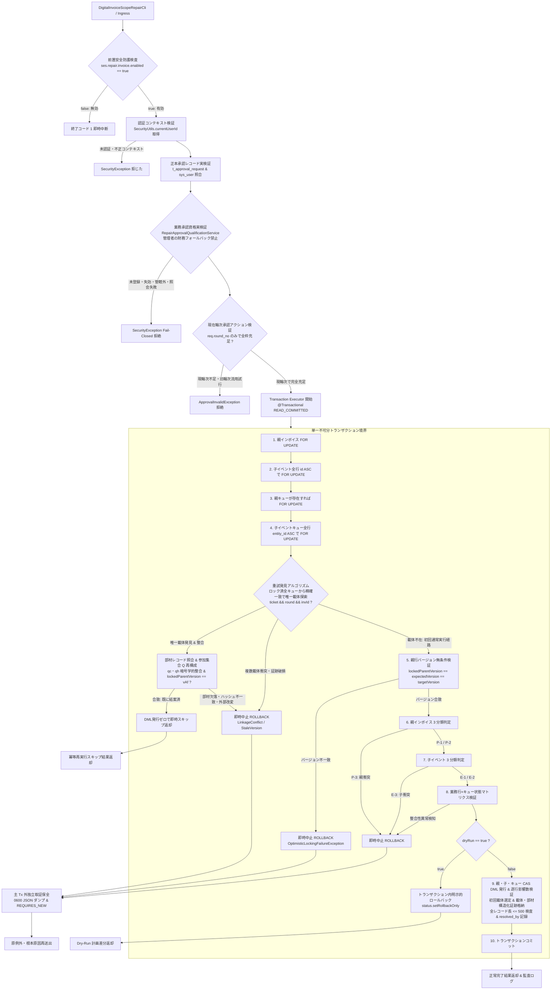

# V182 修復エグゼキュータ 境界 A（電子インボイス集約）最小実装計画書 (Repair Executor Boundary A Plan)

> [!IMPORTANT]
> **本計画書のステータス**: **PLAN REVIEW PENDING（独立計画レビュー待ち）**
> 本計画書は、V182 本番運用手順書（`v182-production-runbook-draft.md`）第 8 節に規定されたトランザクション境界「境界 A（電子インボイス集約）」に対する**最初の最小コード実装切片（First Minimal Implementation Slice）**の技術計画を定義する。
> 本切片において**Java コード・テストコードの実装は一切開始せず、Peppol・外部アカウント・本番デプロイへの拡張も行わない**。Astra による独立 Plan Review の承認完了後に実装フェーズへ移行する。

---

## 1. 目的・適用範囲・演練ヘルパーとの厳格な区分 (Objectives, Scope & Distinction)

### 1.1 目的
`V182__nf09_tenant_scope_hardening.sql` の適用直後に生成される `t_nf09_scope_repair_queue` のうち、`entity_type = 'DIGITAL_INVOICE'` および `entity_type = 'DIGITAL_INVOICE_EVENT'` に隔離された未解決レコード群を、データ欠損や外鍵違反を起こさずに安全・不可分に解消するための**本番対応修復エグゼキュータ（Production Repair Executor for Boundary A）**の最小実装設計を確定する。

### 1.2 適用範囲（境界 A に厳格限定）
- **対象エンティティ**:
  1. 親デジタルインボイス: `t_digital_invoice`（BIGINT `version` 列保有）
  2. 紐づく子イベント: `t_digital_invoice_event`（`version` 列なし、3列複合外鍵 `fk_digital_invoice_event_scope` 拘束）
  3. 親インボイス修復キュー: `t_nf09_scope_repair_queue` (`entity_type = 'DIGITAL_INVOICE'`)
  4. 子イベント修復キュー: `t_nf09_scope_repair_queue` (`entity_type = 'DIGITAL_INVOICE_EVENT'`)
- **本切片の対象外（非スコープ）**:
  - `t_peppol_participant`（境界 B）および `t_external_account_reference`（境界 C）の修復
  - 本番環境への実適用・自動実行スケジューリング・CI/CD パイプラインへの組み込み

### 1.3 テスト用演練ヘルパーと本番修復エグゼキュータの厳格な区分
過去の演練テスト（`V182TenantScopeHardeningRehearsalMySqlTest`）内の `repairInvoiceInTransaction(...)` は、使い捨て（Disposable）MySQL コンテナ上での Flyway 動作検証を目的に作られた**テスト専用ヘルパーに過ぎず、本番修復エグゼキュータとしては未完成・未承認**である。

| 比較項目 | 演練テストヘルパー (`repairInvoiceInTransaction`) | 本計画で策定する本番修復エグゼキュータ |
|---|---|---|
| **実装位置** | `src/test/java/.../V182TenantScopeHardeningRehearsalMySqlTest.java` (private) | `src/main/java/com/ses/service/repair/` (正式プロダクション層) |
| **子イベント (`t_digital_invoice_event`)** | **未実装（完全無視）**。親行のみ更新し、子イベントの外鍵検査を回避。 | **完全集約実装**。親と全子イベントを同一 Tx 内でアトミックにロック・3分類・更新。 |
| **親インボイス状態判定** | 単純な NULL 更新のみ。 | 親行ロック直後の無条件バージョン検証、親 3 分類判定、および精確フィールド一致に基づく已完成冪等重試の独立判定。 |
| **外鍵整合性 (`RESTRICT`)** | 子イベントが存在しない合成データでのみ成立。 | MySQL 8 の即時文単位 RESTRICT 検査を充足する精密な原値比較 UPDATE を実装。 |
| **承認検証** | 呼出引数 `callerTenant` の単純な文字列一致のみ。 | `t_approval_request` および `t_approval_action` 正本照合（用途・テナント・現在輪次充足・2名承認者・実資格）の実照合。 |
| **資格照合とフェイルクローズ** | ロール判定なし（無条件通過）。 | `RepairApprovalQualificationService` による厳格照合。未登録・失効・照会失敗は一律 Fail-Closed（管理者の財務自動フォールバック禁止）。 |
| **完成証跡の格納・重試発見** | なし（コンソールログのみ）。 | 初回選定（親優先／最小参加子）と重試発見（精確フィールド一致）を明確に分離。載体・部材構造化 JSON と SHA-256 集合再構成により確実に検証。 |
| **操作者と承認者の分離** | 呼出引数をそのまま更新者として使用。 | 実行操作者（`executorUserId`）を認証コンテキストから取得して `resolved_by` に記録し、承認責任者・決裁票番号と明確に分離。 |
| **障害現場保全** | ロールバック時にエラーログをコンソール出力するのみ。 | ロールバックに巻き込まれない独立 Tx / 外部ファイルへの完全診断保全（原例外保持・suppressed 付加）。 |
| **ステータス** | テスト検証完了済 (Rehearsal Fact) | **新規最小実装計画中 (PLAN REVIEW PENDING)** |

---

## 2. 呼出入口・トランザクション境界・実行フロー (Ingress, Transaction Boundary & Execution Flow)

### 2.1 エンドツーエンド呼出フロー
修復処理は、CLI や Web 等の入口から厳格に統制されたゲートウェイを経由し、単一の不可分トランザクション内で実行された後、結果または障害現場証拠を独立保全する。



### 2.2 単一トランザクション境界（`@Transactional`）
- **コアサービスインターフェース**:
  ```java
  public interface DigitalInvoiceScopeRepairService {
      RepairResult repairInvoiceAggregate(RepairInvoiceAggregateCommand command);
  }
  ```
- 親インボイス、紐づく全子イベント、親キュー（存在する場合）、および全子イベントキューのすべての読み取り・ロック・更新・完了証跡永続化は、単一のデータベース接続・単一の `@Transactional(rollbackFor = Exception.class, isolation = Isolation.READ_COMMITTED)` 境界内で不可分に実行される。
- 中間状態で外部キー違反や部分更新が発生する余地を完全に排除し、処理途中で異常が検知された場合は例外をスローしてデータベース側で完全ロールバックする。

### 2.3 トランザクション内部での Dry-Run 判定と明示的ロールバック
Spring の `@Transactional` はメソッドが例外なく正常終了した場合、自動的にコミットを発行する。
そのため、Dry-Run を「メソッド正常終了後に外部でロールバックする」という設計は Spring のトランザクション制御下では**永続化コミット漏れを引き起こす致命的欠陥**となる。
本計画では、Dry-Run の判定を**必ずトランザクション内部で完結**させる：
```java
if (command.dryRun()) {
    // 計画された差分および影響行数を収集
    RepairResult dryRunResult = buildDryRunSimulationResult(invoice, events, parentQueue, eventQueues);
    // トランザクションを明示的にロールバックへマーク
    TransactionAspectSupport.currentTransactionStatus().setRollbackOnly();
    log.info("[DRY-RUN] トランザクション内ロールバックを実行しました。invoiceId={}", command.invoiceId());
    return dryRunResult;
}
```
これにより、データベース接続レベルで確実に `ROLLBACK` が発行され、データ不変性が物理的に保証される。

### 2.4 Service 直呼出に対する同一防護の強制
CLI 経由のみならず、将来的な内部ジョブや管理 API から `DigitalInvoiceScopeRepairService` が直接呼び出された場合でも、同一の認証コンテキスト検証、承認検証、資格検証、および有効化前置検査を強制する。
Service 実装の先頭で必ず承認検証ゲートウェイを呼び出し、未承認呼出に対する抜け道（Backdoor）を一切設けない。

### 2.5 保守ウィンドウと書込排空（Write-Drain）の必須前提
後述の固定ロック順序（親 $\to$ 子 $\to$ 親キュー $\to$ 子キュー）は、本修復エグゼキュータの並行ワーカー同士におけるデッドロックを防止する。
しかし、外部の通常業務トランザクション（インボイス編集、入金消込、外部連携バッチ等）が別順序でテーブルにアクセスする場合、データベースエンジンレベルでの交差デッドロック（MySQL 1213）を完全に排除することは数学的に不可能である。
したがって、本エグゼキュータの本番実行は以下の環境前提を必須とする：
1. **計画保守ウィンドウの確保**: 一般利用者のアクセスおよび業務 API トラフィックが遮断されていること。
2. **書込排空（Write-Drain）の完了**: インボイスおよびイベントに関連する非同期メッセージキュー、スケジュールタスクが完全に停止し、未処理トランザクションがゼロ（Drained）であることを確認していること。

---

## 3. 厳格な人工承認検証と信頼できる検証起原 (Strict Approval Verification & Authoritative Source)

### 3.1 単純な真偽値（`approved = true`）や呼出元自称ロールの物理的排除
呼出元が `approved = true` や `bypassApproval = true` などの安易なフラグを渡すことによる修復実行は**アーキテクチャレベルで物理的に拒絶（Compile / Validation Error）**する。
また、呼出元が DTO 等で自称する「役職名（`approverRole`）」や「実行操作者 ID（`executorUserId`）」は一切信用せず、認証コンテキスト、正本データベース、および資格検証サービスから直接判定する。

### 3.2 コマンド DTO および構造化承認証跡（DTO 仕様）
呼出元引数から改変可能な操作者 ID や役職自称を排除した DTO 構成とする：

```java
public record RepairInvoiceAggregateCommand(
    Long invoiceId,
    String targetTenantId,
    Long targetLegalEntityId,
    Long expectedInvoiceVersion,
    boolean dryRun,
    ScopeRepairApprovalEvidence approvalEvidence
) {}

public record ScopeRepairApprovalEvidence(
    String approvalTicketId,       // 正式起票決裁番号（例: "APPR-20261026-INV-0089"、t_approval_request.request_no と照合）
    Long approverUserId1,          // 承認責任者 1（sys_user.id、正の整数値、決裁主体 1）
    Long approverUserId2,          // 承認責任者 2（sys_user.id、正の整数値、決裁主体 2、approverUserId1 と異なること）
    String targetTenantId,         // 承認対象テナント ID（command.targetTenantId と完全一致必須）
    Long targetLegalEntityId,      // 承認対象法人 ID（command.targetLegalEntityId と完全一致必須）
    Long targetInvoiceVersion,     // 申請時点の親インボイス version（command.expectedInvoiceVersion と完全一致必須）
    Instant approvalTimestamp,     // 承認確定日時（t_approval_request.finalized_at と照合）
    String justificationSummary    // 帰属決定の証拠原本（例: "基本契約書CNT-2026-089および課税事業者番号照合済"）
) {}
```

### 3.3 信頼できる正本データベース照合（Authoritative DB Verification）
「連携時」「存在する場合」といった曖昧な仮定表現を全廃し、修復実行前に以下の厳格な正本クエリおよび資格照合を実行する。いずれか 1 項目でも不整合または照合不能である場合は、直ちに `SecurityException` または `ApprovalRequiredException` をスローして実行を拒絶する。

1. **申請レコードの用途・テナント・対象・版・終端ステータス検証 (`t_approval_request`)**:
   - `ApprovalRequestMapper` により `t_approval_request WHERE request_no = :evidence.approvalTicketId` を照合。
   - `request_type` が厳密に `'DIGITAL_INVOICE_SCOPE_REPAIR'` であること（修復用途への厳格バインド）。
   - `tenant_id` がコマンドの `targetTenantId` と完全一致すること（テナント境界への厳格バインド）。
   - `target_type` が厳密に `'DIGITAL_INVOICE'` であること。
   - `target_id` がコマンドの `invoiceId` と完全一致すること（**別インボイスの承認流用・クロスリプレイの絶対禁止**）。
   - `target_version` がコマンドの `expectedInvoiceVersion` と完全一致すること（**申請後にインボイスが更新された場合の無効化・データ変更後リプレイの絶対禁止**）。
   - `status` が厳密に `'approved'`（小文字固定）であること。未決裁（`requested`, `in_review`）や却下（`rejected`）、差戻し（`returned`）行は即座に拒絶。
   - `round_no` を取得し、現在の申請有効輪次 `currentRoundNo` として確定。
   - `payload_json` をパースし、承認された `targetTenantId` および `targetLegalEntityId` が、コマンド指定スコープと**1 文字の狂いもなく完全一致**すること。
2. **現在輪次アクションの選択と旧輪次履歴の分離扱い (`t_approval_action`)**:
   - `ApprovalActionMapper` により、申請レコードの現在輪次に厳密に合致する承認アクションのみを選択抽出する：
     ```sql
     SELECT * FROM t_approval_action
      WHERE request_id = :req.id
        AND round_no = :req.round_no
        AND action = 'APPROVE';
     ```
   - **旧輪次履歴の扱い**: 差戻し等による過去輪次（`action.round_no < req.round_no`）のアクション行は、監査履歴としてデータベース上に正当に残存するが、**現輪次の承認成立判定からは完全に除外・無視**する。過去のアクションが存在すること自体を理由として拒絶してはならない。
   - **現輪次充足の検証**: 現在輪次（`round_no == req.round_no`）のアクションのみを用いて、申請レコードの承認ルートスナップショット（`route_snapshot_json`）に規定された全必要スロットが漏れなく充足されているかを検証する。
   - **旧輪次流用補填の絶対拒絶**: 現輪次の承認枠が 1 名分でも不足している場合に、過去輪次の承認アクションを流用・継ぎ接ぎして承認枠を穴埋めしようとする試みは、直ちに `ApprovalInvalidException` で拒絶する。
3. **業務承認資格プロバイダと Fail-Closed 原則 (`RepairApprovalQualificationService`)**:
   - 承認者 2 名（`approverUserId1` および `approverUserId2`）が互いに異なる実在ユーザーであること（`approverUserId1 != approverUserId2`）。
   - 現輪次の有効な `t_approval_action` において、`approverUserId1` および `approverUserId2` が実際に承認アクションを発行していること。
   - **一般ロール（`sys_user.role`）は十分条件ではない**:
     単に `sys_user.role` が `管理者` や `マネージャー` であることのみを根拠として業務承認資格を認めてはならない。
   - **管理者の財務資格フォールバック絶対禁止**:
     「管理者ロール（`ROLE_管理者`）を保有しているから財務統括責任者資格を代行・兼務可能である」とする安易なフォールバックは物理的に禁止する。財務統括責任者としての明示的な資格付与が必要である。
   - **可信資格プロバイダ契約**:
     以下のサービス契約を定義し、厳格に照合する：
     ```java
     public interface RepairApprovalQualificationService {
         QualificationValidationResult validateQualification(
             Long userId,
             RepairQualificationType requiredQualification, // FINANCE_DIRECTOR, SALES_DIRECTOR, SYSTEM_ADMIN
             String tenantId,
             Instant evaluationTime
         );
     }
     ```
   - **Fail-Closed 判定規約**:
     以下のいずれかに該当する場合、いかなる例外も認めず直ちに `SecurityException` で Fail-Closed 拒絶する：
     1. 資格マッピングにユーザーが未設定・未登録
     2. 人工サインオフ（職務任命決裁原本参照）が未完了
     3. 資格が取り消されている（`revokedFlag == true`）
     4. 評価時点が有効期間外（`evaluationTime < effectiveFrom` または `evaluationTime > effectiveTo`）
     5. 資格の適用テナント管轄が一致しない（他テナント向け資格の流用）
     6. 資格プロバイダの呼出失敗・接続タイムアウト
   - **本番資格名簿のステータス**:
     資格判定の技術的契約はコードで確定するが、本番環境において誰が `FINANCE_DIRECTOR` や `SALES_DIRECTOR` の資格を持つかの実員名簿および任命決裁は **HUMAN PENDING（人工資格決裁待ち）** として管理する。
4. **承認有効期限の検証（提案値 / PENDING）**:
   - `approvalTimestamp` および DB の `finalized_at` からの経過時間を検証。
   - 提案有効期限: **承認確定後 7 日以内（168 時間: `PT168H`）**。未来日時または期限切れの承認は拒絶。
   > [!NOTE]
   > 有効期限「7 日間」は現時点の設計提案値であり、本番運用決裁（PENDING）において正式な SLA として確定される。
5. **実行操作者（Executor）の認証コンテキストからの取得**:
   - コマンド引数による操作者指定を廃止し、`SecurityContextHolder.getContext().getAuthentication()`（`SecurityUtils.currentUserId()`）から認証済みユーザー ID を直接取得する。
   - 認証コンテキストが存在しない、または無効な場合は直ちに `AuthenticationCredentialsNotFoundException` で拒絶。
6. **キュー結案時の `resolved_by` と構造化証跡の記録**:
   - `t_nf09_scope_repair_queue` の更新時、`resolved_by` には**実際にコマンドを実行した操作者（`executorUserId`）**を記録する。
   - 代表載体キューの `resolution_note` には後述 4.2 節に規定する固定プロトコル標識付き定長コンパクト構造化完了証跡（`SES_NF09_COMPL:...`）を格納し、その他の参加キューには固定標識構造化部材参照（`SES_NF09_MEMBER:...`）を格納する。

### 3.4 テスト用フィクスチャの本番バックドア化防止
テスト実行で使用される合成承認フィクスチャ（例: `ticketId = "TEST-MOCK-APPR-001"`）およびモック資格プロバイダは、Spring プロファイルが `@Profile("test")` である環境においてのみ有効なモック検証器として分離する。
本番プロファイル（`prod`）においては、モックフィクスチャは完全に無効化され、データベース上の正式な `t_approval_request` 行および本番資格プロバイダの存在を例外なく要求する。

---

## 4. ロック階層・親インボイスおよび子イベントの 3 分類・精密更新 (Locking, 3-Way Classification & Precision Updates)

### 4.1 決定論的ロック階層順序（Deterministic Lock Ordering）
並行する修復ワーカー間のデッドロック（MySQL 1213）を防止するため、全プロセスで以下のロック階層順序を厳格に順守する：

```
階層 1: t_digital_invoice (単一行 FOR UPDATE)
   ↓
階層 2: t_digital_invoice_event (digital_invoice_id 指定、必ず id ASC で FOR UPDATE)
   ↓
階層 3: t_nf09_scope_repair_queue (親インボイスキュー行が存在する場合のみ FOR UPDATE)
   ↓
階層 4: t_nf09_scope_repair_queue (子イベントキュー全行、必ず entity_id ASC で FOR UPDATE)
```

### 4.2 完成証跡ストレージ・初回載体選定・重試発見および集合再構成アルゴリズム

#### 4.2.1 完成証跡ストレージの課題・容量定義および固定プロトコル標識
`t_nf09_scope_repair_queue.resolution_note` は MySQL 8 スキーマ上 `VARCHAR(500) NULL`（`CHARACTER SET utf8mb4`）である。
無界なキュー ID 配列の平文格納を廃止し、参加キュー件数 `qc` と、ソート済み参加キュー ID 列の SHA-256 ダイジェスト `qh`（厳密に 64 文字の小文字 16 進数）による定長暗号学的要約を採用する。

- **容量定義の明確化（アプリケーション層の防御的バイト上限）**:
  - MySQL 8 の `VARCHAR(500) CHARACTER SET utf8mb4` は最大 500 文字（コードポイント）を格納可能である。
  - しかし本プロトコルにおける「500 制限」は、**MySQL の文字数上限定義そのものではなく、マルチバイト文字展開（1 文字最大 4 バイト）に伴う予期せぬ切り捨てリスクや照合順序依存を物理的に排除するためのアプリケーション層の防御的バイト境界（UTF-8 実バイト長 $\le 500$ バイト）**である。
  - `V182` スキーマにおいて `tenant_id` は `VARCHAR(100)`、`t_approval_request.request_no` は最大 50 文字程度を許容する。
  - 「常に 280 文字以内に収まる」といった無検証の固定長保証は行わず、更新発行前に Java 側で `serializedNote.getBytes(StandardCharsets.UTF_8).length <= 500` を絶対のガードとして検証する。
  - 万一 500 バイトを超過した場合は**決して截断（Truncation）せず、直ちに `IllegalStateException` を送出して全量ロールバック**する。

- **固定プロトコル標識による歴史的自由文との分離**:
  - 新たに書き込まれる完了証跡および部材参照には、先頭に固定かつ識別可能なプロトコル標識プレフィックスを付与する：
    - 代表載体証跡: `SES_NF09_COMPL:`
    - 参加部材参照: `SES_NF09_MEMBER:`
  - エンコーディング、発見スキャン、パース、および実バイト長検査（$\le 500$ バイト）はすべてこの形式に従う。
  - **歴史的普通備考の完全分離**:
    `resolution_note` が `null` であるか、または上記プロトコル標識で始まらない行（例: 過去のマイグレーションや旧チケットで格納された `[IDEMPOTENT_CLOSE]` や手動メンテナンスのメモ）は**歴史的普通備考として完全無視・現状維持**し、本プロトコルの修復証跡としては一切扱わない。
  - **プロトコル標識行の厳格性**:
    `SES_NF09_COMPL:` または `SES_NF09_MEMBER:` で始まる行において、JSON パースエラー、プロトコルバージョン不一致（`v != 1`）、または必須フィールドの欠落を検知した場合は、互換例外を一切設けず直ちに `CorruptedEvidenceException` を送出して全量ロールバックする。

#### 4.2.2 初回実行時における確定載体選定アルゴリズム (Carrier Selection on Initial Execution)
親インボイス集約のロック取得後、本トランザクションで修復対象となる**参加キュー集合 $Q_{\text{participating}}$（現在 `status = 'PENDING'` であるキュー群）**を確定する。
初回実行時の代表載体キュー（`carrierQueue`）は以下の規則でのみ選定する：
$$\text{carrierQueue} = \begin{cases}
q_{\text{parent}} & \text{if } q_{\text{parent}} \in Q_{\text{participating}} \text{（親キューが存在し、かつ PENDING の場合）} \\
\min_{q \in Q_{\text{participating}}} (q.\text{id}) & \text{if } q_{\text{parent}} \notin Q_{\text{participating}} \text{（親が NO\_QUEUE または既に RESOLVED の場合）}
\end{cases}$$

> [!IMPORTANT]
> **初回選定規則の適用境界**:
> 上記の「親 PENDING 優先／最小参加子選定」は**初回書き込み時にのみ適用**される決定規則である。
> 後述の重試（Retry）時には全キューが既に `RESOLVED` に遷移しているため、この選定規則を重試時に再評価してはならない（再評価すると親が RESOLVED であるため親載体を見失う等の不整合を引き起こす）。

#### 4.2.3 完了記録および部材構造化参照のシリアライズ仕様
本トランザクション内で結案される全キュー行に対し、以下の固定プロトコル標識付き厳格構造化 JSON を `resolution_note` に格納する：

1. **代表載体レコード (固定標識 `SES_NF09_COMPL:`)**:
   選定された `carrierQueue` に格納する（プレフィックス `SES_NF09_COMPL:` に続けてコンパクト JSON を連結）：
   ```text
   SES_NF09_COMPL:{"v":1,"ticket":"APPR-20261026-INV-0089","round":1,"invId":10089,"tenant":"tenant-1","legalEntity":100,"pCls":"P2","vBf":0,"vAf":1,"qc":3,"qh":"e3b0c44298fc1c149afbf4c8996fb92427ae41e4649b934ca495991b7852b855","by":1,"at":"2026-10-28T16:30:00Z"}
   ```
   - 各フィールド定義:
     - `v`: プロトコルバージョン（整数値 `1` に固定）
     - `ticket`: 決裁チケット番号（`t_approval_request.request_no`、文字列）
     - `round`: 決裁有効輪次（`t_approval_request.round_no`、正の整数）
     - `invId`: 対象インボイス主キー（`t_digital_invoice.id`、正の整数）
     - `tenant`: 修復ターゲットテナント ID（文字列）
     - `legalEntity`: 修復ターゲット法人 ID（正の整数）
     - `pCls`: 親インボイス修復分類（`"P1"` または `"P2"` の 2 値に限定）
     - `vBf`: 修復前親バージョン（`versionBefore`、整数）
     - `vAf`: 修復後親バージョン（`versionAfter`、整数。P1時は `vBf`、P2時は `vBf + 1`）
     - `qc`: 本修復で結案された参加キュー総件数（`carrier` を含む、整数 $\ge 1$）
     - `qh`: 昇順ソートした全参加キュー ID カンマ区切り列の小文字 SHA-256 16進ダイジェスト（厳密に 64 文字）
     - `by`: コマンドを実行した認証操作者 ID（`sys_user.id`、正の整数）
     - `at`: 結案確定 ISO 8601 UTC タイムスタンプ（文字列）

2. **非載体参加部材レコード (固定標識 `SES_NF09_MEMBER:`)**:
   代表載体以外の参加キュー全行（$q \in Q_{\text{participating}} \setminus \{\text{carrierQueue}\}$）に格納する（プレフィックス `SES_NF09_MEMBER:` に続けてコンパクト JSON を連結）：
   ```text
   SES_NF09_MEMBER:{"v":1,"carrierId":101,"ticket":"APPR-20261026-INV-0089","round":1}
   ```
   - 各フィールド定義:
     - `v`: プロトコルバージョン（整数値 `1` に固定）
     - `carrierId`: 本集約の代表載体キュー主キー（`carrierQueue.id`、正の整数）
     - `ticket`: 決裁チケット番号（文字列）
     - `round`: 決裁有効輪次（正の整数）
   - 単なる `contains(ticket)` のような自由テキストを完全排除し、固定プロトコル標識および `carrierId`、`ticket`、`round` を厳格にバインドした構造化レコードとする。

#### 4.2.4 重試発見アルゴリズム（精確フィールド一致による唯一載体特定と歴史的自由文の分離）
再実行（Retry）時、ロック取得済みの集約内全キュー（親キューが存在すれば親キュー＋全子イベントキュー）の中から、以下の**精確フィールド一致**により本決裁の完了証跡載体を探索する：

- **歴史的自由テキスト備考の完全分離・保護**:
  - キューの `resolution_note` が `null` であるか、または本プロトコルの固定標識（`SES_NF09_COMPL:` または `SES_NF09_MEMBER:`）で始まらない行（例: 過去の移行や旧チケットで書き込まれた `[IDEMPOTENT_CLOSE]` や手動メンテナンスメモ）：
    **非プロトコル行として完全無視（Ignored / Untouched）**し、本プロトコルの修復完了証跡としては一切扱わない。旧自由テキストの改変や削除も行わない。
- **本プロトコル標識行の厳格性（破損・未知バージョン・欠落の即時拒絶）**:
  - `resolution_note` が `SES_NF09_COMPL:` または `SES_NF09_MEMBER:` で始まる行において、以下のいずれかが検知された場合：
    1. JSON パースエラー（文法破損）
    2. プロトコルバージョン不一致（`v != 1`）
    3. 必須フィールドの欠落または NULL（`ticket`, `round`, `invId`, `tenant`, `legalEntity`, `pCls`, `vBf`, `vAf`, `qc`, `qh`, `by`, `at` 等）
    **旧自由文との互換を理由にした緩和は一切行わず、直ちに `CorruptedEvidenceException` を送出して全量ロールバック**する。
- **代表載体の精確探索条件**:
  - `status == 'RESOLVED'`
  - `resolution_note` がプレフィックス `SES_NF09_COMPL:` で始まる
  - プレフィックス除去後の JSON パースが成功し、`v == 1` かつ必須全フィールドが存在する
  - `record.ticket == approval.requestNo`
  - `record.round == approval.roundNo`
  - `record.invId == command.invoiceId`
- **載体整合性の検証**:
  1. **載体不在時（合致件数 == 0）**: 本チケット・輪次による完了証跡は存在しない。通常実行経路（初回実行または版不一致判定）へ進む。
  2. **複数載体衝突時（合致件数 > 1）**: 同一集約内に同一チケット・輪次の完了証跡載体が複数存在する。直ちに `IllegalStateException("同一決裁チケットの完了証跡載体が複数検知されました")` を送出し、Tx 全量ロールバック。
  3. **証跡破損時**: 上述のとおり直ちに `CorruptedEvidenceException` で即時拒絶。

> [!NOTE]
> **状態再評価の完全排除**:
> 重試発見において、現在のキューの PENDING / RESOLVED 状態を基に載体を再計算したり、集約内の全子キューの最小 ID を安易に推測したりしてはならない。必ず上記「精確フィールド一致」により唯一の載体行 `carrierQueue` を特定する。

#### 4.2.5 参加集合の再構成・暗号学的検証および重試時全不変条件検証アルゴリズム
特定された唯一の載体行 $q_{\text{carrier}}$（ID: `carrierId`）に基づき、集約内キューから本チケットで結案された参加集合を厳密に再構成し、全不変条件を検証する：

1. **部材キューの収集**:
   集約内キューのうち、`status == 'RESOLVED'` かつ `resolution_note` が `SES_NF09_MEMBER:` で始まり、プレフィックス除去後の JSON パースが成功し、`v == 1` で以下をすべて満たすキューを収集する：
   - `member.carrierId == carrierId`
   - `member.ticket == approval.requestNo`
   - `member.round == approval.roundNo`
   ※ `SES_NF09_MEMBER:` で始まりながら JSON パースエラー、`v != 1`、または必須項目欠落のキューを検知した場合は直ちに `CorruptedEvidenceException` で即時拒絶。
2. **再構成集合の確定**:
   $$Q_{\text{reconstructed}} = \{ q_{\text{carrier}} \} \cup Q_{\text{members}}$$
3. **暗号学的検証および参加整合性アサーション**:
   - **所属検証**: $Q_{\text{reconstructed}}$ の全キューが本インボイス集約（親または紐づく子イベント）に正当に属していること。
   - **件数検証**: `Q_reconstructed.size() == carrier.qc` であること。
   - **SHA-256 ダイジェスト検証**:
     $Q_{\text{reconstructed}}$ に含まれる全キュー ID を昇順ソートしてカンマ連結した文字列に対し、SHA-256 ハッシュを計算し、`carrier.qh` と完全一致すること。
   - **関連矛盾の排除**:
     集約内のキューで、本チケット・輪次を名乗りながら `carrierId` が異なるもの、または部材が欠落しているものが存在する場合は直ちに `LinkageConflictException` で拒絶。
   - **他決裁履歴および歴史的自由文の独立保護**:
     過去の別チケットで結案されたキューや、歴史的自由テキスト（`[IDEMPOTENT_CLOSE]` 等）を持つキューは、プレフィックスまたは `ticket` / `round` が異なるため本再構成集合には混入せず、正当に現状維持される。
   > [!IMPORTANT]
   > **旧自由テキスト存在下でも緩和されない完全性検証**:
   > 集約内に旧キューの自由テキストが存在する場合でも、本チケットの修復に関与した全参加キューは必ず `SES_NF09_COMPL:` または `SES_NF09_MEMBER:` を保持していなければならない。参加キューが 1 件でも欠落・未更新・破損している場合は、件数検証（`qc`）または SHA-256 ダイジェスト検証（`qh`）によって例外なく Fail-Stop 拒絶される。
4. **全不変条件の完全復帰検証（重試成功認定の絶対必須条件）**:
   再実行を成功と認定して `SKIPPED_ALREADY_RESOLVED` を返却する前に、以下の不変条件チェックを**例外なく全項目検証**する：
   1. **テナントスコープ一致検証**:
      `carrier.tenant.equals(command.targetTenantId)` であること。
      不一致時は直ちに `SecurityException("載体に記録されたテナントスコープがコマンド対象と一致しません: expected=" + command.targetTenantId + ", actual=" + carrier.tenant)` を送出して全量ロールバック。
   2. **法人スコープ一致検証**:
      `carrier.legalEntity.equals(command.targetLegalEntityId)` であること。
      不一致時は直ちに `SecurityException("載体に記録された法人スコープがコマンド対象と一致しません: expected=" + command.targetLegalEntityId + ", actual=" + carrier.legalEntity)` を送出して全量ロールバック。
   3. **承認正本バージョン合致検証**:
      `carrier.vBf == approval.targetVersion` であること。
      載体に記録された修復前版（vBf）が、正本決裁承認の対象バージョンと一致していることを検証。不一致時は直ちに `OptimisticLockingFailureException("載体の修復前版が決裁承認対象バージョンと一致しません: approval=" + approval.targetVersion + ", carrier=" + carrier.vBf)` を送出して全量ロールバック。
   4. **分類別バージョン整合性検証 (vAf vs vBf)**:
      - `carrier.pCls.equals("P1")` の場合:
        親更新なし（+0）であるため、厳格に `carrier.vAf == carrier.vBf` であること。不一致時は直ちに `IllegalStateException("P1 載体の修復後バージョンが修復前バージョンと一致しません: vAf=" + carrier.vAf + ", vBf=" + carrier.vBf)` を送出して全量ロールバック。
      - `carrier.pCls.equals("P2")` の場合:
        親 CAS 更新（+1）であるため、厳格に `carrier.vAf == carrier.vBf + 1` であること。不一致時は直ちに `IllegalStateException("P2 載体の修復後バージョンが修復前バージョン+1と一致しません: vAf=" + carrier.vAf + ", vBf=" + carrier.vBf)` を送出して全量ロールバック。
      - **未知分類の即時拒絶**:
        `carrier.pCls` が `"P1"` または `"P2"` 以外の値（例: `"P3"`, `"P9"`, 不正文字列等）である場合、直ちに `IllegalStateException("未知の修復分類です: " + carrier.pCls)` を送出して全量ロールバック。
   5. **親行 DB 現バージョン一致検証**:
      ロックされた親インボイスの DB 実バージョンが載体の修復後記録と厳格一致:
      `lockedParentVersion == carrier.vAf`
      不一致（外部改変）時は直ちに `OptimisticLockingFailureException` を送出して全量ロールバック。
   6. **DB 現行スコープ一致検証**:
      親インボイスおよび全子イベント行の DB 上の現在スコープが、コマンドのターゲットスコープ `(targetTenantId, targetLegalEntityId)` と完全一致していること。
   7. **決裁識別子および暗号ハッシュ合致**:
      `carrier.ticket == approval.requestNo && carrier.round == approval.roundNo && carrier.invId == command.invoiceId` かつ `Q_reconstructed.size() == carrier.qc && sha256(Q_reconstructed) == carrier.qh`。
5. **正常終了**:
   上記 1〜7 の全検証に完全合格した場合に限り、`ALREADY_COMPLETED_IDEMPOTENT_RETRY` と認定し、**DML ゼロ件（0 発行）**で `RepairResult.skippedAlreadyResolved(...)` を返却する。

---

### 4.3 親インボイスおよび子イベントの 3 分類（通常実行経路時）

前述 4.2 の重試発見で完了証跡が見つからなかった場合、通常実行経路として以下を実行する：

#### (1) 親行バージョン無条件検証
親インボイスの 3 分類判定へ進む前に、以下のバージョン合致を無条件に検証する：
$$\text{lockedParentVersion} == \text{command.expectedInvoiceVersion} == \text{approval.targetVersion}$$
不一致時は直ちに `OptimisticLockingFailureException` を送出して全量ロールバックする（P-1 陳旧バージョン負例および Dry-Run 時の厳格保護）。

#### (2) 親インボイスの 3 分類
1. **分類 P-1（完全一致・検証済）**: 親への UPDATE スキップ（親バージョン変化量 +0）。
2. **分類 P-2（欠落回填・非衝突）**: 親 CAS UPDATE 発行（親バージョン変化量 +1）。
3. **分類 P-3（非空分量衝突）**: `ConflictException` 送出、即時ロールバック。

#### (3) 子イベントの 3 分類
1. **分類 E-1（完全一致・検証済）**: UPDATE スキップ。
2. **分類 E-2（欠落回填・非衝突）**: 回填対象リストに追加。
3. **分類 E-3（非空分量衝突）**: `ConflictException` 送出、即時ロールバック。

---

### 4.4 トランザクション原子性と完了証跡の不可分コミット規約
1. **業務 DML と完了証跡の不可分性**:
   - 親インボイスの更新（P-2 時）、分類 E-2 子イベントの更新、および代表載体キュー（`SES_NF09_COMPL:`）・参加部材キュー（`SES_NF09_MEMBER:`）への証跡書き込みは、**単一のデータベーストランザクション内で不可分にコミット**される。
   - 完了証跡の JSON 生成失敗、実バイト長 500 バイト超過、キュー CAS 更新行数 0 件、DB 障害等のいかなる異常においても、トランザクション全体がロールバックされ、データ・キュー共に処理開始前の状態へ完全復元される。
2. **外部ファイルによる代替の禁止**:
   - データベース外のログファイルや JSON ダンプは障害時の事後診断用であり、**トランザクション内完了証跡の代替として使用することは厳格に禁止**する。

---

### 4.5 実スキーマ準拠の更新 SQL と NULL-Safe 原値比較・逐行影響数検証

#### (1) 親インボイスの version CAS 更新（分類 P-2 の場合のみ発行）
```sql
UPDATE t_digital_invoice
   SET tenant_id = :targetTenantId,
       legal_entity_id = :targetLegalEntityId,
       version = version + 1
 WHERE id = :invoiceId
   AND version = :expectedInvoiceVersion
   AND tenant_id <=> :lockedParentTenantId
   AND legal_entity_id <=> :lockedParentLegalEntityId;
```
- **検証**: 更新行数 == 1。分類 P-1 の場合はスキップ。

#### (2) 分類 E-2 子イベントの精密原値比較 UPDATE
```sql
UPDATE t_digital_invoice_event
   SET tenant_id = :targetTenantId,
       legal_entity_id = :targetLegalEntityId
 WHERE id = :eventId
   AND digital_invoice_id = :invoiceId
   AND tenant_id <=> :lockedEventTenantId
   AND legal_entity_id <=> :lockedEventLegalEntityId;
```
- **検証**: 各文の更新行数 == 1。全 $N_2$ 件で計 $N_2$ 行。

#### (3) 代表載体キューの CAS 結案および固定標識定長完了証跡（SES_NF09_COMPL:）格納
前述 4.2.2 項で選定された代表載体キューに対し：
```sql
UPDATE t_nf09_scope_repair_queue
   SET status = 'RESOLVED',
       resolved_at = NOW(),
       resolved_by = :executorUserId,
       resolution_note = :carrierProtocolText,
       version = version + 1
 WHERE id = :carrierQueueId
   AND status = 'PENDING'
   AND version = :expectedCarrierQueueVersion;
```
- **検証**: 更新行数 == 1。`:carrierProtocolText`（`SES_NF09_COMPL:` + コンパクト JSON）の実バイト長 $\le 500$ バイト（UTF-8）を事前検証。

#### (4) 参加部材キュー全行の CAS 結案および固定標識構造化参照（SES_NF09_MEMBER:）格納
代表載体以外の参加キュー全行に対し：
```sql
UPDATE t_nf09_scope_repair_queue
   SET status = 'RESOLVED',
       resolved_at = NOW(),
       resolved_by = :executorUserId,
       resolution_note = :memberProtocolText,
       version = version + 1
 WHERE id = :memberQueueId
   AND status = 'PENDING'
   AND version = :expectedMemberQueueVersion;
```
- **検証**: 各行更新行数 == 1。`:memberProtocolText`（`SES_NF09_MEMBER:` + コンパクト JSON）の実バイト長 $\le 500$ バイト（UTF-8）を事前検証。

---

## 5. 業務行と修復キューの状態遷移マトリクス・エッジケース (Business Row vs Queue State Matrix & Edge Cases)

### 5.1 状態組み合わせマトリクス

| 業務行スコープ状態 | キュー状態 (`t_nf09_scope_repair_queue`) | エグゼキュータの確定動作 | 整合性保護理由 |
|---|---|---|---|
| **MISSING_SCOPE** (欠落あり) | **NO_QUEUE** (キュー不在) | **即時 REJECT (`IllegalStateException`)** | V182 初期隔離から漏れた異常孤立行。データ整合性障害として手動調査を強制。 |
| **MISSING_SCOPE** (欠落あり) | **PENDING** | **CAS UPDATE 実行** | 正当な修復対象。前提条件（承認・資格・バージョン・分類）成立後に親・子・キューを更新。 |
| **MISSING_SCOPE** (欠落あり) | **RESOLVED** | **即時 REJECT (`IllegalStateException`)** | キューは解決済みなのに実データが未解決という矛盾。障害として即時中断。 |
| **CONSISTENT_SCOPE** (完全一致) | **NO_QUEUE** (キュー不在) | **LEGAL SKIP (正当スキップ)** | 健全レコード。元々修復不要でありキューが存在しないことが正常。DML なし。 |
| **CONSISTENT_SCOPE** (完全一致) | **PENDING** | **キューのみ CAS 結案 (P-1 載体・部材証跡格納)** | バージョン合致前提。親/子 DML をスキップ（親バージョン変化量 +0）し、キューのみ P-1 プロトコル証跡（pCls="P1", vAf=vBf）を格納して PENDING $\to$ RESOLVED へ進める。※版不一致時は即 REJECT。 |
| **CONSISTENT_SCOPE** (完全一致) | **RESOLVED** | **已完成冪等重試または REJECT** | 精確フィールド一致による唯一載体特定、部材照合による $Q$ 再構成、qc/qh 合致、および全不変条件検証合格時は合法スキップ（DML=0）。それ以外は REJECT。 |
| **CONFLICT_SCOPE** (非空衝突) | 任意 (NO_QUEUE / PENDING / RESOLVED) | **即時 REJECT (`ConflictException`)** | 非 NULL スコープの再帰属は本境界で禁止。Fail-Stop し全量ロールバック。 |
| 任意 | **UNKNOWN_STATUS** (PENDING/RESOLVED 以外) | **即時 REJECT (`IllegalStateException`)** | 不正なキュー状態。予期せぬデータ破壊を防ぐため即時停止。 |

### 5.2 特殊シナリオの処置規約
1. **父 NO_QUEUE ＋ 子 PENDING**:
   - 親インボイスは元々健全（スコープ完備）のためキュー不在。
   - 子イベントのみが修復対象。親行 UPDATE は発行せず（親バージョン変化量 +0）、分類 E-2 子イベントを更新。
   - 初回選定規約に基づき `min(participating_child_queue.id)` が代表載体（`SES_NF09_COMPL:`）となり、他子キューは `SES_NF09_MEMBER:` を格納。
2. **父 RESOLVED ＋ 子 PENDING**:
   - 親インボイスは過去の修復等で既に `RESOLVED` であり、その監査証跡が親キューに格納済。
   - 親キューの既存証跡を保護するため、親キューには一切上書きしない。
   - 子イベントのみを更新し、初回選定規約に基づき `min(participating_child_queue.id)` が代表載体（`SES_NF09_COMPL:`）となる。
   - 重試時は精確フィールド一致により `min(participating_child_queue.id)` が唯一載体として正しく発見され、親の旧証跡は完全に保護される。

---

## 6. トランザクション全量ロールバックと現場取証設計 (Atomic Rollback & Forensic Evidence Design)

### 6.1 トランザクション全量ロールバック（All-or-Nothing）
処理途中でいかなる例外（ロック待ちタイムアウト 1205、デッドロック 1213、CAS 更新行数 0 件、分類 P-3/E-3 衝突、外部キー違反 1452、無条件バージョン不一致、資格検証失敗、証跡長 500 文字超過、載体衝突、部材ハッシュ不一致）が発生した場合も、Spring の `@Transactional` によりデータベース接続は即座に `ROLLBACK` される。
親インボイス、全子イベント、および親・子キューテーブルの状態は、処理開始前の状態へと完全に復元される（部分結案ゼロの物理的保証）。

### 6.2 既有機能と新規設計機能の厳格な区分

| 区分 | コンポーネント・メソッド | 状態 | 責務・トランザクション境界 |
|---|---|---|---|
| **既有** | `SysUserMapper.selectById(...)` | 既存 | 承認者・操作者アカウントの検索・実ロール確認 |
| **既有** | `ApprovalRequestMapper.selectOne(...)` | 既存 | 正本承認レコード（`t_approval_request`）の検索 |
| **既有** | `ApprovalActionMapper.selectList(...)` | 既存 | 承認アクション（`t_approval_action`）の検索 |
| **既有** | `AuditLogService.record(...)` | 既存 | API 監査ログのベストエフォート記録（例外握りつぶし型） |
| **新規** | `RepairApprovalQualificationService` | **新設** | **業務承認資格の検証（Fail-Closed・管理者の財務フォールバック禁止）** |
| **新規** | `DigitalInvoiceScopeRepairForensicsService` | **新設** | **主 Tx 外で動作する障害現場証拠保全サービス** |
| **新規** | `recordFailureEvidence(...)` | **新設** | 0600 JSON 出力および `Propagation.REQUIRES_NEW` 監査記録 |

### 6.3 主トランザクション外での独立証拠保全と例外伝播規約
- 障害現場の保全は、主トランザクションがロールバックされた後、外側の catch ブロックにおいて独立して実行される。
- 取証処理自体の失敗例外は、元の業務例外へ `addSuppressed` として付加して再スローし、根本原因を絶対に隠蔽しない。成功ステータスの偽装を厳禁する。

### 6.4 実行主体・承認責任者・承認単据の明確な分離記録
現場証跡には、以下の主体を混同せずに明確に分離して記録する：
- `executorUserId`: 認証コンテキストから取得された実際のコマンド実行操作者（`sys_user.id`）。
- `approverUserIds`: 決裁申請を現輪次で正式承認した責任者一覧（`List<Long>`）。
- `approvalTicketId`: 承認の根拠となった正本決裁番号（`t_approval_request.request_no`）。
- `approvalRoundNo`: 承認が成立した現在有効輪次番号（`t_approval_request.round_no`）。

### 6.5 現場証跡ファイル仕様・ファイル権限・機微情報脱敏
- 出力パス: `${ses.repair.evidence-dir:logs/repair-evidence}/repair-failure-INV-{invoiceId}-{timestamp}.json`
- パーミッション: POSIX `0600`（親ディレクトリ `0700`）。
- 顧客の売上金額、税額、品目名、銀行口座番号、個人情報（PII）は一切 JSON に出力せず、スコープ識別子、主キー、バージョン、および技術的診断情報のみを記録する。

---

## 7. 検証テストマトリクス・MySQL 割当・AI-1 引渡規約 (Test Matrix, MySQL Shard Allocation & AI-1 Queue)

### 7.1 包括的テストマトリクス（全 49 シナリオ）

| テスト ID | シナリオ概要 | 入力・対象データ条件 | 期待結果・検証アサーション | 実行環境・担当区分 |
|---|---|---|---|---|
| **TC-REP-BND-01** | 正常系・完全回填 (P-2) | 親 NULL (ver=0) + 子 2 件 NULL + キュー 3 件 PENDING | 親・子ともに回填完了、親 ver=1 (+1)、載体・部材証跡保存、全キュー RESOLVED、`resolved_by = executor` | Fast H2 & MySQL (両方) |
| **TC-REP-BND-02** | 正常系・親 legal_entity 単独欠落回填 (P-2) | 親: `tenant-1`, `null`。子: `tenant-1`, `null` | 分類 P-2 / E-2。`legal_entity=100` 回填、親 ver=1 (+1)、載体証跡保存、全キュー RESOLVED | Fast H2 & MySQL (両方) |
| **TC-REP-BND-03** | 正常系・親 tenant_id 単独欠落回填 (P-2) | 親: `null`, `100`。子: `null`, `100` | 分類 P-2 / E-2。`tenant-1` 回填、親 ver=1 (+1)、載体証跡保存、全キュー RESOLVED | Fast H2 & MySQL (両方) |
| **TC-REP-BND-04** | 正常系・親既一致かつ子回填要 (P-1) | 親: `tenant-1`, `100` (ver=0)。子 1: 一致。子 2: NULL | 分類 P-1（親 UPDATE なし、ver=0 維持・変化量 +0）。子 2 のみ回填、載体証跡保存 | Fast H2 & MySQL (両方) |
| **TC-REP-BND-05a** | 正常系・TC01 (P-2) 完了後同票再実行 | TC-REP-BND-01 完了済、同一 ticket、親 ver=1 (=vBf+1) | 精確フィールド一致で載体特定、部材照合合致。DML=0、`SKIPPED_ALREADY_RESOLVED` 返却 | Fast H2 & MySQL (両方) |
| **TC-REP-BND-05b** | 正常系・TC04 (P-1) 完了後同票再実行 | TC-REP-BND-04 完了済、同一 ticket、親 ver=0 (=vBf+0) | 精確フィールド一致で載体特定、部材照合合致。DML=0、`SKIPPED_ALREADY_RESOLVED` 返却 | Fast H2 & MySQL (両方) |
| **TC-REP-BND-05c** | 正常系・TC06 (P-1 結案のみ) 完了後同票再実行 | TC-REP-BND-06 完了済、同一 ticket、親 ver=0 (=vBf+0) | 精確フィールド一致で載体特定。DML=0、`SKIPPED_ALREADY_RESOLVED` 返却 | Fast H2 & MySQL (両方) |
| **TC-REP-BND-05d** | 正常系・合法無キュー混在行完了後再実行 | 健全子行が NO_QUEUE を維持、参加キューのみ結案済 | 構造化完了証跡合致。DML=0、`SKIPPED_ALREADY_RESOLVED` 返却 | Fast H2 & MySQL (両方) |
| **TC-REP-BND-05e** | 異常系・完了証跡存在後の外部版改変拒絶 | 完了証跡は存在するが、DB 実バージョンが `vAf` より大きい | 外部改変検知。`OptimisticLockingFailureException` 送出、全量ロールバック | Fast H2 & MySQL (両方) |
| **TC-REP-BND-06** | 正常系・无需修復行のキュー単独結案 (P-1) | 親・子既一致 (ver=0) だがキュー PENDING | バージョン合致。親・子 DML ゼロ件 (親 ver=0 維持)、キューのみ CAS 結案 (`[IDEMPOTENT_CLOSE]`) | Fast H2 & MySQL (両方) |
| **TC-REP-BND-07** | 正常系・ドライラン不変性検証 | `dryRun = true` で実行 | トランザクション内ロールバック実行。DB 変更ゼロ件、計画差分返却 | Fast H2 & MySQL (両方) |
| **TC-REP-BND-08** | 異常系・親インボイス非空衝突拒絶 | 親 `tenant_id = 'tenant-2'`（ターゲットと相違） | 分類 P-3 検知。即時 Fail-Stop、Tx ロールバック、キュー PENDING 維持 | Fast H2 & MySQL (両方) |
| **TC-REP-BND-09** | 異常系・子イベント非空衝突拒絶 | 親 NULL。子 1 は NULL。子 2 は `tenant-2` | 分類 E-3 検知。即時 Fail-Stop、Tx ロールバック、現場証拠出力 | Fast H2 & MySQL (両方) |
| **TC-REP-BND-10** | 異常系・未承認 / 承認欠落拒絶 | コマンドに承認証跡なし、または DB にチケット不在 | `ApprovalRequiredException` 送出。Tx 開始前に即時拒絶 | Fast H2 & MySQL (両方) |
| **TC-REP-BND-11** | 異常系・承認スコープ相違拒絶 | チケットの承認先が `(tenant-9, entity-900)` | `SecurityException` 送出。ターゲット相違を検知して即時拒絶 | Fast H2 & MySQL (両方) |
| **TC-REP-BND-12** | 異常系・期限切れ承認拒絶 | チケットの `finalized_at` が 8 日前（7 日超過） | `ApprovalExpiredException` 送出。有効期限切れを検知して拒絶 | Fast H2 & MySQL (両方) |
| **TC-REP-BND-13** | 異常系・跨発注 / 異インボイス重放拒絶 | 別インボイス番号 `target_id = 9999` の承認チケットを使用 | `target_id` 不一致を検知して即時拒絶 | Fast H2 & MySQL (両方) |
| **TC-REP-BND-14** | 異常系・データ変更後重放拒絶 | 申請後に対象インボイスの `version` が更新された | `target_version` 不一致を検知して即時拒絶 | Fast H2 & MySQL (両方) |
| **TC-REP-BND-15** | 異常系・キュー欠落（野良 NULL 孤立行）拒絶 | 親スコープ NULL であるにもかかわらずキュー不在 | `MISSING_SCOPE_NO_QUEUE` を検知、`IllegalStateException` で停止 | Fast H2 & MySQL (両方) |
| **TC-REP-BND-16** | 異常系・親インボイス CAS バージョン競合 | `expectedInvoiceVersion = 0` に対し実値 `version = 1` | 無条件バージョン検証失敗。`OptimisticLockingFailureException`、全量ロールバック | Fast H2 & MySQL (両方) |
| **TC-REP-BND-17** | 異常系・MySQL 外部キー RESTRICT 拒絶 | 子イベントを親と異なるスコープで更新試行 | MySQL エラー 1452 発生。即時ロールバック、現場証跡保全 | **Real MySQL 必須（Docker / AI-1 排隊）** |
| **TC-REP-BND-18** | 異常系・行ロック競合タイムアウト | 別接続が親インボイスをロック保持 | MySQL 1205 タイムアウト検知。即時ロールバック、現場証跡保全 | **Real MySQL 必須（Docker / AI-1 排隊）** |
| **TC-REP-BND-19** | 異常系・整組不可分ロールバック検証 | 子イベントキュー結案時のみ意図的例外発生 | 親・全子・全キューの全更新が取り消され、完全ロールバック確認 | Fast H2 & MySQL (両方) |
| **TC-REP-BND-20** | 異常系・取証書き込み失敗時の原例外保全 | 取証ファイル書き込み時に意図的に IOException 発生 | 元の業務例外を root cause、取証失敗を suppressed で送出 | Fast H2 & MySQL (両方) |
| **TC-REP-BND-21** | 異常系・P-1 スコープ既一致時の陳旧バージョン拒絶 | 親スコープ既一致だが DB 実バージョン `version = 2` (expected=0) | 親行ロック直後の無条件バージョン検査で即時拒絶。P-1 スキップ不可 | Fast H2 & MySQL (両方) |
| **TC-REP-BND-22a** | 正常系・旧輪次履歴存在下での現輪次完全充足 | 過去 round_no=1 の履歴が存在するが、現在 round_no=2 で全枠充足 | 過去アクションは監査保持し現輪次のみで正当判定 -> **通過 (PASS)** | Fast H2 & MySQL (両方) |
| **TC-REP-BND-22b** | 異常系・現輪次不足・旧輪次流用補填試行拒絶 | 現在 round_no=2 が 1 名不足、round_no=1 の古いアクションで穴埋め試行 | 輪次混用を検知。`ApprovalInvalidException` で即時拒絶 | Fast H2 & MySQL (両方) |
| **TC-REP-BND-23a** | 異常系・管理者ロールの財務資格フォールバック拒絶 | `sys_user.role = '管理者'` だが資格プロバイダに財務資格マッピング不在 | 管理者の財務自動フォールバックを排除。`SecurityException` で即時拒絶 | Fast H2 & MySQL (両方) |
| **TC-REP-BND-23b** | 異常系・業務承認資格の失効 / 期限切れ拒絶 | 資格登録はあるが `revokedFlag = true` または評価時刻が有効期限外 | 資格失効を検知。`SecurityException` で Fail-Closed 即時拒絶 | Fast H2 & MySQL (両方) |
| **TC-REP-BND-23c** | 異常系・テナント管轄外資格拒絶 | テナント A 用に付与された資格でテナント B の修復を承認試行 | テナント不一致を検知。`SecurityException` で Fail-Closed 即時拒絶 | Fast H2 & MySQL (両方) |
| **TC-REP-BND-24** | 異常系・実行操作者冒用拒絶 | 認証コンテキストと異なるユーザー ID を実行者として詐称試行 | 認証コンテキストからの直接取得により冒用を無効化／未認証時即時拒絶 | Fast H2 & MySQL (両方) |
| **TC-REP-BND-25a** | 正常系・大量子イベント長参与集合のハッシュ圧縮結案と重試 | 子イベント 50 件 (qCnt=50)、qHash 64文字 | 実バイト長 $\le 500$ 検査合格、再実行時 SHA-256 照合合致、DML=0 重試成功 | Fast H2 & MySQL (両方) |
| **TC-REP-BND-25b** | 異常系・完了証跡 500 文字超過フェイルクローズ | 不正な過長パラメータで証跡が 500 文字超過 | 截断を禁止し `IllegalStateException` 送出、全量ロールバック | Fast H2 & MySQL (両方) |
| **TC-REP-BND-26a** | 正常系・父 NO_QUEUE ＋ 子 PENDING 初回実行 | 親スコープ完備 (キューなし)、子 2 件 PENDING | 親 ver=0 (+0)。`min(childQueue.id)` に証跡格納、全子キュー RESOLVED | Fast H2 & MySQL (両方) |
| **TC-REP-BND-26b** | 正常系・父 NO_QUEUE ＋ 子 PENDING 完了後同票再実行 | TC-REP-BND-26a 完了済、同一 ticket | 精確一致で `min(childQueue.id)` 照合合致。DML=0、`SKIPPED_ALREADY_RESOLVED` 返却 | Fast H2 & MySQL (両方) |
| **TC-REP-BND-26c** | 異常系・父 NO_QUEUE ＋ 子 PENDING 途中失敗全量ロールバック | 子キュー 2 の結案時に例外発生 | 子イベント更新もロールバック、親・子共に開始前の整合状態復元 | Fast H2 & MySQL (両方) |
| **TC-REP-BND-27a** | 正常系・父 RESOLVED ＋ 子 PENDING 初回実行 | 親キューは過去 Ticket-Old で結案済、子 2 件 PENDING | 親キュー証跡を現状保持、`min(childQueue.id)` に Ticket-New 証跡格納 | Fast H2 & MySQL (両方) |
| **TC-REP-BND-27b** | 正常系・父 RESOLVED ＋ 子 PENDING 完了後同票再実行 | TC-REP-BND-27a 完了済、Ticket-New で再実行 | 親旧証跡を保護しつつ `min(childQueue.id)` 照合合致。DML=0 スキップ | Fast H2 & MySQL (両方) |
| **TC-REP-BND-27c** | 異常系・父 RESOLVED ＋ 子 PENDING 途中失敗全量ロールバック | 子キュー結案時に例外発生 | 親キューの既存証跡が上書き破壊されないことを確認、子も PENDING 維持 | Fast H2 & MySQL (両方) |
| **TC-REP-BND-28a** | 正常系・旧子キュー履歴存在下での新票修復重試・正確載体特定 | 旧子キュー 10 は Ticket-Old で結案済。新票 Ticket-New で子キュー 20, 30 を修復 | 旧 10 に惑わされず精確一致で載体 20 を発見、部材 30 を照合し $\{20, 30\}$ 再構成、DML=0 重試成功 | Fast H2 & MySQL (両方) |
| **TC-REP-BND-28b** | 正常系・父 PENDING 載体結案後の重試・正確親載体発見 | 初回実行時に親 PENDING が載体として結案。重試時に親は RESOLVED | 親が RESOLVED でも精確一致により親行を唯一載体として特定し DML=0 重試成功 | Fast H2 & MySQL (両方) |
| **TC-REP-BND-28c** | 異常系・部材レコードの輪次相違・関連不整合拒絶 | 部材キューの round がチケットと不一致、または carrierId が別載体を指定 | 関連不整合を検知。`LinkageConflictException` で即時拒絶・全量ロールバック | Fast H2 & MySQL (両方) |
| **TC-REP-BND-28d** | 異常系・重試時の部材欠落・ハッシュ不一致拒絶 | 参加部材キューが欠落または改変され、再構成集合の件数/ハッシュ不一致 | 集合破損を検知。`CorruptedEvidenceException` で即時拒絶・全量ロールバック | Fast H2 & MySQL (両方) |
| **TC-REP-BND-28e** | 異常系・同一集約内複数載体衝突拒絶 | 同一集約内に同一 ticket/round/invId の SES_NF09_COMPL: 載体が複数存在 | 証跡多重破損を検知。`IllegalStateException` で即時拒絶・全量ロールバック | Fast H2 & MySQL (両方) |
| **TC-REP-BND-29a** | 正常系・旧キュー自由テキスト存在下での新チケット載体・部材正常判定 | 集約内旧キューに `[IDEMPOTENT_CLOSE]` や自由テキストが存在、新チケットの親・子は固定標識付きで結案済 | 旧自由テキストを非プロトコル行として無視。新プロトコル標識を持つ載体・部材のみで正しく再構成・ハッシュ検証に成功し、DML=0 で `SKIPPED_ALREADY_RESOLVED` 返却 | Fast H2 & MySQL (両方) |
| **TC-REP-BND-29b** | 異常系・プロトコル証跡破損 / 未知バージョン / 必須フィールド欠落拒絶 | キューに `SES_NF09_COMPL:` または `SES_NF09_MEMBER:` で始まる証跡が存在するが、JSON 文法破損、`v=2`、または `vBf`/`qc` 等が欠落 | プロトコル標識行の不正を看過せず、直ちに `CorruptedEvidenceException` で即時拒絶・全量ロールバック | Fast H2 & MySQL (両方) |
| **TC-REP-BND-29c** | 異常系・重試時テナント / 法人スコープ不一致拒絶 | 重試実行時、特定された載体の `carrier.tenant != command.targetTenantId` または `carrier.legalEntity != command.targetLegalEntityId` | スコープ不一致を検知。`SecurityException` で即時拒絶・全量ロールバック | Fast H2 & MySQL (両方) |
| **TC-REP-BND-29d** | 異常系・重試時 vBf 承認版不一致拒絶 | 重試実行時、特定された載体の `carrier.vBf != approval.targetVersion` | 承認対象バージョン不整合を検知。`OptimisticLockingFailureException` で即時拒絶・全量ロールバック | Fast H2 & MySQL (両方) |
| **TC-REP-BND-29e** | 異常系・分類別 vAf/vBf 整合不一致および未知分類拒絶 | 重試時載体の関係不正（(1) P1 で `vAf != vBf`、(2) P2 で `vAf != vBf + 1`、(3) 未知分類 `pCls="P9"`） | 載体内部の論理不整合または未知分類を検知。`IllegalStateException` で即時拒絶・全量ロールバック | Fast H2 & MySQL (両方) |

### 7.2 テストクラス設計と環境責務
- **Fast Feedback 単体テスト**:
  - クラス名: `DigitalInvoiceScopeRepairServiceTest`
  - 対象: Spring H2 テスト環境において、TC-REP-BND-01〜04, 05a〜05e, 06〜16, 19〜29e を高速回帰テストとして実行。
- **Real MySQL 統合テスト**:
  - クラス名: `DigitalInvoiceScopeRepairMySqlTest`
  - 配置先: `src/test/java/com/ses/repair/DigitalInvoiceScopeRepairMySqlTest.java`
  - テストタグ: `@Tag("mysql")`
  - 対象: Docker tmpfs 上の MySQL 8 コンテナを用い、MySQL 固有の即時 RESTRICT（TC-REP-BND-17）および InnoDB 行ロック待ち診断（TC-REP-BND-18）を含む全シナリオを実証。

### 7.3 MySQL シャード登録と AI-1 への明確な引き渡し
`MySqlTestShardInventoryTest` の整合性を維持するため、本計画で策定する `DigitalInvoiceScopeRepairMySqlTest` は、以下の単一シャードファイルへ登録することを確定する：
- **割当シャード**: `scripts/test-suites/mysql-shard-1.txt`（末尾追加）
- **AI-1 への引き渡し表明**:
  本計画策定フェーズにおいて Java / Test コードの実装およびテスト実行（Maven / Docker）は一切行わない。実装完了後の実 MySQL 実行・CI ゲート通過は、**AI-1 の実行キューへ排隊（Queued for AI-1）**として引き渡す。

---

## 8. 実行エントリポイントの本番安全防護と有効化ゲート (Execution Ingress Safety & Activation Gates)

### 8.1 デフォルト安全防護（Safety by Default）
誤操作や未承認実行による本番障害を物理的に防止するため、CLI バッチツール `DigitalInvoiceScopeRepairCli` に以下の多重インターロックを組み込む：

1. **本番無効化プロパティ（Feature Toggle）**:
   - `application.yml` の既定値: `ses.repair.invoice.enabled: false`
   - `false` の状態で実行された場合、CLI は直ちに終了コード `1` で停止し、標準エラー出力へ印字して停止する：
     ```text
     [FATAL] 修復エグゼキュータは安全のため本番無効化されています。
     実行には明示的な有効化プロパティ (ses.repair.invoice.enabled=true) と正式な承認証跡が必要です。
     ```
2. **ドライラン既定有効（Dry-Run by Default）**:
   - `--dry-run` オプションの既定値は `true`。
   - 明示的に `--dry-run=false` が渡されない限り、前述 2.3 節のトランザクション内ロールバックが必ず作動する。

### 8.2 本番実有効化の 3 大前置ゲート (Production Activation Gates)
本エグゼキュータを本番環境で実行可能とするためには、以下の 3 つの承認ゲートをすべて通過しなければならない：


1. **Gate 1: 独立 CODE Review PASS（Astra）**:
   - 本計画に基づく Java 実装・Mapper・CLI・テストコードが、Astra による独立コードレビューにおいて `CODE REVIEW PASS` を獲得すること。
2. **Gate 2: Staging 演練検証 PASS**:
   - Staging 環境において、合成データを用いた TC-REP-BND-01〜29e（全 49 パターン）がすべて PASS し、Postflight SQL-06（野良 NULL ゼロ件）が実証されること。
3. **Gate 3: 本番人工決裁サインオフ（実決裁完了）**:
   - 財務統括責任者（インボイス帰属の業務承認）
   - 運用統括責任者（保守ウィンドウ確保およびトラフィック遮断承認）
   - リード DBA（PITR 準備完了・Binlog 保持確認）
   - 上記 3 名による正式な書面／電子決裁が完了すること。

---

## 9. 署名・承認記録 (Sign-Off Register)

| レビュー役職 | 氏名 | 承認ステータス | 承認日 | 承認コメント / 判定 |
|---|---|---|---|---|
| **独立 Reviewer** | Astra | **REQUEST CHANGES** | 2026-10-28 | 境界 A 第一切片コードレビュー: (1) 入力・集約バインディング補完、(2) 厳格パース（重複キー・余剰トークン・数値型検査・UTC）、(3) 走査順序是正（全件事前検証）を要求 |
| **技術仕様担当 / 執筆者** | AI-3 (gpt-6-luna) | **SLICE-1 REVISED SUBMITTED** | 2026-10-28 | Astra 指摘 3 項目の是正を反映し、単体テストを全 50 件に拡充して再提出（CODE REVIEW PENDING / TEST NOT RUN） |
