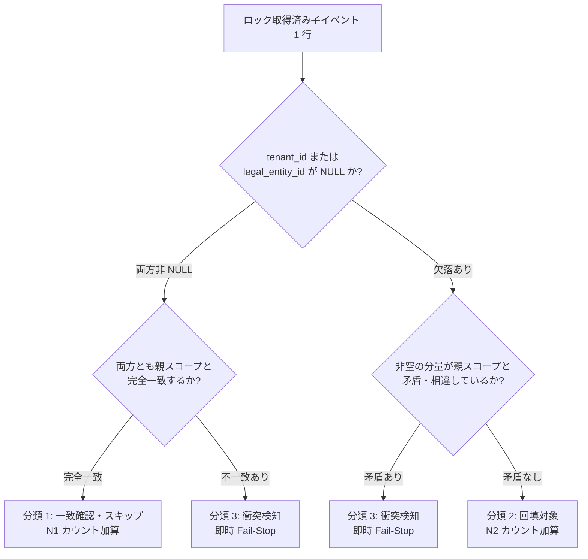

# V182 修復エグゼキュータ 境界 A（電子インボイス集約）最小実装計画書 (Repair Executor Boundary A Plan)

> [!IMPORTANT]
> **本計画書のステータス**: **PLAN REVIEW PENDING（独立計画レビュー待ち）**  
> 本計画書は、V182 本番運用手順書（`v182-production-runbook-draft.md`）第 8 節に規定されたトランザクション境界「境界 A（電子インボイス集約）」に対する**最初の最小コード実装切片（First Minimal Implementation Slice）**の技術計画を定義する。  
> 本切片において**Java コード・テストコードの実装は一切開始せず、Peppol・外部アカウント・本番デプロイへの拡張も行わない**。Astra による独立 Plan Review の承認完了後に実装フェーズへ移行する。

---

## 1. 目的・適用範囲・演練ヘルパーとの厳格な区分 (Objectives, Scope & Distinction)

### 1.1 目的
`V182__nf09_tenant_scope_hardening.sql` の適用直後に生成される `t_nf09_scope_repair_queue` のうち、`entity_type = 'DIGITAL_INVOICE'` および `entity_type = 'DIGITAL_INVOICE_EVENT'` に隔離された未解決レコード群を、データ欠損や外鍵違反を起こさずに安全・不可分に解消するための**本番対応修復エグゼキュータ（Production Repair Executor for Boundary A）**の最小実装設計を確定する。

### 1.2 適用範囲（境界 A に厳格限定）
- **対象エンティティ**:
  1. 親デジタルインボイス: `t_digital_invoice`（BIGINT `version` 列保有）
  2. 紐づく子イベント: `t_digital_invoice_event`（`version` 列なし、3列複合外鍵 `fk_digital_invoice_event_scope` 拘束）
  3. 親インボイス修復キュー: `t_nf09_scope_repair_queue` (`entity_type = 'DIGITAL_INVOICE'`)
  4. 子イベント修復キュー: `t_nf09_scope_repair_queue` (`entity_type = 'DIGITAL_INVOICE_EVENT'`)
- **本切片の対象外（非スコープ）**:
  - `t_peppol_participant`（境界 B）および `t_external_account_reference`（境界 C）の修復
  - 本番環境への実適用・自動実行スケジューリング・CI/CD パイプラインへの組み込み

### 1.3 テスト用演練ヘルパーと本番修復エグゼキュータの厳格な区分
過去の演練テスト（`V182TenantScopeHardeningRehearsalMySqlTest`）内の `repairInvoiceInTransaction(...)` は、使い捨て（Disposable）MySQL コンテナ上での Flyway 動作検証を目的に作られた**テスト専用ヘルパーに過ぎず、本番修復エグゼキュータとしては未完成・未承認**である。

| 比較項目 | 演練テストヘルパー (`repairInvoiceInTransaction`) | 本計画で策定する本番修復エグゼキュータ |
|---|---|---|
| **実装位置** | `src/test/java/.../V182TenantScopeHardeningRehearsalMySqlTest.java` (private) | `src/main/java/com/ses/service/repair/` (正式プロダクション層) |
| **子イベント (`t_digital_invoice_event`)** | **未実装（完全無視）**。親行のみ更新し、子イベントの外鍵検査を回避。 | **完全集約実装**。親と全子イベントを同一 Tx 内でアトミックにロック・3分類・更新。 |
| **外鍵整合性 (`RESTRICT`)** | 子イベントが存在しない合成データでのみ成立。 | MySQL 8 の即時文単位 RESTRICT 検査を充足する精密な原値比較 UPDATE を実装。 |
| **承認検証** | 呼出引数 `callerTenant` の単純な文字列一致のみ。 | 人工承認記録（Ticket ID、役職、署名ダイジェスト、権限ロール）の実照合。 |
| **障害現場保全** | ロールバック時にエラーログをコンソール出力するのみ。 | ロールバックに巻き込まれない独立 Tx / 外部ファイルへの完全診断保全。 |
| **ステータス** | テスト検証完了済 (Rehearsal Fact) | **新規最小実装計画中 (PLAN REVIEW PENDING)** |

---

## 2. 擬新增・変更対象ファイル・呼出入口・トランザクション境界 (Proposed Files, Ingress & Transaction Boundary)

既存の `DigitalInvoiceService` や MyBatis-Plus BaseMapper 等の共通基盤を最大限再利用し、重複実装を排除する。

### 2.1 新規・変更対象ファイル一覧

```
src/main/java/com/ses/
├── entity/
│   └── Nf09ScopeRepairQueue.java                     # [新規] t_nf09_scope_repair_queue の MyBatis-Plus エンティティ
├── mapper/
│   └── Nf09ScopeRepairQueueMapper.java               # [新規] キュー検索・FOR UPDATE ロック・CAS 結案用 Mapper
├── service/
│   ├── Nf09ScopeRepairQueueService.java              # [新規] キュー管理サービスインターフェース
│   ├── impl/
│   │   └── Nf09ScopeRepairQueueServiceImpl.java      # [新規] キュー管理実装
│   └── repair/
│       ├── DigitalInvoiceScopeRepairService.java     # [新規] 境界 A 集約修復サービスインターフェース
│       ├── impl/
│       │   └── DigitalInvoiceScopeRepairServiceImpl.java # [新規] 境界 A 集約修復実装（ロック順序・3分類・CAS・ロールバック）
│       └── dto/
│           ├── RepairInvoiceAggregateCommand.java    # [新規] 修復実行コマンド DTO
│           ├── ScopeRepairApprovalEvidence.java      # [新規] 構造化人工承認証跡 DTO（単なる boolean を拒絶）
│           └── RepairResult.java                     # [新規] 実行結果・診断 DTO
└── cli/
    └── DigitalInvoiceScopeRepairCli.java             # [新規] 本番安全防護付きバッチ実行エントリポイント
```

### 2.2 呼出入口とトランザクション境界
- **コアサービスメソッド**:
  ```java
  @Transactional(rollbackFor = Exception.class, isolation = Isolation.READ_COMMITTED)
  RepairResult repairInvoiceAggregate(RepairInvoiceAggregateCommand command);
  ```
- **トランザクション境界（Boundary A）**:
  親インボイス、紐づく全子イベント、親キュー、および全子イベントキューのすべての操作は、単一のデータベース接続・単一の `@Transactional` 境界内で不可分に実行される。
  中間状態で外部キー違反が発生する余地を排除し、処理途中で異常が検知された場合は例外をスローしてデータベース側で完全ロールバックする。

```mermaid
flowchart TD
    subgraph BoundaryA_Tx [単一トランザクション境界 (@Transactional)]
        Lock1[1. 親インボイス FOR UPDATE] --> Lock2[2. 子イベント全行 id ASC で FOR UPDATE]
        Lock2 --> Lock3[3. 親キュー FOR UPDATE]
        Lock3 --> Lock4[4. 子イベントキュー全行 entity_id ASC で FOR UPDATE]
        Lock4 --> ValAuth[5. 人工承認記録の真正性実検証]
        ValAuth --> Classify[6. 子イベント 3 分類判定]
        Classify -->|分類3: 衝突あり| FailRollback[即時中止 ROLLBACK]
        Classify -->|分類1・2のみ| UpdParent[7. 親インボイス version CAS UPDATE]
        UpdParent --> UpdEvts[8. 分類2の子イベントのみ親スコープ回填 UPDATE]
        UpdEvts --> ResParentQ[9. 親キュー version CAS 結案 UPDATE]
        ResParentQ --> ResEvtQs[10. 子イベントキュー全行 version CAS 結案 UPDATE]
        ResEvtQs --> TxCommit[11. トランザクションコミット]
    end

    FailRollback -.-> OutOfBandLog[Tx 外独立証拠保全: ファイル出力 / REQUIRES_NEW 監査ログ]
```

---

## 3. 人工承認記録の引用および信頼できる検証起原 (Human Approval Record & Trusted Verification Source)

### 3.1 単純な真偽値（`approved = true`）の絶対排除
呼出元が `approved = true` や `bypassApproval = true` などの安易なフラグを渡すことによる修復実行は**アーキテクチャレベルで物理的に拒絶（Compile / Validation Error）**する。修復コマンドには、改ざん不能な構造化承認証跡オブジェクト `ScopeRepairApprovalEvidence` の同封を必須とする。

### 3.2 構造化承認証跡（`ScopeRepairApprovalEvidence`）仕様
```java
public record ScopeRepairApprovalEvidence(
    String approvalTicketId,       // 例: "APPR-20261026-INV-0089"（正式起票決裁番号）
    Long approverUserId,           // sys_user.id（正の整数値、監査主体）
    String approverRole,           // 承認時ロール（"管理者" または "財務統括責任者"）
    String approvedTenantId,       // 承認対象テナント ID（targetTenantId と完全一致必須）
    Long approvedLegalEntityId,    // 承認対象法人 ID（targetLegalEntityId と完全一致必須）
    Instant approvalTimestamp,     // 承認確定日時（過去7日以内、未来日時の拒絶）
    String justificationSummary,   // 帰属決定の証拠原本（例: "基本契約書CNT-2026-089照合済"）
    String digitalSignatureDigest  // 承認内容の SHA-256 HMAC / 改ざん検知ダイジェスト
) {}
```

### 3.3 信頼できる検証起原（Authoritative Verification Source）
サービス内部において、渡された証跡を以下の権威データソースと突き合わせて実検証する：
1. **承認者アカウントの存在・有効性検証**:
   - `SysUserMapper` により `sys_user WHERE id = :approverUserId AND status = 1 AND deleted_flag = 0` を照合。
   - 承認者のロールが `管理者`（`ROLE_ADMIN`）または財務決裁権限を保有していることを確認。
2. **ワークフロー正本照合（`ApprovalEngineService` 連携時）**:
   - 内部統制承認エンジンが存在する場合、`t_approval_request` テーブルにおいて `request_type = 'DIGITAL_INVOICE_SCOPE_REPAIR'`, `target_id = :invoiceId`, `status = 'APPROVED'` であることを照合。
3. **承認スコープの一致検証**:
   - 承認証跡内の `(approvedTenantId, approvedLegalEntityId)` が、コマンドで指定された修復先 `(targetTenantId, targetLegalEntityId)` と**1文字の狂いもなく完全一致**することを強制する。

> [!WARNING]
> **本番承認ステータスの PENDING 表明**:  
> 現時点において、本番環境における実データのインボイス帰属に関する実サインオフは **PENDING（未承認）** として管理される。テスト実行においては、テスト専用に固定された合成承認フィクスチャ（明確に `TEST-MOCK-APPROVAL` と識別可能なもの）のみを使用し、本番承認が完了したと誤認させてはならない。

---

## 4. ロック順序・状態判定・3分類・CAS・逐行影響数検証 (Locking, Classification, CAS & Row Verification)

### 4.1 デッドロックを排除する固定ロック順序 (Deterministic Lock Ordering)
複数インボイスの並行修復や通常業務との競合時におけるデッドロック（MySQL 1213）を防止するため、全プロセスで以下のロック階層順序を厳格に順守する：

```
階層 1: t_digital_invoice (単一行 FOR UPDATE)
   ↓
階層 2: t_digital_invoice_event (digital_invoice_id 指定、必ず id ASC で FOR UPDATE)
   ↓
階層 3: t_nf09_scope_repair_queue (親インボイスキュー行 FOR UPDATE)
   ↓
階層 4: t_nf09_scope_repair_queue (子イベントキュー行全件、必ず entity_id ASC で FOR UPDATE)
```

### 4.2 親インボイスの状態判定
ロック取得した `t_digital_invoice` に対し、以下の前置検査を実施する：
- `deleted_flag == 1`: 論理削除済み行。特別廃棄承認（Waiver）がない限り直ちに `IllegalStateException` で中止。
- `tenant_id IS NOT NULL AND legal_entity_id IS NOT NULL`:
  - 既に入力ターゲットスコープと一致している場合: 第 5 節「既一致行・修復不要行」として処理。
  - ターゲットスコープと異なる値が既に設定されている場合: **非 NULL スコープの再帰属は本切片では禁止**されているため、直ちに `ConflictException` をスローしてフェイルストップ。

### 4.3 子イベントの 3 分類（Three-way Classification）
ロック取得された全子イベント（$M$ 件）をループし、承認済親スコープ `(:targetTenantId, :targetLegalEntityId)` に対して逐項分類する：



1. **分類 1（完全一致・検証済）**:
   - `event.tenant_id == targetTenantId && event.legal_entity_id == targetLegalEntityId`
   - **処置**: 既に整合しているため UPDATE は発行しない。カウント $N_1$ を加算。
2. **分類 2（欠落回填・非衝突）**:
   - `(event.tenant_id == null || event.legal_entity_id == null)` かつ非 NULL の分量がある場合は親と一致。
   - **処置**: 回填対象リストに追加。カウント $N_2$ を加算。
3. **分類 3（非空分量衝突・フェイルストップ）**:
   - `(event.tenant_id != null && !event.tenant_id.equals(targetTenantId)) || (event.legal_entity_id != null && !event.legal_entity_id.equals(targetLegalEntityId))`
   - **処置**: **直ちに例外をスローしてトランザクション全体を ROLLBACK**。未解決キューを `PENDING` に維持し、人間の調査へエスカレーション。

### 4.4 実スキーマ準拠の更新 SQL と逐行影響数検証

#### (1) 親インボイスの version CAS 更新
```sql
UPDATE t_digital_invoice
   SET tenant_id = :targetTenantId,
       legal_entity_id = :targetLegalEntityId,
       version = version + 1
 WHERE id = :invoiceId
   AND tenant_id IS NULL
   AND version = :expectedInvoiceVersion;
```
- **検証**: 更新行数が厳密に `1` であること。`0` の場合は他トランザクションによる更新とみなし、即座に `OptimisticLockingFailureException` をスローしてロールバック。

#### (2) 分類 2 子イベントの精密原値比較 UPDATE
MySQL 8 の複合外部キー `fk_digital_invoice_event_scope` は文単位で即時 RESTRICT 評価される。親インボイスが上記 (1) で更新された直後に、分類 2 のイベントを 1 行ずつ実行する：
```sql
UPDATE t_digital_invoice_event
   SET tenant_id = :targetTenantId,
       legal_entity_id = :targetLegalEntityId
 WHERE id = :eventId
   AND digital_invoice_id = :invoiceId
   AND tenant_id <=> :lockedEventTenantId
   AND legal_entity_id <=> :lockedEventLegalEntityId;
```
- **検証**: 各文の更新行数が厳密に `1` であること。分類 2 の全 $N_2$ 件にわたり合計影響行数が厳密に $N_2$ 行であることを検証する。

#### (3) 親キューの version CAS 結案
```sql
UPDATE t_nf09_scope_repair_queue
   SET status = 'RESOLVED',
       resolved_at = NOW(),
       resolved_by = :approverUserId,
       resolution_note = :resolutionNote,
       version = version + 1
 WHERE id = :parentQueueId
   AND status = 'PENDING'
   AND version = :expectedParentQueueVersion;
```
- **検証**: 更新行数 == 1。

#### (4) 子イベントキュー全行の version CAS 結案
各子イベントキュー行に対し：
```sql
UPDATE t_nf09_scope_repair_queue
   SET status = 'RESOLVED',
       resolved_at = NOW(),
       resolved_by = :approverUserId,
       resolution_note = :resolutionNote,
       version = version + 1
 WHERE id = :eventQueueId
   AND status = 'PENDING'
   AND version = :expectedEventQueueVersion;
```
- **検証**: 各行更新行数 == 1。

---

## 5. 異常系・エッジケース・並行競合制御 (Edge Cases & Concurrency Handling)

| 異常ケース / 境界条件 | 発生シナリオ | エグゼキュータの確定動作 | 整合性保護理由 |
|---|---|---|---|
| **已一致行（完全修復済）** | 親インボイスおよび全子イベントが既にターゲットスコープを持ち、キューが `RESOLVED` | DML 発行をスキップし、`RepairResult.skippedAlreadyRepaired()` を返却 | 多重実行に対する安全な冪等性の確保。バージョンの無用なインクリメントを防止。 |
| **无需修復行（キュー未結案）** | 親・子は既にスコープ一致しているが、キューのみ `PENDING` 残存 | 親・子の更新をスキップし、キューのみ CAS で結案（メモに `[IDEMPOTENT_CLOSE]` を記録） | スキーマ更新は不要だが、キューの `PENDING = 0` 口径を達成するための整合回復。 |
| **缺失キュー行 (Missing Queue)** | 親インボイスまたは子イベントのスコープが NULL であるにもかかわらず、対応するキュー行が存在しない | **即時 Fail-Stop（`IllegalStateException`）**。修復処理を拒絶。 | V182 の初期隔離から漏れた異常孤立行の疑いがあるため、手動 DBA 調査を強制。 |
| **过期バージョン (Stale Version)** | コマンドで指定された `expectedVersion` が、DB 上の現在 `version` より古い | CAS 更新が 0 件となり、`OptimisticLockingFailureException` でロールバック | 並行する他オペレータやバッチによる先行更新の保護（Lost Update 排除）。 |
| **重複要求 (Duplicate Request)** | 同一インボイスに対する修復リクエストがほぼ同時に 2 件到達 | 第 1 Tx がロック取得して完了。第 2 Tx はロック解放待ち後に現在行を読み取り、已一致またはバージョン不一致を検知して安全に中断 | 排他的行ロック（FOR UPDATE）とバージョン CAS の二重防護による安全遮断。 |
| **外鍵拒否 (FK Error 1452)** | 親の更新前に子を更新しようとした、または親と異なるスコープへ更新しようとした | MySQL が即座にエラー 1452 を送出。Tx 全体ロールバック | RESTRICT 制約により不正なスコープ分離レコードの残存を物理遮断。 |

---

## 6. 完全ロールバックと障害証跡の独立永続化 (Atomic Rollback & Out-of-Band Evidence)

### 6.1 トランザクション全量ロールバック（All-or-Nothing）
処理途中でいかなる例外（ロック待ちタイムアウト 1205、デッドロック 1213、CAS 更新行数 0 件、分類 3 衝突、外鍵違反）が発生した場合も、Spring の `@Transactional` によりデータベース接続は即座に `ROLLBACK` される。
親インボイス、子イベント、および全キューテーブルの状態は、処理開始前の状態へと完全に復元される（部分結案ゼロの保証）。

### 6.2 ロールバックに巻き込まれない障害証跡保全（Out-of-Band Evidence Preservation）
障害原因や競合ログがトランザクションのロールバックによって破棄されることを防ぐため、以下の 2 経路で診断証跡を永続化する：

1. **外部ファイルシステムへの診断ダンプ（File System Log）**:
   - `ses.repair.evidence-dir`（既定: `logs/repair-evidence/`）配下に、`repair-failure-INV-{id}-{timestamp}.json` を出力。
   - 内容: 失敗したインボイス ID、期待バージョン、ロック取得時の DB 実値、分類 3 衝突詳細、SQLState、MySQL エラーコード、スタックトレース。
2. **独立トランザクションによる監査ログ記録（`Propagation.REQUIRES_NEW`）**:
   - データベースが接続可能である場合、`AuditLogService.recordFailureInNewTransaction(...)` を呼び出し、失敗イベントを `t_audit_log` に永続記録する。

---

## 7. 合成データ検証テストマトリクスと実 MySQL 実行区分 (Test Matrix & AI-1 Allocation)

全 8 つの検証シナリオを設計し、Fast Feedback（H2 / Mock）と Real MySQL（Testcontainers）の実行責務を明確に区分する。

| テスト ID | シナリオ概要 | 入力・対象データ条件 | 期待結果・検証アサーション | 実行環境・担当区分 |
|---|---|---|---|---|
| **TC-REP-BND-01** | 正常系・完全回填 | 親スコープ NULL (ver=0) + 子イベント 2 件 (両方 NULL) + キュー 3 件 PENDING | 親・子ともに `(tenant-1, entity-100)` 回填完了、親 ver=1、キュー 3 件 RESOLVED、影響行数完全合致 | Fast H2 & MySQL (両方) |
| **TC-REP-BND-02** | 正常系・legal_entity 単独欠落回填 | 親: `tenant-1`, `legal_entity=null`。子 1: `tenant-1`, `null` | 分類 2 で非衝突と判定され、`legal_entity=100` のみ精密回填。親 ver=1、全キュー RESOLVED | Fast H2 & MySQL (両方) |
| **TC-REP-BND-03** | 異常系・分類 3 非空衝突拒絶 | 親スコープ NULL。子 1 は NULL。子 2 は `tenant-2`（ターゲットと異なる） | 分類 3 を検知して即時 Fail-Stop。全更新中断、Tx ロールバック、キュー 3 件とも PENDING 維持 | Fast H2 & MySQL (両方) |
| **TC-REP-BND-04** | 異常系・CAS バージョン衝突 | 親の `expectedInvoiceVersion = 0` に対し、DB 実値が `version = 1` | UPDATE 影響行数 0 件を検知、`OptimisticLockingFailureException` 送出、全量ロールバック | Fast H2 & MySQL (両方) |
| **TC-REP-BND-05** | 異常系・MySQL 外鍵 RESTRICT 拒否 | 子イベントに対し、親と異なる `(tenant-3, entity-300)` を付与しようと試みる | MySQL エラー 1452 (23000) 発生を捕捉。即時ロールバック、現場証跡保全 | **Real MySQL 必須（Docker / AI-1 排隊）** |
| **TC-REP-BND-06** | 異常系・ロック競合・タイムアウト | 別コネクションが親インボイスをロックしたまま保持 | ロック待ちタイムアウト（1205）を検知。即時ロールバック、診断ログ保全 | **Real MySQL 必須（Docker / AI-1 排隊）** |
| **TC-REP-BND-07** | 正常系・重複実行の冪等スキップ | TC-REP-BND-01 完了済みのインボイスに対し、再度同一スコープで修復を実行 | `SKIPPED_ALREADY_REPAIRED` を返却。DML 発行ゼロ、バージョン不変 | Fast H2 & MySQL (両方) |
| **TC-REP-BND-08** | 整合系・ゼロ部分結案保証 | 子イベント 2 のキュー結案時のみ意図的にバージョン不一致を起こす | 親・子 1・親キューの更新も巻き込んで全量 ROLLBACK。RESOLVED 件数ゼロを確認 | Fast H2 & MySQL (両方) |

> [!NOTE]
> **AI-1 への引き渡し事項**:  
> `TC-REP-BND-05`（3列複合外鍵 RESTRICT の即時検査）および `TC-REP-BND-06`（InnoDB 行ロック競合およびタイムアウト診断）は、H2 データベースでは MySQL 固有のロック・外部キー評価順序を完全再現できないため、JUnit `@Tag("mysql")` を付与し、AI-1 が管理する Testcontainers (MySQL 8 tmpfs) 実行キューへ登録する。

---

## 8. 実行エントリポイントの本番安全防護と有効化ゲート (Execution Ingress Safety & Activation Gates)

### 8.1 デフォルト安全防護（Safety by Default）
誤操作や未承認実行による本番障害を物理的に防止するため、CLI バッチツール `DigitalInvoiceScopeRepairCli` に以下の多重インターロックを組み込む：

1. **本番無効化プロパティ（Feature Toggle）**:
   - `application.yml` の既定値: `ses.repair.invoice.enabled: false`
   - `false` の状態で実行された場合、CLI は直ちに終了コード `1` で停止し、以下のエラーを標準エラー出力へ印字する：
     ```text
     [FATAL] 修復エグゼキュータは安全のため本番無効化されています。
     実行には明示的な有効化プロパティ (ses.repair.invoice.enabled=true) と正式な承認証跡が必要です。
     ```
2. **ドライラン既定有効（Dry-Run by Default）**:
   - `--dry-run` オプションの既定値は `true`。
   - 明示的に `--dry-run=false` が渡されない限り、すべての検証・3分類・擬似更新を実行した後に**強制的に `txManager.rollback()` を発行**し、計画された差分と影響行数を JSON 形式で出力して終了する。

### 8.2 本番実有効化の 3 大前置ゲート (Production Activation Gates)
本エグゼキュータを本番環境で実行可能とするためには、以下の 3 つの承認ゲートをすべて通過しなければならない：


1. **Gate 1: 独立 CODE Review PASS（Astra）**:
   - 本計画に基づく Java 実装・Mapper・CLI・テストコードが、Astra による独立コードレビューにおいて `CODE REVIEW PASS` を獲得すること。
2. **Gate 2: Staging 演練検証 PASS**:
   - Staging 環境において、合成データを用いた TC-REP-BND-01〜08 がすべて PASS し、Postflight SQL-06（野良 NULL ゼロ件）が実証されること。
3. **Gate 3: 本番人工決裁サインオフ（実決裁完了）**:
   - 財務統括責任者（インボイス帰属の業務承認）
   - 運用統括責任者（保守ウィンドウ確保およびトラフィック遮断承認）
   - リード DBA（PITR 準備完了・Binlog 保持確認）
   - 上記 3 名による正式な書面／電子決裁が完了すること。

---

## 9. 署名・承認記録 (Sign-Off Register)

| レビュー役職 | 氏名 | 承認ステータス | 承認日 | 承認コメント / 判定 |
|---|---|---|---|---|
| **独立 Reviewer** | Astra | **PLAN REVIEW PENDING** | - | 境界 A 最小実装計画書の独立審査待ち |
| **技術仕様担当 / 執筆者** | AI-3 (gpt-6-luna) | **SUBMITTED** | 2026-10-26 | 境界 A 最小実装計画書を策定・提出 |
