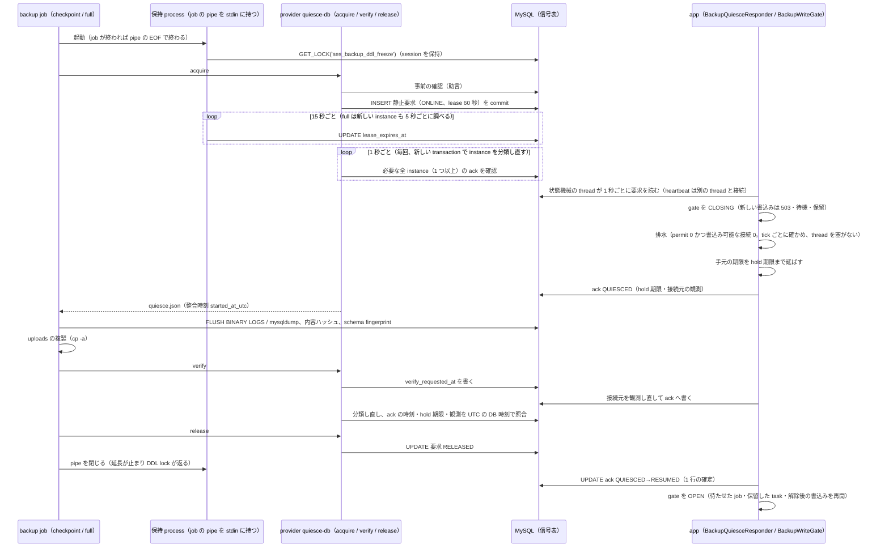

# backup の書込み静止（app 内の静止応答）設計

- 状態: **草案（第 1 段階: spec のみ。第 4 版）**。第 2 版は `32733d28` への review（P1〜P3）、第 3 版は `c2e18127` への差分 review（D-P2・D-P3）と、2026-11-21 の利用者の決定（U-1〜U-14）、第 4 版は `9b8cc0a5` への差分 review（D3-P2・D3-P3）を反映した。要件は `requirements.md`、手順は `tasks.md`。
- 本書は brief の 13 の設計問題（Q1〜Q13）に答える。答えの一覧は §2、利用者の決定は §16（全て決定済み）、review の指摘の対応先は §20。
- 実測していない前提は §19 にまとめ、実装の時に確かめる。

## 0. 位置付け

- 本 spec は `database-backup-recovery`（HFP-03）の RQ-002（全 app replica と scheduler の書込みを静止し、DDL/change freeze を確かめてから整合点を取る）を、本番の構成で成り立たせるための部品である。HFP-03 の他の要件（manifest・PITR・restore・cutover）は変えない。
- 整合点の定義は変えない: full は mysqldump の一貫 snapshot と uploads の複製を同じ静止区間で取り、checkpoint は FLUSH BINARY LOGS の closed coordinate と uploads の複製を同じ静止区間で取る（`database-backup-recovery/design.md` §5）。本 spec が足すのは「静止区間の間、app が DB と uploads を変えないこと」の保証と、その保証が途切れたら VALID にしない仕組みである。
- 中心の保証（§6.1 の不変条件）: provider が VALID を許すのは、静止区間の終わりに、書込みをし得る全ての instance（1 つ以上）について「QUIESCED の ack が整合点より前に DB に確定しており（要求の後に登録した instance を除く）、その instance が gate を開け得る時刻（手元の期限）より前である」ことを DB の時刻で確かめられた場合だけである。

## 1. 全体像



## 2. 設計問題への回答（一覧）

| # | 問題 | 結論 | 節 |
|---|---|---|---|
| Q1 | 信号表 | 3 表（要求・instance・ack）。要求は provider、instance と ack は app が書く。時刻は全て `UTC_TIMESTAMP(6)`。`active_slot` は生成列。tenant 列なし。V202。H2 は変種 file と `engineer-schema-h2.sql`。`CONTENT_HASH_TABLES` からは除外を強制。保存期間 30 日（U-12） | §3 |
| Q2 | backup account の権限 | 既存の backup account に `sys_backup_quiesce_request` への表単位の `INSERT`・`UPDATE` だけを足す（U-11）。GRANT は §3 の Flyway job の後・初回 backup の前、restore の cutover の後にも付け直す。PROD-002 に記録し Security・DBA が署名 | §4 |
| Q3 | instance の識別と heartbeat | 起動ごとの UUID＋host 名＋DB から見た接続元。heartbeat は専用の thread と専用の接続。provider は要求を先に登録し、待ちと verify の度に分類し直し、必要な instance が 1 つ以上で、要求の前からの instance は整合点より前に ack したことを求める。PROCESS は誰にも足さない（U-2） | §5 |
| Q4 | 書込み停止の意味と仕組み | HTTP の分類で 503、scheduler は ShedLock の前で待機（SHUTDOWN では待たない）、async は閉じた後の投入を保留、起動時処理は permit、業務の接続は静止中に読取り専用、uploads は storage 層でも拒否（directory の作成は除く）。logout は HTTP session を直ちに無効にし DB の失効と監査は解除の後に書く（U-8）。best-effort の監査は WARN の log（U-9）、download は 503（U-10）、外部 API は `ExternalApiErrorWriter` の 503（U-6）。排水の上限 checkpoint 30 秒・full 600 秒（U-3） | §6 |
| Q5 | 安全 | gate を開けてよいのは非 QUIESCED の確定か手元の期限だけ。ack の結果不明は閉じたまま。responder は塞がない状態機械で、制御用の接続は短い timeout。延長は job 本体の pipe に結び付けた保持 process が行う | §6.1、§6.9、§7 |
| Q6 | DDL 凍結 | runbook で backup の timer を止め、Flyway job の callback が同じ GET_LOCK を取る（U-5） | §8 |
| Q7 | app 停止の確認 | `quiesce-app-stopped`。保持を先に登録してから全 instance が停止済みであることを確かめる。STOPPED は業務 pool を閉じた後にだけ書く（DestructionAwareBeanPostProcessor、起動の失敗の経路も含む）。停止口で無効にした instance（DISABLED）があれば失敗 | §9 |
| Q8 | 静止時間 | 上限 checkpoint 300 秒・full 60 分（U-1）。checkpoint は uploads 約 3,000〜5,000 件まで持つ見込みで、本番の前に staging の EFS で測る | §10 |
| Q9 | 配備手順との関係 | §2 の初めに timer を止め、§2 の5 は停止確認の full、§4 の後に再開。PROD-004 は 004a・004b。ONLINE の full の最中に新しい instance が登録されたら full をやめて静止を解く（U-13。APP_STOPPED の full は中止しない）。欠けた full は手で取り直す | §11 |
| Q10 | 設定と fail-fast | `app.backup-quiesce.*`。prod の停止口は `BACKUP_QUIESCE_DISABLED_TICKET` と組でだけ（U-7）。停止中も登録と heartbeat を続け、backup は全て失敗する。範囲・JDBC・startPeriod・stopTimeout を §1.0・雛形・照合 script に入れる | §12 |
| Q11 | 可観測性 | 固定の `errorCode=BACKUP_QUIESCE_*` の日本語 log、`ses_backup_quiesce_*` の metric、critical の条件 | §13 |
| Q12 | 試験計画 | unit・H2・MVC・MySQL・shell・CI。CI は DB の protocol を話す shell の responder と Java の MySQL 契約試験（U-4） | §14、`tasks.md` |
| Q13 | 文書 | runbook §1.0・§1.2・§1.7・§2・§3・§4・§5、README、監視 runbook、restore-cutover、baseline PROD-002・PROD-004、pii-inventory | §15 |

## 3. 信号表（Q1）

### 3.1 表の定義（V202 の骨子）

実際の DDL は BWQ-001 で書く。全表 `ENGINE=InnoDB DEFAULT CHARSET=utf8mb4 COLLATE=utf8mb4_unicode_ci`、列と表に日本語の COMMENT を付ける。時刻の列は全て **UTC の値を入れる DATETIME(6)** で、COMMENT に「UTC」と書く（§3.10）。

**`sys_backup_quiesce_request`**（静止要求。1 回の backup の静止ごとに 1 行）

| 列 | 型 | 内容 |
|---|---|---|
| `id` | BIGINT AUTO_INCREMENT PK | 要求の番号。epoch として使う |
| `request_token` | CHAR(32) NOT NULL、一意 `uk_bq_request_token` | provider が作る 16 byte の乱数の hex |
| `mode` | VARCHAR(16) NOT NULL | `ONLINE` / `APP_STOPPED` |
| `job_kind` | VARCHAR(16) NOT NULL | `FULL` / `CHECKPOINT` |
| `status` | VARCHAR(16) NOT NULL | `REQUESTED` / `RELEASED` / `ABORTED` / `EXPIRED` |
| `active_slot` | TINYINT **GENERATED ALWAYS AS (CASE WHEN status = 'REQUESTED' THEN 1 ELSE NULL END) STORED**、一意 `uk_bq_request_active` | 有効な要求だけ 1。誰も書かない。MySQL の一意索引は NULL を重複とみなさない |
| `lease_seconds` | INT NOT NULL | 1 回の延長で延ばす秒数 |
| `requested_by` | VARCHAR(64) NOT NULL | job 名と backup host（`^[A-Za-z0-9._:-]{1,64}$`。個人名・秘密を書かない） |
| `protocol_version` | SMALLINT NOT NULL | protocol の版（初版 1） |
| `requested_at` | DATETIME(6) NOT NULL | UTC |
| `lease_expires_at` | DATETIME(6) NOT NULL | UTC。延長ごとに保持 process が更新 |
| `verify_requested_at` | DATETIME(6) NULL | UTC。verify の前に provider が書き、app に接続元を観測し直させる（§5.4） |
| `released_at` | DATETIME(6) NULL | UTC |
| `release_reason` | VARCHAR(32) NULL | `COMPLETED` / `ABORTED` / `VERIFY_FAILED` / `EXPIRED` / `NEW_INSTANCE`（U-13） |

制約: `ck_bq_request_mode`・`ck_bq_request_kind`・`ck_bq_request_status`・`ck_bq_request_reason`（値の集合）。`active_slot` を生成列にしたため、状態と有効枠の組合せは矛盾し得ない。索引 `idx_bq_request_requested_at (requested_at)`。

**`sys_backup_quiesce_instance`**（app の instance。JVM の起動ごとに 1 行）

| 列 | 型 | 内容 |
|---|---|---|
| `instance_id` | CHAR(36) PK | 起動ごとの UUID |
| `host_name` | VARCHAR(255) NOT NULL | `InetAddress.getLocalHost().getHostName()`（取れなければ `unknown`） |
| `db_client_host` | VARCHAR(255) NOT NULL | 制御用の接続の `USER()` の host 部（そのまま。port は付かない。§5.4） |
| `db_connection_id` | BIGINT NOT NULL | 登録時の `CONNECTION_ID()`（診断用） |
| `app_commit` | VARCHAR(64) NOT NULL | build の commit（取れなければ `unknown`） |
| `protocol_version` | SMALLINT NOT NULL | |
| `poll_interval_ms` / `heartbeat_interval_ms` / `fence_after_ms` | INT NOT NULL | provider が閾値の整合を確かめる（§5.2） |
| `max_hold_checkpoint_ms` / `max_hold_full_ms` | INT NOT NULL | app の最大保持時間。保持 process の延長の上限に使う（D-P3-6） |
| `scheduling_enabled` | TINYINT NOT NULL | `app.scheduling.enabled` の値 |
| `status` | VARCHAR(16) NOT NULL | `STARTING` / `RUNNING` / `STOPPED` |
| `gate_state` | VARCHAR(16) NOT NULL | `UNARMED` / `OPEN` / `CLOSING` / `CLOSED` / `FENCED` / `SHUTDOWN` / `DISABLED`。`DISABLED`（停止口。U-7）は provider の判定に使い、それ以外は診断用 |
| `started_at` / `last_beat_at` | DATETIME(6) NOT NULL | UTC |
| `stopped_at` | DATETIME(6) NULL | UTC |

制約: `ck_bq_instance_status`・`ck_bq_instance_gate`。索引 `idx_bq_instance_last_beat (last_beat_at)`。

**`sys_backup_quiesce_ack`**（要求×instance の応答）

| 列 | 型 | 内容 |
|---|---|---|
| `request_id` | BIGINT NOT NULL | FK `fk_bq_ack_request` → `sys_backup_quiesce_request(id)` ON DELETE CASCADE |
| `instance_id` | CHAR(36) NOT NULL | FK を張らない（instance の行は先に消え得る） |
| `state` | VARCHAR(16) NOT NULL | `QUIESCED` / `REFUSED` / `RESUMED` |
| `scheduler_state` | VARCHAR(16) NOT NULL | `PAUSED` / `DISABLED` |
| `drain_millis` | INT NOT NULL | |
| `hold_until` | DATETIME(6) NULL | UTC。app が自動で再開し得る最も早い時刻（§3.3） |
| `observed_app_hosts` | VARCHAR(1024) NOT NULL | 同じ app account の接続元と件数（`host=件数` を host の昇順に `,` でつなぐ） |
| `observed_at` | DATETIME(6) NOT NULL | UTC。最後に観測した時刻 |
| `refuse_reason` | VARCHAR(64) NULL | `DRAIN_TIMEOUT` / `ERROR` / `UNSUPPORTED_PROTOCOL` / `DISABLED` |
| `acked_at` | DATETIME(6) NOT NULL | UTC |
| `resumed_at` | DATETIME(6) NULL | UTC |
| `resume_reason` | VARCHAR(32) NULL | `RELEASED` / `LEASE_EXPIRED` / `MAX_HOLD` / `REQUEST_GONE` / `SHUTDOWN` |

PK `(request_id, instance_id)`。制約 `ck_bq_ack_state`・`ck_bq_ack_scheduler`・`ck_bq_ack_refuse`・`ck_bq_ack_resume`（`resume_reason` の値の集合。第 2 段階 2a で足した。BWQ-001 の「CHECK の外の理由の値が拒否される」の対象）。

### 3.2 書く者と状態遷移

| 表 | provider（acquire・verify・release・保持 process） | app | backup 以外の運用者 |
|---|---|---|---|
| 要求 | INSERT・UPDATE（status・lease_expires_at・verify_requested_at・released_at・release_reason） | SELECT。保存期間を過ぎた RELEASED/ABORTED/EXPIRED の行の DELETE（ack は CASCADE） | 異常時だけ DBA が `ABORTED` にする（§9.4） |
| instance | SELECT | INSERT・UPDATE・保存期間を過ぎた行の DELETE | — |
| ack | SELECT | INSERT・UPDATE（状態の遷移は条件付きの文で、影響した行数で確定する。§6.9） | — |

要求の状態: `REQUESTED` → `RELEASED`（release）/ `ABORTED`（verify 前の失敗の cleanup、または full の最中の新しい instance。§7.6）/ `EXPIRED`（次の provider が期限切れを見つけた）。app は lease を過ぎた REQUESTED を「無効」と扱い、要求の行は書き換えない。

instance の状態: `STARTING`（登録済み。起動の待機中を含む）→ `RUNNING`（起動完了）→ `STOPPED`（**業務の接続 pool を閉じた後**。§6.11）。強制終了した instance は STARTING/RUNNING のまま残り、`last_beat_at` で判定する（§5.3）。

ack の状態: なし → `QUIESCED` または `REFUSED` → `QUIESCED` から `RESUMED`。app は同じ要求について閉じ直さない。

### 3.3 epoch・lease・hold 期限

- epoch は要求の `id`。ack は `(request_id, instance_id)` の行なので、前の要求の ack が次の要求の ack に見えることは無い。
- lease: acquire が `lease_expires_at = UTC_TIMESTAMP(6) + lease_seconds` で登録し、保持 process が `QUIESCE_LEASE_RENEW_SECONDS`（既定 15 秒）ごとに `… WHERE id = ? AND status = 'REQUESTED' AND lease_expires_at > UTC_TIMESTAMP(6)` で延ばす（期限を過ぎた lease は延ばせない。§7.6）。
- hold 期限: app は要求を読むたびに `LEAST(lease_expires_at, requested_at + INTERVAL <最大保持時間(job_kind)> SECOND)` と `UTC_TIMESTAMP(6)` を同じ文で読む。
- **順序**: app は新しい hold 期限 H を DB へ書く**前に**、手元の期限（単調時計）を H まで延ばす。手元の期限は縮めない。書込みが失敗・結果不明でも、DB に確定し得る全ての `hold_until` は手元の期限より前になる。H は DB の lease と最大保持時間から決まるため上界がある。
- 手元の期限への換算: `手元の期限 = 文が返った後の単調時計 + (H − 文の中の UTC_TIMESTAMP(6))`（文の往復の分だけ遅い側にずれる。安全側）。
- provider の verify は全ての必要な ack について `UTC_TIMESTAMP(6) <= hold_until − QUIESCE_LEASE_MARGIN_SECONDS`（既定 5 秒）を求める。

### 3.4 tenant 列を持たない理由

- 静止の対象は DB と uploads の全体（全 tenant）で、tenant ごとには静止できない。表が表すのは process と DB instance の状態で、業務データではない。前例は `shedlock`（V58）と `flyway_schema_history`。
- 表に触るのは静止応答の専用 thread と制御用・heartbeat 用の接続の `JdbcTemplate` だけで、MyBatis-Plus の mapper・HTTP の request thread を通らない。`InternalTenantContextFilter`・`AccountingTenantContextHolder` は関与しない。
- API・画面・menu を作らないため、`ActionPermissionResolver.RESOURCE_NAMES`・`m_menu`・権限 group の seed も足さない。
- 単一 tenant（SRE-1）の前提は変わらない。全表に tenant 列を求める走査は現時点で無い。`BackupQuiesceControlPoolUsageTest`（§14）が、表を mapper・controller から参照していないことを固定する。

### 3.5 Flyway の版番号

- `db/migration` は V201 まで（V199 は意図した欠番）。`db/migration-dev` は V100・V145・V146・V172_1。`db/privacy-journal` は別の instance の別の空間。
- main（`42719b10` の時点を含む）と全 branch に V202 以上の file は無い。**V202 を使う**: `V202__backup_write_quiesce_signal.sql`。実装の着手時と統合の直前に再確認し、衝突したら後に統合する側を上の空き番号へ振り直す（空き番号を埋めない）。
- 連動して直すもの: `LatestMigrationVersion.LATEST`（`202`）、`deploy-runbook.md` §3.3 の「V1〜V202（versioned 201件。SQL 200件＋Java migration 1件）」、§3.4 の最新版と件数の照会、§4 の schema guard の log 例、§1.7 の `FLYWAY_VERSION`（`202`）。`DeployRunbookMigrationCountTest` が照合する。trigger は作らないため 67 件は変わらない。

### 3.6 H2 の同期

- V202 は MySQL 固有の句を含むため、`shedlock` と同じく H2 の変種 `src/test/resources/sql/schema-backup-quiesce-h2.sql`（`CREATE TABLE IF NOT EXISTS`、COMMENT なし、生成列は H2 の `GENERATED ALWAYS AS (CASE … END)`）を作り、`application-test.yml` の `schema-locations` の V201 の変種の後に足す。
- `src/test/resources/sql/engineer-schema-h2.sql` にも 3 表を足す（ack → instance → request の順に DROP）。
- `BackupQuiesceSchemaContractTest`（Docker 不要）が、V202 と H2 の 2 定義の列名・型・NULL 可否・生成式・一意索引の一致を固定する。

### 3.7 `CONTENT_HASH_TABLES`（DBA-6）から外す理由

- 信号表は静止区間の中でも書かれる（heartbeat、観測、lease の延長、verify の要求）。checkpoint の内容ハッシュは FLUSH BINARY LOGS の後に計算するため、FLUSH の後の書込みは次の binlog に入り、復元（closed coordinate までの replay）には現れない。記録したハッシュと復元後の値が合わず、復元検証が必ず FAIL になる。内容は運用の記録で業務上の意味も無い。
- `lib/content-hash.sh` の `content_hash::collect` は名前が `sys_backup_quiesce_` で始まる表を指定されたら計算の前に失敗する。`CRITICAL_TABLES` は情報だけなので拒否しないが README で勧めない。

### 3.8 restore の後の信号表と権限

- 復元した DB には checkpoint の時点の信号表が残る。restore の後に起動する app は新しい UUID で登録し、残った要求は lease の期限切れとして無視し（INFO の log に番号を出す）、残った instance は停止済みの閾値で無視される。cutover の後に最初に動く provider が残った要求を `EXPIRED` にする。手で消さない。
- 生成列 `active_slot` の dump・import・schema fingerprint の扱いは §19 で確かめる（CI の backup integration が source に V202 を適用するため、そこで往復を確かめる）。
- **権限の付け直し**: `mysql.tables_priv` は dump に入らないため、復元先を新しい source にした後、backup の再開の前に DBA が backup account と表単位の権限（§4）を付け直す。`ops/backup/runbooks/restore-cutover.md` の cutover の後の手順に足し、preflight の `checks.quiesce`（§12.4）が無いことを検出する。

### 3.9 保存期間と個人データ

- 個人データは持たない（host 名・接続元の IP・job 名・時刻だけ）。`requested_by` に人の名前を書かせない。
- **backup の側の記録（2d review P3-4 の統括の決定（2026-11-22）: 最小化）**: provider の `quiesce.json` の全体（instance ごとの host 名・接続元（`db_client_host`）・要求の token・state dir の path を含む）は job の state dir にだけ置き、job の container とともに消える。backup の保存期間まで残る metadata（restic の snapshot と index）には、provider・mode・job の種類・`request_id`・時刻・`release_reason`・静止区間の秒数と内訳・instance の件数と ID だけの投影を入れる（`ops/backup/lib/metadata.sh`）。preflight の JSON の理由も instance は ID と件数だけで示し、host 名・接続元・接続の識別子（user・DB 名）を出さない。置き場所・期限・ticket に貼らない取扱いは `ops/backup/README.md`「書込み静止の記録（quiesce.json）」。
- **保存期間は 30 日（U-12。決定済み）**。app が 1 日 1 回、有効な要求が無い時に、30 日より古い RELEASED/ABORTED/EXPIRED の要求（ack は CASCADE）と `last_beat_at` が 30 日より古い instance を消す。ただし停止口で動いていた行（`gate_state = 'DISABLED'` かつ `status <> 'STOPPED'`）は消さない（§5.3・§9.4。DBA が確かめて手で STOPPED にするまで backup を失敗させ続ける行で、古さで消すと停止口の app の異常停止を見落とす。2a の review P3-7）。停止口の instance は、heartbeat でも停止の途中（gate が SHUTDOWN）でも `gate_state` に常に `DISABLED` を書き、STOPPED にする時も `DISABLED` のまま残す（2b の review P3-4。SHUTDOWN を書くと、停止が確かめられずに残った行がこの除外と §5.3 の停止口の分類から外れていた）。
- 個人データを消す経路ではないため、NF07 の保全 hold の gate（`deploy-runbook.md` §4.4）には接続しない。§4.4 の除外の一覧に D16 として理由つきで載せた（2d review の後の統括の指示（2026-11-22）。pii-inventory の DB-148〜DB-150 に登録したため）。
- `privacy-retention-dsar/pii-inventory.md` に DB-148〜DB-150 として 3 表を足す（構造の記録。個人データなし）。
- privacy catalog の seed 行は足さない。この 3 表は個人データも provider も持たず、行を足すと catalog の未分類の件数が意味なく増える。`CATALOG_MISSING` は provider が宣言した data element だけが対象（`PrivacyCoverageReport`）なので、行が無くても欠落として報告されない。

### 3.10 時刻

- DATETIME 列は値をそのまま保存し、`NOW()` は session の `time_zone` に従う。app と provider（backup tool には `SET SESSION time_zone = '+00:00'` の前例がある。`lib/content-hash.sh:88`）で session の時刻帯が違えば、`NOW(6)` で書いた値の比較は 9 時間ずれる。
- そのため信号表の時刻は両側とも **`UTC_TIMESTAMP(6)` だけで書き、比べる**。`NOW()`・`CURRENT_TIMESTAMP`・`LOCALTIMESTAMP` と、JVM の時刻で作った値を使わない。列の DEFAULT にも `CURRENT_TIMESTAMP` を使わない。
- 試験: app の session と provider の session の time_zone を `+09:00` と `+00:00` の組で入れ替えて往復する MySQL の試験（前例: `PrivacyRequestApprovalMySqlTest`）。repository と provider の SQL に `NOW(`・`CURRENT_TIMESTAMP`・`LOCALTIMESTAMP` が無いことを静的に確かめる。

## 4. backup account の権限（Q2。U-11 決定済み）

- **既存の backup の source account に足す権限**: `GRANT INSERT, UPDATE ON ses_manager_db.sys_backup_quiesce_request TO '<backup account>'@'<host>';`（表単位）。専用の account は作らない（2026-11-18 の「dump role と binlog role の account の分離は本番のリリースの後」の決定と合わせる）。
  - `sys_backup_quiesce_instance`・`sys_backup_quiesce_ack` の読取りは既存の schema 単位の `SELECT` で足りる。
  - 要らないもの: `DELETE`、他の表への書込み、`PROCESS`（U-2。誰にも足さない）、`GET_LOCK` の権限（権限不要）。
  - backup account が業務 DB の 1 表の書き手になることを、`database-backup-recovery/baseline.md` の PROD-002（アプリ以外の writer の有無）に記録し、Security と DBA が署名する（§1.7 の署名一覧に足す）。
- **GRANT の時期**: 存在しない表への表単位の GRANT は `CREATE` を含めないと通らない規則がある（MySQL の文書による。**未実測**、§19）。GRANT は §3 の Flyway job の後（V202 が表を作った後）・§2 の5 の初回 backup の前に行う。配備の前の DBA-1 の確認からは外し、§3.4 の確認に足す。restore の後は §3.8 のとおり付け直す。preflight が権限の有無を検査する。
- **app account**: 変えない。schema 単位の DML に信号表も含まれる。制御用・heartbeat 用の接続も同じ app account を使う（別の user を作ると SRE-5 の (a)・§1.2 の processlist の確認・NF06 の照合・§5.4 の観測が崩れる）。
- **app account の host の型は 1 つにする**: PROCESS の無い account に見えるのは「同じ account（`user@host` の組）」の thread で、同じ user 名でも host の型が違う別の account の thread は見えない。§1.2 に書き、DBA が `SELECT user, host FROM mysql.user WHERE user = '<アプリaccount>'` が 1 行であることを確かめる。
- **直す文書**:
  - `ops/backup/README.md`「権限分離」: 「source 側の account の権限」の表に行を足す（`INSERT`・`UPDATE` / `<db>.sys_backup_quiesce_request`（表単位。§3 の後に付ける）/ full・checkpoint（`quiesce-db`・`quiesce-app-stopped`）/ 静止要求の登録・延長・verify の要求・解除）。dump role の行にも足す。「要らないもの」に `DELETE` と `PROCESS` の理由。
  - `deploy-runbook.md` §1.2「backup 用の account」: 表単位の権限、GRANT の時期、`SHOW GRANTS` の期待。アプリ account の項に「制御用・heartbeat 用の接続も同じ account」「host の型は 1 つ」。
  - §1.7 DBA-1: 表単位の権限は §3.4 で行う。§3.4: GRANT と確認の SQL。§1.7 の署名一覧: U-11 の Security・DBA の署名。

## 5. instance の識別と heartbeat（Q3）

### 5.1 instance ID の取り方

- 起動ごとに `UUID.randomUUID()` を作り、再利用しない。補助として host 名・`USER()` の host 部・`CONNECTION_ID()`・commit・設定値を記録する。
- ECS task metadata（`ECS_CONTAINER_METADATA_URI_V4` の HTTP 呼出し）は使わない。起動時に link-local への HTTP 依存が増える一方、識別には UUID で足り、task との対応は接続元の IP（awsvpc の ENI）で SRE が ECS の画面と照合できる。

### 5.2 heartbeat・thread・接続と閾値（D-P2-3）

| 値 | 既定 | 置き場所 | 関係 |
|---|---|---|---|
| 要求の読取り間隔 | 1 秒 | app `poll-interval` | 状態機械の thread の SELECT |
| heartbeat の間隔 | 5 秒 | app `heartbeat-interval` | heartbeat の thread の UPDATE |
| self-fence の閾値 | 20 秒 | app `fence-after` | 最後に heartbeat を書けてからの単調時計の経過 |
| 制御用の接続の timeout | lock 待ち 5 秒・query 5 秒・socket 10 秒・接続 5 秒 | app（固定値。設定で `fence-after − heartbeat-interval` 未満であることを検査） | 1 つの文が thread を塞ぐ時間の上限 |
| 状態不明の閾値 | 60 秒 | provider `QUIESCE_STALE_SECONDS` | `fence_after + 2 × heartbeat_interval` 以上 |
| 停止済みの閾値 | 300 秒 | provider `QUIESCE_DEAD_SECONDS` | `QUIESCE_STALE_SECONDS` より大きい |
| lease | 60 秒 | provider `QUIESCE_LEASE_SECONDS` | `fence_after + poll_interval < QUIESCE_LEASE_SECONDS − QUIESCE_LEASE_RENEW_SECONDS` |

- **thread と接続を分ける**: heartbeat は専用の thread（`backup-quiesce-heartbeat`）と専用の接続 pool（`ses-backup-quiesce-heartbeat`、最大 1）で書く。要求の処理は別の thread（`backup-quiesce-responder`）の**塞がない状態機械**で行い、制御用 pool（`ses-backup-quiesce-control`、最大 2）を使う。状態機械は 200 ms ごとの tick で、1 tick に短い文を高々 1 つ実行し、排水の完了は memory の数で毎 tick 確かめる（待つための sleep・繰返しの loop を持たない）。結果不明の解決・RESUMED の繰返しも次の tick へ回す。full の排水（最長 600 秒）や REFUSED の INSERT の lock 待ちが heartbeat を止めて FENCED を誤って出すことは無い。
- **短い timeout**: 両方の pool の接続は `connectionInitSql` で `SET SESSION innodb_lock_wait_timeout = 5` とし、Connector/J の `connectTimeout=5000`・`socketTimeout=10000`、`JdbcTemplate` の query timeout 5 秒、Hikari の `connectionTimeout=3000`・`validationTimeout=2000` を付ける（D3-P3-3。Hikari の既定の 30 秒の接続待ちで thread が塞がれないため）。全て `fence-after − heartbeat-interval`（既定 15 秒）より短い。どちらも業務の pool の設定には影響しない。
- どちらの thread も `ScheduledExecutorService` を自分で持つ（bean にしない）。`@Scheduled` を使わないため `APP_SCHEDULING_ENABLED=false` でも動く。`SchedulingDisabledDrainTest` の既知一覧に理由つきで載せる（BWQ-006）。
- 最後の行（lease）の理由: app が DB に届かなくなったとき、最後に読めた hold 期限は少なくとも `lease − 延長間隔 − 読取り間隔` だけ先にあり、self-fence がそれより早く働けば FENCED が優先して書込みは止まったままになる（I-3 の上では多重の防御）。provider は instance が申告した値でこの式を確かめる。

### 5.3 instance の分類

provider は **毎回新しい transaction（autocommit の SELECT）** で instance を読み、`age = UTC_TIMESTAMP(6) − last_beat_at` で分ける。

| 分類 | 条件 | 扱い |
|---|---|---|
| 停止口 | status ≠ STOPPED かつ `gate_state = 'DISABLED'`（**heartbeat の古さによらない**。D3-P2-3） | ONLINE・APP_STOPPED のどちらも直ちに失敗（§12.2）。停止口は静止応答の不具合の時に使うため、heartbeat が書けないまま app が書き続けている可能性があり、古さで無視しない。正常に止まれば STOPPED になり外れる。異常に止まった後は DBA が §9.4 の手の SQL で STOPPED にする |
| 必要 | status ≠ STOPPED かつ（`age ≤ QUIESCE_DEAD_SECONDS` または `last_beat_at ≥ requested_at`） | この要求の QUIESCED の ack が要る。新しい（`age ≤ QUIESCE_STALE_SECONDS`）なら待つ。ack が無く状態不明なら失敗 |
| 無視 | status = STOPPED、または `age > QUIESCE_DEAD_SECONDS` かつ `last_beat_at < requested_at`（停止口の行を除く） | 待たない。STOPPED は業務 pool を閉じた後にだけ書かれる（§6.11） |

- **順序**: provider は要求を INSERT して commit した後で分類し、app は instance を登録して commit した後で有効な要求を読む。どちらも commit の後に相手の行を新しい transaction で読むため、少なくとも一方は他方を見る。
- **必要な instance は 1 つ以上（D-P2-4 (a)）**: ONLINE の acquire の成功と verify は、必要な instance が 1 つ以上で、その全てに QUIESCED があることを求める。登録の後に唯一の instance が止まり必要な instance が 0 になった場合は失敗する（観測の照合が空にならないため。L-4 の補い）。
- **要求の前からの instance は整合点より前に ack する（D-P2-4 (b)）**: `started_at < requested_at` の必要な instance は、`acked_at <= 整合時刻（quiesce.json の started_at_utc）` を求める。acquire の時に「無視」だった instance が区間の中で生き返って後から ack しても、その前に permit の持ち主が書いた可能性があるため受け入れない。要求の後に登録した instance（prod では登録の前は UNARMED で閉じた扱い。§6.2）だけは後からの ack を受け入れる（checkpoint。full は U-13 で中止する。§7.6）。
- 根拠: app は heartbeat を書けない状態が 20 秒続くと自分で gate を閉じる。300 秒までの猶予は、閉じる前に始まった書込みが終わる時間と、self-fence の誤りへの余裕である。
- 前提: 1 件の書込み処理（request・job・async）は `QUIESCE_DEAD_SECONDS` より短い。超える長い job がある場合の残余は §17 の L-4。

### 5.4 processlist との照合（ONLINE）

- app（状態機械の thread）は ack を書く時、静止中の heartbeat の間隔ごと、要求の `verify_requested_at` が自分の最後の観測より新しくなった時に、制御用の接続で次を実行し、結果を ack の `observed_app_hosts` と `observed_at` に書く。
  ```sql
  SELECT host FROM information_schema.PROCESSLIST WHERE user = SUBSTRING_INDEX(USER(), '@', 1);
  ```
  `PROCESSLIST.HOST` は Java で解釈し、末尾の `:<数字>`（port）だけを外す（IPv6 の `:` を切らない。port が無い値はそのまま）。**`USER()` の host 部には port が付かないため、何も外さずそのまま使う**（D-P3-1。`fe80::1` を `fe80:` と誤って切らない）。
- 見える範囲: PROCESS 権限の無い account には同じ account（`user@host` の組）の thread だけが見える。全 instance が同じ app account（host の型も 1 つ。§4）を使うため、同じ account の全ての接続元が見える。
- provider の verify は、`verify_requested_at` を書いた後、必要な全 instance の `observed_at` が `verify_requested_at` より新しくなるまで（最長 `QUIESCE_VERIFY_OBSERVE_SECONDS`、既定 10 秒）待ってから、観測した host が全て「ack した必要な instance の `db_client_host`」に含まれることを求める。
- 限界（§17 L-5）: 観測はその瞬間に在る接続だけを見る。中継（RDS Proxy 等）を挟むと照合は弱くなる。

## 6. 書込みを止める意味と仕組み（Q4）

### 6.1 不変条件

- **I-1（静止）**: ack（QUIESCED）を確定した時点から gate が開くまで、permit を持たない thread は業務の接続 pool で書けず、uploads の file を変えられない（§6.5・§6.12）。
- **I-2（排水）**: QUIESCED の ack を書く時点で、閉じる前に始まった書込み（permit を持つ処理）と、閉じる前に借りられた書込み可能な業務の接続は全て終わっている。
- **I-3（開け直しの規則）**: 一度 QUIESCED の ack を書こうとした要求について、gate を開けてよいのは次のどちらかだけである。
  - (a) この instance が、その要求について非 QUIESCED の状態を確定した: `UPDATE … SET state = 'RESUMED' … WHERE request_id = ? AND instance_id = ? AND state = 'QUIESCED'` が 1 行に効いたことを確かめた、または `INSERT … state = 'REFUSED'` が成功した（PK が一意なので、QUIESCED の行は確定していない）。
  - (b) 手元の期限に達した。手元の期限は、DB に確定し得る全ての `hold_until` より前にならない（§3.3）。
  QUIESCED を一度も書こうとしていない要求は、REFUSED を書けなくても開けてよい。
- **I-4（数え方）**: permit と書込み可能な接続の数は、増やす側が「先に数を増やしてから gate の状態と permit を読む」、gate の側が「先に状態を CLOSING にしてから数を読み、CLOSED にする前にもう一度読む」。状態と数は順序が一貫する atomic で持つ。
- **I-5（停止）**: instance の行を STOPPED にするのは、業務の接続 pool を閉じた後だけである（§6.11）。
- **I-6（塞がない）**: 状態機械と heartbeat の thread は、1 つの文の timeout より長く塞がれない（§5.2）。

### 6.2 gate の状態

```text
UNARMED --登録・最初の heartbeat--> OPEN（有効な ONLINE の要求なし）/ CLOSING（あり）
OPEN    --要求を読む--> CLOSING --排水完了・QUIESCED の確定（結果不明を含む）--> CLOSED
CLOSING --排水の上限超過（REFUSED の確定、または QUIESCED を試していない）--> OPEN
CLOSED  --I-3 (a) または (b)--> OPEN
OPEN / CLOSING / CLOSED --heartbeat を fence-after 書けない--> FENCED（他の判定より優先）
FENCED  --heartbeat 回復--> 有効な要求と ack の状態に応じて OPEN / CLOSING / CLOSED
任意    --shutdown の開始（ContextClosedEvent、または業務の DataSource の破棄の開始）--> SHUTDOWN（戻らない）
DISABLED（停止口。U-7）: 登録と heartbeat を続け、gate は閉じない
```

- OPEN と DISABLED 以外では新しい permit を出さず、permit の無い thread に業務の接続を読取り専用で渡す（§6.5）。
- **UNARMED**（登録の前）: **prod の profile（`Environment.acceptsProfiles("prod")`）では閉じた状態と同じに扱う**（permit の無い接続は読取り専用）。prod 以外の profile では UNARMED の間は従来どおり書ける（D-P3-3。dev の Flyway や、`spring.sql.init` で schema を作る試験の context が止まらないため。prod 以外は本番の backup の対象ではない）。
- 状態は `BackupWriteGate` の 1 つの object が持つ。FENCED と手元の期限の判定は、gate を参照する側で毎回評価する（遅延評価）。
- prod 以外で `app.backup-quiesce.enabled=false`（test profile）のときは、登録も heartbeat もせず、gate は常に OPEN。prod で `enabled=false`（ticket あり）のときは DISABLED（§12.2）。

### 6.3 書込み経路の一覧と静止中の扱い

| 経路 | 例 | 静止中（OPEN 以外） | 仕組み |
|---|---|---|---|
| HTTP の更新 method（GET・HEAD・OPTIONS 以外。`/logout` を除く） | 画面・API・PWA の送信・`/login`・`/password/change` | 503 | `BackupWriteGateFilter`（認証より前） |
| 社内の `/logout`（POST。bootstrap・break-glass の session を含む） | | **U-8（決定済み）**: HTTP session を直ちに無効にして logout を終え、`t_user_session` の失効と logout の監査は解除の後に書く（§6.13）。特権の session の logout も同じ（第 2 段階 2c。2b の review P3-1 の統括の決定。§17 L-21） | filter は permit 無しで通し、logout の handler が解除後の書込みへ回す |
| portal の logout（`/api/portal/auth/logout`） | 外部の顧客・BP | 503（U-8 の対象外。DB の session のため失効を遅らせない。§6.13） | WRITE と同じ |
| 書込みを伴う既知の GET | OIDC の `/oauth2/authorization/**`・`/login/oauth2/code/**`、freee の `/integrations/freee/**` | 503 | 同上 |
| file の download（`ApiAuditFilter` の download 判定） | | **U-10（決定済み）**: 503（download の監査を欠かさない） | 同上 |
| 外部 API `/external-api/**`（NF05。初回リリースは OFF で LB でも遮断） | | **U-6（決定済み）**: `ExternalApiErrorWriter` の 503（retryable・Retry-After）。監査行は書かず抑止の metric だけ。NF05 を開ける前に NF05 owner の受理が要る | 同上（§6.10） |
| bootstrap・break-glass の session の要求（`/logout` の POST を除く） | §5 の bootstrap 作業 | 503（毎回の監査を残せないため） | 同上 |
| その他の GET・HEAD | 一覧・詳細・dashboard・通知の取得 | 継続。業務の接続は読取り専用。session の最終利用の更新は省き、idle は U-14 のとおり扱う（§6.4）。想定外の書込みは ERROR 1792 → 503。best-effort の監査は **U-9（決定済み）**: DB へ書かず WARN の application log | §6.4・§6.5 |
| portal の GET・HEAD（`/portal/**`・`/api/portal/**`。portal の静的資源 `/portal/css`・`/portal/js`・`/portal/img` を含む。download を除く） | 検収・契約・請求・見積・注文請の参照、`/api/portal/auth/me` | **U-15（決定済み 2026-11-22）**: 継続。`PortalSessionFilter` の `PortalSessionServiceImpl.resolve` は `t_portal_session` へ書かず（touch も期限切れの失効も）、idle は U-14 と同じ規則で判定する（§6.4）。portal の download は U-10 のとおり 503 | §6.4 |
| `@Scheduled`（全て `@SchedulerLock` 付き） | outbox・会計 worker・清掃・通知 | ShedLock の表へ書く前で解除まで待つ（飛ばさない）。SHUTDOWN・割込みでは待たずに戻る | `BackupQuiesceLockProvider`（§6.6） |
| `@Async`（`SchedulingDisabledDrainTest` の `ASYNC_INVENTORY`。全て `taskExecutor`） | 取込の解析・mail・webhook・残業の通知 | 閉じる前（または permit を持つ thread）の投入は排水の対象。閉じた後の投入は保留して開いた時に投入し直す | `BackupQuiesceTaskDecorator`（§6.7） |
| 起動時の処理（DB 書込みあり 6 件） | `LegacyUploadMigrationRunner`・`ContractDocumentBackfillRunner`・`ContractDocumentDispatchBackfill`・`ProductionSecurityConfigurationValidator`・`IntegrationHubOutboundStartupBarrier`・`ProductionBootstrapMode`（bootstrap の再開の必須監査 `BOOTSTRAP_REOPENED`。2a の review P1-1 で bean 生成時から `ApplicationRunner` へ移した） | startup permit を持つ。有効な要求がある間は permit を取らずに待つ | §6.8 |
| uploads の file の変更 | 保存・公開・削除・移行・台帳 | storage 層で permit の無い変更を拒否（directory の作成だけは除く） | §6.12 |
| 信号表 | heartbeat・ack・観測 | 継続 | 制御用・heartbeat 用の接続（§5.2） |
| NF07 の Journal の接続（`PrivacyJournalConnections`） | hold の journal | 対象外 | Journal は application DB と別の MySQL instance で、application DB の restore の対象に含めず別に backup する（`privacy-retention-dsar/journal-witness-grant-design.md:58`）。初回リリースは hold の開始が未開放で使わない |

### 6.4 HTTP

- `com.ses.backup.quiesce.BackupWriteGateFilter` の順は **`Ordered.HIGHEST_PRECEDENCE + 35`**。`FeatureSwitchFilter`（+30）の後にする理由: OFF の機能は静止中も 404 のまま返す（機能の有無を応答から区別させない既存の規則を保つ）。Spring Security（-100）の前なので、login の POST は `LoginFailureHandler` が `failed_count` を数える前に止まる。portal と外部 API の filter chain にも効く。
- 分類は `BackupQuiesceRequestClassifier`（純粋な関数）で `ALWAYS`（静的資源・`/actuator/health/**`・`/actuator/prometheus`・`/actuator/metrics/**`・error dispatch）/ `READ` / `WRITE` / `LOGOUT` / `EXTERNAL` を返す。download の判定は `ApiAuditFilter.isDownloadUri` を `com.ses.common.util.AuditedDownloadPaths` へ移して共有する。
- `WRITE` は permit を取って通す（I-4 の順。取れなければ 503）。`READ` は permit を取らずに通す。`LOGOUT` は permit を取れれば（OPEN）従来どおり書き、取れなければ permit 無しで通して §6.13 の解除後の書込みへ回す。
- **session の idle（U-14 決定済み。D-P2-5）**: `PersistentSessionServiceImpl.validateAndTouch` は、gate が OPEN でなく呼び出し元が permit を持たないとき、
  - `t_user_session.touch` を省く。
  - idle 期限は「gate が閉じた時刻」で判定する（閉じた時点で有効だった session は静止の間に idle 期限を過ぎても失効させない）。最長の有効期間（`expires_at`）は今の時刻で判定する。
  - 通った要求の時刻を HTTP session の属性「静止中の最終利用」（`backupQuiesceLastUse`）に書く。
  - 解除の後の最初の要求は、`idle_expires_at` と「静止中の最終利用 + idle の長さ」の遅い方で idle を判定し、通れば通常の touch で `idle_expires_at` を延ばして属性を消す。そのため、静止の間に使い続けた利用者は解除の後も logout されない。
  - 緩和の範囲: idle の判定が緩むのは最大保持時間（full 60 分）までである。閉じる前から使われていない session が、閉じた時点で有効なら静止の間は使える（決定済みの扱い）。ただし servlet の session の期限（`server.servlet.session.timeout` 30 分）は別に効くため、閉じる前から 30 分使われていない HTTP session はその期限で消え、実際の緩和はその範囲に収まる（D3-P3-6）。
  - HTTP session は memory にあり（単一 task）、process が落ちれば属性も session も消えるため、持越しの記録は残らない。
- **portal の session の idle（U-15 決定済み 2026-11-22）**: portal の session（`t_portal_session`。cookie の token で DB の行を引く）は、`PortalSessionFilter` が method と path に依らず毎回 `PortalSessionServiceImpl.resolve` を呼ぶ。gate が書込みを許さず呼出し元が permit を持たないとき、
  - `touchIfValid` の UPDATE を省き、`SELECT` した行で判定する。失効（`revoked_at`）と最長の有効期間（`expires_at`）は今の時刻で、idle は U-14 と同じく「gate が閉じた時刻（`今 − 最長の保持時間` で下限を切る）」で判定する。
  - 期限切れ・失効の session は `revokeById(EXPIRED)` を書かず、未認証として扱う（行は失効しないが、解除の後の要求でも今の時刻で判定するため有効に戻らない）。
  - 通した要求の時刻を、portal の session の行の ID を鍵とする memory の表「静止中の最終利用」に持ち越す（portal は HTTP session を持たないため。単一 instance の前提、SRE-5）。上限は 10,000 件で、上限に達したら idle の長さを過ぎた持越しを捨て、それでも空かなければ記録せず WARN `errorCode=BACKUP_QUIESCE_DEFERRED_WRITE_DROPPED` を間引いて出す（その session は解除の後に行の idle 期限で失効し得るだけで、緩和は広がらない）。metric は `skipped_writes`（社内と共通）。
  - 解除の後の最初の要求は、`idle_expires_at` と「静止中の最終利用 + idle の長さ」の遅い方で idle を判定する。行の idle 期限が過ぎていれば `PortalSessionMapper.touchCarriedOver`（`revoked_at IS NULL AND expires_at > now` を条件にする UPDATE）で touch して持越しを消す。緩和の範囲は U-14 と同じ（最大保持時間まで）。
  - process が落ちれば持越しは失われ、その session は解除の後に行の idle 期限で失効し得る（安全側）。
  - portal の GET の経路の他の書込み: download の best-effort の監査（`PortalAuditService.record`。download は U-10 で 503 のため静止中は届かない）だけで、rate limit は memory、利用者・組織・権限・規約の同意は読むだけ（第 2 段階 2c で `PortalCustomerApiController`・`PortalBpApiController`・`PortalCustomerServiceDeskApiController`・`PortalAuthApiController` の GET を確かめた。網羅ではなく、残りは §13.2 の `rejected{readonly_sql}` で見つける。L-2）。
  - portal の logout と更新の要求は従来どおり 503（L-20）。
- **最後の防線の変換**: 原因の連鎖に読取り専用の拒否（server の ERROR 1792（SQLSTATE `25006`）か、Connector/J の client 側の拒否（SQLSTATE `S1009` で message が「Connection is read-only. … Queries leading to data modification are not allowed」。§6.5.1））があり gate が OPEN でないときは 503 にする。判定は `BackupQuiesceReadOnlyViolation.matches` で、`BackupWriteGateFilter` の chain 全体の try/catch（未 commit の場合）、`GlobalExceptionHandler.handleBusinessException`・`handleException`・`handleLockConflict` の前で行う。明示に投げる `BackupWriteQuiescedException` の handler も足す。 どちらで 503 にした拒否も同じ部品 `BackupQuiesceRejectionRecorder` で `rejected_requests{kind}`（読取り専用の拒否は形によらず `readonly_sql`、uploads の明示は `uploads`、その他の明示は `api`・`page`・`external`）を数え、読取り専用の拒否の WARN `BACKUP_QUIESCE_READONLY_REJECTED`（拒否の形 `server-1792`・`connector-j-S1009` を含む）を 60 秒に 1 回へ間引く（第 2 段階 2c。2b の review P2-1: `/api/**` の controller の中の拒否は filter に届かず数えられていなかった。fix E: client 側の形を判定できず 500 になっていた。§20.7）。
- **NF05 が OFF の外部 API**（第 2 段階 2c。2b の review P3-2）: 公開 API（`integration.hub.public-api.enabled`）が OFF の間は、`/external-api/**` を EXTERNAL でなく READ として permit を取らずに通し、平時と同じ `ExternalApiDisabledFilter` の 404（DB へ書かず `audit_suppressed{PUBLIC_API_DISABLED}` だけを数える）を返す。公開 API の有無と backup の実行を応答から区別させない。
- **best-effort の監査（U-9 決定済み）**: `AuditLogServiceImpl.record` は gate が閉じていて permit が無いとき DB へ書かず、同じ内容（user・method・URI・status・applicationCode）を WARN の application log `errorCode=BACKUP_QUIESCE_AUDIT_DEFERRED` に出し、metric `skipped_writes` を数える。必須の監査（`recordRequired`）は例外になり要求は 503 になる。logout の監査だけは §6.13 のとおり解除の後に DB へ書く。

### 6.5 DataSource の最後の防線

#### 6.5.1 読取り専用の接続

- `BackupQuiesceDataSourcePostProcessor` が業務の `DataSource` bean（Hikari）を `BackupQuiesceAwareDataSource`（`DelegatingDataSource` の派生）で包む。static な `@Bean` method で登録し、gate・metric は `ObjectProvider` で包む時に遅れて引く。metric の登録は `MeterBinder` の bean で行う。この class は `DestructionAwareBeanPostProcessor` でもあり、停止の時の処理を持つ（§6.11）。
- permit の無い thread が gate の OPEN と DISABLED 以外の間に借りた接続には `setReadOnly(true)` を呼ぶ。Connector/J は `readOnlyPropagatesToServer=true`（既定）で `SET SESSION TRANSACTION READ ONLY` を送り、MySQL は永続表への書込みを ERROR 1792 で拒否する。接続を返すと Hikari が既定へ戻す（§19）。
  - **拒否の形（fix E。`fea83915` の Runner の実測）**: Connector/J 8.3.0 は `setReadOnly(true)` の接続で `Statement#executeUpdate`・`execute`、`ClientPreparedStatement#execute`（MyBatis の更新が通る）の DML を **server へ送る前に** client 側で拒否する（`SQLException`、SQLSTATE `S1009`、vendor code 0、message「Connection is read-only. Queries leading to data modification are not allowed」。`LocalizedErrorMessages` の `Statement.27`+`.28`（`execute`）・`Statement.42`+`.43`（`executeUpdate`・`executeLargeUpdate`。`StatementImpl.executeUpdateInternal`。2d review P3-2）・`PreparedStatement.20`+`.21` 等。英語の bundle だけ）。業務の接続の書込みは実際にはこの形になり、server の 1792 は driver を経由しない読取り専用（`SET SESSION TRANSACTION READ ONLY` を直接送った接続）や driver が文を送る経路で出る。`BackupQuiesceReadOnlyViolation.matches` は両方を読取り専用の拒否とする（任意の `S1009` は該当にしない。message の先頭と本文の両方を見る）。session も `transaction_read_only = 1` になるため、server 側の読取り専用は driver の外の防線として残る。driver の版を上げて文言が変われば `BackupQuiesceReadOnlyViolationTest`（driver の bundle の文言で照合する）が失敗する。H2 の試験の driver `ReadOnlyEnforcingH2Driver` は既定で client 側の形を模し、1792 にも切り替えられる。
- 静止で読取り専用にした接続への `setReadOnly(false)` は無視する（DEBUG）。
- `readOnlyPropagatesToServer=false` ではこの防線が黙って消えるため、起動時に拒否する（§12.2）。
- `SELECT … FOR UPDATE` / `FOR SHARE`: 読取り専用の transaction では locking read も ERROR 1792 になる見込み（**未実測**。§19）。GET の経路で locking read を使う処理は静止中に 503 になる。静止中だけの挙動として受け入れ、metric と WARN の log で経路を見る（§17 L-2）。

#### 6.5.2 書込み可能な接続の数え方

- **借りる時**: 先に数を 1 増やし、その後で gate の状態と thread の permit を読む。OPEN（または DISABLED）でなく permit も無ければ `setReadOnly(true)` を呼び、数を 1 減らす。
- **`setReadOnly(false)`（静止以外の理由で読取り専用だった接続を戻す呼出し）**: 先に数を増やしてから状態を読み、閉じていて permit が無ければ読取り専用のまま（呼出しを無視）にして数を戻す。
- **`setReadOnly(true)`**: autocommit の間に呼ばれ成功した場合だけ、書込み可能な数から外す。
- **返す時**: 書込み可能なら数を 1 減らす。
- **gate の側**: 先に状態を CLOSING にし、その後で permit と数を読む。0 になったら CLOSED にする前にもう一度読み、0 でなければ排水を続ける。

#### 6.5.3 permit

| 種類 | 取る所 | 返す所 |
|---|---|---|
| HTTP | `BackupWriteGateFilter`（WRITE） | 要求の終わり |
| scheduler | `BackupQuiesceLockProvider.lock` | `SimpleLock.unlock` の後 |
| async | `BackupQuiesceTaskDecorator` の投入時（OPEN、または permit を持つ thread の投入） | task の終わり |
| startup | 静止応答の起動の処理（§6.8） | `ApplicationReadyEvent` |
| 解除後の書込み | §6.13 の書込みを executor で行う時 | 書込みの終わり |

- permit は I-4 の順で取る。thread に結び付け（`ThreadLocal` の深さで入れ子を許す）、permit を持つ thread の入れ子の要求は待たせない。async の permit は投入時に数え、task を実行する thread が引き継ぐ。
- permit ごとに取得の時刻と持ち主を記録する（REFUSED の log と §13.2 の gauge に使う）。

#### 6.5.4 制御用・heartbeat 用の接続

- `BackupQuiesceControlConnectionPool`: `DataSourceProperties` から作る 2 つの小さな `HikariDataSource`（状態機械用 `ses-backup-quiesce-control` 最大 2、heartbeat 用 `ses-backup-quiesce-heartbeat` 最大 1。§5.2 の timeout）を内部に持つ holder の class。**`DataSource` 型の bean にしない**。
- 信号表の SQL は `BackupQuiesceSignalRepository` に集め、この 2 つの pool の `JdbcTemplate` だけを使う。`BackupQuiesceControlPoolUsageTest` が他の class から使っていないことを固定する。
- `BusinessConnectionBypassGuardTest` が、main の code が業務の接続を包みの外で得ないことを固定する（既知の例外: 制御用・heartbeat 用の pool、`PrivacyJournalConnections`（別 instance）、`LifecycleAuthorizationPreflight`（読むだけの CLI））。
- 接続数は 1 task あたり最大 3 増える（雛形の `DB_POOL_SIZE=10` に対して 13）。

### 6.6 scheduler

- `SchedulerLockConfig.lockProvider` が返す `JdbcTemplateLockProvider` を `BackupQuiesceLockProvider` で包む。全ての `@Scheduled` に `@SchedulerLock` がある（`ScheduledMethodsHaveSchedulerLockTest`。programmatic な scheduling は無い）。
- `lock(config)`: thread が permit を持てばそのまま委譲する。持たなければ scheduler の permit を取り、取れなければ gate が OPEN（または DISABLED）に戻るまで待ってから取る。**gate が SHUTDOWN になった・thread が割り込まれた（割込みの印は戻す）場合は、待たずに委譲せず空を返す**（D-P3-4。scheduler の停止を待たせない）。待ちは最大保持時間で終わり、それでも取れなければ空を返して WARN を出す（FENCED が続く場合だけ）。取った後で委譲し、委譲が空なら permit を返す。`SimpleLock` は `unlock()` の後で permit を返す包みにする。
- ShedLock の表は委譲の中で書かれるため、待っている間は書かれない。cron の job は遅れて実行され、1 日分飛ばない。待つのは scheduler の thread だけである。

### 6.7 async

- `AsyncConfig.taskExecutor` に `setTaskDecorator(BackupQuiesceTaskDecorator)` を設定する。
- `decorate()` は投入する thread で呼ばれる。gate が OPEN か、投入する thread が permit を持つなら、async の permit を数え（queue の中でも数える）、task を実行する thread が引き継ぎ、task の終わりに返す。
- 閉じた後に permit の無い thread が投入した task は、実行の開始の時に待たない: その時点で gate が OPEN なら I-4 の順で permit を取って実行し、OPEN でなければ元の task を gate の保留一覧へ移して直ちに戻る。gate が OPEN に戻った時に保留一覧の task を executor へ投入し直す。`CallerRunsPolicy` で Tomcat の thread が実行する場合も待たない。
- 保留一覧は memory だけにあり、process が落ちると失われる（§17 L-8）。

### 6.8 起動時

1. gate は UNARMED で始まる（§6.2）。
2. `BackupQuiesceResponder.afterSingletonsInstantiated()`（lifecycle の開始・Tomcat の port・`ApplicationRunner` より前）で、heartbeat 用の接続から instance を `STARTING` で登録し（最初の heartbeat）、commit の後に有効な要求を新しい transaction で読む。最初の heartbeat を書けなければ起動を中止する。
3. 有効な要求で分ける:
   - **APP_STOPPED**: ERROR `BACKUP_QUIESCE_STARTUP_ABORT` で起動を中止する（§9。DISABLED の場合も同じ）。
   - **無し**: まだ状態機械の thread を始めていないため gate を変える者は他にいない。startup permit を取り、gate を OPEN にし、その後で状態機械と heartbeat の thread を始める。
   - **ONLINE**: startup permit を取らずに thread を始める（gate は CLOSING）。permit も書込み可能な接続も無いため、状態機械はすぐ排水を終えて ack する。main の thread は gate が OPEN に戻るのを `startup-wait-max`（既定 60 秒）まで待ち、I-4 の順で startup permit を取る。上限を超えたら `BACKUP_QUIESCE_STARTUP_ABORT` で中止する。
4. `ApplicationReadyEvent` で instance を `RUNNING` にし、startup permit を返す。
- **ONLINE の full の最中の起動（U-13 決定済み）**: ONLINE の full の最中に新しい instance が登録されると、保持 process が 5 秒以内に気付いて要求を `ABORTED`（`NEW_INSTANCE`）にし静止を解く（§7.6）。新しい instance の起動の待ちはその解除で終わるため、app は通常 1〜2 分で起動する。その日の full は verify で失敗して欠け、runbook の手順で取り直す（§11）。checkpoint の最中の起動は、新しい instance が待ちの間に ack して checkpoint は続く（区間が `startup-wait-max` より長ければ、新しい instance は起動を中止し ECS が起動し直す）。APP_STOPPED の full（配備の前の backup）の最中に起動した task は、保持を読んで起動を中止し続け、保持は解かれない（D3-P2-2）。
- **startPeriod との関係**: 待つ間は Tomcat が動かず liveness が応答しない。照合 script が `startPeriod >= startup-wait-max + 120` を確かめる（§12.3）。通常の起動時間は **未実測**（SRE が staging で測る）。

### 6.9 排水と ack（状態機械の tick で進める）

1. 要求を読んだら gate を CLOSING にし、毎 tick「permit 0 かつ書込み可能な業務の接続 0」を確かめる（I-4 の順）。上限は job_kind で選ぶ（**U-3 決定済み: checkpoint 30 秒・full 600 秒**）。full の 02:00 には同じ時刻の日次 job（`DocumentArchiveFileCleanupScheduler`・`ResumeRetentionCleanupServiceImpl`・`CustomerHealthScheduler`・`TaskDueDateNotificationScheduler`）があり、先に走っていればその終わりを待つ（その間 02:00 の更新は 503）。
2. **上限を超えた場合**: QUIESCED を一度も書こうとしていないので `INSERT … state = 'REFUSED', refuse_reason = 'DRAIN_TIMEOUT'` を試み、成否によらず gate を OPEN に戻す。待っていた permit の持ち主と保持の時間を WARN の log に出す（排水を止めた処理を後で特定するため）。
3. **排水が終わった場合**: hold 期限 H と `UTC_TIMESTAMP(6)` を DB で読み、手元の期限を H まで延ばしてから、PROCESSLIST を観測し、`INSERT … state = 'QUIESCED', hold_until = H` を書く（ここまで次々の tick の短い文）。gate はこの時点から CLOSED として扱う。
   - 成功: CLOSED のまま続ける。
   - 例外（結果不明を含む）: CLOSED のまま、手元の期限は H のまま。次の tick で `INSERT … state = 'REFUSED', refuse_reason = 'ERROR'` を試みる。成功なら I-3 (a) で OPEN に戻す。重複なら行を読み、QUIESCED なら ack 済みとして続け、REFUSED/RESUMED なら OPEN に戻す。また例外（lock 待ちの 5 秒の timeout を含む）なら後の tick で繰り返し、手元の期限に達したら I-3 (b) で OPEN に戻す。
4. **hold 期限の延長**: lease が延びたら新しい H' を読み、先に手元の期限を H' まで延ばし、次の tick で `UPDATE … SET hold_until = H' WHERE … AND state = 'QUIESCED' AND hold_until < H'` を書く。
5. **再開**: 解除・期限切れ・要求の消失を読んだら `UPDATE … SET state = 'RESUMED' … WHERE … AND state = 'QUIESCED'` を試みる。1 行に効いたら OPEN に戻す。0 行なら行を読み、RESUMED/REFUSED なら OPEN に戻す。例外なら後の tick で繰り返し、手元の期限で OPEN に戻す。
6. 同じ要求を二度処理しない。DISABLED の時は要求を読んだら `REFUSED`（`DISABLED`）を書くだけで gate は閉じない。

### 6.10 503 の応答と文言

- API（`/api/**`、`X-Requested-With: XMLHttpRequest`、`Accept: application/json` のいずれか）: status 503、`Retry-After`（残りの手元の期限の秒数を 5〜60 に丸めた値。CLOSING の間は 10）、`X-SES-Error-Code: BACKUP_QUIESCED`、本文 `{"code":503,"message":"<error.backup.quiesce.writeUnavailable>","data":null}`。
- 画面: `response.sendError(503)` と request 属性 `BackupWriteGate.REJECTED_ATTRIBUTE`。`CustomErrorController` は属性があれば `error.backup.quiesce.pageTitle`・`pageMessage` を `MessageSource` で引き、icon を `bi-hourglass-split` にする。
- **外部 API（U-6 決定済み）**: `ExternalApiErrorWriter.write(response, objectMapper, correlationId, 503, "BACKUP_QUIESCED", true, retryAfter)`。error code の allow-list に `BACKUP_QUIESCED` を足す。gate の filter は `ExternalApiCorrelationFilter` より前に動くため、correlation ID は `ExternalApiCorrelationFilter` と同じ方法（`UUID.randomUUID()`、`ExternalApiErrorWriter.CORRELATION_ATTRIBUTE` と `X-Correlation-ID`）で gate の filter が作る。作り方は 1 か所の static method にまとめて両方から使う（D-P3-8）。監査行は書かず、`audit_suppressed_total` に理由 `BACKUP_QUIESCED` を足して数える（NF05 の OFF の時の扱いと同じ形）。NF05 を開ける前に NF05 owner の受理を得る（`deploy-runbook.md` §1.7 の NF05 の行に足す）。
- PWA の送信（POST）: 503 は `pwa-queue.js` の 5xx の経路で queue に残り、自動で再送される。
- 文言（4 つの bundle に置き、それぞれ翻訳する）:

| key | 日本語（基底） | 英語の例 |
|---|---|---|
| `error.backup.quiesce.writeUnavailable` | バックアップを取得しているため、一時的に更新を受け付けていません。しばらく待ってから再度お試しください。 | A backup is in progress, so updates are temporarily unavailable. Please wait a moment and try again. |
| `error.backup.quiesce.pageTitle` | 一時的に更新を停止しています | Updates are temporarily paused |
| `error.backup.quiesce.pageMessage` | バックアップを取得しているため、更新の操作を一時的に止めています。しばらく待ってから、もう一度操作してください。 | Updates are paused while a backup is taken. Please wait a moment and try again. |

  韓国語・中国語（簡体）は実装の時に訳す。

### 6.11 停止（D-P2-1）

- **SHUTDOWN に入る所は 2 つ**: (1) `ContextClosedEvent`（通常の停止。lifecycle の停止より前）、(2) `BackupQuiesceDataSourcePostProcessor.postProcessBeforeDestruction` が業務の `dataSource` bean（包む前の Hikari。Spring は破棄の callback を包む前の bean に登録するため、包みの `close()` は呼ばれない）を受けた時。(2) は refresh の失敗の経路（`destroyBeans()`。`ContextClosedEvent` は出ない）でも必ず通る。
- **破棄の順を固定する（D3-P2-1）**: `BeanFactoryPostProcessor`（`BackupQuiesceDestructionOrderPostProcessor`）で次の依存を足す。
  - `taskExecutor` と Spring Boot の `taskScheduler` の依存に `dataSource`（executor・scheduler は DataSource より先に破棄され、executor は最長 30 秒 task の終わりを待ち、scheduler は先に止まる。D3-P3-1）。
  - `dataSource` の依存に **最小の anchor の bean `BackupQuiesceLifecycleAnchor` だけ**。anchor は制御用・heartbeat 用の pool の holder、gate（依存の無い object）、STOPPED を書く部品だけを持ち、`DataSourceProperties` と `BackupQuiesceProperties` にだけ依存する。anchor と pool は DataSource より後に破棄される。
  - 静止応答（状態機械・heartbeat の thread・起動の処理）は anchor を使うが、`dataSource` の依存には入れない。静止応答が使う `taskExecutor`・業務の service（`PersistentSessionService`・`AuditLogService`）・`MeterRegistry` は全て `ObjectProvider` で使う時に引く。そのため `taskExecutor → dataSource → anchor` の向きだけになり、depends-on の循環（`taskExecutor → dataSource → 静止応答 → taskExecutor`、`service → mapper → SqlSessionFactory → dataSource → 静止応答 → service`）は作られない。
  - 試験: prod の profile と prod 以外の profile（`enabled=true`）の両方で context が起動する（depends-on の循環が無い）ことを確かめる（BWQ-003）。
- **STOPPED の書込み**: `postProcessBeforeDestruction(dataSource)` で SHUTDOWN にし、呼んだ thread が持つ permit（起動の失敗の時に main の thread が持つ startup permit。D3-P3-1）を返し、permit と書込み可能な接続が 0 になるのを最長 10 秒待つ。**0 になった場合だけ**、Hikari を明示に `close()` し（後で Spring が呼ぶ close は何もしない）、その後で anchor が heartbeat 用の接続で instance を STOPPED にする。**10 秒で 0 にならなければ STOPPED を書かず**（WARN `BACKUP_QUIESCE_STOP_UNCONFIRMED`）、停止済みの閾値（300 秒）に任せる（D3-P3-1。書込み中の処理が残るかもしれない instance を STOPPED にしない）。制御用・heartbeat 用の pool は anchor の破棄で最後に閉じる。登録の前に起動が失敗した場合は書く行が無い。
- `ContextClosedEvent` の listener も、SHUTDOWN に入る時に呼んだ thread が持つ permit を返す（`ApplicationRunner` の失敗で `SpringApplication` が main の thread で close する場合に、main の thread の startup permit が残らない）。
- CLOSED の間に止まる場合は ack を RESUMED にしない。強制終了（SIGKILL）では STOPPED は書かれず、停止済みの閾値（300 秒）で判定する。
- ECS の `stopTimeout`（D-P3-5）: SIGTERM の後、Tomcat の排水（`SHUTDOWN_TIMEOUT` 30 秒）と executor の待ち（30 秒）と STOPPED の書込みが終わる前に SIGKILL されないよう、app の container の `stopTimeout` を 120 秒にする（Fargate の上限。既定は 30 秒）。雛形と照合 script に足す（§12.3）。それでも STOPPED が無い場合は、§2 の5 は停止済みの閾値（300 秒）を待つ。
- 試験: 通常の停止と refresh の失敗（DataSource の作成の後に初期化で例外を投げる bean）の両方で、STOPPED を書いた時点で業務の Hikari が閉じていて `taskExecutor` の task が終わっていること（BWQ-003）。

### 6.12 uploads の最後の防線

- `ImportStageReconciler` は台帳と stage の file を DB に書かずに消す（`ImportStageReconciler.java:136,143-144`。台帳は upload root の下）。現在は scheduler の下で動くため gate に覆われるが、それを保証する試験は無い。
- `BackupWriteGate.assertUploadsMutationAllowed(String operation)`: gate が OPEN・DISABLED でなく（UNARMED の扱いは §6.2 と同じ）、thread が permit を持たなければ `BackupWriteQuiescedException` を投げる。
- 呼ぶ所: upload root の下の file を変える storage の入口（`FileStorageServiceImpl` の保存・公開の移動・削除・再 scan の移動、`LocalDocumentStorage` の file の書込み・削除、`ContractDocumentServiceImpl` の PDF の書込み、`ImportStageReconciliationLedger` の書込み・削除、`LegacyUploadMigrationService` の移動、`FileCleanupServiceImpl` の削除、`DocumentServiceImpl`・`ImportCsvIngestionService`・`CloudSignArtifactService` 等のうち upload root を変えるもの）。
- `UploadsMutationInventoryTest`（bytecode の走査）: `Files` の変更系、`FileOutputStream`・`RandomAccessFile` の生成、`File.delete`・`renameTo`・`mkdirs` の呼出しを列挙し、既知の一覧と突き合わせる。一覧の分類は 3 つ（D-P2-7）:
  1. upload root の下の file を変える: assert あり。
  2. **upload root の下で directory を作るだけ（内容を変えない）**: assert なし。例: `LocalDocumentStorage` の constructor の `Files.createDirectories(quarantine/published)`（`LocalDocumentStorage.java:29-36`。bean の初期化の時、prod の UNARMED で動く）。理由: `providers/uploads-local.sh` は file だけを複製し（`find -type f`）、空の directory は inventory に影響しない。
  3. upload root の外（一時 file 等）: assert なし。理由を書く。
  一覧に無い呼出しが増えたら失敗する。
- BWQ-015 に「prod の profile で context が起動する（初期化の間に assert に当たらない）」試験を足す。

### 6.13 解除の後に書く logout の記録（U-8 決定済み）

- 静止中（gate が OPEN でなく permit が無い）に `/logout` の POST を受けたら、logout の handler は:
  1. HTTP session を直ちに無効にし、JSESSIONID の cookie を消す（従来どおり）。
  2. `PersistentSessionService.revokeCurrent` の DB の書込み（`t_user_session` の失効）と、`logoutSuccessHandler` の監査（`LOGOUT`）を、`BackupQuiesceDeferredWrites`（解除後の書込みの一覧。memory、上限 10,000 件、超えたら最も古いものから WARN を出して捨てる）へ入れる。**入れる時に、後で書く値を全て logout の時点で取っておく**（D3-P3-5）: user、tenant、session の hash、logout の時刻（監査の `createdAt` と失効の時刻に使う）、correlation ID、method・URI・status・applicationCode。**接続元の IP は取っておかず、書かない**（第 2 段階 2c の事実の修正）: `t_audit_log` には IP の列が無い（V11 から今まで）。そのために DDL を足すことはせず、IP を application log にも新しく書かない。`AuditLogServiceImpl.record` は今の時刻と今の request から値を取るため、解除後の書込みには取っておいた値をそのまま書く method（`AuditLogService.recordCaptured`）を足して使う。入れた時に同じ内容（user・session の hash の先頭 8 文字・時刻）を WARN の application log `errorCode=BACKUP_QUIESCE_DEFERRED_WRITE` に出す。
  3. logout の完了の画面（OIDC の RP initiated logout を含む）へ進める。
- gate が OPEN に戻ったら、状態機械が一覧を `taskExecutor` へ投入し、各書込みは「解除後の書込み」の permit を持って業務の service を通して書く。permit を取れない（その間に gate がまた閉じた）場合は捨てずに一覧へ戻し、次に開いた時に書く（D3-P3-5）。DB の失敗は WARN を出して 3 回まで繰り返し、それでも失敗したら WARN の log（内容つき）を残して捨てる。
- **portal の logout は対象外**（D3-P3-5）: 外部の顧客・BP の portal の logout（`/api/portal/auth/logout`）は DB の session（`t_portal_session`。失効は DB の行で即時に効く）を使うため、失効を解除の後へ遅らせると session がその間使えてしまう。portal の logout は静止中も WRITE と同じく 503 のままにする（利用者は待って操作し直す）。
- 安全上の意味: 静止の間も logout はでき、HTTP session は直ちに無効になるため、同じ JSESSIONID で続けて使うことはできない。`t_user_session` の行が解除まで「有効」のまま残るのは、その session hash を持つ HTTP session がもう無い状態である。
- **特権の session の logout**（第 2 段階 2c。2b の review P3-1 の統括の決定）: bootstrap・break-glass の session の `POST /logout` も、上と同じく HTTP session を直ちに無効にし、失効と `LOGOUT` の監査を解除の後に書く（分類は特権の session より先に `/logout` を見る）。U-8 に例外は無く、特権の session を静止の間も直ちに終えられる方が安全なため。現行の logout の filter は `ApiAuditFilter` より前に動き、特権の session の logout の監査は元々 `LOGOUT` の1行だけなので、後回しでも監査の上で普通の session と同じになる（§17 L-21）。
- **解除後の監査の時刻の範囲**: `recordCaptured` は `[今 − 最長の保持時間 − 余裕, 今 + 5 秒]` の時刻だけを書く。未来の 5 秒は logout の後に NTP が時計を少し戻した場合に監査を失わないための幅で、利用者の操作の順を監査の上で入れ替えるほどには大きくない（第 2 段階 2c。2b の review P3-7）。
- 制約（§17 L-14）: process が解除の前に落ちると一覧は失われ、`t_user_session` の行は idle 期限まで残り、logout の監査は application log にだけ残る（HTTP session は process とともに消えるため、残った行で session を使い続けることはできない）。

## 7. provider の手順と安全（Q5）

### 7.1 `quiesce-db`（ONLINE）の acquire

1. 設定を検査する（`QUIESCE_STALE_SECONDS` < `QUIESCE_DEAD_SECONDS`、lease・延長間隔・margin・verify の観測待ちが正の整数で延長間隔 < lease、`requested_by` の形式）。
2. 保持 process（§7.6）が DDL 凍結の lock を取ったことを state dir の印で確かめる（取れなければ要求を登録せずに失敗する）。
3. **事前の確認（助言）**: 期限切れの有効な要求を `EXPIRED` にし、instance を §5.3 で分類する（要求が無いので「必要」は `age ≤ QUIESCE_DEAD_SECONDS` だけ）。状態不明が 1 つでもある・停止口の行（STOPPED でない DISABLED。heartbeat の古さによらない）が 1 つでもある・新しい instance が 0 件・protocol の版が違う・閾値の式（§5.2）を満たさない、のどれかで失敗する。新しい instance が 0 件のときは「app が停止中なら `--app-stopped` を使う」と出す。
4. 要求を INSERT して commit し、要求の番号を state dir に書く（保持 process が延長を始める）。一意索引に当たれば他の要求が有効なので失敗する。
5. `QUIESCE_DEADLINE_SECONDS`（既定 checkpoint 90 秒・full 660 秒）まで 1 秒ごとに、新しい transaction で instance を分類し直し、必要な全 instance の ack を読む。**必要な instance が 1 つ以上**で全て `QUIESCED` なら成功。`REFUSED`・`RESUMED`・停止口の行（heartbeat の古さによらない）が 1 つでも、ack の無い状態不明の instance があれば直ちに失敗する。
6. ack を確かめる: `scheduler_state` が `PAUSED`/`DISABLED`、必要な instance の申告値が閾値の式を満たす、観測した host が ack した必要な instance の `db_client_host` に含まれる。instance の `max_hold_*` が `QUIESCE_LEASE_MAX_SECONDS` より短ければ WARN を出す（D-P3-6）。
7. `quiesce.json` を書く: `provider`、`mode`、`request_id`、`request_token`、`requested_at_utc`、`started_at_utc`（全 ack を確かめた時刻。整合時刻。§5.3 の「整合点より前に ack」の基準）、instance ごとの ID・host・`started_at_utc`・`acked_at_utc`・`hold_until_utc`、`ddl_lock`、`released_at_utc: null`。 `quiesce.json` の全体（host 名・接続元・`request_token`・state dir の path を含む）は job の state dir にだけ置き、container とともに消える。backup の metadata（restic の snapshot と index。backup の保存期間まで残る）には、provider・mode・job の種類・`request_id`・時刻・`release_reason`・静止区間の秒数と内訳・instance の件数と ID だけの投影を入れる（`lib/metadata.sh` の `metadata::quiesce_projection`。2d review P3-4 の統括の決定（2026-11-22））。
- 失敗の cleanup は要求を `ABORTED` にする（app は I-3 で開く）。保持 process は job の pipe が閉じた時に終わる。

### 7.2 verify

- `backup-full.sh` は schema fingerprint の採取の後、`create-checkpoint.sh` は uploads の snapshot の後で、`quiesce::release` の直前に `quiesce::verify` を呼ぶ。失敗したら `common::fail "静止が途中で途切れたため VALID にしません"` で止まり、cleanup が解除する（`release_reason=VERIFY_FAILED`）。
- 手順:
  1. `UPDATE … SET verify_requested_at = UTC_TIMESTAMP(6) WHERE id = ? AND status = 'REQUESTED'`（0 行なら要求は既に解かれている。full の `NEW_INSTANCE` を含む。失敗）。
  2. 必要な全 instance の `observed_at` が `verify_requested_at` より新しくなるまで、最長 `QUIESCE_VERIFY_OBSERVE_SECONDS`（既定 10 秒）待つ。
  3. 新しい transaction で 1 回評価する: 要求が REQUESTED、保持 process の延長が止まった印が無い、分類し直した**必要な instance が 1 つ以上**、その全ての ack が `QUIESCED` で `UTC_TIMESTAMP(6) <= hold_until − margin`、**`started_at < requested_at` の必要な instance は `acked_at <= started_at_utc`**、停止口の行（STOPPED でない DISABLED。heartbeat の古さによらない）が無い、観測の host が ack した必要な instance の接続元だけ。
- 1 回で足りる理由: I-3 により、ack の後に gate が開いた instance は「確定した非 QUIESCED の状態」か「hold 期限の超過」のどちらかを残す。要求の前からの instance は整合点より前に ack しているため、区間の初めから静止している。要求の後に登録した instance は登録の前（UNARMED）から閉じている（prod）。

### 7.3 release

- `UPDATE … SET status = 'RELEASED', released_at = UTC_TIMESTAMP(6), release_reason = ? WHERE id = ? AND status = 'REQUESTED'`（verify 済みなら `COMPLETED`、そうでなければ `ABORTED`）。その後、`quiesce::release` が保持 process の pipe を閉じ、保持 process の終わり（DDL lock の返却）を待つ。
- `QUIESCE_RESUME_CONFIRM_SECONDS`（既定 15 秒）まで、**この要求に QUIESCED の ack を持ち、この時点で heartbeat が新しい（`age ≤ QUIESCE_STALE_SECONDS`）instance** の ack が `RESUMED` になるのを待つ（D-P3-2・D3-P3-4）。ならなければ「重大: app の再開を確かめられません（instance …）」を出して exit 3。区間の中で heartbeat が止まった instance（落ちた等）と、ack の前に要求が解かれた instance（U-13 の中止の時の新しい instance 等。ack の行が無い）は待たず、前者は WARN を出す。
- 解除の失敗は `database-backup-recovery/design.md:122` のとおり重大な alert とする。app 側には `errorCode=BACKUP_QUIESCE_AUTO_RESUMED`（ERROR）が残る。

### 7.4 app 側の自動再開

- app は 1 秒ごとに要求を読み、`RELEASED`/`ABORTED`/`EXPIRED`・行が無い・lease の期限切れのどれかで §6.9 の 5 の再開を行う。
- 手元の期限に達したら、要求を読めなくても再開する（I-3 (b)）。FENCED はこれより優先する。
- 理由が `RELEASED` 以外なら ERROR `errorCode=BACKUP_QUIESCE_AUTO_RESUMED` を出す（full の `NEW_INSTANCE` の中止は WARN の `BACKUP_QUIESCE_FULL_ABORTED` を別に出す）。

### 7.5 静止の中断が VALID にならない理由（まとめ）

| 中断の原因 | app の挙動 | provider が気付く所 |
|---|---|---|
| backup job・host の停止 | lease の期限で再開 | job が VALID を登録しない。保持 process も pipe の EOF で終わる |
| lease の延長だけが止まった | 同上 | 延長が止まった印、または `hold_until` の超過で verify が失敗 |
| ack の書込みの結果が不明 | CLOSED のまま。REFUSED を確定できたら開く、できなければ手元の期限まで閉じる | REFUSED が見えれば失敗。QUIESCED が見えても app は `hold_until` より前には開かない |
| 解除の失敗 | 手元の期限で再開 | release の exit 3（重大） |
| 最大保持時間の超過 | 再開（`MAX_HOLD`） | `hold_until` の超過で verify が失敗 |
| checkpoint の最中の instance の追加 | 新しい instance は permit を取らずに待ち、ack する | 分類し直しで「必要」に入り、QUIESCED が無ければ失敗 |
| full の最中の instance の追加（U-13） | 静止が解かれ、新しい instance は起動する | 要求が ABORTED で verify が失敗（その日の full は欠ける） |
| 要求の前からの instance の区間の中での復帰 | 排水して後から ack | `acked_at > started_at_utc` で verify が失敗 |
| 唯一の instance の区間の中での停止 | — | 必要な instance が 0 で verify が失敗 |
| heartbeat の停止（fence） | FENCED（閉じたまま） | ack が有効なら安全。ack が無ければ状態不明で失敗 |
| heartbeat の無い接続元 | — | verify の前に観測し直した host の照合で失敗 |
| 停止口（DISABLED） | gate を閉じない | STOPPED でない DISABLED の行があれば、heartbeat の古さによらず acquire・verify とも失敗 |

### 7.6 保持 process（D-P2-2。U-13 の検出を含む）

- **job 本体に結び付ける**: `quiesce::acquire`（job 本体の shell で動く `lib/quiesce.sh` の関数）が、provider の acquire を呼ぶ前に `exec {QUIESCE_HOLD_FD}> >("$PROVIDERS_DIR/quiesce-db.sh" hold "$QUIESCE_STATE_DIR")` で保持 process を起動する。保持 process の stdin は job 本体が持つ pipe の読み口で、job 本体が終わる（正常・異常・SIGKILL）と kernel が書き口を閉じ、保持 process は EOF を読んで終わる。PID の再利用の問題が無く、acquire・verify・release の短い process が終わっても保持 process は続く。
- **出力と fd の扱い（D3-P3-2）**:
  - 保持 process の stdout・stderr は state dir の `hold.log` へ向ける（job の stdout は結果の JSON なので混ぜない）。`quiesce::release` と cleanup は `hold.log` の要約を job の stderr に出す。
  - 保持 process は起動の直後（DDL lock を取る前・取る待ちの間を含む）から 1 秒ごとに pipe を読み、EOF ならその時点で lock の session を閉じて終わる。
  - job 本体が起動する長い子 process（mysqldump・`cp -a`・restic・mysqlbinlog 等）は `{QUIESCE_HOLD_FD}>&-` で書き口を閉じて起動する（子が書き口を持つと、container の外で job が kill されても子が終わるまで EOF にならないため）。`script-contract-test.sh` が、`lib/quiesce.sh` を読む script の長い子 process の起動にこの指定があることを確かめる。`tool-image.sh compose run` では job が container の PID 1 で、PID 1 が終われば container 内の process は全て止まる。
  - process substitution の process を `wait` で待つには bash 4.4 以上が要る。tool image の bash（Debian bookworm の 5.2）で満たし、`tool-image-test.sh` が版を確かめる。
- **役目**:
  1. DDL 凍結の lock の session を持つ（mysql は `--skip-reconnect` で起動し、接続が切れたら繋ぎ直さずに終わる。保持 process が終わると session も終わり、MySQL が lock を返す）。lock を取れたら state dir に印を書く。lock を取った後は毎秒 session の stdin へ `SELECT 'DDL_HELD', COALESCE(IS_USED_LOCK('ses_backup_ddl_freeze') = CONNECTION_ID(), 0);` を流して、この session がまだ lock を持つことを確かめる。結果が 1 でない・session が終わった・文を送れない場合は lock を失ったとみなし、`ddl-lock.lost` の印を書いて保持 process を終える（verify は失敗し、lease の延長が止まるため app は lease の期限で再開する。2d review P3-5）。この確認の文は shell の中の固定の文で、`quiesce-db.d` の file ではないため BWQ-011 の Java の契約試験の外にあり、CI の backup integration が実 MySQL 8.4 の client で通す。
  2. state dir に要求の番号が書かれたら、`read -t <QUIESCE_LEASE_RENEW_SECONDS>` で pipe を待ち、時間切れのたびに lease を延ばす（EOF なら終わる）。延長の UPDATE が 0 行なら印を書いて延長を止める（verify が失敗する）。
  3. 延長の上限: `requested_at` から `min(QUIESCE_LEASE_MAX_SECONDS, 必要な instance の max_hold(job_kind))` を超えたら延長を止める。
  4. **ONLINE の full の最中の新しい instance（U-13）**: **`mode = 'ONLINE'` かつ `job_kind = 'FULL'` のときだけ**（D3-P2-2）、5 秒ごとに `started_at >= requested_at` で STOPPED でない instance を調べ、見つけたら要求を `ABORTED`（`release_reason='NEW_INSTANCE'`）にして延長を止め、state dir に中止の印を書き、WARN `BACKUP_QUIESCE_FULL_ABORTED` を出す。app は要求の消失を読んで再開し、新しい instance の起動の待ちも終わる。**APP_STOPPED の full（配備の前の backup）は中止しない**: 保持の間に起動した task は §6.8 のとおり起動を中止し続け、保持は解かれない（中止すると配備の途中、§3 の Flyway の前に app が起動してしまうため）。
- **中止の後の job（D3-P3-4）**: `backup-full.sh` は mysqldump を background で動かし、5 秒ごとに中止の印を確かめ、印があれば mysqldump を止めて直ちに失敗する（repository lock を長く持たず、次の checkpoint を塞がない）。他の step の間でも `quiesce::check_aborted` で印を確かめる。
- release は要求を RELEASED にした後で pipe を閉じ（`exec {QUIESCE_HOLD_FD}>&-`）、保持 process の終わりを待つ。
- 試験: job 本体を kill すると保持 process が終わり lock が返る（mysqldump の最中を含む）、acquire の process が終わっても保持 process は延長を続ける、DDL lock の取得の待ちの間に job を kill しても保持 process が終わる、保持 process の出力が結果の JSON に混ざらない、ONLINE の full の最中の新しい instance で要求が ABORTED になり job が早く失敗する、**APP_STOPPED の full の最中に起動しようとした instance では要求が ABORTED にならず、その instance は起動を中止する**（BWQ-009・BWQ-010）。

## 8. DDL 凍結（Q6。U-5 決定済み）

- **runbook**: 配備の §2 の初めに backup の timer（checkpoint の 15 分ごとの起動と 02:00 の full）を止め、実行中の job の終わり（repository lock の解放、`tool-image.sh compose ps`）を待つ。§4 の readiness の UP と `FLYWAY_VERSION` の更新の後に再開する。DBA の手作業の DDL（§1.8）は、DDL の session で先に `SELECT GET_LOCK('ses_backup_ddl_freeze', 0);` が 1 を返すことを確かめてから行う。
- **Flyway job の callback**: `com.ses.config.ProductionBackupDdlFreezeFlywayCallback` を `ops/flyway/flyway-prod.conf` の `flyway.callbacks` の先頭に足す。
  - `BEFORE_MIGRATE`（と `BEFORE_REPAIR`）: 構成の DataSource から専用の接続を開き、`SELECT GET_LOCK('ses_backup_ddl_freeze', 120)` を実行する。1 でなければ「backup が実行中のため migration を始めません（ses_backup_ddl_freeze）。backup の timer が止まっていることを確かめて再実行してください」で失敗する。
  - `AFTER_MIGRATE`・`AFTER_MIGRATE_ERROR`（と repair の対）: `RELEASE_LOCK` を実行して接続を閉じる。process が落ちれば MySQL が lock を返す。
  - 待ち時間 120 秒は code の定数（job の環境変数は `FLYWAY_*` の 4 つに限る。§1.3）。
  - 実装の記録（第 2 段階 2c）: Flyway は同じ event の callback を `getCallbackName()` の昇順で動かす（`flyway.callbacks` の並びではない）。名前を `BackupDdlFreezeLock` にし、DB に触れない初期管理者 hash の検査（`AdminInitialPasswordHashCheck`）の後、補償の DDL を行い得る `LegacyDatabaseFlywayCallback` の前に動かす（`flyway.callbacks` もこの順に書く）。「先頭」は DB に触れる callback の先頭の意味とした。hash の検査を先にするのは、Flyway 10.10 が `BEFORE_MIGRATE` を migration の try の外で呼び、`BEFORE_MIGRATE` の後の callback が失敗しても `AFTER_MIGRATE_ERROR` を呼ばないため（lock を取った後に hash の検査で失敗すると、同じ JVM の中では process の終わりまで lock が残る）。この場合と `FlywayException` 以外の失敗では、job の process の終わりで接続が閉じて lock が返る。同じ instance で解放が呼ばれずに次の migrate が始まったら、前の接続を閉じてから取り直す。lock を確かめられない失敗（接続・SQL）も migration を始めない（fail-closed。message は別）。
  - 既知の制約: Flyway は履歴表の無い DB では migrate の前（`BEFORE_MIGRATE` より前）に `flyway_schema_history` を作る（validate・baseline もその前）。これは初回の空の DB だけで起き、業務の表には触れない。初回は §2 の0 で timer を止めて行う。
  - **lock の session を保つ（2c の review P3-1。第 2 段階 2d の fix commit D）**: lock の接続は migration の間ずっと idle のため、server の `wait_timeout`（非対話の client の既定。RDS の既定は 28800 秒）が migration より短い・idle の接続を切る中継がある場合、MySQL が session を閉じて lock を返し、backup の保持 process が migration の途中で lock を取れてしまう。そこで `GET_LOCK` の前にこの接続だけ `SET SESSION wait_timeout = 86400`（24 時間。migration は数十秒〜数分の見込みで十分に長い。server の全体の設定は変えない）にする（設定できなければ lock を確かめられないとして migration を始めない）。解放の `RELEASE_LOCK` が 1 でない（0 = 他の session が持つ、NULL = lock が無い）か文が接続の失敗で通らなければ、途中で lock を失った可能性があるため、migration の結果は変えずに WARN `errorCode=BACKUP_DDL_FREEZE_LOST`（「migration の途中で DDL 凍結の lock が失われた可能性」）を出し、`deploy-runbook.md` §3.5 の確認（その間の backup の有無と、あれば復元に使わない記録・full の取り直し）を求める。
- provider（保持 process）は静止を求める前に lock を取る（`providers/quiesce-db.d/ddl-lock.sql`。名前は同じ `ses_backup_ddl_freeze`。§7.6）。

## 9. app 停止の確認（Q7）

### 9.1 使う場面

- 初回 backup（`deploy-runbook.md` §2 の5。§3 の後・§4 の前で、app は一度も起動していない）。
- 2 回目以降の配備の backup（§2 の4 でアプリ接続 0 件を確かめた後）。
- app を止めて行う DB の保守（保守の前の full）。

### 9.2 判定の条件（`quiesce-app-stopped` の acquire）

1. 保持 process が DDL 凍結の lock を取ったことを確かめる。
2. 事前の確認（助言）: 期限切れの有効な要求を `EXPIRED` にし、有効な要求が残っていれば失敗する。STOPPED 以外で `age ≤ QUIESCE_DEAD_SECONDS` の instance と、STOPPED 以外の停止口の行（`gate_state = 'DISABLED'`。heartbeat の古さによらない。D3-P2-3）が 1 つでもあれば失敗する。表が空なら通る。
3. `APP_STOPPED` の要求を INSERT して commit し、番号を state dir に書く（保持 process が延長を始める）。
4. 登録の後に新しい transaction で分類し直し、STOPPED 以外で（`age ≤ QUIESCE_DEAD_SECONDS` または `last_beat_at ≥ requested_at` または停止口の行）の instance が 1 つでもあれば `ABORTED` にして失敗する。
5. `quiesce.json` を書く（`mode: APP_STOPPED`、instance は空、`started_at_utc` は手順 4 を確かめた時刻）。

verify: 要求が有効で、手順 4 と同じ分類で該当する instance が 0 件であること。release は ONLINE と同じ（RESUMED を待つ instance は無い）。

### 9.3 誤用の防止（U-2 決定済み: PROCESS は誰にも足さない）

- **明示の引数だけで選ぶ**: `backup-full.sh --app-stopped` と `create-checkpoint.sh --app-stopped`。`lib/quiesce.sh` は `QUIESCE_PROVIDER=quiesce-app-stopped` が環境変数から来たら拒否する。
- **起動の拒否**: 保持が有効な間に起動した app は port を開く前に中止する（§6.8。DISABLED でも同じ）。
- **動いていた app が保持を読んだ場合**: gate を閉じ（FENCED と同じ扱い。ack は書かない）、ERROR `BACKUP_QUIESCE_STOPPED_HOLD_SEEN` を出す。その instance の heartbeat で verify は失敗する。
- **停止口で無効にした app も heartbeat を書く**（D-P2-6）ため、停止確認を通らない。
- **STOPPED の意味**: STOPPED は業務 pool を閉じた後にだけ書かれる（§6.11）。
- **人の確認**: runbook は従来どおり §2 の4 で DBA が PROCESS を持つ管理用の account でアプリ接続 0 件を確かめてから実行する。heartbeat を止めたまま書き続ける instance は機械では見つけられないため、この確認が最後の防線である（§17 L-4）。

### 9.4 異常時

- backup の host が落ちると、保持 process も終わり、保持は lease（60 秒）で切れ、app を起動できるようになる。
- 保持を手で終わらせる必要がある場合（runbook に SQL を書く）: `UPDATE sys_backup_quiesce_request SET status = 'ABORTED', released_at = UTC_TIMESTAMP(6), release_reason = 'ABORTED' WHERE id = <番号> AND status = 'REQUESTED';`（DBA が管理用の account で行う）。
- **停止口の行の片付け（D3-P2-3）**: 停止口（DISABLED）で動いていた app が異常に止まり（SIGKILL・task の喪失等）、instance の行が STOPPED にならずに残ると、全ての backup が失敗し続ける（§5.3。古さで無視しないため）。DBA は、(1) ECS で該当の task が止まっていること、(2) 管理用の account の `SELECT COUNT(*) FROM information_schema.processlist WHERE user = '<アプリaccount>' AND SUBSTRING_INDEX(host, ':', 1) = '<その行の db_client_host>';` が 0 であること、を確かめてから、次の SQL でその行だけを STOPPED にする。
  ```sql
  UPDATE sys_backup_quiesce_instance
     SET status = 'STOPPED', stopped_at = UTC_TIMESTAMP(6)
   WHERE instance_id = '<instance_id>' AND gate_state = 'DISABLED' AND status <> 'STOPPED';
  -- 1 行だけが変わること
  ```
  停止口を外して app を起動し直した後も、古い行を片付けるまで backup は失敗する（安全側）。
- 上の 2 つの SQL は、`deploy-runbook.md` §1.8 の「本番DBへ手作業の変更をしない（RR-10）」の例外の一覧（本書が手順として書いたものだけ）へ足す（BWQ-013）。信号表は業務データでも認可 epoch の対象でもなく、NF01 の writer の閉包に関わらない。

### 9.5 provider の形

- `ops/backup/providers/quiesce-db.sh`（ONLINE。`acquire|verify|release|hold <state_dir>`）と `ops/backup/providers/quiesce-app-stopped.sh`（APP_STOPPED。同じ sub command）。共通の部分（DDL lock の session、要求の登録・延長・verify の要求・解除、分類、SQL の実行）は `ops/backup/lib/quiesce-db-common.sh`。どれも `set -Eeuo pipefail`、明示の引数だけを受け付ける。
- SQL は `ops/backup/providers/quiesce-db.d/*.sql` の固定の file にし、先頭に fake の mysql が見分ける印（`-- ses-backup:quiesce-db:<名前>`）を書く。値は検査した整数・hex・列挙だけを `SET @p_… = …;` の前置きで渡す。時刻は全て `UTC_TIMESTAMP(6)`。Java の MySQL 契約試験（BWQ-011）が同じ file を JDBC で実行する。
- `lib/quiesce.sh` は `quiesce-local`・`quiesce-db`・`quiesce-app-stopped` の 3 つだけを振り分け、`quiesce::verify` を足し、`quiesce-db` 系では保持 process を job 本体の pipe で起動する（`quiesce-local` は従来のまま。verify は常に成功する）。
- tool image は `providers/` を丸ごと写す（`ops/backup/Dockerfile:53`）ため Dockerfile は変えないが、image の content ID が変わる。配布の手順（build-record → save → load → compose の pin のし直し）を初回 backup の前に行う。

## 10. 静止時間（Q8。U-1 決定済み）

### 10.1 checkpoint の静止区間（推定。実測は未取得）

| 区間 | 推定 | 根拠 |
|---|---|---|
| 静止の取得（DDL lock、要求、排水、ack の確認） | 2〜4 秒 | 読取り 1 秒間隔×2、通常の排水は 1 秒未満 |
| FLUSH BINARY LOGS・SHOW BINARY LOGS | 1 秒未満 | |
| 内容ハッシュ（`CONTENT_HASH_TABLES`） | 1〜5 秒 | 少数の表に絞る前提（DBA-6） |
| schema fingerprint | 1〜5 秒 | 約 285 表の information_schema |
| archiver の追従と checksum | 通常 2 秒未満、最長 120 秒 | `CHECKPOINT_ARCHIVER_WAIT` |
| uploads の snapshot | F × 30〜100 ms ＋ 容量 B の 3 倍 ÷ 50〜100 MB/s | `providers/uploads-local.sh:122-136`: 1 件ごとに約 6 個の process と EFS の metadata の往復 |
| verify・release | 2〜12 秒 | verify の観測し直しの待ち（最長 10 秒）を含む |

- **上限（U-1 決定済み）: checkpoint 300 秒・full 60 分**。
- checkpoint の 300 秒は、uploads の件数で**約 3,000〜5,000 件**まで持つ見込み（1,000 件で 30 秒〜2 分増え、5,000 件で 3〜8 分増える推定から）。
- **本番の前に、staging の EFS で 1,000 件・5,000 件の fixture の snapshot の時間を測る**（SRE。BWQ-014 の前。§1.7 の「Backup 開始の前提」に足す）。実測の件数の上限と、uploads の増え方の見込みから、上限に届く時期を配備記録に書き、届く前に uploads の方式の見直し（後の batch）を始める。

### 10.2 full の静止区間

- 上の各区間に mysqldump の全体が加わる。初期の DB は小さく数十秒、10 GB 程度で 5〜15 分と見込む（DB の大きさは HFP-03-PROD-007 で BLOCKED）。02:00 に始まり、同じ時刻の日次 job は解除の後に遅れて走る。
- mysqldump の起点の採取（`--source-data=2` の `FLUSH TABLES` / `FLUSH TABLES WITH READ LOCK`）は、静止中も続く長い SELECT の終わりを待ち、その間 lease の延長と heartbeat の UPDATE も待たされ得る（§17 L-6、§19）。

### 10.3 上限と超えたときの挙動

- 最大保持時間を超えると app は自動で再開し（`MAX_HOLD`）、verify が失敗し、その backup は VALID にならない。checkpoint が続けて失敗すると `check-backup.sh` の checkpoint age が 30 分を超えて CRITICAL（RPO 不達）になる。
- provider は静止区間の秒数と内訳を `quiesce.json`・結果の JSON・index（`quiesce.window_seconds`）に記録し、`QUIESCE_WINDOW_WARN_SECONDS`（既定 60 秒）を超えたら WARN を出す。

### 10.4 既知の制約（本 batch では方式を変えない）

- uploads の全量複製は件数と容量に比例して伸び、いずれ checkpoint の上限を超える。hardlink は RQ-002 が拒否する（`providers/uploads-local.sh:41-54`）。対策の候補（後の batch）: inventory の SHA-256 を解除の後に staging で計算する、1 件ごとの process をまとめる、差分の複製、volume snapshot、object storage。
- full の静止区間は mysqldump 全体を含む。対策の候補（後の batch）: uploads の複製と内容ハッシュを先に取り、dump の一貫 snapshot が始まった時点で解除する。

## 11. 配備手順との関係（Q9）

- **scheduler の drain（§2 の2）**: `APP_SCHEDULING_ENABLED=false` の instance は ack に `scheduler_state=DISABLED` を書き、provider は `PAUSED` と同じく受け入れる（停止口の `gate_state=DISABLED` とは別の列・別の意味）。
- **配備の手順**（`deploy-runbook.md` に足す）:
  - §2 の0（新）: backup の timer を止め、実行中の job の終わりを待つ（§8）。checkpoint が止まる間の RPO の alert は計画停止として抑止する。
  - §2 の2〜4: 従来どおり。graceful に止めた instance は業務 pool を閉じた後に STOPPED になる。STOPPED が無い instance があれば（SIGKILL）、停止済みの閾値（300 秒）を待つ。
  - §2 の5: 初回も 2 回目以降も `tool-image.sh compose run --rm backup --app-stopped`。初回は §3.4 で backup account の表単位の権限を付けた後に行う。
  - §3: Flyway job が DDL 凍結の lock を取る。§3.4 に表単位の GRANT と確認を足す。
  - §4: readiness の UP の後、instance の行（1 行、`RUNNING`、heartbeat が 10 秒以内、`gate_state=OPEN`）を確かめ、`.env.backup` の `FLYWAY_VERSION` を更新してから timer を再開する。再開後の最初の checkpoint が VALID になることを確かめ、配備記録に残す（004b）。
- **欠けた full の取り直し（U-13）**: full が `NEW_INSTANCE` で中止された（`backup-full.sh` の失敗と WARN `BACKUP_QUIESCE_FULL_ABORTED`）日は、app の起動が落ち着いた（readiness が UP で instance が 1 つ）後に、運用担当が `tool-image.sh compose run --rm backup` を手で流す。取り直すまで、PITR の基点は前日の full のままで、RPO は checkpoint で保たれる。`backup-health-monitoring.md` に手順を書く。
  - **期限（D3-P3-4）**: `ops/backup/lib/health.sh` の full の CRITICAL の閾値は 26 時間（`HEALTH_FULL_CRITICAL_SECONDS=93600`）で、前日の 02:00 の full から数えるため、取り直しが当日のおよそ 04:00 までに VALID にならなければ `check-backup.sh` が CRITICAL になる。runbook には「中止を知ったら 2 時間以内に取り直す。間に合わなければ CRITICAL を計画外の既知の事象として記録し、取り直しの VALID で解消を確かめる」と書く。閾値は変えない。
- **PROD-004 の分割**: 「Backup 開始の前提」の 001〜005 は初回 backup の前に揃える条件で、初回 backup は §4 の前に取る。最初の ONLINE checkpoint は §4 の後にしか取れないため、004 を分ける。
  - **004a（初回 backup の前）**: deployment owner の inventory（ECS の desired count と deployment configuration、`stopTimeout`、DB 接続が中継を経由しないこと、app account の host の型が 1 つであること、backup host の timer の止め方と再開の仕方、静止中の 503 を利用者へ伝える方法、staging の EFS の snapshot の実測（§10.1））。
  - **004b（§4 の後）**: 最初の ONLINE checkpoint が VALID になった記録。004b が揃うまで、本番の RPO 15 分の達成を宣言しない。
- **bootstrap mode（§5）の間**: checkpoint は動かす。静止中は bootstrap の session の要求が全て 503 になるため、作業者は待って操作し直す。§5 の手順に 1 行注意を書く。

## 12. 設定と fail-fast（Q10）

### 12.1 app の設定（`application.yml`）

```yaml
app:
  backup-quiesce:
    enabled: ${BACKUP_QUIESCE_ENABLED:true}
    disabled-ticket: ${BACKUP_QUIESCE_DISABLED_TICKET:}
    poll-interval: ${BACKUP_QUIESCE_POLL_INTERVAL:1s}
    heartbeat-interval: ${BACKUP_QUIESCE_HEARTBEAT_INTERVAL:5s}
    fence-after: ${BACKUP_QUIESCE_FENCE_AFTER:20s}
    drain-timeout-checkpoint: ${BACKUP_QUIESCE_DRAIN_TIMEOUT_CHECKPOINT:30s}
    drain-timeout-full: ${BACKUP_QUIESCE_DRAIN_TIMEOUT_FULL:600s}
    max-hold-checkpoint: ${BACKUP_QUIESCE_MAX_HOLD_CHECKPOINT:300s}
    max-hold-full: ${BACKUP_QUIESCE_MAX_HOLD_FULL:3600s}
    startup-wait-max: ${BACKUP_QUIESCE_STARTUP_WAIT_MAX:60s}
    retention: ${BACKUP_QUIESCE_RETENTION:30d}
    deferred-writes-max: 10000
```

- `BackupQuiesceProperties`（`@Validated`）が全 profile で検査する: `poll-interval` < `heartbeat-interval` < `fence-after` ≤ 30 秒、制御用の接続の timeout（固定値）< `fence-after − heartbeat-interval`、`drain-timeout-*` < `max-hold-*`、`max-hold-checkpoint` は 30 秒〜900 秒、`max-hold-full` は 60 秒〜4 時間、`startup-wait-max` は 10 秒〜120 秒、`retention` は 1 日〜365 日。範囲外は起動を中止する（prod では fail-fast の 1 つ。§1.0 に載せる）。
- `application-test.yml`: `app.backup-quiesce.enabled: false`。静止応答を確かめる試験は専用の context で明示に有効にする。

### 12.2 prod の起動時検査と停止口（U-7 決定済み。D-P2-6）

- `BackupQuiesceProductionValidator`（`SmartInitializingSingleton`。port を開く前）。prod の判定は `Environment.acceptsProfiles(Profiles.of("prod"))`。
  - **停止口**: prod の `enabled=false` は、`disabled-ticket` が変更 ticket の形式（`^[A-Z][A-Z0-9]+-[0-9]+$`）のときだけ許す。無ければ起動を中止する。許した場合は **DISABLED の動き**になる: instance の登録と heartbeat を続け（`gate_state='DISABLED'`）、gate は閉じず、要求には `REFUSED`（`DISABLED`）を返し、起動時の APP_STOPPED の保持の拒否も続ける。provider は ONLINE・APP_STOPPED のどちらも、DISABLED の instance があれば失敗する。そのため停止口の間は backup が全て失敗し RPO の alert になる。起動時に ERROR `errorCode=BACKUP_QUIESCE_DISABLED`（ticket を含む）を出し、gauge `ses_backup_quiesce_disabled=1` を出し続ける。
  - prod 以外の `enabled=false` は登録も heartbeat もしない（試験の context の背景の thread を止めるため）。
  - 業務の DataSource の JDBC URL と `spring.datasource.hikari.data-source-properties` で、Connector/J の展開後の属性も含めて `readOnlyPropagatesToServer` が false なら中止する（prod 以外でも `enabled=true` なら行う）。`ConnectorJUrl` は `ImportJdbcReconnectGuard` の package-private の入れ子の enum なので、`com.ses.common.jdbc.ConnectorJUrl`（public）へ移し、`ImportJdbcReconnectGuard` もそれを使う。
- 検査の順（第 2 段階 2c）: `SmartInitializingSingleton` の間の順は bean の登録の順で決まり保証されないため、静止応答（`BackupQuiesceResponder.afterSingletonsInstantiated`）が instance の登録の前に `validate()` を呼ぶ（検査は 1 回だけ行う）。停止口の ticket が無い起動は、信号表に行を書く前に止まる。`readOnlyPropagatesToServer` は `true`・`yes` 以外の値を全て無効とみなし（Connector/J は `false`・`no` を無効とし、他の値では接続に失敗する）、複数 host・解析できない URL は展開後の属性を確かめられないため拒否する。
- prod の profile で全 context を起動する試験のうち `application-test.yml` を import するもの（実装の時に grep で数え直す）は、`@MockBean BackupQuiesceProductionValidator` を置く（第 2 段階 2c の数え直し: `@SpringBootTest` では `ProductionSecurityConfigurationTest` の 1 件。`BackupQuiesceProductionContextStartTest` は `enabled=true` を明示し検査を通るため置き換えず、実の検査が通ったことを確かめる。`FreeeProductionStartupTest` は `@SpringBootTest` でなく、freee の `@PostConstruct` の検査で先に止まる）。
- `BackupQuiesceTestContextInventoryTest`（静的な走査）が、全ての `@SpringBootTest` が test profile（基底 class の `@ActiveProfiles` を含む）か `app.backup-quiesce.enabled` の明示のどちらかを持つことを固定する。prod の profile では明示を必須とし、`enabled=false` を明示した context には `@MockBean BackupQuiesceProductionValidator` を求める。

### 12.3 同じ変更で直すもの（CLAUDE.md の規則）

- `deploy-runbook.md` §1.0:
  - 「設定してはいけない値」: `BACKUP_QUIESCE_DISABLED_TICKET` 無しの `BACKUP_QUIESCE_ENABLED=false`、`DB_URL` の `readOnlyPropagatesToServer=false`。
  - 範囲で起動しない設定: `BACKUP_QUIESCE_*` の各値の範囲と相互の関係（§12.1）。
  - 停止口の使い方（ticket の形式、DISABLED の間は backup が全て失敗すること、戻す手順）。
  - 雛形が `BACKUP_QUIESCE_ENABLED=true` を明示すること。
- `infra/ecs/task-definition.prod.json`: environment に `{ "name": "BACKUP_QUIESCE_ENABLED", "value": "true" }`、app の container に `"stopTimeout": 120`（D-P3-5）。
- `infra/ecs/offline/validate-task-definition.ps1`: 雛形の mode は `BACKUP_QUIESCE_ENABLED=true`、実値の mode は `true`、または `false` と `BACKUP_QUIESCE_DISABLED_TICKET`（形式つき）の組。secrets に置かない、正規名（`APP_BACKUPQUIESCE_*`・`APP_BACKUP_QUIESCE_*`）や `SPRING_APPLICATION_JSON` の `app.backup-quiesce` で上書きしない、`BACKUP_QUIESCE_*` の数値が範囲内、`startPeriod >= startup-wait-max + 120`、`stopTimeout >= 90`（`SHUTDOWN_TIMEOUT`＋executor の 30 秒＋余裕。`SHUTDOWN_TIMEOUT` を変えた場合はその値で計算）。`test-validate-task-definition.ps1` に正例・負例を足し、pwsh と Windows PowerShell 5.1 の両方で `0 mismatched` を確かめる。`ProductionTaskDefinitionTemplateTest` に雛形の期待を足す。
  - 実装で足した照合（第 2 段階 2c）: `BACKUP_QUIESCE_*` は文書の名前の綴りだけを許す（大文字小文字の違いも FAIL）。`true` と組の ticket は FAIL（停止口を戻した後の消し忘れ）。時間の値は `<整数><単位>` だけを許す（ISO-8601 と単位の無い数は FAIL）。`stopTimeout` の計算に使う `SHUTDOWN_TIMEOUT` は environment に置かせ、正規名（`SPRING_LIFECYCLE_*`）と `SPRING_APPLICATION_JSON` の `spring.lifecycle` で変えることも FAIL にする。

### 12.4 backup tool の設定（`.env.backup`）

| 変数 | 既定 | 内容 |
|---|---|---|
| `QUIESCE_PROVIDER` | `quiesce-local` | 本番は `quiesce-db`。`quiesce-app-stopped` は環境変数では拒否 |
| `QUIESCE_STALE_SECONDS` | 60 | 状態不明の閾値 |
| `QUIESCE_DEAD_SECONDS` | 300 | 停止済みの閾値 |
| `QUIESCE_DEADLINE_SECONDS` | checkpoint 90・full 660 | ack を待つ上限 |
| `QUIESCE_LEASE_SECONDS` | 60 | |
| `QUIESCE_LEASE_RENEW_SECONDS` | 15 | |
| `QUIESCE_LEASE_MARGIN_SECONDS` | 5 | |
| `QUIESCE_LEASE_MAX_SECONDS` | checkpoint 300・full 3600 | 延長の上限（instance の `max_hold_*` と小さい方を使う） |
| `QUIESCE_FULL_NEW_INSTANCE_CHECK_SECONDS` | 5 | full の最中の新しい instance を調べる間隔（U-13） |
| `QUIESCE_VERIFY_OBSERVE_SECONDS` | 10 | |
| `QUIESCE_RESUME_CONFIRM_SECONDS` | 15 | |
| `QUIESCE_WINDOW_WARN_SECONDS` | 60 | |
| `QUIESCE_REQUESTED_BY` | `<job>:<hostname>` | `^[A-Za-z0-9._:-]{1,64}$` |

- `backup-full.sh`・`create-checkpoint.sh` の `REPLICA_HEARTBEAT_DIR`・`SCHEDULER_ACK_DIR` の必須の検査は `QUIESCE_PROVIDER=quiesce-local` のときだけにする。
- `preflight.sh` に検査 `checks.quiesce` を足す（読むだけ）: 3 表が在ること、`SHOW GRANTS FOR CURRENT_USER()` に要求の表への表単位の `INSERT`・`UPDATE` があること、DISABLED の instance が無いこと、新しい instance の protocol の版と閾値の式。失敗は exit code 19（`EXIT_QUIESCE`）。

## 13. 可観測性（Q11）

### 13.1 log（日本語。固定の `errorCode=`）

| errorCode | level | 内容 |
|---|---|---|
| `BACKUP_QUIESCE_REQUESTED` | INFO | 要求を読んだ（request_id・mode・job_kind） |
| `BACKUP_QUIESCE_ACKED` | INFO | 排水を終えて ack した（排水の ms・hold 期限） |
| `BACKUP_QUIESCE_ACK_UNKNOWN` | WARN | ack の書込みの結果が不明で、閉じたまま確かめている |
| `BACKUP_QUIESCE_REFUSED` | WARN | 排水の上限を超えた・エラー（待っていた permit の持ち主と保持の時間） |
| `BACKUP_QUIESCE_RESUMED` | INFO | 解除で再開した（保持の秒数、拒否・待機・保留・省略・解除後の書込みの件数） |
| `BACKUP_QUIESCE_AUTO_RESUMED` | ERROR | lease の期限切れ・最大保持時間・要求の消失で再開した |
| `BACKUP_QUIESCE_FULL_ABORTED` | WARN | full の最中の新しい instance で full が中止された（U-13。backup tool と app の両方） |
| `BACKUP_QUIESCE_FENCED` / `UNFENCED` | ERROR / WARN | heartbeat を書けず閉じた / 戻った |
| `BACKUP_QUIESCE_STARTUP_WAIT` / `STARTUP_ABORT` | WARN / ERROR | 起動の待機 / 中止 |
| `BACKUP_QUIESCE_STOPPED_HOLD_SEEN` | ERROR | 動いている instance が APP_STOPPED の保持を読み、gate を閉じた |
| `BACKUP_QUIESCE_AUDIT_DEFERRED` | WARN | 静止中に best-effort の監査を DB へ書かなかった（内容を log に残す。U-9） |
| `BACKUP_QUIESCE_DEFERRED_WRITE` | WARN | logout の失効と監査を解除の後へ回した（U-8） |
| `BACKUP_QUIESCE_DEFERRED_WRITE_DROPPED` | WARN | 解除後の書込みを書かずに捨てた（上限 10,000 件を超えた最も古いもの、3 回失敗したもの、解除後の監査の時刻が許す範囲の外のもの。内容を log に残す。第 2 段階 2a・2b で足した） |
| `BACKUP_QUIESCE_READONLY_REJECTED` | WARN | 最後の防線（読取り専用の拒否。server の 1792 か Connector/J の client 側の `S1009`。§6.5.1）で 503 にした（経路の型と拒否の形。間引いて出す） |
| `BACKUP_QUIESCE_DISABLED` | ERROR | prod で停止口を使って起動した（ticket を含む） |
| `BACKUP_QUIESCE_STOP_UNCONFIRMED` | WARN | 停止の時に permit・書込み可能な接続が 10 秒で 0 にならず、STOPPED を書かなかった（D3-P3-1） |

- §4 の確認の手順と障害の切分け: `deploy-runbook.md` §4 に、`BACKUP_QUIESCE_STARTUP_ABORT`（有効な要求・保持の確認の SQL）、`BACKUP_QUIESCE_FENCED`（制御用・heartbeat 用の接続）、`BACKUP_QUIESCE_DISABLED` の見方を足す。

### 13.2 metric（Micrometer。`/actuator/prometheus`）

| 名前 | 種類 | label |
|---|---|---|
| `ses_backup_quiesce_gate_state` | gauge（0 UNARMED・1 OPEN・2 CLOSING・3 CLOSED・4 FENCED・5 SHUTDOWN・6 DISABLED） | — |
| `ses_backup_quiesce_requests_total` | counter | `job_kind`、`result`（`acked`・`refused_drain_timeout`・`refused_error`・`refused_disabled`・`ack_unknown`・`ignored_expired`） |
| `ses_backup_quiesce_drain_seconds` / `hold_seconds` | timer | `job_kind` |
| `ses_backup_quiesce_resumed_total` | counter | `reason` |
| `ses_backup_quiesce_rejected_requests_total` | counter | `kind`（`api`・`page`・`download`・`session`・`external`・`readonly_sql`・`uploads`。`readonly_sql` は最後の防線の読取り専用の拒否で、server の 1792 と Connector/J の client 側の `S1009` の両方を数える。§6.5.1・fix E） |
| `ses_backup_quiesce_deferred_total` | counter | `kind`（`scheduler`・`async`・`startup`・`logout`。`logout` は logout 1 回に 1（失効と監査の 2 件を後回しにしても。2b の review P3-6）） |
| `ses_backup_quiesce_skipped_writes_total` | counter | `kind`（`session_touch`・`best_effort_audit`） |
| `ses_backup_quiesce_deferred_writes_pending` | gauge | —（解除後の書込みの未処理の件数） |
| `ses_backup_quiesce_oldest_permit_seconds` | gauge | `kind` |
| `ses_backup_quiesce_heartbeat_failures_total` | counter | — |
| `ses_backup_quiesce_heartbeat_age_seconds` | gauge | — |
| `ses_backup_quiesce_disabled` | gauge | — |

health indicator は作らない。

### 13.3 alert（routing は HFP-03-PROD-008 で BLOCKED。条件だけ決める）

- critical: `BACKUP_QUIESCE_AUTO_RESUMED`・`BACKUP_QUIESCE_FENCED`・`BACKUP_QUIESCE_STOPPED_HOLD_SEEN`・`BACKUP_QUIESCE_DISABLED` のどれかが 1 件でも出た、`gate_state` が CLOSING/CLOSED のまま最大保持時間＋60 秒を超えた、`oldest_permit_seconds` が最大保持時間を超えた、`disabled` が 1。
- warning: `BACKUP_QUIESCE_REFUSED` が 30 分に 2 件以上、`BACKUP_QUIESCE_ACK_UNKNOWN`、`BACKUP_QUIESCE_FULL_ABORTED`（その日の full を取り直す）、静止区間の秒数が `QUIESCE_WINDOW_WARN_SECONDS` を超えた、`rejected_requests` の増加、`deferred_writes_pending` が解除の後 5 分を過ぎても 0 にならない、`BACKUP_QUIESCE_DEFERRED_WRITE_DROPPED` が 1 件でも出た（logout の失効・監査を失った）。
- 既存: checkpoint の失敗と RPO 不達は `check-backup.sh`。`backup-health-monitoring.md` に「CRITICAL: 書込み静止の自動再開・FENCED・解除の失敗・停止口」と「WARN: full の中止の取り直し」の対応手順を足す。

## 14. 試験計画（Q12。U-4 決定済み）

詳細は `tasks.md` の各 task に書く。

| 区分 | 試験 |
|---|---|
| unit（Docker 不要） | `BackupWriteGateTest`（状態遷移（UNARMED・SHUTDOWN・DISABLED）、I-3、I-4 の競合、排水の上限、手元の期限と fence の遅延評価、保留一覧）、`BackupQuiesceRequestClassifierTest`、`BackupQuiescePropertiesTest`、`BackupQuiesceProductionValidatorTest`（停止口と ticket）、`BackupQuiesceLockProviderTest`（SHUTDOWN・割込みで待たない）、`BackupQuiesceTaskDecoratorTest`、`BackupQuiesceResponderTest`（fake の repository: commit の後の例外、結果不明の解決、hold 期限の延長の失敗、起動の 3 分岐、**排水 60 秒の間も heartbeat が止まらず FENCED にならない**、**REFUSED の INSERT の lock 待ちの timeout が次の tick へ回る**、DISABLED の動き、解除後の書込みの投入）、`BackupQuiesceDeferredWritesTest`（上限・捨てる時の WARN・3 回の繰返し）、`BackupQuiesceReadOnlyViolationTest`、`BackupQuiesceSchemaContractTest`、`BackupQuiesceControlPoolUsageTest`、`BusinessConnectionBypassGuardTest`、`BackupQuiesceTestContextInventoryTest`、`UploadsMutationInventoryTest`（3 分類）、`AuditedDownloadPathsTest`、`ConnectorJUrlTest`、host の解釈（`PROCESSLIST.HOST` だけ port を外し、`USER()` の `fe80::1` はそのまま） |
| H2・MVC | `BackupWriteGateMockMvcTest`（API・画面・download・bootstrap session・login の 503、**logout が静止中も成功し HTTP session が無効になり、解除の後に `t_user_session` の失効と監査が書かれる**、GET の継続、静的資源と actuator の通過、`failed_count` が変わらない、filter の順 +35、portal と外部 API の chain、**外部 API の 503 が `ExternalApiErrorWriter` の形で correlation ID を持ち、監査行が増えず抑止の metric が増える**）、`PersistentSessionServiceImplTest`（**静止の間に使い続けた session が解除の後の最初の要求でも失効せず、touch で `idle_expires_at` が延びる**、最大保持時間を超える緩和が無い、`expires_at` は今の時刻）、`AuditLogServiceImplTest`（静止中の best-effort の監査が DB に入らず WARN に出る）、`CustomErrorControllerTest`・`GlobalExceptionHandlerTest`、`SchedulerLockProxyInvocationTest`・`SchedulingDisabledDrainTest`、`MessageBundleConsistencyTest`、**prod の profile で context が起動する試験**（UNARMED の間に `LocalDocumentStorage` の directory の作成が assert に当たらない） |
| MySQL（`@Tag("mysql")`） | `BackupWriteQuiesceMySqlTest`（1792、locking read の挙動、permit の接続、負荷の中で ack の後に permit の無い書込みが 0 件、`setReadOnly(false)` の競合、marker の前後）、`BackupQuiesceResponderMySqlTest`（登録・heartbeat・ack・lease の期限切れ・起動の待機と中止・PROCESSLIST の観測・ack の commit の後の `KILL`・session の time_zone の違い・**通常の停止と refresh の失敗の両方で STOPPED が Hikari の close の後に書かれる**・**REFUSED の INSERT が他の session の lock で 5 秒の timeout になっても heartbeat が続く**・DISABLED の登録と heartbeat）、`BackupQuiesceProviderContractMySqlTest`（provider の SQL file を README の権限だけの user で実行: 分類と INSERT の間の登録、要求の後の登録、**必要な instance が 0 になる場合の失敗**、**要求の前からの instance が整合点の後に ack する場合の失敗**、**full の最中の新しい instance で要求が ABORTED になり app が開く**、DISABLED で失敗、結果不明の ack）、`ProductionBackupDdlFreezeFlywayCallbackMySqlTest` |
| backup tool の shell | `ops/backup/tests/quiesce-db-test.sh`（fake の mysql。上の場合に加えて、**job 本体を kill すると保持 process が終わり lock が返る**、**acquire の process が終わっても保持 process が延長を続ける**、release が RESUMED を新しい instance にだけ求める）、`full-backup-test.sh`・`binlog-checkpoint-test.sh`（verify を解除の前に呼ぶ、verify の失敗で VALID にしない、`--app-stopped`、full の `NEW_INSTANCE` の中止）、`script-contract-test.sh`、`preflight-test.sh`（exit 19） |
| CI の backup integration | compose の `scheduler`・`replica` の fake を DB の protocol を話す shell の `responder` に置き換え、source に V202 の file を適用し、表単位の GRANT、最初の full を `--app-stopped`、checkpoint を `quiesce-db` で取る。responder を途中で止めた負例。生成列 `active_slot` の dump・復元・schema fingerprint の往復を確かめる（D-P3-7） |

- 第 4 版で足した試験（D3-P3-8）: prod と prod 以外の profile で context が起動する（depends-on の循環が無い。BWQ-003）、排水が 10 秒で終わらない停止で STOPPED を書かない（BWQ-003）、APP_STOPPED の full の最中に起動しようとした task で要求が ABORTED にならずその task が起動を中止する（BWQ-009・010・011）、heartbeat が 300 秒より古い停止口の行でも ONLINE と `--app-stopped` が失敗し、片付けの SQL の後は通る（BWQ-009・010・011）、保持 process の出力が結果の JSON に混ざらない・DDL lock の待ちの間の kill で終わる・mysqldump の最中の kill で終わる（BWQ-009）、中止の後の job が mysqldump を止めて早く失敗する（BWQ-009）、release が ack の無い新しい instance を待たない（BWQ-009）、解除後の書込みが logout の時点の user・tenant・session の hash・時刻（`created_at`）・correlation ID を持つ（IP は §6.13 のとおり対象外）・gate がまた閉じたら一覧へ戻る（BWQ-005）、portal の logout が静止中 503（BWQ-005）。
- MySQL の試験は `scripts/test-suites/mysql-shard-3.txt` に足し、実行時間を見て振り分け直す。`MySqlTestShardInventoryTest` と `MySqlTestImagesTest` が通ること。
- 試験は各 task の対象だけを流す。全 gate の実行は統合の時に統括が決める。

## 15. 文書（Q13）

| 文書 | 変更 |
|---|---|
| `deploy-runbook.md` 冒頭の実装の一覧 | RB-QUIESCE の項 |
| §1.0 | 設定してはいけない値・範囲で起動しない設定・停止口の使い方・雛形の `BACKUP_QUIESCE_ENABLED=true` と `stopTimeout`（§12.3） |
| §1.2 | backup account の表単位の権限と GRANT の時期、制御用・heartbeat 用の接続も同じ app account、host の型は 1 つ（§4） |
| §1.7「Backup 開始の前提」・署名一覧 | 004a・004b（§11）、staging の EFS の実測、`.env.backup` の `QUIESCE_PROVIDER=quiesce-db` と閾値、tool image の pin のし直し、`FLYWAY_VERSION` を `202`、U-11 の Security・DBA の署名、NF05 の行に U-6 の NF05 owner の受理 |
| §1.7 DBA-1 | 表単位の権限は §3.4 で行う |
| §1.8（RR-10） | 手作業の変更の例外の一覧に、§9.4 の 2 つの SQL（保持の手での終了、停止口の行の片付け）を足す |
| §2 | の0（timer の停止）、の4（STOPPED が無い場合の 300 秒）、の5（`--app-stopped` の full。初回は §3.4 の GRANT の後） |
| §3・§3.4・§3.5 | callback の lock と失敗時の対応、表単位の GRANT と確認、版と件数 |
| §4 | schema guard の log、instance の行の確認、障害の切分け |
| §5 | bootstrap 中の 503 の注意 |
| `ops/backup/README.md` | 設定（§12.4）、実行（`--app-stopped`、欠けた full の取り直し）、権限分離（§4）、298〜299 行（origin/main `42719b10`）の静止の説明、テスト |
| `ops/backup/runbooks/backup-health-monitoring.md` | §13.3 の対応手順、欠けた full の取り直し |
| `ops/backup/runbooks/restore-cutover.md` | 信号表の残りと、backup account と表単位の権限の付け直し |
| `database-backup-recovery/baseline.md` | PROD-002 に「backup account が信号表の 1 表を書く」、PROD-004 を 004a・004b に分けて「実装済み・inventory 待ち（BLOCKED）」 |
| `database-backup-recovery/design.md` §5.1 | 静止の provider の正本が本 spec であることを 1 行 |
| `privacy-retention-dsar/pii-inventory.md` | DB-148〜DB-150 |

CLAUDE.md は本 batch では変えない。

## 16. 利用者の決定（2026-11-21・2026-11-22。全て決定済み）

| # | 事項 | 決定 | 反映した節 |
|---|---|---|---|
| U-1 | 静止時間の上限 | **決定済み（2026-11-21 利用者）**: checkpoint 300 秒・full 60 分。checkpoint は uploads 約 3,000〜5,000 件まで持つ見込みで、本番の前に staging の EFS で実測する | §10、§11（004a）、§12.1 |
| U-2 | 停止確認と processlist の権限 | **決定済み（2026-11-21 利用者）**: PROCESS は誰にも与えない。heartbeat・self-fence・起動の拒否・verify と、DBA の手の processlist の確認で判定する（heartbeat を止めて書き続ける instance は機械では見つけられない） | §4、§9.3、§17 L-4 |
| U-3 | 排水の上限 | **決定済み（2026-11-21 利用者）**: checkpoint 30 秒・full 600 秒。超えたら ack を拒否し、排水を止めた処理を log に残す（長い処理と重なった checkpoint は欠け、2 回続けば RPO の alert。full の排水の間 02:00 の更新は 503） | §6.9、§12.1、§17 L-9 |
| U-4 | CI の responder | **決定済み（2026-11-21 利用者）**: CI は DB の protocol を話す shell の responder、app の側は Java の MySQL 契約試験 | §14 |
| U-5 | DDL 凍結 | **決定済み（2026-11-21 利用者）**: runbook で backup の timer を止め、Flyway job の callback が同じ GET_LOCK を取る | §8 |
| U-6 | 外部 API（NF05） | **決定済み（2026-11-21 利用者）**: `ExternalApiErrorWriter` の 503（retryable・Retry-After）、監査行は書かず抑止の metric だけ。NF05 を開ける前に NF05 owner の受理が要る | §6.3、§6.10、§15 |
| U-7 | prod の停止口 | **決定済み（2026-11-21 利用者）**: 停止口を持つ。`enabled=false` は `BACKUP_QUIESCE_DISABLED_TICKET` と組でだけ許し、ERROR と alert を出す。停止口の間も登録と heartbeat を続け（DISABLED）、backup は ONLINE・停止確認とも全て失敗する | §6.2、§12.2、§12.3 |
| U-8 | 静止中の logout | **決定済み（2026-11-21 利用者。本書の当初の推奨から変更）**: HTTP session を直ちに無効にし、`t_user_session` の失効と logout の監査は解除の後に書く（process が落ちると解除後の書込みは失われる制約がある） | §6.3、§6.13、§17 L-14 |
| U-9 | best-effort の監査 | **決定済み（2026-11-21 利用者）**: 静止中は DB へ書かず WARN の application log に残す | §6.4 |
| U-10 | download | **決定済み（2026-11-21 利用者）**: 静止中は 503 | §6.3 |
| U-11 | backup account が書き手になること | **決定済み（2026-11-21 利用者）**: 既存の backup account に要求の表への表単位の `INSERT`・`UPDATE` だけを与え、PROD-002 に記録し、Security と DBA が署名する | §4、§15 |
| U-12 | 信号表の保存期間 | **決定済み（2026-11-21 利用者）**: 30 日 | §3.9、§12.1 |
| U-13 | full の最中に新しい instance が登録された時 | **決定済み（2026-11-21 利用者）**: ONLINE の full（`mode=ONLINE` かつ `job_kind=FULL`）に限り、provider が full を中止し（verify は失敗）静止を解く。その日の full は欠け、runbook の手順で取り直す | §6.8、§7.6、§11 |
| U-14 | 静止中の idle 期限 | **決定済み（2026-11-21 利用者）**: 静止中は idle の判定を gate が閉じた時刻で行い、静止中の最終利用の時刻を解除の後へ持ち越す（緩和は最大保持時間まで） | §6.4 |
| U-15 | 静止中の portal の参照 | **決定済み（2026-11-22 利用者）**: 静止中も customer portal の GET（検収・契約・請求・見積・注文請 等の参照）を続ける。社内の U-14 と同じく、gate が閉じていて permit が無ければ portal の session の最終利用の更新を省き、idle は gate が閉じた時刻で判定し、解除の後に最終利用を補う（緩和は最大保持時間まで）。portal の logout と更新の要求は 503 のまま（L-20） | §6.3、§6.4、§17 L-2・L-20 |

## 17. 既知の制約・危険

| # | 内容 | 理由・扱い |
|---|---|---|
| L-1 | uploads の全量複製と full の mysqldump 全体が静止区間を決める | §10.4。方式の変更は本 batch の対象外 |
| L-2 | 静止中に書く必要がある想定外の GET（locking read を含む）は 503 になる | §6.5.1。metric と log で経路を見つけ、分類か query を直す。portal の session の touch と期限切れの失効は U-15 で静止中に書かないようにした（portal の参照は続く。§6.4） |
| L-3 | 静止中の best-effort の監査は application log にだけ残る | U-9。監査表の連続性を求める場面ではその要求を WRITE に分類する |
| L-4 | 停止確認では「heartbeat だけが止まり長い処理を続ける instance」を機械で見つけられない | U-2。二重の故障で、DBA の手の確認で補う。ONLINE は必要な instance 1 つ以上と観測で補う |
| L-5 | processlist の観測は観測の瞬間に在る接続だけを見る。中継を挟むと弱くなる | §5.4。verify の前に観測し直させ、中継を使わないことを 004a で確かめる |
| L-6 | full の起点の採取（`FLUSH TABLES WITH READ LOCK` 等）は長い SELECT を待ち、その間 lease の延長と heartbeat も待たされる。lease が切れると full は VALID にならない | full は 02:00 で長い SELECT は少ない。続けて起きる場合は後の batch で対策を検討する。§19 で確かめる |
| L-7 | checkpoint の区間が `startup-wait-max` より長いと、その間に置き換わった task は起動を中止し、ECS が起動し直す | §6.8。full の最中は U-13 で静止を解くため起動できる |
| L-8 | 閉じた後に投入した async の task の保留一覧は memory にだけあり、落ちると失われる | §6.7。既存の executor の queue と同じ性質 |
| L-9 | 長時間の処理と重なった checkpoint は欠ける | U-3 |
| L-10 | 多 instance（sticky session 構成）でも protocol は働くが、本番は単一 task で多 instance の実測はしない | SRE-5 |
| L-11 | prod 以外は登録の前（UNARMED）に書ける | §6.2。prod 以外は本番の backup の対象ではない |
| L-12 | NF07 の Journal の接続は gate の外 | §6.3。別 instance で application DB の restore の対象外 |
| L-13 | prod では登録の前（UNARMED）の書込みが読取り専用で失敗するため、context の初期化中に DB へ書く bean があれば起動が止まる | 第 1 段階の抽出（約 15 class）では 1 件を見落とした: `ProductionBootstrapMode` の `@PostConstruct` が bootstrap の再開の必須監査を書いていた（2a の review P1-1）。これを起動の最後の `ApplicationRunner`（main の thread。startup permit の下）へ移し、監査を書けるまで再開を有効にしない（Tomcat は runner より前に要求を受けるため）。書けなければ従来どおり起動を中止する。以後の検出は 2 つで補い合う（第 2 段階 2c。2b の review P3-3）: (1) `InitializationWriteGuardTest`（静的な bytecode の走査）は、constructor・`@PostConstruct`・`afterPropertiesSet` を入口に、main の具体 class の method を辿って業務の DB の書込み（mapper の更新系・監査・`JdbcTemplate` の更新系・`*Service` の save・update・remove）を拒否する。interface の method は実装へ展開せず、invokedynamic（lambda）も辿らず、`@Bean` の factory method・BPP・`SmartInitializingSingleton` は入口に含まない。(2) `BackupQuiesceProductionContextStartTest` は、prod の profile の全体の context を、読取り専用の接続の DML を拒否する試験の driver（`com.ses.test.ReadOnlyEnforcingH2Driver`。既定は Connector/J の client 側の拒否の形 `S1009`、server の 1792 にも切り替えられる。fix E）で起動し、登録の前（UNARMED）に業務の pool で DML を実行した bean があれば起動が止まるか拒否の記録に残ることを確かめる（interface・lambda・`@Bean`・SIS の経由を含む。試験の準備の `spring.sql.init` だけを外す）。(2) は H2 の上の判定のため、MySQL に固有の挙動（locking read・DDL）は含まない（§19）。fail-closed |
| L-14 | 静止中の logout の `t_user_session` の失効と監査は、解除の前に process が落ちると失われる | U-8。HTTP session は直ちに無効で、process とともに消えるため、残った行で session を使い続けることはできない。監査は WARN の log に残る |
| L-15 | full の最中に task が置き換わると、その日の full は欠ける | U-13。RPO は checkpoint で保たれ、full は手で取り直す |
| L-16 | idle の判定は静止の間（最大保持時間まで）緩む | U-14・U-15（portal の session も同じ。portal の持越しは memory の表で上限 10,000 件、溢れたら記録しない）。閉じる前から使われていない session も、閉じた時点で有効なら静止の間は使える。ただし servlet の session の期限（30 分）は別に効くため、実際の緩和はその範囲に収まる（D3-P3-6） |
| L-17 | 停止口（DISABLED）の間は backup が全て失敗する | U-7。ticket で記録し alert を出す |
| L-18 | 停止口で動いていた app が異常に止まると、その行を DBA が手で片付けるまで全ての backup が失敗する | D3-P2-3。heartbeat の書けない停止口の app を古さで無視しないための安全側の取扱い。§9.4 の手順と RR-10 の例外 |
| L-19 | 停止の時に 10 秒で排水が終わらなければ STOPPED は書かれず、§2 の5 は停止済みの閾値（300 秒）を待つ | D3-P3-1。書込み中かもしれない instance を STOPPED にしないため |
| L-20 | portal の logout は静止中 503 になる | D3-P3-5。DB の session の失効を遅らせないため（U-8 の対象外） |
| L-21 | 特権の session（bootstrap・break-glass）の logout も静止中は U-8 で終わり、失効と監査は解除の後に書く | 2b の review P3-1（統括の決定）。HTTP session は直ちに無効になる。process が解除の前に落ちると失効と監査は失われ、監査は WARN の log にだけ残る（L-14 と同じ） |
| L-22 | 試験の context が静止応答の thread を共有の `testdb` で動かさないことの静的な走査は、`@SpringBootTest`（test profile か明示・prod の専用 DB と `@DirtiesContext`。注釈を除き基底 class の prod を辿る）と、`SpringApplicationBuilder` の prod の context（理由つきの一覧の中だけ）に限る | 2c の review P3-2・P3-3。`ApplicationContextRunner` と initializer（`setActiveProfiles("prod")`）で profile を決める context は走査の外。今ある該当（`BackupQuiesceContextStartTest`・`BackupQuiesceProductionValidatorTest` 等）は専用の DB を使うか、SIS の前に失敗する（review で確かめた）。足す時は専用の DB にする |

## 18. 変更する file と規模（見込み）

- Java（main、新規 約 22）: `com.ses.backup.quiesce` の `BackupQuiesceProperties`・`BackupQuiesceConfiguration`・`BackupWriteGate`・`BackupWritePermit`・`BackupQuiesceResponder`・`BackupQuiesceSignalRepository`・`BackupQuiesceControlConnectionPool`・`BackupQuiesceDeferredWrites`・`BackupWriteGateFilter`・`BackupQuiesceRequestClassifier`・`BackupQuiesceAwareDataSource`・`BackupQuiesceDataSourcePostProcessor`（DestructionAware を含む）・`BackupQuiesceDestructionOrderPostProcessor`（BeanFactoryPostProcessor）・`BackupQuiesceLifecycleAnchor`（`dataSource` が依存する最小の bean）・`BackupQuiesceLockProvider`・`BackupQuiesceTaskDecorator`・`BackupWriteQuiescedException`・`BackupQuiesceReadOnlyViolation`・`BackupQuiesceMetrics`・`BackupQuiesceProductionValidator`、`com.ses.config.ProductionBackupDdlFreezeFlywayCallback`、`com.ses.common.util.AuditedDownloadPaths`、`com.ses.common.jdbc.ConnectorJUrl`。実装で足した（spec の外の）class: `JdbcBackupQuiesceSignalRepository`（repository の interface と JDBC の実装を分けた。fake の試験のため）・`BackupQuiesceHosts`（host の解釈の純粋な関数）・`BackupQuiesceTicker`（2 つの専用 thread の包み）・`BackupQuiesceRejections`（503 の header・文言・判定の共通部品）・`BackupQuiesceLogoutDeferral`（logout の handler と success handler）、test の `com.ses.test.H2MySqlTimeFunctions`（H2 の `UTC_TIMESTAMP`・`CONNECTION_ID`）。第 2 段階 2c で足した: main の `BackupQuiesceRejectionRecorder`（静止による拒否の数え方と 1792 の WARN の間引き。filter と `GlobalExceptionHandler` で共有）、test の `com.ses.test.ReadOnlyEnforcingH2Driver`（読取り専用の接続の DML を 1792 で拒否する H2 の包み）と `com.ses.controller.api.BackupQuiesceRejectionProbeConfiguration`（API の controller の中の拒否を起こす試験だけの API）。
- Java（main、変更 約 20）: `SchedulerLockConfig`・`AsyncConfig`・`SecurityConfig`（logout の handler）・`PersistentSessionServiceImpl`・`AuditLogServiceImpl`・`ApiAuditFilter`・`GlobalExceptionHandler`・`CustomErrorController`・`ImportJdbcReconnectGuard`・`ExternalApiErrorWriter`・`ExternalApiCorrelationFilter`・storage 層の約 9 class。
- resources（約 8）、test（新規 約 22、変更 約 14）、ops/backup（新規 約 14、変更 約 10）、infra（3）、文書（約 11）。
- 合計は約 122 file、`tasks.md` は 15 task。

## 19. 実装の時に実測で確かめる事項（未実測の前提）

| 前提 | 確かめる所 | 違った場合 |
|---|---|---|
| 存在しない表への表単位の GRANT は `CREATE` を含めないと通らない（MySQL 8.4） | BWQ-011 の準備（**未取得**。CI の mysql-test の shard 3 で `BackupQuiesceProviderContractMySqlTest` が試験の log に記録する予定。CI の backup integration は表を作った後に GRANT するため、ここでは取れない）、DBA の staging（**未取得**） | 規則が無くても §3.4 の後に GRANT する順は変えない |
| 読取り専用の session で locking read が ERROR 1792 になる | BWQ-004 | 通るなら L-2 の locking read の 503 は起きない |
| 読取り専用の業務の接続の DML を MySQL が ERROR 1792 で拒否する | BWQ-004（**`fea83915` の Runner の実測で前提が違った**。fix E） | Connector/J 8.3.0 は `setReadOnly(true)` の接続の DML を server へ送る前に `S1009` で拒否する（vendor code 0）。1792 だけを見る判定は 503 にならず 500 で、`readonly_sql` も数えなかった（書込み自体は拒否されていた）。判定を両方の形にした（§6.5.1・§20.7）。`BackupWriteQuiesceMySqlTest` は判定で両方を受け入れ、server 側の形（driver を経由しない読取り専用の session）を別の case で固定する |
| Hikari は接続を返すと read-only を既定へ戻し、Connector/J は `SET SESSION TRANSACTION READ ONLY` を送る | BWQ-004 | 戻らなければ包みが返す時に戻す |
| InnoDB の一意キーの検査の lock 待ち（REFUSED の INSERT が未確定の QUIESCED を待つ）と `innodb_lock_wait_timeout` の session 設定 | BWQ-003 の MySQL 試験 | 待ちの扱いを見直す |
| Spring は破棄の callback を包む前の bean に登録し、refresh の失敗では `ContextClosedEvent` を出さない。`DestructionAwareBeanPostProcessor` は両方の経路で呼ばれる | BWQ-003 の停止の試験 | §6.11 の入口を見直す |
| mysqldump 8.4 の `--single-transaction --source-data=2` の lock の取り方と待ち | BWQ-012・BWQ-014（**未取得**。CI の backup integration で取得予定: 証跡 `full-dump-start-lock.txt`。記録だけで判定しない。統括が CI の後に書き戻す） | L-6 の扱いを見直す |
| STORED 生成列 `active_slot` の mysqldump・import・schema fingerprint の扱い（D-P3-7） | BWQ-012（integration が V202 を source に適用する。**未取得**。CI の backup integration で取得予定: 証跡 `quiesce-generated-column.txt`。統括が CI の後に書き戻す） | dump の option か fingerprint の正規化を見直す |
| bash の process substitution と `read -t` による保持 process の終わり方（job の SIGKILL で EOF）、process substitution の `wait`（bash 4.4 以上）、長い子 process が書き口を閉じること | BWQ-009（**第 2 段階 2d に tool image（Debian bookworm の bash 5.2）の中で成立を確かめた**: `quiesce-db-test.sh` の kill の case（mysqldump の最中と DDL lock の取得の待ちの間に job を SIGKILL すると、保持 process が 5 秒以内に終わり lock の session も終わる）、`$!` で process substitution の PID を取り `wait` できること。前提は変わらない） | 名前付き pipe 等に替える |
| Connector/J の query timeout は文の取消しに別の接続を開く | BWQ-003 の MySQL 試験 | 制御用 pool の大きさと取消しの扱いを見直す |
| Spring の `DisposableBeanAdapter` と depends-on による破棄の順（anchor・`taskExecutor`・`taskScheduler`） | BWQ-003 | 破棄の順の固定の方法を見直す |
| Fargate の `stopTimeout` の既定と上限 | SRE（004a） | 雛形の値を見直す |
| EFS での uploads の 1 件あたりの複製の時間 | SRE が staging で測る（本番の前） | U-1 の上限に届く時期を見直す |
| 通常の起動時間（startPeriod の余裕） | SRE が staging で測る | `startup-wait-max` と `startPeriod` を見直す |

## 20. review の指摘の対応表

### 20.1 `32733d28` への review（P1〜P3）

| ID | 対応 | 本書の場所 | tasks |
|---|---|---|---|
| P1-1 | 開け直しの規則（I-3）、結果不明は閉じたまま、手元の期限を先に延ばす、`fence_after + poll < lease − renew` | §3.3、§5.2、§6.1、§6.9、§7.5 | BWQ-002・003・009・011 |
| P1-2 | 先に増やしてから読む（I-4） | §6.1、§6.5.2 | BWQ-002・004 |
| P1-3 | 要求を先に登録し、待ちと verify の度に分類し直す | §5.3、§7.1、§7.2、§9.2 | BWQ-009・010・011 |
| P2-1 | STOPPED は業務 pool を閉じた後（第 3 版で機構を D-P2-1 のとおり直した） | §6.11 | BWQ-003 |
| P2-2 | `verify_requested_at`、port の解釈（第 3 版で D-P3-1）、同じ account と host の型 | §3.1、§4、§5.4 | BWQ-003・009・013 |
| P2-3 | `UTC_TIMESTAMP(6)` と時刻帯の試験 | §3.10 | BWQ-001・003・009・011 |
| P2-4 | `active_slot` を生成列に | §3.1 | BWQ-001 |
| P2-5 | GRANT の時期、restore の後の付け直し、preflight | §3.8、§4、§11、§12.4 | BWQ-009・013 |
| P2-6 | PROD-004 を 004a・004b に | §11 | BWQ-013 |
| P2-7 | U-6（決定済み） | §6.10、§16 | BWQ-005 |
| P2-8 (a)〜(f) | U-7〜U-12（決定済み） | §16 | BWQ-003・005・007・013 |
| P2-9 | storage 層の確認と一覧の試験（第 3 版で D-P2-7 の分類を足した） | §6.12 | BWQ-015 |
| P3-1 | `ConnectorJUrl` を public の util へ | §12.2 | BWQ-007 |
| P3-2 | filter の順 +35 | §6.4 | BWQ-005 |
| P3-3 | UNARMED と起動の順（第 3 版で D-P3-3 の判定に直した） | §6.2、§6.8 | BWQ-003 |
| P3-4 | static な BPP と `ObjectProvider` | §6.5.1 | BWQ-004 |
| P3-5 | permit の保持の時間の log と gauge | §6.5.3、§6.9、§13.2 | BWQ-002・003 |
| P3-6 | 1792 の判定を各 handler に | §6.4 | BWQ-005 |
| P3-7 | locking read の 503 を受け入れ | §6.5.1、§17 L-2、§19 | BWQ-004 |
| P3-8 | idle の判定（第 3 版で D-P2-5 のとおり持越しを足した） | §6.4 | BWQ-005 |
| P3-9 | 閉じた後の async を保留 | §6.7、§17 L-8 | BWQ-006 |
| P3-10 | uploads の見積りと staging の実測 | §10.1 | BWQ-014 |
| P3-11 | 既知の制約 | §10.2、§17 L-6、§19 | — |
| P3-12 | 延長の終わり方（第 3 版で D-P2-2 のとおり job の pipe に結び付けた） | §7.6 | BWQ-009 |
| P3-13 | 範囲の検査を §1.0 に、§4 の切分け | §12.1、§12.3、§13.1 | BWQ-007・013 |
| P3-14 | `startup-wait-max` 60 秒と照合 | §6.8、§12.3、§17 L-7 | BWQ-007 |
| P3-15 | chain の試験、試験の context の一覧、迂回の静的 guard | §6.5.4、§12.2、§14 | BWQ-004・005・007 |
| P3-16 | catalog の seed を足さない理由 | §3.9 | BWQ-013 |
| P3-17 | Journal を対象外にする理由 | §6.3、§17 L-12 | — |

### 20.2 `c2e18127` への差分 review（D-P2・D-P3）と利用者の決定

| ID | 対応 | 本書の場所 | tasks |
|---|---|---|---|
| D-P2-1 | STOPPED を `DestructionAwareBeanPostProcessor` で包む前の Hikari の破棄の前に書く（Hikari を明示に閉じてから）。`BeanFactoryPostProcessor` で破棄の順を固定。SHUTDOWN は `ContextClosedEvent` と DataSource の破棄の 2 か所で入り、refresh の失敗の経路も覆う | §6.11 | BWQ-003・004 |
| D-P2-2 | 延長と DDL lock を job 本体の pipe に結び付けた保持 process へ移し、EOF で終わる。acquire の process の終わりでは止まらない | §7.6、§9.5 | BWQ-009 |
| D-P2-3 | heartbeat を専用の thread と接続に分け、要求の処理は塞がない状態機械にし、制御用の接続に短い lock 待ち・query・socket の timeout | §5.2、§6.1 I-6、§6.9 | BWQ-003 |
| D-P2-4 | 必要な instance 1 つ以上、要求の前からの instance は整合点より前の ack | §5.3、§7.1、§7.2、§7.5 | BWQ-009・011 |
| D-P2-5 | 静止中の最終利用を HTTP session に持ち、解除の後の最初の要求で判定と touch（U-14） | §6.4 | BWQ-005 |
| D-P2-6 | 停止口の間も登録と heartbeat を続け（DISABLED）、ONLINE・停止確認とも失敗 | §6.2、§9.3、§12.2 | BWQ-003・007・009・010 |
| D-P2-7 | uploads の一覧に「directory の作成だけ」の分類、prod の profile の context の起動の試験 | §6.12 | BWQ-015 |
| D-P2-8 | U-13（決定済み）: full の最中の新しい instance で full を中止し静止を解く | §6.8、§7.6、§11 | BWQ-009・011・013 |
| D-P3-1 | `USER()` の host 部は port を外さない | §5.4 | BWQ-003 |
| D-P3-2 | release は新しい instance にだけ RESUMED を求め、他は WARN | §7.3 | BWQ-009 |
| D-P3-3 | UNARMED の判定を prod の profile にする | §6.2 | BWQ-002 |
| D-P3-4 | LockProvider は SHUTDOWN・割込みで待たずに戻る | §6.6 | BWQ-006 |
| D-P3-5 | `stopTimeout` 120 秒を雛形と照合 script に。STOPPED が無ければ 300 秒待つ | §6.11、§11、§12.3 | BWQ-007・013 |
| D-P3-6 | instance に `max_hold_*` を記録し、保持 process の延長の上限と WARN に使う | §3.1、§7.1、§7.6 | BWQ-003・009 |
| D-P3-7 | 生成列の dump・復元・fingerprint を §19 と integration で確かめる | §3.8、§14、§19 | BWQ-012 |
| D-P3-8 | 外部 API の correlation ID を gate の filter が共有の方法で作る | §6.10 | BWQ-005 |
| U-1〜U-14 | 全て決定済みとして各節へ反映 | §16 | 各 task |

### 20.3 `9b8cc0a5` への差分 review（D3-P2・D3-P3）

| ID | 対応 | 本書の場所 | tasks |
|---|---|---|---|
| D3-P2-1 | `dataSource` が依存するのは最小の anchor（pool の holder・gate・STOPPED を書く部品）だけにし、静止応答の `taskExecutor`・業務の service・`MeterRegistry` は `ObjectProvider` で引く。prod と prod 以外の profile で context が起動する試験 | §6.11 | BWQ-003 |
| D3-P2-2 | U-13 の中止を `mode=ONLINE` かつ `job_kind=FULL` に限る。APP_STOPPED の full では起動した task が拒否され続ける負例の試験 | §6.8、§7.6、§16 | BWQ-009・010・011 |
| D3-P2-3 | STOPPED でない DISABLED の行は heartbeat の古さによらず全ての provider を失敗させる。異常の停止の後の片付けの SQL を §9.4 に書き、RR-10 の例外へ足す | §5.3、§7.1、§7.2、§9.2、§9.4、§15、§17 L-18 | BWQ-009・010・011・013 |
| D3-P3-1 | 排水が 10 秒で終わらなければ STOPPED を書かない、`taskScheduler` も `dataSource` の前に破棄、SHUTDOWN に入る thread の permit を返す | §6.11、§13.1、§17 L-19 | BWQ-003・004 |
| D3-P3-2 | 保持 process の出力を `hold.log` へ、起動の直後から pipe を読む、長い子 process は書き口を閉じる、bash 4.4 以上 | §7.6、§19 | BWQ-009 |
| D3-P3-3 | 制御用・heartbeat 用の pool に Hikari の `connectionTimeout=3000` | §5.2 | BWQ-003 |
| D3-P3-4 | 中止の後は job が mysqldump を止めて早く失敗する、full の CRITICAL（26 時間）までの取り直しの期限を runbook に、release は QUIESCED の ack を持つ instance にだけ RESUMED を求める | §7.3、§7.6、§11 | BWQ-009・013 |
| D3-P3-5 | 解除後の書込みは logout の時点の user・tenant・session の hash・時刻・correlation ID を使う（IP は `t_audit_log` に列が無いため対象外。第 2 段階 2c の事実の修正）、gate がまた閉じたら一覧へ戻す、portal の logout は対象外で 503 | §6.3、§6.13、§17 L-20 | BWQ-005 |
| D3-P3-6 | L-16 に servlet の session の期限を書く | §6.4、§17 L-16 | — |
| D3-P3-7 | §6.4 の日本語でない 1 語（取捨の誤字）を「扱い」に直す | §6.4 | — |
| D3-P3-8 | D3-P2-1〜3 と portal の logout の 503 の試験を tasks に足す | §14 | BWQ-003・005・009・010・011 |

### 20.4 利用者の追加の決定（2026-11-22）

| # | 内容 | 反映した節 | task |
|---|---|---|---|
| U-15 | 静止中の portal の参照を続ける（portal の session の touch・期限切れの失効を書かず、idle は U-14 と同じ規則、持越しは memory の表）。2b の review 第 8 点 d の (ii) | §6.3、§6.4、§16、§17 L-2・L-16 | BWQ-005（実装の記録） |

### 20.5 第 2 段階 2a の実装の review（`d3d3c589`）

| # | 内容 | 対応 | commit |
|---|---|---|---|
| P1-1 | bootstrap の再開の必須監査を `@PostConstruct`（UNARMED）で書いていた | `ApplicationRunner`（startup permit の下）へ移し、`InitializationWriteGuardTest` を足した。§6.3・L-13 | `8bd93e24` |
| P2-1 | Runner・Demo の前に checkbox を `[x]` にしていた | `[ ]` に戻し「状態」の行を足した | `63012b97` |
| P2-2 | 2a だけを先に本番へ出すと停止の時に書込みが一律に読取り専用になる | 2a・2b・BWQ-007 を一緒に統合する（PR の説明に書く。統括） | — |
| P3-1 | 入れ子の permit の fail-open | 「数えて閉じていない permit」が在る時だけ持つと判定する | `8bd93e24` |
| P3-2 | REFUSED（ERROR）の一つの経路が errorCode を出さない | `refuse()` で ERROR にも出す | `ff0fff29` |
| P3-3 | 信号表が無い時の起動の中止の message が誤解を招く | 1146・42S02 を見分け §3.4 と schema guard を示す | `ff0fff29` |
| P3-4 | 状態機械の tick の中で CallerRunsPolicy が投入を実行する | 実行せず次の tick へ回す | `3ee708cd` |
| P3-5 | prod の profile の試験の context が共有の testdb で thread を動かす | 専用の H2 と `@DirtiesContext`、`BackupQuiesceTestContextInventoryTest`（BWQ-007 で全ての `@SpringBootTest` の明示を足した） | `8bd93e24`・BWQ-007 |
| P3-6 | `BackupQuiesceAwareDataSourceTest` の 20 通りが模型の検証 | 注釈で明示（実の I-4 は競合の試験と MySQL の負荷の試験） | `ff0fff29` |
| P3-7 | 保存期間の削除が停止口の行を消す | 除外の条件を足した（§3.9） | `ff0fff29` |
| P3-8 | RESUMED の log の件数を開けた後に読む | 開ける前に読む | `ff0fff29` |
| P3-9 | 制御用の接続の timeout と fence の関係を socket だけで見ていた | 接続の取得 3 秒 + socket 10 秒の和で検査する | `ff0fff29` |
| P3-10 | `BusinessConnectionBypassGuardTest` の粒度 | 対応しない（統括の指示）。既知の例外は class 単位のまま | — |
| P3-11 | spec と実装のずれ（`ck_bq_ack_resume`・errorCode・spec の外の file） | §3.1・§13.1・§13.3・§18 に書いた。§19 の実測は Runner の後 | `ff0fff29` |

### 20.6 第 2 段階 2b の実装の review（`e6f3c3af`）

| # | 内容 | 対応（第 2 段階 2c の fix commit C） |
|---|---|---|
| P2-1 | `/api/**` の controller の中の 1792・明示の拒否が `rejected_requests` に数えられず、WARN が間引かれない | `BackupQuiesceRejectionRecorder` を filter と `GlobalExceptionHandler` で共有（§6.4） |
| P3-1 | 特権の session の `POST /logout` が 503 で U-8 に入らない | 統括の決定で U-8 に入れる（§6.3・§6.13・L-21） |
| P3-2 | NF05 が OFF でも外部 API が静止中 503 になる | OFF の間は READ として通し平時の 404（§6.4） |
| P3-3 | `InitializationWriteGuardTest` の盲点 | prod の context の起動の試験に読取り専用を強制する H2 の driver を足し、L-13 の書き方を直した |
| P3-4 | 停止口の行が停止の途中に `gate_state=SHUTDOWN` になる | DISABLED の mode は常に `DISABLED` を書く（§3.9） |
| P3-5 | portal の logout の試験の cookie が偽物 | U-15 の commit で本物の portal の session にした |
| P3-6 | `deferred{logout}` が logout 1 回に 2 | 1 回に 1（§13.2） |
| P3-7 | `recordCaptured` に未来の時刻の幅が無い | 5 秒を許す（§6.13） |
| P3-8 | `ImportRawTempFileStore.deleteOrReport` の静止の分岐が削除の失敗の経路と揃っていない | metric と file 名を揃え、実際には来ないことを注釈に書いた（静止中は内容も切り詰めない） |
| P3-9 | `MySqlTestShardInventoryTest` が source の部分一致で数える | compile 済みの class の JUnit の注釈で数え、fixture の空白の工夫を外した。前半（`BackupQuiesceTestContextInventoryTest` が `SpringApplicationBuilder`・initializer で prod にした context を見ない）は 2c の review P3-2 で、`SpringApplicationBuilder` の prod の context を理由つきの一覧の中だけにする走査を足した（§20.8）。`ApplicationContextRunner`・initializer の profile は静的な走査の外に残る（L-22） |
| P3-10 | spec の書き戻しの漏れ（§20・L-13・特権の logout・IP） | 本節と §20.5・L-13・L-21。IP は 2c の事実の修正の commit（§6.13・§14・§20、tasks の BWQ-005） |
| P3-11 | 2a・2b を BWQ-007 無しで main へ入れない | PR の説明に書く（統括） |
| 第 8 点 b | NF05 の openapi に 503 が無い | BWQ-013 で §1.7 の NF05 の行に書く |

### 20.7 Runner の実測（`fea83915` の mysql shard 3）と fix E

| # | 内容 | 対応（第 2 段階 2d の fix commit E） |
|---|---|---|
| Runner | `BackupWriteQuiesceMySqlTest` の 7 件中 3 件が失敗（MySQL 8.0.36 の container。8.0/8.4 の違いではなく driver の挙動）: Connector/J 8.3.0 は `setReadOnly(true)` の接続の DML を server へ送る前に client 側で拒否し（SQLSTATE `S1009`、vendor code 0、「Connection is read-only. Queries leading to data modification are not allowed」）、1792 だけを見る `BackupQuiesceReadOnlyViolation.matches` が判定できなかった。静止中の書込みは 500 になり `rejected_requests{readonly_sql}` も 1792 の WARN も出なかった（書込み自体は拒否されていた）。H2 の試験の driver が 1792 を模していたため隠れていた | `matches` が client 側の形（`S1009` で message の先頭と本文が driver の文言）も読取り専用の拒否とする（任意の `S1009` は該当にしない。503 への変換は従来どおり gate が OPEN でない時だけ）。`BackupQuiesceReadOnlyViolationTest` は driver の bundle（`com.mysql.cj.Messages`）の文言で照合し、他の `S1009` が該当しないことも固定する。`ReadOnlyEnforcingH2Driver` は既定で client 側の形を模し 1792 にも切り替えられる（`MySqlReadOnlyRejections`）。filter（`BackupWriteGateFilterReadOnlyRejectionTest`）・`GlobalExceptionHandlerTest`・`BackupWriteGateMockMvcTest`・`BackupQuiesceProductionContextStartTest` は両方の形で 503・`readonly_sql`・WARN の間引きを確かめる。`BackupWriteQuiesceMySqlTest` は判定で両方を受け入れ、server 側の形（driver を経由しない `SET SESSION TRANSACTION READ ONLY` の DML → 1792）と `@@session.transaction_read_only = 1` を別に固定する。WARN に拒否の形を出す。§6.4・§6.5.1・§13.1・§13.2・L-13・§19 に書いた |

### 20.8 第 2 段階 2c の実装の review（`fea83915`）

| # | 内容 | 対応（第 2 段階 2d の fix commit D） |
|---|---|---|
| P3-1 | Flyway job の DDL 凍結の lock の接続が migration の間に `wait_timeout` で閉じられ得て、`RELEASE_LOCK` の結果も見ていない | `GET_LOCK` の前に lock の接続の `SET SESSION wait_timeout = 86400`（設定できなければ migration を始めない）。`RELEASE_LOCK` が 1 でない・文が通らなければ WARN `errorCode=BACKUP_DDL_FREEZE_LOST`（「migration の途中で DDL 凍結の lock が失われた可能性」）。§8・`deploy-runbook.md` §3.5 |
| P3-2 | context の棚卸しが `SpringApplicationBuilder`・initializer の prod を見ない | `SpringApplicationBuilder` で prod の context を作る試験を理由つきの一覧（`FreeeProductionStartupTest`・`BackupQuiesceResponderMySqlTest`）の中だけにする走査と fixture を足した。残りの範囲は §20.6・L-22 |
| P3-3 | 明示の照合が注釈も数え、基底 class の prod を見ない | 注釈を除いた source で照合し（文字列・text block の中は残す）、prod の profile と `@MockBean` を基底 class へ 5 段まで辿る。fixture を足した |
| P3-4 | U-15 の解除の後の touch の判定が touch しなくても通る | 最終利用を 1 時間前にしてから、解除の後の値が進んだことを厳しく比べる |
| P3-5 | `BackupQuiesceProductionContextStartTest` の javadoc が古い | fix commit E（試験の driver の拒否の形を変えた commit）で直した |
| P3-6 | 照合 script の `SHUTDOWN_TIMEOUT` の形式・置き場所の制限が §1.0 に無い | `deploy-runbook.md` §1.0 の backup の書込み静止の段に書いた（`environment` に `<整数><単位>`） |
| P3-7 | commit message の誤記（3a5fb783 の負例の件数は 28、fea83915 の用語） | amend しない。PR の説明で直す（統括） |

### 20.9 第 2 段階 2d の実装の review（`90aa628d`）

| # | 内容 | 対応（第 2 段階 2e の後の fix commit。統括の決定は 2026-11-22） |
|---|---|---|
| P2-1 | `quiesce_db::run_sql` が command substitution の subshell で `QDB_SQL_ERROR` を設定し、親に届かない（SQL の失敗の文が log に出ず、`set -u` の下で一意索引の衝突の判定が unbound で落ちる） | `quiesce_db::query`（呼んだ shell の中で実行し、結果を変数へ、redact した標準エラーを `QDB_SQL_ERROR` へ）に全ての呼出しを移した。標準エラーは password の値と `password=` 等の形を伏せてから 400 文字に切る。判定は `${QDB_SQL_ERROR:-}`。preflight は加えて user@host・`MYSQL_HOST`・DB 名・user を伏せて理由に出す。試験は `quiesce-db-test.sh`（一意索引の衝突の message・unbound が無い・ack の待ちへ進まない、失敗の文と password の伏せ）と `preflight-test.sh`（SQL の失敗の文を識別子を伏せて出す） |
| P3-1 | BWQ-011 が `preflight.sql` を実行していない | `BackupQuiesceProviderContractMySqlTest` に、README の権限の user で `preflight.sql` を実行し `SHOW GRANTS` の行を `preflight.sh` と同じ規則で判定する case（表単位の権限の無い user では偽）を足した |
| P3-2 | fix E の文言の試験に `Statement.42`・`.43` が無い | 試験の一覧に足し、`MySqlReadOnlyRejections` の javadoc と §6.5.1 を直した |
| P3-3 | `ReadOnlyEnforcingH2Driver.useForm` の戻しが断言の失敗で残り得る | 切替えの直後から try/finally で戻し、`@AfterEach` でも戻す |
| P3-4 | `quiesce.json` の全体（host 名・接続元・token・state dir）が backup の metadata に入り、preflight の理由に host 名が出る | 統括の決定（最小化）: metadata には投影（`metadata::quiesce_projection`。instance は件数と ID）だけを入れ、全体は state dir にだけ置く。preflight の理由は instance ID と件数。§3.9・§7.1・`metadata.sh`・`preflight.sh` の頭の注釈・README を直した。試験は `full-backup-test.sh`（index に host 名・接続元・token・state dir が無い） |
| P3-5 | DDL lock の session の防御 | mysql を `--skip-reconnect` で起動し、毎秒の `DO 0;` を `IS_USED_LOCK('ses_backup_ddl_freeze') = CONNECTION_ID()` の確認に替えた。結果が 1 でない・session が終わった・送れない場合は印 `ddl-lock.lost` を書いて保持 process を終える（verify は失敗し、app は lease の期限で再開する）。試験は `quiesce-db-test.sh` |
| P3-6 | BWQ-011 に「STOPPED を書かずに止まった」応答の case が無い | `destroy` の後に STOPPED を書かず、verify-check が観測の待ちの間 WAIT のままである case を足した |
| P3-7 | README の「preflight は権限を検査しない」 | BWQ-013（2e）で直した（要求の表への表単位の権限だけを検査する） |
| P3-8 | U-13 の試験が job 全体の 15 秒で見ている | 中止の印（`full-aborted`）から job の終わりまでを 10 秒以内で見る |
| P3-9 | verify の準備の失敗で `verify-failed` を書かない | 設定の検査と接続の準備の失敗も `verify-failed` を書き、解除の理由を `VERIFY_FAILED` にする。試験は `quiesce-db-test.sh` |
| P3-10・P3-11 | commit の衛生・件数の誤記 | 直さない（統括が PR の説明に書く） |

### 20.10 最終の差分 review（`b0dd8f41`）

| # | 内容 | 対応（最終 review の fix commit） |
|---|---|---|
| P3-1 | 本 branch の code の変更で、`deploy-runbook.md` の既存の行番号の参照がずれた（`backup-full.sh`・`create-checkpoint.sh`・`preflight.sh`・`application.yml`・`ProductionSecurityConfigurationValidator`・`ImportStageReconciliationLedger`・`ImportRawTempFileStore`・`ContractDocumentServiceImpl`・`GlobalExceptionHandler`・`SecurityConfig`・HFP-03 の `design.md:272`） | 行番号を変えない書き方（関数名・class 名・節名）へ替えた。`application.yml` と validator は値の行の番号を HEAD に合わせた。requirements §1 の行番号は origin/main `42719b10` の値であることを明記した |
| P3-2 | 2026-11-22 の利用者決定（BWQ-014 は本 PR で行わず、本番の前に SRE が staging で行う）が文書に無い | `deploy-runbook.md` §1.7 の BQ-3・BQ-4、tasks の BWQ-005・BWQ-013・BWQ-014・BWQ-015 に書いた（**未取得**。隔離環境で通しても満たさない）。BWQ-014 の Evidence は `quiesce.json` の投影 |
| P3-3 | §7.6 の本文が `DO 0;` のまま | §7.6 の役目 1 を `--skip-reconnect` と IS_USED_LOCK の確認に直し、確認の文が契約試験の外であることを `lib/quiesce-db-common.sh` の頭の注釈に書いた |
| P3-4 | preflight の伏字が user 名を含む表の名前を壊す | 値の前後が識別子の文字でない所だけを伏せる（`preflight::mask_token`）。`preflight-test.sh` に user `backup` の case を足した |
| P3-5 | held=1 の LOST の log が誤解を招く | 失った理由（lock を持たない・session が終わった・文を送れない）を分けて印と log に書く |
| P3-6 | D16 と README の最小化が metadata だけであることが書かれていない | dump・binlog には信号表の行（host 名・接続元・token）が入り backup の保存期間まで残ることを書いた。保存期間は既定 30 日（1〜365 日） |
| P3-7 | 監視の AUTO_RESUMED の原因に DDL lock の喪失が無い | `LEASE_EXPIRED` の一つとして足した |
| P3-8 | P2-1 の回帰を止める静的な守りが無い | `script-contract-test.sh` に、本番 script が `quiesce_db::run_sql` を command substitution の中で呼ばず lib の外で直接呼ばないことの走査（見本の fixture つき）を足した |
| P3-9 | 文言 | §1.2 の pool の書き方、監視の Connector/J の文言の末尾の「.」 |
