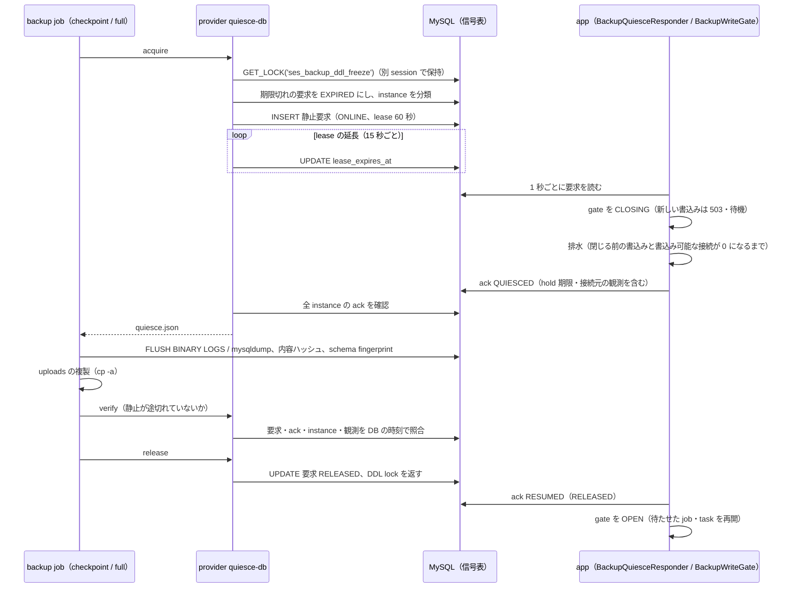

# backup の書込み静止（app 内の静止応答）設計

- 状態: **草案（第 1 段階: spec のみ）**。要件は `requirements.md`、手順は `tasks.md`。
- 本書は brief の 13 の設計問題（Q1〜Q13）に答える。答えの一覧は §2、利用者の決定待ちは §16。
- 「未決（利用者の決定待ち）」と書いた事項は、本書の推奨を前提に他の節を書いている。決定が推奨と違えば、該当する節と `tasks.md` を直す。

## 0. 位置付け

- 本 spec は `database-backup-recovery`（HFP-03）の RQ-002（全 app replica と scheduler の書込みを静止し、DDL/change freeze を確かめてから整合点を取る）を、本番の構成で成り立たせるための部品である。HFP-03 の他の要件（manifest・PITR・restore・cutover）は変えない。
- 整合点の定義は変えない: full は mysqldump の一貫 snapshot と uploads の複製を同じ静止区間で取り、checkpoint は FLUSH BINARY LOGS の closed coordinate と uploads の複製を同じ静止区間で取る（`database-backup-recovery/design.md` §5）。本 spec が足すのは「静止区間の間、app が DB と uploads を変えないこと」の保証と、その保証が途切れたら VALID にしない仕組みである。

## 1. 全体像



## 2. 設計問題への回答（一覧）

| # | 問題 | 結論 | 節 |
|---|---|---|---|
| Q1 | 信号表 | 3 表（要求・instance・ack）。要求は provider、instance と ack は app だけが書く。tenant 列なし。V202。H2 は変種 file と `engineer-schema-h2.sql` の両方に足す。`CONTENT_HASH_TABLES` からは除外を強制する | §3 |
| Q2 | backup account の権限 | `sys_backup_quiesce_request` への表単位の `INSERT`・`UPDATE` だけを足す。README・§1.2・DBA-1 を同じ内容に直す | §4 |
| Q3 | instance の識別と heartbeat | 起動ごとの UUID＋host 名＋DB から見た接続元。ECS task metadata は使わない。heartbeat 5 秒、self-fence 20 秒、状態不明 60 秒、停止済み 300 秒。接続元は app が同じ user の PROCESSLIST で観測する。停止確認 provider の processlist の扱いは **未決 U-2** | §5 |
| Q4 | 書込み停止の意味と仕組み | HTTP の分類で 503、scheduler は ShedLock の前で待機、async は投入時点で区別、起動時処理は permit、業務の接続は静止中に読取り専用、排水の条件は「permit 0 かつ書込み可能な接続 0」。上限超過は ack を拒否。排水の上限は **未決 U-3** | §6 |
| Q5 | 安全 | lease（60 秒、15 秒ごとに延長）と app の最大保持時間で自動再開。ack の hold 期限を DB の時刻で照合する verify を、整合点の採取の後・解除の前に必ず呼ぶ | §7 |
| Q6 | DDL 凍結 | 配備中は backup の timer を止める。加えて本番の Flyway job が callback で同じ GET_LOCK を取る。**未決 U-5**（推奨: 両方を実装） | §8 |
| Q7 | app 停止の確認 | `quiesce-app-stopped`。全 instance が停止済みで有効な要求が無いことを確かめ、APP_STOPPED の保持を登録する。保持中は app が起動しない。`--app-stopped` の明示の引数でだけ使う | §9 |
| Q8 | 静止時間 | 初期は checkpoint 10〜30 秒程度（推定）。uploads の件数に比例して伸びる。上限は **未決 U-1**（推奨: checkpoint 300 秒、full 60 分）。超えたら自動再開・VALID にしない・RPO alert | §10 |
| Q9 | 配備手順との関係 | `APP_SCHEDULING_ENABLED=false` は ack の `scheduler_state=DISABLED` で足りる。§2 の初めに timer を止め、§2 の5 は停止確認の full、§4 の後に再開。bootstrap 中も checkpoint を取る | §11 |
| Q10 | 設定と fail-fast | `app.backup-quiesce.*`。prod は `enabled=false` と `readOnlyPropagatesToServer=false` で起動を中止。§1.0・雛形・照合 script を同じ変更で直す | §12 |
| Q11 | 可観測性 | 固定の `errorCode=BACKUP_QUIESCE_*` の日本語 log、`ses_backup_quiesce_*` の metric、自動再開・FENCED は critical | §13 |
| Q12 | 試験計画 | unit・H2・MVC・MySQL（shard に追加）・shell・CI の backup integration。integration の responder は **未決 U-4**（推奨: DB の protocol を話す shell の responder ＋ Java の MySQL 契約試験） | §14、`tasks.md` |
| Q13 | 文書 | runbook §1.0・§1.2・§1.7・§2・§3・§4、README、監視 runbook、restore-cutover、baseline PROD-004、pii-inventory | §15 |

## 3. 信号表（Q1）

### 3.1 表の定義（V202 の骨子）

実際の DDL は BWQ-001 で書く。列名・制約名は次のとおりにする。全表 `ENGINE=InnoDB DEFAULT CHARSET=utf8mb4 COLLATE=utf8mb4_unicode_ci`、列と表に日本語の COMMENT を付ける（既存の migration と同じ）。

**`sys_backup_quiesce_request`**（静止要求。1 回の backup の静止ごとに 1 行）

| 列 | 型 | 内容 |
|---|---|---|
| `id` | BIGINT AUTO_INCREMENT PK | 要求の番号。epoch として使う |
| `request_token` | CHAR(32) NOT NULL、一意 `uk_bq_request_token` | provider が作る 16 byte の乱数の hex。自分の要求を取り違えないため |
| `mode` | VARCHAR(16) NOT NULL | `ONLINE`（app の静止応答）/ `APP_STOPPED`（停止確認の保持） |
| `job_kind` | VARCHAR(16) NOT NULL | `FULL` / `CHECKPOINT`（app が最大保持時間・排水の上限を選ぶ） |
| `status` | VARCHAR(16) NOT NULL | `REQUESTED` / `RELEASED` / `ABORTED` / `EXPIRED` |
| `active_slot` | TINYINT NULL、一意 `uk_bq_request_active` | 有効な要求だけ 1、それ以外は NULL（MySQL の一意索引は NULL を重複とみなさない） |
| `lease_seconds` | INT NOT NULL | 1 回の延長で延ばす秒数 |
| `requested_by` | VARCHAR(64) NOT NULL | job 名と backup host（`^[A-Za-z0-9._:-]{1,64}$`。個人名・秘密を書かない） |
| `protocol_version` | SMALLINT NOT NULL | protocol の版（初版 1） |
| `requested_at` | DATETIME(6) NOT NULL | DB の `NOW(6)` |
| `lease_expires_at` | DATETIME(6) NOT NULL | 延長ごとに provider が更新する |
| `released_at` | DATETIME(6) NULL | |
| `release_reason` | VARCHAR(32) NULL | `COMPLETED` / `ABORTED` / `VERIFY_FAILED` / `EXPIRED` |

制約: `ck_bq_request_mode`・`ck_bq_request_kind`・`ck_bq_request_status`（値の集合）、`ck_bq_request_active`（`(status = 'REQUESTED' AND active_slot = 1) OR (status <> 'REQUESTED' AND active_slot IS NULL)`）。索引 `idx_bq_request_requested_at (requested_at)`。

**`sys_backup_quiesce_instance`**（app の instance。JVM の起動ごとに 1 行）

| 列 | 型 | 内容 |
|---|---|---|
| `instance_id` | CHAR(36) PK | 起動ごとの UUID |
| `host_name` | VARCHAR(255) NOT NULL | `InetAddress.getLocalHost().getHostName()`（取れなければ `unknown`） |
| `db_client_host` | VARCHAR(255) NOT NULL | 制御用の接続で読んだ `SUBSTRING_INDEX(USER(), '@', -1)`。PROCESSLIST の host（`SUBSTRING_INDEX(host, ':', 1)`）と照合する |
| `db_connection_id` | BIGINT NOT NULL | 登録時の `CONNECTION_ID()`（診断用） |
| `app_commit` | VARCHAR(64) NOT NULL | build の commit（取れなければ `unknown`） |
| `protocol_version` | SMALLINT NOT NULL | |
| `heartbeat_interval_ms` / `fence_after_ms` | INT NOT NULL | provider が閾値の整合を確かめる |
| `scheduling_enabled` | TINYINT NOT NULL | `app.scheduling.enabled` の値 |
| `status` | VARCHAR(16) NOT NULL | `STARTING` / `RUNNING` / `STOPPED` |
| `gate_state` | VARCHAR(16) NOT NULL | `OPEN` / `CLOSING` / `CLOSED` / `FENCED`（診断用。判定には ack を使う） |
| `started_at` / `last_beat_at` | DATETIME(6) NOT NULL | DB の `NOW(6)` |
| `stopped_at` | DATETIME(6) NULL | |

制約: `ck_bq_instance_status`・`ck_bq_instance_gate`。索引 `idx_bq_instance_last_beat (last_beat_at)`。

**`sys_backup_quiesce_ack`**（要求×instance の応答）

| 列 | 型 | 内容 |
|---|---|---|
| `request_id` | BIGINT NOT NULL | FK `fk_bq_ack_request` → `sys_backup_quiesce_request(id)` ON DELETE CASCADE |
| `instance_id` | CHAR(36) NOT NULL | FK を張らない（instance の行は先に削除され得る。孤立した ack は判定に使わない） |
| `state` | VARCHAR(16) NOT NULL | `QUIESCED` / `REFUSED` / `RESUMED` |
| `scheduler_state` | VARCHAR(16) NOT NULL | `PAUSED`（scheduler 有効で待機中）/ `DISABLED`（`APP_SCHEDULING_ENABLED=false`） |
| `drain_millis` | INT NOT NULL | 排水にかかった時間 |
| `hold_until` | DATETIME(6) NULL | app が自動で再開する時刻（DB の時刻。§3.3） |
| `observed_app_hosts` | VARCHAR(1024) NOT NULL | 同じ app account の接続元と件数（`host=件数` を host の昇順に `,` でつなぐ） |
| `observed_at` | DATETIME(6) NOT NULL | 最後に観測した DB の時刻 |
| `refuse_reason` | VARCHAR(64) NULL | `DRAIN_TIMEOUT` / `ERROR` / `UNSUPPORTED_PROTOCOL` |
| `acked_at` | DATETIME(6) NOT NULL | |
| `resumed_at` | DATETIME(6) NULL | |
| `resume_reason` | VARCHAR(32) NULL | `RELEASED` / `LEASE_EXPIRED` / `MAX_HOLD` / `REQUEST_GONE` |

PK `(request_id, instance_id)`。制約 `ck_bq_ack_state`・`ck_bq_ack_scheduler`。

### 3.2 書く者と状態遷移

| 表 | provider | app | backup 以外の運用者 |
|---|---|---|---|
| 要求 | INSERT・UPDATE（status・active_slot・lease_expires_at・released_at・release_reason） | SELECT。保存期間を過ぎた RELEASED/ABORTED/EXPIRED の行の DELETE（ack は CASCADE） | 異常時だけ DBA が `ABORTED` にする（§9.4） |
| instance | SELECT | INSERT・UPDATE・保存期間を過ぎた行の DELETE | — |
| ack | SELECT | INSERT・UPDATE | — |

要求の状態:

```text
REQUESTED --release-->        RELEASED
REQUESTED --cleanup trap-->   ABORTED   （verify 前の失敗。release_reason=ABORTED / VERIFY_FAILED）
REQUESTED --次の provider が期限切れを発見--> EXPIRED
```

app は lease_expires_at を過ぎた REQUESTED を「無効」と扱い、要求の行は書き換えない（書く者を 1 つに保つ）。

instance の状態: `STARTING`（登録済み。起動の待機中を含む）→ `RUNNING`（起動完了）→ `STOPPED`（graceful shutdown の最後）。強制終了した instance は RUNNING のまま残り、`last_beat_at` の古さで判定する（§5.3）。

ack の状態: なし → `QUIESCED`（排水を終えて CLOSED）または `REFUSED`（排水の上限超過・エラー）→ `QUIESCED` から `RESUMED`（再開。理由を記録）。同じ要求について app は一度 RESUMED にしたら閉じ直さない。

### 3.3 epoch・lease・hold 期限

- epoch は要求の `id`。ack は `(request_id, instance_id)` の行なので、前の要求の ack が次の要求の ack に見えることは無い。
- lease: provider は `lease_expires_at = NOW(6) + lease_seconds` で登録し、`QUIESCE_LEASE_RENEW_SECONDS`（既定 15 秒）ごとに `UPDATE … SET lease_expires_at = NOW(6) + INTERVAL lease_seconds SECOND WHERE id = ? AND status = 'REQUESTED' AND lease_expires_at > NOW(6)` で延ばす。期限を過ぎた lease は延ばせない（0 行なら延長を止め、verify を失敗させる印を state dir に書く）。
- hold 期限: app は要求を読むたびに `LEAST(lease_expires_at, requested_at + INTERVAL <最大保持時間(job_kind)> SECOND)` を DB で計算し、値が変わったら **先に ack の `hold_until` を更新し、commit が成功した後で** 手元の期限（単調時計）を延ばす。書けなければ延ばさない。そのため app が実際に再開する時刻は、最後に書けた `hold_until` より前にならない。
- provider の verify は `NOW(6) <= hold_until - INTERVAL QUIESCE_LEASE_MARGIN_SECONDS SECOND`（既定 5 秒）を全 ack について求める。app の単調時計と DB の時計の進みの差は margin で吸収する。
- 時刻は全て DB の `NOW(6)` で書き、差は SQL（`TIMESTAMPDIFF`・比較）で求める。JVM の時刻で書いた値と DB の時刻を比べない（`created_at` を JVM の時刻帯で書く既存の罠と同じ種類の誤りを避ける）。

### 3.4 tenant 列を持たない理由

- 静止の対象は DB と uploads の全体（全 tenant）で、tenant ごとには静止できない。表が表すのは process と DB instance の状態であり、業務データではない。前例は `shedlock`（V58）と `flyway_schema_history`。
- 表に触るのは静止応答の専用 thread と制御用 pool の `JdbcTemplate` だけで、MyBatis-Plus の mapper・HTTP の request thread を通らない。そのため `InternalTenantContextFilter`（認証済みの request へ tenant を束縛する）と `AccountingTenantContextHolder` は関与せず、tenant 未束縛の 403（`TENANT_CONTEXT_REQUIRED`）の対象にもならない。
- API・画面・menu を作らないため、`ActionPermissionResolver.RESOURCE_NAMES`・`m_menu`・権限 group の seed も足さない（新しい `/api` root が無い）。
- 単一 tenant（SRE-1）で配備する前提は変わらない。多 tenant 化は対象外。
- 試験: tenant の分離を確かめる既存の試験は業務の表を対象にし、全表に tenant 列を求める走査は現時点で無い（`shedlock` も tenant 列を持たない）。将来そのような走査を足す場合は、この 3 表を `shedlock` と同じく理由つきで除外する。`BackupQuiesceControlPoolUsageTest`（§14）が、表を mapper・controller から参照していないことを固定する。

### 3.5 Flyway の版番号

- `db/migration` は V201 まで（V199 は意図した欠番）。`db/migration-dev` は V100・V145・V146・V172_1 を使い、同じ版の空間を共有する。`db/privacy-journal` は別の instance の別の空間。
- 2026-11-21 時点で、main（`5ddddc2b`）と全 branch（local・remote）に V202 以上の file は無い。**V202 を使う**: `V202__backup_write_quiesce_signal.sql`。
- 実装の着手時と統合の直前に再確認する。衝突したら後に統合する側を上の空き番号へ振り直す（V199 などの空き番号は埋めない。CLAUDE.md）。
- 版番号に連動して直すもの: `src/test/java/com/ses/migration/LatestMigrationVersion.java` の `LATEST`（`202`）、`deploy-runbook.md` §3.3 の「V1〜V202（versioned 201件。SQL 200件＋Java migration 1件）」、§3.4 の最新版と件数の照会の末尾、§4 の schema guard の log 例、§1.7「Backup 開始の前提」の `FLYWAY_VERSION`（本 release は `202`）。`DeployRunbookMigrationCountTest` が照合する。trigger は作らないため 67 件は変わらない。

### 3.6 H2 の同期

- V202 は MySQL 固有の句（`ENGINE`・列の `COMMENT`）を含むため、`shedlock` と同じく H2 の変種 `src/test/resources/sql/schema-backup-quiesce-h2.sql`（`CREATE TABLE IF NOT EXISTS`、COMMENT なし、同じ列・制約・索引）を作り、`application-test.yml` の `schema-locations` の V201 の変種の後に足す。
- `src/test/resources/sql/engineer-schema-h2.sql` にも同じ 3 表を足す（`DROP TABLE IF EXISTS` → `CREATE TABLE`。ack を先に DROP する）。
- `BackupQuiesceSchemaContractTest`（Docker 不要）が、V202 の `CREATE TABLE` の列名・型・NULL 可否と H2 の 2 つの定義が一致することを固定する（前例: `ImportStageStorageKeyIndexContractTest`）。
- 3 表は MyBatis-Plus の entity を持たない（制御用 pool の `JdbcTemplate` で読み書きする）。そのため entity の全列を並べる SELECT の「Unknown column」の問題は起きないが、上の 2 か所は CLAUDE.md の規則どおり更新する。

### 3.7 `CONTENT_HASH_TABLES`（DBA-6）から外す理由

- 信号表は静止区間の中でも書かれる（heartbeat は 5 秒ごと、ack の観測、lease の延長）。checkpoint の内容ハッシュは FLUSH BINARY LOGS の後に計算するため、FLUSH の後の書込みは次の binlog に入り、復元（closed coordinate までの replay）には現れない。記録したハッシュと復元後の値が合わず、復元検証が必ず FAIL になる。
- 内容は運用の記録で、業務上の意味が無い。
- 設定の誤りを早く見つけるため、`lib/content-hash.sh` の `content_hash::collect` は名前が `sys_backup_quiesce_` で始まる表を指定されたら、計算を始める前に失敗する（`CRITICAL_TABLES` の件数は情報だけなので拒否しないが、README で勧めない）。
- 逆に、静止中に動かない表（業務の表、`shedlock`、`t_user_session`）は従来どおり指定できる（静止中は session の更新も止める。§6.4）。

### 3.8 restore の後の信号表

- 復元した DB には、checkpoint の時点の信号表（REQUESTED の要求、RUNNING の instance、QUIESCED の ack）が残る。restore の後に起動する app は新しい UUID で登録し、残った要求は lease の期限切れとして無視し（起動の INFO log に要求の番号を出す）、残った instance は停止済みの閾値で無視される。追加の作業は要らない。
- cutover の後に最初に動く provider が、残った要求を `EXPIRED` にしてから自分の要求を登録する。
- `ops/backup/runbooks/restore-cutover.md` に、この挙動と「手で消さない」ことを 1 段落で書く。

### 3.9 保存期間と個人データ

- 個人データは持たない（host 名・接続元の IP・job 名・時刻だけ）。`requested_by` に人の名前を書かせない（形式の検査）。
- 保存期間は 30 日（`app.backup-quiesce.retention`）。app が 1 日 1 回、有効な要求が無い時に、30 日より古い RELEASED/ABORTED/EXPIRED の要求（ack は CASCADE）と、`last_beat_at` が 30 日より古い instance を消す。
- 個人データを消す経路ではないため、NF07 の保全 hold の gate（`deploy-runbook.md` §4.4）には接続しない。review で求められれば §4.4 の除外の行に理由つきで足す。
- `privacy-retention-dsar/pii-inventory.md` に DB-148〜DB-150 として 3 表を足す（構造の記録だけ。個人データなし）。

## 4. backup account の権限（Q2）

- **source 側の account に足す権限**: `GRANT INSERT, UPDATE ON ses_manager_db.sys_backup_quiesce_request TO '<backup account>'@'<host>';`（表単位）。
  - `sys_backup_quiesce_instance`・`sys_backup_quiesce_ack` の読取りは既存の schema 単位の `SELECT` で足りる。
  - 要らないもの: `DELETE`（保存期間の削除は app が行う）、他の表への書込み、`PROCESS`（停止確認での processlist の照合は **U-2**。推奨では足さない）、`GET_LOCK` の権限（権限不要。既存）。
  - 影響: backup account が 1 つの表の書き手になる。その transaction は binlog と GTID に残り、PITR で replay される（問題ない）。
- **app account**: 変えない。schema 単位の `SELECT, INSERT, UPDATE, DELETE` に信号表も含まれる。制御用 pool も同じ app account を使う。別の user を作ると、SRE-5 の (a)・§1.2 の processlist の確認と NF06 の照合（同じ user の thread だけが見える）が崩れ、§5.4 の観測も働かない。
- **直す文書**:
  - `ops/backup/README.md`「権限分離」: 「source 側の account の権限」の表に行を足す（`INSERT`・`UPDATE` / `<db>.sys_backup_quiesce_request`（表単位）/ full・checkpoint（`quiesce-db`・`quiesce-app-stopped`）/ 静止要求の登録・延長・解除（`providers/quiesce-db.d/*.sql`））。dump role の行の権限の列にも足す。「要らないもの」に `DELETE` と（U-2 の推奨なら）`PROCESS` の理由を足す。
  - `deploy-runbook.md` §1.2「backup 用の account」: 上の表単位の権限と、`SHOW GRANTS` の期待（要求の表への `INSERT, UPDATE` の表単位の GRANT が 1 行増える）を足す。アプリ account の項に「制御用 pool も同じ account」を足す。
  - DBA-1（§1.7）: 「backup 用の account も同じ日に確かめる」に、表単位の権限を含めることを書く。
- 実 MySQL の試験（BWQ-011）で、README の表と同じ権限だけを持つ user が provider の SQL を全て実行でき、業務の表への INSERT は拒否されることを確かめる。

## 5. instance の識別と heartbeat（Q3）

### 5.1 instance ID の取り方

- **採る方式**: 起動ごとに `UUID.randomUUID()` を作り、再利用しない。補助として host 名・`USER()` の host 部（DB から見た接続元）・`CONNECTION_ID()`・commit・設定値を記録する。
- **採らない方式**: ECS task metadata（`ECS_CONTAINER_METADATA_URI_V4` の HTTP 呼出し）。起動時に link-local への HTTP 依存が増え、取れないときの扱いを別に決める必要がある一方、識別には UUID で足り、task との対応は接続元の IP（awsvpc の ENI）で SRE が ECS の画面と照合できる。必要になれば列を足す（後の batch）。
- host 名＋起動時刻だけの ID は、同じ host での再起動（ECS の再配置で起こり得る）と区別しにくいため使わない。

### 5.2 heartbeat と閾値

| 値 | 既定 | 置き場所 | 関係 |
|---|---|---|---|
| 要求の読取り間隔 | 1 秒 | app `poll-interval` | SELECT だけ（binlog に残らない） |
| heartbeat の間隔 | 5 秒 | app `heartbeat-interval` | instance の行の UPDATE |
| self-fence の閾値 | 20 秒 | app `fence-after` | 最後に heartbeat を書けてからの単調時計の経過。超えたら gate を FENCED にする |
| 状態不明の閾値 | 60 秒 | provider `QUIESCE_STALE_SECONDS`（既存の名前と既定） | `fence_after + 2 × heartbeat_interval` 以上であること（instance の申告値で provider が確かめ、満たさなければ設定の誤りとして失敗） |
| 停止済みの閾値 | 300 秒 | provider `QUIESCE_DEAD_SECONDS`（新規） | `QUIESCE_STALE_SECONDS` より大きいこと |

- heartbeat と要求の読取りは、静止応答が自分で持つ 1 本の thread（`ScheduledExecutorService`。bean にしない）で行う。`@Scheduled` を使わないため `APP_SCHEDULING_ENABLED=false` でも動く。`SchedulingDisabledDrainTest` の既知一覧に理由つきで載せる（BWQ-006）。
- 制御用 pool（§6.5.4）を使うため、業務の pool が満杯でも heartbeat は書ける。

### 5.3 古い heartbeat の扱い

provider は `NOW(6) - last_beat_at` で instance を分ける。

| 分類 | 条件 | 扱い |
|---|---|---|
| 新しい | status が STARTING/RUNNING で経過 ≤ `QUIESCE_STALE_SECONDS` | 静止を求め、ack を待つ |
| 状態不明 | STARTING/RUNNING で `QUIESCE_STALE_SECONDS` < 経過 ≤ `QUIESCE_DEAD_SECONDS` | **backup を失敗させる**（instance ID・host・経過秒を出す）。生きていて ack しない instance を黙って無視しない |
| 停止済み | status が STOPPED、または経過 > `QUIESCE_DEAD_SECONDS` | 無視する。止まった instance の古い行で backup が永久に止まらない |

- 根拠: app は heartbeat を書けない状態が `fence-after`（20 秒）続くと自分で gate を閉じる（§6.2）。heartbeat が 60 秒より古い instance は、生きていても新しい書込みを受け付けていない。300 秒までの猶予は、閉じる前に始まった書込み（in-flight）が終わる時間と、self-fence の実装に誤りがあった場合の余裕である。
- 前提: 1 件の書込み処理（request・job・async）は `QUIESCE_DEAD_SECONDS` より短い。長い job（NF10 の定期レポートの生成など）がこれを超えると、強制終了ではない「heartbeat だけが止まった instance」の書込みを見逃す余地が残る。ONLINE では §5.4 の観測と「新しい instance が 1 つ以上必要」で塞がれる。停止確認（§9）での残余は U-2 で扱う。
- 異常時に強制終了した instance の後は、最長 300 秒 backup が失敗し、その後は進む。

### 5.4 processlist との照合（ONLINE）

- app は ack を書く時と、静止中の heartbeat ごとに、制御用の接続で次を実行し、結果を ack の `observed_app_hosts` と `observed_at` に書く。
  ```sql
  SELECT SUBSTRING_INDEX(host, ':', 1) AS h, COUNT(*) AS n
    FROM information_schema.PROCESSLIST
   WHERE user = SUBSTRING_INDEX(USER(), '@', 1)
   GROUP BY h ORDER BY h;
  ```
  PROCESS 権限の無い account にも同じ user 名の thread は見える（`deploy-runbook.md` §1.2 の NF06 の項と同じ性質）。そのため PROCESS を誰にも足さずに、同じ app account を使う全ての接続元が見える。
- provider の verify は、観測が `QUIESCE_STALE_SECONDS` 以内に更新され、観測した host が全て「ack した instance の `db_client_host`」に含まれることを求める。heartbeat を書かずに DB の接続を持ち続ける instance（停止に失敗した旧 task、app account を使う別の process）がいれば失敗する。
- SRE-5 の (a) と同じく、RDS Proxy 等の中継を挟むと全接続が中継の IP に見え、照合は弱くなる（instance の `db_client_host` も中継の IP になるため常に一致する）。現在の配備は中継を使わない前提で、deployment owner の inventory（PROD-004）で確かめる。

## 6. 書込みを止める意味と仕組み（Q4）

### 6.1 不変条件

- **I-1**: ack を書いた時点から gate が OPEN に戻るまで、app は業務の接続 pool で DB へ書かず、uploads を変えない。
- **I-2**: 閉じる前に始まった書込みは、ack の前に全て終わっている（排水）。
- **I-3**: gate が OPEN に戻るのは、解除を読んだ時・hold 期限・排水の上限超過（ack 前）のどれかだけで、hold 期限は最後に書けた `hold_until` より前にならない。
- uploads を変える経路（upload の POST、file の清掃 job、旧 upload の移行、DSAR package の削除など）は、全て HTTP の更新・scheduler・async・起動時処理のどれかに含まれる。そのため DB の書込みを止める仕組みで uploads の変更も止まる。GET の中で file を書く経路があっても、DB の更新が読取り専用で失敗する。残るのは参照のない file だけで、DB→file の参照は壊れない（参照のない file は `FileCleanupScheduler` が後で消す）。

### 6.2 gate の状態

```text
OPEN --要求を読む--> CLOSING --排水完了・ack 書込み--> CLOSED --解除/hold 期限--> OPEN
CLOSING --排水の上限超過・エラー（REFUSED を書く）--> OPEN
任意の状態 --heartbeat を fence-after 書けない--> FENCED --heartbeat 回復かつ有効な要求なし--> OPEN
                                                    （有効な要求があれば、その要求の処理へ戻る）
```

- CLOSING・CLOSED・FENCED では新しい permit を出さず、業務の接続を読取り専用で渡す（§6.5）。
- 状態は `BackupWriteGate` の 1 つの object が持ち、判定は lock を持たない読取り（volatile の状態＋単調時計）で行う。FENCED の判定と hold 期限の判定は、静止応答の thread が止まっても働くよう、gate を参照する側で毎回評価する（遅延評価）。
- `app.backup-quiesce.enabled=false`（test profile）では gate は常に OPEN で、heartbeat も fence も無い。

### 6.3 書込み経路の一覧と静止中の扱い

| 経路 | 例 | 静止中（CLOSING・CLOSED・FENCED） | 仕組み |
|---|---|---|---|
| HTTP の更新 method（GET・HEAD・OPTIONS 以外） | 画面・API・PWA の送信・`/login`・`/logout`・`/password/change`・`/external-api/**` | 503 | `BackupWriteGateFilter`（認証より前） |
| 書込みを伴う既知の GET | OIDC の `/oauth2/authorization/**`・`/login/oauth2/code/**`、freee の `/integrations/freee/**`、file の download（`ApiAuditFilter` の download 判定。監査を残すため）、`/external-api/**` の全 method | 503 | 同上 |
| bootstrap・break-glass の session の要求（静的資源と error dispatch を除く） | §5 の bootstrap 作業 | 503（毎回の監査を残せないため） | 同上（session の属性で判定。認証前でも読める） |
| その他の GET・HEAD | 一覧・詳細・dashboard・通知の取得 | 継続。業務の接続は読取り専用。session の最終利用の更新は省く。想定外の書込みは ERROR 1792 → 503 | §6.5、`PersistentSessionServiceImpl`、例外の変換 |
| `@Scheduled`（全て `@SchedulerLock` 付き。`ScheduledMethodsHaveSchedulerLockTest`） | outbox・会計 worker・清掃・通知 | ShedLock の表へ書く前で解除まで待つ（飛ばさない） | `BackupQuiesceLockProvider`（§6.6） |
| `@Async`（`SchedulingDisabledDrainTest` の `ASYNC_INVENTORY` の method。全て `taskExecutor`） | 取込の解析・mail・webhook・残業の通知 | 閉じる前（または permit を持つ thread）の投入は排水の対象。閉じた後の投入は開始を待つ | `BackupQuiesceTaskDecorator`（§6.7） |
| 起動時の処理（DB 書込みあり 5 件） | `LegacyUploadMigrationRunner`・`ContractDocumentBackfillRunner`・`ContractDocumentDispatchBackfill`・`ProductionSecurityConfigurationValidator`・`IntegrationHubOutboundStartupBarrier` | 有効な要求がある間は起動を待つ。起動中は startup permit を持ち排水の対象 | §6.8 |
| 信号表 | heartbeat・ack・観測 | 継続 | 制御用 pool（§6.5.4） |

一覧の起動時処理と async は `SchedulingDisabledDrainTest` の既知一覧（`STARTUP_HOOK_INVENTORY`・`ASYNC_INVENTORY`）と同じものである。新しい起動時処理・async・自前の thread を足すと、その試験が失敗して見直しを求める。

### 6.4 HTTP

- `com.ses.backup.quiesce.BackupWriteGateFilter`（servlet filter。`@Order(Ordered.HIGHEST_PRECEDENCE + 30)`。`CorrelationIdFilter`・`PwaNoStoreFilter` の後、Spring Security（-100）の前）。認証より前に置くため、login の POST は `LoginFailureHandler` が `failed_count` を数える前に止まる（静止中に数えられない失敗で lock を回避できない）。portal の filter chain にも同じく効く。
- 分類は `BackupQuiesceRequestClassifier`（純粋な関数。`RequestPaths.pathWithinApplication` を使う）で、`ALWAYS`（静的資源・`/actuator/health/**`・`/actuator/prometheus`・`/actuator/metrics/**`・error dispatch）/ `READ` / `WRITE` を返す。download の判定は `ApiAuditFilter.isDownloadUri` を `com.ses.common.util.AuditedDownloadPaths` へ移して共有する（2 か所で判定がずれないため）。
- `WRITE` は gate が OPEN のとき permit を取って通し（増やしてから状態を読み直す。取れなければ戻す）、要求の終わりに返す。OPEN でなければ 503。
- `READ` は permit を取らずに通す。session の検査（`PersistentSessionServiceImpl.validateAndTouch`）は、gate が OPEN でなく呼び出し元の thread が permit を持たないとき、検証（失効・期限）だけを行い `t_user_session.touch` を省いて true を返す（metric `skipped_writes`）。最大保持時間の間 idle の延長が止まるだけで、30 分の idle 期限に比べて小さい。
- 最後の防線に当たった場合の変換: filter は chain 全体を try/catch で包み、原因の連鎖に MySQL の ERROR 1792（SQLSTATE `25006`）があり gate が OPEN でないときは、応答が未 commit なら 503 に変える。API の controller の例外は先に `GlobalExceptionHandler` が受けるため、`handleException` の前で同じ判定（`BackupQuiesceReadOnlyViolation.matches`）を行い 503 にする。明示に投げる `BackupWriteQuiescedException` の handler も足す。
- best-effort の監査（`AuditLogService.record`）は例外を握りつぶすため、静止中の READ の要求が監査を書こうとすると黙って失われる。`AuditLogServiceImpl.record` は gate が閉じていて permit が無いとき DB へ書かず、同じ内容を WARN の application log（`errorCode=BACKUP_QUIESCE_AUDIT_DEFERRED`）に出して metric `skipped_writes` を数える。必須の監査（`recordRequired`）は例外になり、要求は 503 になる。

### 6.5 DataSource の最後の防線

#### 6.5.1 読取り専用の接続

- `BackupQuiesceDataSourcePostProcessor`（`BeanPostProcessor`）が業務の `DataSource` bean（Hikari）を `BackupQuiesceAwareDataSource`（`DelegatingDataSource` の派生）で包む。
- gate が OPEN でなく、借りる thread が permit を持たないとき、借りた接続に `setReadOnly(true)` を呼ぶ。Connector/J は `readOnlyPropagatesToServer=true`（既定）で `SET SESSION TRANSACTION READ ONLY` を送り、MySQL は永続表への INSERT・UPDATE・DELETE を ERROR 1792 で拒否する。接続を返すと Hikari が既定（書込み可）へ戻す。
- 包んだ接続への `setReadOnly(false)`（読取り専用の transaction を終えた Spring が戻す呼出し）は、静止で読取り専用にした接続では無視する（DEBUG の log）。
- `readOnlyPropagatesToServer=false` の JDBC 設定ではこの防線が黙って消えるため、起動時に拒否する（§12）。
- H2 は接続単位の読取り専用を強制しないため、拒否の挙動は MySQL の試験でだけ確かめる（BWQ-004）。H2 の試験は「`setReadOnly(true)` を呼んだこと」を確かめる。

#### 6.5.2 書込み可能な接続の数え方

- 包んだ接続は「書込み可能か」を持つ（借りた時の状態と `setReadOnly` の呼出しで更新する）。gate は「借りられていて書込み可能な業務の接続の数」を数える。
- 排水の完了条件（§6.9）にこの数を含める。閉じる前に借りられた書込み可能な接続（READ の要求が持っている transaction を含む）は返されるまで数えられ、閉じた後に permit 無しで借りた接続は読取り専用なので数えない。この条件が 0 になった後は、permit を持つ thread でなければ業務の pool で書けない。
- 読取り専用の transaction（`@Transactional(readOnly = true)`。Spring が `setReadOnly(true)` を呼ぶ）を持つ長い export は数えないため、排水を止めない。

#### 6.5.3 permit

| 種類 | 取る所 | 返す所 |
|---|---|---|
| HTTP | `BackupWriteGateFilter`（WRITE） | 要求の終わり |
| scheduler | `BackupQuiesceLockProvider.lock` | `SimpleLock.unlock` の後（ShedLock の表の解除の書込みを含む） |
| async | `BackupQuiesceTaskDecorator` の投入時（閉じる前・permit を持つ thread の投入） | task の終わり |
| startup | 静止応答の `afterSingletonsInstantiated` | `ApplicationReadyEvent` |

- permit は thread に結び付け（`ThreadLocal` の深さで入れ子を許す）、permit を持つ thread の入れ子の要求（例: HTTP の中から呼ぶ `@SchedulerLock` の method）は待たせない。

#### 6.5.4 制御用 pool

- `BackupQuiesceControlConnectionPool`: `DataSourceProperties`（`spring.datasource.url`・`username`・`password`）から作る小さな `HikariDataSource`（pool 名 `ses-backup-quiesce-control`、最大 2、autoCommit）を内部に持つ holder の class。**`DataSource` 型の bean にしない**（`DataSource` の bean が 2 つになると Spring Boot の DataSource の自動構成が働かなくなり、注入先も曖昧になる）。
- 信号表の SQL は `BackupQuiesceSignalRepository` に集め、この pool の `JdbcTemplate` だけを使う。`BackupQuiesceControlPoolUsageTest`（静的な走査）が、他の class から使っていないことを固定する。
- 接続数は 1 task あたり最大 2 増える（雛形の `DB_POOL_SIZE=10` に対して 12）。

### 6.6 scheduler

- `SchedulerLockConfig.lockProvider` が返す `JdbcTemplateLockProvider` を `BackupQuiesceLockProvider` で包む。`ScheduledMethodsHaveSchedulerLockTest` が全ての `@Scheduled` に `@SchedulerLock` があることを固定しているため、全ての job が `lock()` を通る。
- `lock(config)`: thread が permit を持てばそのまま委譲する。持たなければ scheduler の permit を取り（OPEN のときだけ取れる）、取れなければ gate が OPEN に戻るまで待ってから取る（gate は hold 期限で必ず開くため待ちは最大保持時間で終わる。それでも取れなければ委譲せずに空を返し、WARN を出してその回を飛ばす。FENCED が続く場合だけ起こる）。取った後で委譲し、委譲が空（他で実行中）なら permit を返す。返ってきた `SimpleLock` は、`unlock()` の後で permit を返す包みにする。
- ShedLock の表は委譲の中で書かれるため、待っている間は書かれない。cron の job は遅れて実行され、1 日分飛ばない（`@Scheduled` の cron は次の発火まで待つため、飛ばすと 02:00 の日次 job が 1 日分欠ける）。
- Spring Boot の scheduler の thread は既定で 1 本（`spring.task.scheduling.pool.size` 未設定）なので、待っている job があると他の job も後ろに並ぶ。静止中は全ての job が止まっているので問題ない。
- `@SchedulerLock` の method は primitive を返さない（CLAUDE.md）。包みは interceptor の外の LockProvider で行うため、method の戻り値の型には触れない。`SchedulerLockProxyInvocationTest` に「閉じている間は表へ書かず、開くと実行される」場合を足す。

### 6.7 async

- `AsyncConfig.taskExecutor` に `setTaskDecorator(BackupQuiesceTaskDecorator)` を設定する（`@Async` は修飾なしも含め全てこの executor で動く）。
- `decorate()` は投入する thread で呼ばれる。gate が OPEN か、投入する thread が permit を持つなら、その場で async の permit を数え（in-flight。task が始まる前の queue の中でも数える）、task を実行する thread がその permit を引き継いで持ち、task の終わりに返す。閉じた後に permit の無い thread が投入した task は、実行の開始時に gate が開くまで待ってから permit を取る。
- そのため、閉じる前に queue に入った task と、排水中の job が中で投入して待つ task は排水の対象になり、排水が終わらずに止まることが無い。`CallerRunsPolicy` で呼び出し元の thread が実行する場合も、同じ包みが働く。
- 取込の解析（CAS で状態を進める）は、始まっていれば最後まで書いてから排水が終わるため、中間の状態（抽出中）で止まらない。

### 6.8 起動時

- `BackupQuiesceResponder.afterSingletonsInstantiated()`（全 singleton の生成後、lifecycle の開始・Tomcat の port・`ApplicationRunner` より前）で、instance を `STARTING` で登録し（最初の heartbeat）、heartbeat と要求の読取りの thread を始め、startup permit を取る。最初の heartbeat を書けなければ起動を中止する（DB に届かない app は動かせないため）。
- 有効な要求があれば:
  - `ONLINE`: WARN `errorCode=BACKUP_QUIESCE_STARTUP_WAIT` を出し、要求が終わるか期限切れになるまで、`startup-wait-max`（既定 150 秒）を上限に待つ。新しい instance の登録により provider の verify は失敗するため、通常はその解除で待ちが終わる。上限を超えたら ERROR `BACKUP_QUIESCE_STARTUP_ABORT` で起動を中止する。
  - `APP_STOPPED`: 待たずに ERROR `BACKUP_QUIESCE_STARTUP_ABORT` で起動を中止する（停止確認の backup の最中に app を起動させない。§9）。
- `startup-wait-max` は ECS の container health check の `startPeriod`（雛形 180 秒）より短くする（待つ間は Tomcat が動かず liveness が応答しないため）。
- 起動が終わったら（`ApplicationReadyEvent`）instance を `RUNNING` にし、startup permit を返す。起動中に要求が来たら、排水は startup permit を待つ（上限を超えれば REFUSED）。
- graceful shutdown（`server.shutdown: graceful`）では、静止応答の lifecycle は最後に止まり（phase を最小にする）、instance を `STOPPED` にする。CLOSED の間に止まる場合は ack を RESUMED にせず（再開していないため）、`STOPPED` だけを書く。

### 6.9 排水と ack

- 要求を読んだら gate を CLOSING にし、`permit の合計 == 0` かつ `書込み可能な業務の接続 == 0` になるまで待つ（10 ms 間隔の確認または条件変数）。
- 上限は job_kind で選ぶ（既定 checkpoint 30 秒・full 600 秒。**U-3**）。full は 02:00 に始まり、同じ 02:00 に始まる日次 job（`DocumentArchiveFileCleanupScheduler`・`ResumeRetentionCleanupServiceImpl`・`CustomerHealthScheduler`・`TaskDueDateNotificationScheduler`）が先に走っていればその終わりを待つ。
- 終わったら gate を CLOSED にし、hold 期限を DB で計算し、PROCESSLIST を観測して、ack（`QUIESCED`）を 1 つの transaction で書く。書けなければ gate を OPEN に戻す（ack が無いので provider は待ちの期限で失敗する）。
- 上限を超えたら `REFUSED`（`DRAIN_TIMEOUT`）を書き、gate を OPEN に戻し、待っていた permit の持ち主（種類・名前。HTTP は method と path の型、job は ShedLock の名前、async は method 名）を WARN の log に出す（どの処理が排水を止めたかを後で調べるため）。
- 同じ要求を二度処理しない（`(request_id, instance_id)` の行があれば ack の処理をしない）。

### 6.10 503 の応答と文言

- API（`/api/**`、`X-Requested-With: XMLHttpRequest`、`Accept: application/json` のいずれか）: status 503、`Retry-After`（残りの hold 期限の秒数を 5〜60 に丸めた値。CLOSING の間は 10）、`X-SES-Error-Code: BACKUP_QUIESCED`、本文 `{"code":503,"message":"<error.backup.quiesce.writeUnavailable>","data":null}`。`CorrelationContext` の ERROR_CODE は `BACKUP_QUIESCED`、分類は SYSTEM。
- 画面: `response.sendError(503)` と request 属性 `BackupWriteGate.REJECTED_ATTRIBUTE`。`CustomErrorController` は属性があれば `error.backup.quiesce.pageTitle`・`pageMessage` を `MessageSource` で引き（locale は言語切替えに従う）、icon を `bi-hourglass-split` にする（Bootstrap Icons は同梱済み）。`error.html` は変えない。
- PWA の送信（POST）: 503 は `pwa-queue.js` の 5xx の経路で queue に残り、自動で再送される（`PwaMutationApiController` の lock 競合の 503 と同じ挙動）。client の変更は要らない。
- `common.js` は API の 4xx/5xx で server の message を toast に出すため、変更しない。
- 文言（4 つの bundle に置き、それぞれ翻訳する。日本語を他の bundle へ写さない。`MessageBundleConsistencyTest`）:

| key | 日本語（基底） | 英語の例 |
|---|---|---|
| `error.backup.quiesce.writeUnavailable` | バックアップを取得しているため、一時的に更新を受け付けていません。しばらく待ってから再度お試しください。 | A backup is in progress, so updates are temporarily unavailable. Please wait a moment and try again. |
| `error.backup.quiesce.pageTitle` | 一時的に更新を停止しています | Updates are temporarily paused |
| `error.backup.quiesce.pageMessage` | バックアップを取得しているため、更新の操作を一時的に止めています。しばらく待ってから、もう一度操作してください。 | Updates are paused while a backup is taken. Please wait a moment and try again. |

  韓国語・中国語（簡体）は実装の時に訳す。

## 7. provider の手順と安全（Q5）

### 7.1 `quiesce-db`（ONLINE）の acquire

1. 設定を検査する（`QUIESCE_STALE_SECONDS` < `QUIESCE_DEAD_SECONDS`、lease・延長間隔・margin が正の整数で延長間隔 < lease、`requested_by` の形式）。
2. DDL 凍結の lock を取る（既存の `quiesce_local::ddl_lock_acquire` を共通の lib へ移して使う）。取れなければ要求を登録せずに失敗する（app を止めない）。
3. 1 つの transaction で: 期限切れの有効な要求を `EXPIRED`（`active_slot=NULL`）にし、instance を §5.3 で分類する。状態不明が 1 つでもある・新しい instance が 0 件・protocol の版が違う・閾値が整合しない、のどれかで失敗する（新しい instance が 0 件のときは「app が停止中なら `--app-stopped` を使う」と出す）。
4. 要求を INSERT する（`active_slot=1`）。一意索引に当たれば他の要求が有効なので失敗する。
5. lease の延長を background の process（固定の executable の関数。`bash -c` は使わない）で始め、pid を state dir に書く。
6. `QUIESCE_DEADLINE_SECONDS`（既定 checkpoint 90 秒・full 660 秒。full は排水の上限 600 秒を含む）まで 1 秒ごとに ack を読む。手順 3 の全ての新しい instance が `QUIESCED` になれば成功。`REFUSED` が 1 つでもあれば理由を出して直ちに失敗する。要求の後に `started_at` を持つ instance が現れたら失敗する。
7. ack を確かめる: `scheduler_state` が `PAUSED`/`DISABLED`、観測した host が ack した instance の `db_client_host` に含まれる。
8. `quiesce.json` を書く: `provider`、`mode`、`request_id`、`request_token`、`requested_at_utc`、`started_at_utc`（全 ack を確かめた時刻。DB の `UTC_TIMESTAMP(6)`。既存の script が整合時刻として読む名前を保つ）、instance ごとの ID・host・`acked_at_utc`・`hold_until_utc`、`ddl_lock`、`released_at_utc: null`。

### 7.2 verify（新しい sub command）

- `backup-full.sh` は schema fingerprint の採取の後、`create-checkpoint.sh` は uploads の snapshot の後（どちらも静止区間の最後の採取）で、`quiesce::release` の直前に `quiesce::verify` を呼ぶ。失敗したら `common::fail "静止が途中で途切れたため VALID にしません"` で止まり、cleanup の trap が解除する（`release_reason=VERIFY_FAILED`）。
- verify は 1 回の SELECT を DB の時刻で評価する:
  - 要求が `REQUESTED` で `active_slot=1`、lease の延長が止まった印が無い。
  - 手順 3 の全 instance の ack が `QUIESCED`（`RESUMED`・`REFUSED` が無い）で、`NOW(6) <= hold_until - margin`。
  - 手順 3 の instance が、status RUNNING/STARTING で `last_beat_at` が `QUIESCE_STALE_SECONDS` 以内、または `STOPPED`（静止中に graceful に止まった。CLOSED のまま止まるため書込みは無い）。
  - 要求の後に登録された instance が無い。
  - 全 ack の観測が `QUIESCE_STALE_SECONDS` 以内に更新され、host が ack した instance の接続元だけである。
- 成功したら `quiesce.json` に `verified_at_utc` を足す。verify は静止区間の最後の採取の後に 1 回呼べば足りる: 区間の終わりまで静止が続いたことを確かめれば、区間の途中の採取は全て静止の中で行われている（ack の後に再開すれば RESUMED か hold 期限の超過が残るため）。

### 7.3 release

- 延長の process を止め、`UPDATE … SET status = 'RELEASED', active_slot = NULL, released_at = NOW(6), release_reason = ? WHERE id = ? AND active_slot = 1`（理由は verify 済みなら `COMPLETED`、そうでなければ `ABORTED`）。0 行（既に期限切れ）でも DDL lock は必ず返す。
- `QUIESCE_RESUME_CONFIRM_SECONDS`（既定 15 秒）まで、全 instance の ack が `RESUMED` になるのを待つ。ならなければ「重大: app の再開を確かめられません（instance …）」を出して exit 3（既存の script は非 0 を「静止解除失敗（incident 扱い）」として扱う）。app は hold 期限で必ず再開するため、更新の停止は最長でも lease の期限で終わる。
- 解除の失敗は `database-backup-recovery/design.md:122` のとおり重大な alert とする。app 側には `errorCode=BACKUP_QUIESCE_AUTO_RESUMED`（ERROR）が残る（§13）。

### 7.4 app 側の自動再開

- app は 1 秒ごとに要求を読み、`RELEASED`/`ABORTED`/`EXPIRED`・行が無い・lease の期限切れのどれかで再開する（理由 `RELEASED`・`LEASE_EXPIRED`・`REQUEST_GONE`）。
- 手元の hold 期限（§3.3）に達したら、要求を読めなくても再開する（理由 `LEASE_EXPIRED` または `MAX_HOLD`。読めない間は RESUMED を書けず、書けるようになったら書く）。この判定は gate 自身が毎回行うため、静止応答の thread が止まっても再開する。
- 再開の理由が `RELEASED` 以外なら ERROR `errorCode=BACKUP_QUIESCE_AUTO_RESUMED`（request_id・経過秒・理由）を出す。backup の job が落ちた・解除に失敗した、のどちらかを意味する。

### 7.5 静止の中断が VALID にならない理由（まとめ）

| 中断の原因 | app の挙動 | provider が気付く所 |
|---|---|---|
| backup job の停止・host の停止 | lease の期限（最長 60 秒＋延長間隔）で再開 | job 自体が VALID を登録しない |
| lease の延長だけが止まった | 同上 | 延長が止まった印、または `hold_until` の超過で verify が失敗 |
| 解除の失敗 | hold 期限で再開 | release の exit 3（重大） |
| 静止が最大保持時間を超えた | 再開（`MAX_HOLD`） | `hold_until` の超過で verify が失敗 |
| instance の再起動・追加 | 新しい instance は起動を待つ | 要求の後に登録された instance で verify が失敗 |
| heartbeat の停止（fence） | FENCED（閉じたまま） | heartbeat の古さで verify が失敗 |
| heartbeat の無い接続元 | — | 観測した host の照合で verify が失敗 |

## 8. DDL 凍結（Q6）

- 現状: provider は `GET_LOCK('ses_backup_ddl_freeze')` を取るが、Flyway job も DBA の手作業も同じ lock を取らない。そのため lock は何も止めていない。
- **最小の方式（runbook）**: 配備の §2 の初めに backup の timer（checkpoint の 15 分ごとの起動と 02:00 の full）を止め、実行中の job の終わり（repository lock の解放、`tool-image.sh compose ps`）を待つ。§4 の readiness の UP と `FLYWAY_VERSION` の更新の後に再開する。DBA の手作業の DDL（§1.8）は、DDL の session で先に `SELECT GET_LOCK('ses_backup_ddl_freeze', 0);` が 1 を返すことを確かめてから行う。
- **実装の方式（推奨）**: `com.ses.config.ProductionBackupDdlFreezeFlywayCallback` を `ops/flyway/flyway-prod.conf` の `flyway.callbacks` の先頭に足す。
  - `BEFORE_MIGRATE`（と `BEFORE_REPAIR`）: 構成の DataSource から専用の接続を開き、`SELECT GET_LOCK('ses_backup_ddl_freeze', 120)` を実行する。1 でなければ「backup が実行中のため migration を始めません（ses_backup_ddl_freeze）。backup の timer が止まっていることを確かめて再実行してください」で失敗する（migration は 1 件も適用されない）。
  - `AFTER_MIGRATE`・`AFTER_MIGRATE_ERROR`（と repair の対）: `RELEASE_LOCK` を実行して接続を閉じる。process が落ちれば MySQL が lock を返す。
  - 待ち時間 120 秒は code の定数にする（job の環境変数は `FLYWAY_*` の 4 つに限る。§1.3）。
  - `ProductionFlywayJobConfigurationTest` の callback の順の期待を直し、`FlywayProdFreshInstallMySqlTest`（または新しい MySQL 試験）で lock の競合を確かめる。
- provider は静止を求める前に lock を取る（§7.1 の手順 2）。そのため Flyway job の最中は backup が始まらず、backup の最中は Flyway job が始まらない。
- **未決 U-5**: runbook だけにするか、callback も実装するか（§16）。

## 9. app 停止の確認（Q7）

### 9.1 使う場面

- 初回 backup（`deploy-runbook.md` §2 の5。§3 の後・§4 の前で、app は一度も起動していない）。
- 2 回目以降の配備の backup（§2 の4 でアプリ接続 0 件を確かめた後）。
- app を止めて行う DB の保守（保守の前の full）。

### 9.2 判定の条件（`quiesce-app-stopped` の acquire）

1. DDL 凍結の lock を取る（§7.1 と同じ）。
2. 期限切れの有効な要求を `EXPIRED` にし、有効な要求が残っていれば失敗する。
3. 全 instance が停止済み（`STOPPED`、または `last_beat_at` が `QUIESCE_DEAD_SECONDS` より古い）であること。新しい・状態不明の instance が 1 つでもあれば失敗する（「app が動いている可能性があります。instance …、最終 heartbeat から N 秒」）。表が空（一度も起動していない）なら通る。
4. `APP_STOPPED` の要求を登録し、lease を延長し続ける。
5. `quiesce.json` を書く（`mode: APP_STOPPED`、instance は空、`started_at_utc` は登録の時刻）。

verify: 要求が有効で、要求の後に登録された instance と、要求の後に heartbeat を書いた instance が無いこと。release は ONLINE と同じ（ack を待つ手順は無い）。

### 9.3 誤用の防止

- **明示の引数だけで選ぶ**: `backup-full.sh --app-stopped` と `create-checkpoint.sh --app-stopped`。`lib/quiesce.sh` は `QUIESCE_PROVIDER=quiesce-app-stopped` が環境変数から来たら拒否する（`.env.backup` に書いて定期の job が停止確認で動くことを防ぐ）。`tool-image.sh compose run --rm backup --app-stopped` は既存の「コンテナへ渡す引数」で渡せる。
- **起動の拒否**: 保持が有効な間に起動した app は port を開く前に中止する（§6.8）。
- **動いていた app が保持を読んだ場合**: 判定の後に heartbeat が戻った instance など、動いている app が有効な APP_STOPPED の保持を読んだら、gate を閉じ（FENCED と同じ扱い。ack は書かない）、ERROR `errorCode=BACKUP_QUIESCE_STOPPED_HOLD_SEEN` を出す。その instance の heartbeat で verify は失敗する。
- **heartbeat と self-fence**: 動いている app は 5 秒ごとに heartbeat を書き、書けなければ 20 秒で自分の書込みを止める。停止済みの閾値（300 秒）より新しい heartbeat があれば停止確認は通らない。
- **verify**: 保持の間に起動・heartbeat があれば VALID にしない。
- **人の確認**: runbook は従来どおり §2 の4 で DBA が PROCESS を持つ管理用の account でアプリ接続 0 件を確かめてから実行する。

### 9.4 異常時

- backup の host が落ちると、保持は lease（60 秒）で切れ、app を起動できるようになる。
- 保持を手で終わらせる必要がある場合（runbook に SQL を書く）: `UPDATE sys_backup_quiesce_request SET status = 'ABORTED', active_slot = NULL, released_at = NOW(6), release_reason = 'ABORTED' WHERE id = <番号> AND active_slot = 1;`（DBA が管理用の account で行う）。

### 9.5 provider の形

- `ops/backup/providers/quiesce-db.sh`（ONLINE）と `ops/backup/providers/quiesce-app-stopped.sh`（APP_STOPPED）。共通の部分（DDL lock、要求の登録・延長・解除、SQL の実行）は `ops/backup/lib/quiesce-db-common.sh`。どれも `set -Eeuo pipefail`、`acquire|verify|release <state_dir>` の明示の引数だけを受け付ける。
- SQL は `ops/backup/providers/quiesce-db.d/*.sql` の固定の file にし、先頭に fake の mysql が見分ける印（`-- ses-backup:quiesce-db:<名前>`）を書く。値は検査した整数・hex・列挙だけを `SET @p_… = …;` の前置きで渡す（自由な文字列を SQL に埋め込まない）。Java の MySQL 契約試験（BWQ-011）が同じ file を JDBC で実行する。
- `lib/quiesce.sh` は `quiesce-local`・`quiesce-db`・`quiesce-app-stopped` の 3 つだけを振り分け、`quiesce::verify` を足す（`quiesce-local` の verify は常に成功する。隔離の試験用のまま）。
- tool image は `providers/` を丸ごと写す（`ops/backup/Dockerfile:53`）ため Dockerfile は変えないが、image の content ID が変わる。配布の手順（build-record → save → load → compose の pin のし直し）を初回 backup の前に行う。

## 10. 静止時間（Q8）

### 10.1 checkpoint の静止区間（推定。実測は未取得）

| 区間 | 推定 | 根拠 |
|---|---|---|
| 静止の取得（DDL lock、要求、排水、ack の確認） | 2〜3 秒 | 読取り 1 秒間隔×2、通常の排水は 1 秒未満 |
| FLUSH BINARY LOGS・SHOW BINARY LOGS | 1 秒未満 | |
| 内容ハッシュ（`CONTENT_HASH_TABLES`） | 1〜5 秒 | 少数の表に絞る前提（DBA-6） |
| schema fingerprint | 1〜5 秒 | 約 285 表の information_schema |
| archiver の追従と checksum | 通常 2 秒未満、最長 120 秒 | `CHECKPOINT_ARCHIVER_WAIT` |
| uploads の snapshot | 件数 F・容量 B に比例。F × 10〜20 ms ＋ 3B ÷ 50〜100 MB/s | `providers/uploads-local.sh`: 1 件ごとに `find`・`stat`（hardlink の検査）・`cp -a`（1 件 1 process）・`sha256sum`（staging を読み直す）。EFS の metadata 操作の待ち時間の推定 |
| verify・release | 1〜2 秒 | |

- 初回配備の直後は uploads が空（`v0`）で、静止区間は 10〜30 秒程度と見込む（15 分に 1 回。更新の停止は時間の 1〜3%）。
- uploads 1,000 件・1 GB で 15〜30 秒増え、10,000 件・10 GB で 2〜4 分増える（推定）。30,000 件を超えると 5 分の上限に近づく。

### 10.2 full の静止区間

- 上の各区間に mysqldump の全体が加わる（静止区間は dump の始まりから uploads の複製の終わりまで）。初期の DB は小さく数十秒、10 GB 程度で 5〜15 分と見込む（DB の大きさは HFP-03-PROD-007 で BLOCKED）。
- 02:00 に始まるため利用者への影響は小さいが、同じ時刻の日次 job（§6.9）は解除の後に遅れて走る。

### 10.3 上限と超えたときの挙動

- app の最大保持時間（**U-1**。推奨: checkpoint 300 秒、full 60 分）を超えると app は自動で再開し（`MAX_HOLD`）、verify が失敗し、その backup は VALID にならない。checkpoint が続けて失敗すると `check-backup.sh` の checkpoint age が 30 分を超えて CRITICAL（RPO 不達）になる。
- provider は静止区間の秒数を `quiesce.json`・結果の JSON・index（`quiesce.window_seconds`）に記録し、`QUIESCE_WINDOW_WARN_SECONDS`（既定 60 秒）を超えたら区間ごとの内訳（uploads の秒数を含む）を WARN で出す。上限に達する前に傾向が見える。

### 10.4 既知の制約（本 batch では方式を変えない）

- uploads の全量複製は件数と容量に比例して伸び、いずれ checkpoint の上限を超える。超えた時点で 15 分の RPO を保てなくなる。hardlink は RQ-002 が拒否する（`providers/uploads-local.sh:41-54`）。対策の候補（後の batch）: inventory の SHA-256 を解除の後に staging で計算する（staging は app から書けないため、区間から外せる。区間が半分程度になる見込み）、差分の複製、volume snapshot、object storage。
- full の静止区間は mysqldump 全体を含む。対策の候補（後の batch）: uploads の複製と内容ハッシュを先に取り、dump の一貫 snapshot が始まった（出力に起点の行が出た）時点で解除する。

## 11. 配備手順との関係（Q9）

- **scheduler の drain（§2 の2）**: `APP_SCHEDULING_ENABLED=false` の instance は `@EnableScheduling` が無く job が動かないため、ack に `scheduler_state=DISABLED` を書く。provider は `PAUSED` と同じく受け入れる。scheduler 用の ack を別に持たない（旧 protocol の `SCHEDULER_ACK_DIR` は `quiesce-local` だけのもの）。
- **配備の手順**（`deploy-runbook.md` に足す）:
  - §2 の0（新）: backup の timer を止め、実行中の job の終わりを待つ（§8）。checkpoint が止まる間の RPO の alert は計画停止として抑止する。
  - §2 の2〜4: 従来どおり。graceful に止めた instance は `STOPPED` になる。
  - §2 の5: 初回も 2 回目以降も `tool-image.sh compose run --rm backup --app-stopped`（§9）。初回は信号表が空で通る（V202 は §3 で適用済みの前提。初回は §3 の後に行うため成り立つ）。
  - §3: Flyway job が DDL 凍結の lock を取る（U-5 で実装する場合）。
  - §4: readiness の UP の後、instance の行（1 行、`RUNNING`、heartbeat が 10 秒以内、`gate_state=OPEN`）を確かめ、`.env.backup` の `FLYWAY_VERSION` を更新してから timer を再開する。再開後の最初の checkpoint が VALID になることを確かめる（静止応答の本番での最初の確認）。
- **bootstrap mode（§5）の間**: app は `APP_SCHEDULING_ENABLED=false`・bootstrap の session で動く。checkpoint は動かす（IdP の登録・MFA など bootstrap の結果も守る）。静止中は bootstrap の session の要求が全て 503 になる（§6.3）ため、作業者は数十秒待って操作し直す。§5 の手順に 1 行注意を書く。
- **ECS**: readiness・liveness は静止で変わらない（§6.2。ALB や ECS が task を不健全とみなさない）。`startup-wait-max` は `startPeriod` より短くする（§6.8）。

## 12. 設定と fail-fast（Q10）

### 12.1 app の設定（`application.yml`）

```yaml
app:
  backup-quiesce:
    enabled: ${BACKUP_QUIESCE_ENABLED:true}
    poll-interval: ${BACKUP_QUIESCE_POLL_INTERVAL:1s}
    heartbeat-interval: ${BACKUP_QUIESCE_HEARTBEAT_INTERVAL:5s}
    fence-after: ${BACKUP_QUIESCE_FENCE_AFTER:20s}
    drain-timeout-checkpoint: ${BACKUP_QUIESCE_DRAIN_TIMEOUT_CHECKPOINT:30s}   # U-3
    drain-timeout-full: ${BACKUP_QUIESCE_DRAIN_TIMEOUT_FULL:600s}             # U-3
    max-hold-checkpoint: ${BACKUP_QUIESCE_MAX_HOLD_CHECKPOINT:300s}           # U-1
    max-hold-full: ${BACKUP_QUIESCE_MAX_HOLD_FULL:3600s}                      # U-1
    startup-wait-max: ${BACKUP_QUIESCE_STARTUP_WAIT_MAX:150s}
    retention: ${BACKUP_QUIESCE_RETENTION:30d}
    control-pool-size: 2
```

- `BackupQuiesceProperties`（`@ConfigurationProperties`・`@Validated`）が全 profile で検査する: `poll-interval` < `heartbeat-interval` < `fence-after` ≤ 30 秒、`drain-timeout-*` < `max-hold-*`、`max-hold-checkpoint` は 30 秒〜900 秒、`max-hold-full` は 60 秒〜4 時間、`startup-wait-max` は 10 秒〜170 秒。範囲外は起動を中止する。
- `application-test.yml`: `app.backup-quiesce.enabled: false`（背景の thread が共有の試験 DB を書かない。scheduler と同じ扱い）。静止応答を確かめる試験は、専用の context で明示に有効にする。

### 12.2 prod の起動時検査

- `BackupQuiesceProductionValidator`（`SmartInitializingSingleton`。port を開く前）。prod の判定は `Environment.acceptsProfiles(Profiles.of("prod"))`（`@ActiveProfiles("prod")` の試験でも走る。CLAUDE.md）。
  - `app.backup-quiesce.enabled` が true でなければ中止する: 「本番では backup の書込み静止の応答（BACKUP_QUIESCE_ENABLED）を無効にできません」。無効のままでは backup が全て失敗し、RPO 15 分（D-3）が成り立たないため。
  - 業務の DataSource の JDBC URL と `spring.datasource.hikari.data-source-properties` で、Connector/J の展開後の属性も含めて `readOnlyPropagatesToServer` が false なら中止する（`ImportJdbcReconnectGuard` が使う `ConnectorJUrl.effectiveProperties` を使う）。§6.5 の防線が黙って消えるため。この検査は prod 以外でも `enabled=true` なら行う。
- prod の profile で全 context を起動する試験（実装の時に `grep` で数える。2026-11-21 時点で 5 class）のうち `application-test.yml` を import するもの（`enabled=false` になる）は、既存の `ProductionSecurityConfigurationValidator` と同じく `@MockBean BackupQuiesceProductionValidator` を置く。validator 自体は `BackupQuiesceProductionValidatorTest` が確かめる。

### 12.3 同じ変更で直すもの（CLAUDE.md の規則）

- `deploy-runbook.md` §1.0: 「設定してはいけない値」に `BACKUP_QUIESCE_ENABLED=false` と、`DB_URL` の `readOnlyPropagatesToServer=false` を足す（出処の列に validator を書く）。「起動は止めないが運用で設定するもの」の前に、雛形が `BACKUP_QUIESCE_ENABLED=true` を明示することを書く。
- `infra/ecs/task-definition.prod.json`: environment に `{ "name": "BACKUP_QUIESCE_ENABLED", "value": "true" }`。
- `infra/ecs/offline/validate-task-definition.ps1`: 雛形・実値の両 mode で、`BACKUP_QUIESCE_ENABLED` が environment にあり値がちょうど `true`、secrets に無い、正規名（`APP_BACKUPQUIESCE_*`・`APP_BACKUP_QUIESCE_*`）や `SPRING_APPLICATION_JSON` の `app.backup-quiesce` で上書きしていないことを確かめる（security・scheduler・upload と同じ「短い名前以外で渡さない」の分類に足す）。`DB_URL` は secret のため値は見ない（起動時の validator が見る）。`test-validate-task-definition.ps1` に正例・負例を足し、pwsh と Windows PowerShell 5.1 の両方で `0 mismatched` を確かめる。`ProductionTaskDefinitionTemplateTest` に雛形の期待を足す。

### 12.4 backup tool の設定（`.env.backup`）

| 変数 | 既定 | 内容 |
|---|---|---|
| `QUIESCE_PROVIDER` | `quiesce-local` | 本番は `quiesce-db`。`quiesce-app-stopped` は環境変数では拒否（§9.3） |
| `QUIESCE_STALE_SECONDS` | 60 | 既存の名前。状態不明の閾値 |
| `QUIESCE_DEAD_SECONDS` | 300 | 停止済みの閾値 |
| `QUIESCE_DEADLINE_SECONDS` | checkpoint 90・full 660 | ack を待つ上限（指定すると両方に使う） |
| `QUIESCE_LEASE_SECONDS` | 60 | |
| `QUIESCE_LEASE_RENEW_SECONDS` | 15 | |
| `QUIESCE_LEASE_MARGIN_SECONDS` | 5 | |
| `QUIESCE_RESUME_CONFIRM_SECONDS` | 15 | |
| `QUIESCE_WINDOW_WARN_SECONDS` | 60 | |
| `QUIESCE_REQUESTED_BY` | `<job>:<hostname>` | 形式の検査あり（`^[A-Za-z0-9._:-]{1,64}$`） |

- `backup-full.sh`・`create-checkpoint.sh` の `REPLICA_HEARTBEAT_DIR`・`SCHEDULER_ACK_DIR` の必須の検査は、`QUIESCE_PROVIDER=quiesce-local` のときだけにする。
- `preflight.sh` に検査 `checks.quiesce` を足す（読むだけ）: 3 表が在ること、`SHOW GRANTS FOR CURRENT_USER()` に要求の表への `INSERT`・`UPDATE` があること、新しい instance の protocol の版と閾値の整合。失敗は新しい exit code 19（`EXIT_QUIESCE`）。初回 backup の前（信号表は空）は instance の検査を省く。

## 13. 可観測性（Q11）

### 13.1 log（日本語。固定の `errorCode=` を含め、CloudWatch Logs の metric filter で数えられるようにする）

| errorCode | level | 内容 |
|---|---|---|
| `BACKUP_QUIESCE_REQUESTED` | INFO | 要求を読んだ（request_id・mode・job_kind） |
| `BACKUP_QUIESCE_ACKED` | INFO | 排水を終えて ack した（排水の ms・hold 期限） |
| `BACKUP_QUIESCE_REFUSED` | WARN | 排水の上限を超えた・エラー（待っていた permit の持ち主の一覧） |
| `BACKUP_QUIESCE_RESUMED` | INFO | 解除で再開した（保持の秒数、静止中に拒否・待機・省略した件数の内訳） |
| `BACKUP_QUIESCE_AUTO_RESUMED` | ERROR | lease の期限切れ・最大保持時間・要求の消失で再開した |
| `BACKUP_QUIESCE_FENCED` / `UNFENCED` | ERROR / WARN | heartbeat を書けず閉じた / 戻った |
| `BACKUP_QUIESCE_STARTUP_WAIT` / `STARTUP_ABORT` | WARN / ERROR | 起動の待機 / 中止 |
| `BACKUP_QUIESCE_STOPPED_HOLD_SEEN` | ERROR | 動いている instance が APP_STOPPED の保持を読み、gate を閉じた（§9.3） |
| `BACKUP_QUIESCE_AUDIT_DEFERRED` | WARN | 静止中に best-effort の監査を DB へ書かなかった（監査の内容を log に残す） |

- 拒否した要求は 1 件ごとには INFO で出さない（DEBUG）。再開時の要約で件数を出す。
- backup tool の側の message も日本語にし、重大なもの（解除・再開の確認の失敗）は既存の「重大:」の接頭を使う。

### 13.2 metric（Micrometer。`/actuator/prometheus`）

| 名前 | 種類 | label |
|---|---|---|
| `ses_backup_quiesce_gate_state` | gauge（0 OPEN・1 CLOSING・2 CLOSED・3 FENCED） | — |
| `ses_backup_quiesce_requests_total` | counter | `job_kind`、`result`（`acked`・`refused_drain_timeout`・`refused_error`・`ignored_expired`） |
| `ses_backup_quiesce_drain_seconds` | timer | `job_kind` |
| `ses_backup_quiesce_hold_seconds` | timer | `job_kind` |
| `ses_backup_quiesce_resumed_total` | counter | `reason` |
| `ses_backup_quiesce_rejected_requests_total` | counter | `kind`（`api`・`page`・`download`・`session`・`readonly_sql`） |
| `ses_backup_quiesce_deferred_total` | counter | `kind`（`scheduler`・`async`・`startup`） |
| `ses_backup_quiesce_skipped_writes_total` | counter | `kind`（`session_touch`・`best_effort_audit`） |
| `ses_backup_quiesce_heartbeat_failures_total` | counter | — |
| `ses_backup_quiesce_heartbeat_age_seconds` | gauge | — |

health indicator は作らない（`show-details: never` で見えず、readiness・liveness の group に入れてはいけないため）。

### 13.3 alert（routing は HFP-03-PROD-008 で BLOCKED。条件だけ決める）

- critical: `BACKUP_QUIESCE_AUTO_RESUMED`・`BACKUP_QUIESCE_FENCED`・`BACKUP_QUIESCE_STOPPED_HOLD_SEEN` のどれかが 1 件でも出た、`gate_state` が CLOSED/CLOSING のまま最大保持時間＋60 秒を超えた（起こらないはずの状態）。
- warning: `BACKUP_QUIESCE_REFUSED` が 30 分に 2 件以上、静止区間の秒数が `QUIESCE_WINDOW_WARN_SECONDS` を超えた（backup tool の WARN）。
- 既存: checkpoint の失敗と RPO 不達は `check-backup.sh`（`ops/backup/runbooks/backup-health-monitoring.md`）。
- `backup-health-monitoring.md` に「CRITICAL: 書込み静止の自動再開・FENCED・解除の失敗」の対応手順（信号表の確認の SQL、app の log の errorCode、backup job の log）を足す。

## 14. 試験計画（Q12）

詳細は `tasks.md` の各 task に書く。区分と新しい試験 class は次のとおり。

| 区分 | 試験 |
|---|---|
| unit（Docker 不要） | `BackupWriteGateTest`（状態遷移、permit の競合、排水の上限、hold 期限と fence の遅延評価）、`BackupQuiesceRequestClassifierTest`、`BackupQuiescePropertiesTest`、`BackupQuiesceProductionValidatorTest`、`BackupQuiesceLockProviderTest`、`BackupQuiesceTaskDecoratorTest`、`BackupQuiesceResponderTest`（信号表の repository を fake にして手順を確かめる）、`BackupQuiesceReadOnlyViolationTest`、`BackupQuiesceSchemaContractTest`、`BackupQuiesceControlPoolUsageTest`、`AuditedDownloadPathsTest` |
| H2・MVC | `BackupWriteGateMockMvcTest`（API・画面・download・bootstrap session・login の 503、GET の継続、静的資源と actuator の通過、`failed_count` が変わらないこと）、`PersistentSessionServiceImplTest` の追加、`CustomErrorControllerTest`・`GlobalExceptionHandlerTest` の追加、`SchedulerLockProxyInvocationTest`・`SchedulingDisabledDrainTest` の更新、`MessageBundleConsistencyTest`（既存） |
| MySQL（`@Tag("mysql")`、`new MySQLContainer<>(MySqlTestImages.image())`） | `BackupWriteQuiesceMySqlTest`（読取り専用の ERROR 1792、permit の接続は書ける、書込み可能な接続の数え方、制御用 pool は書ける、並行の書込みが ack の後に 1 件も commit されない marker の試験）、`BackupQuiesceResponderMySqlTest`（登録・heartbeat・ack・lease の期限切れの自動再開・起動の待機と中止・PROCESSLIST の観測）、`BackupQuiesceProviderContractMySqlTest`（provider の SQL file を README の権限だけの user で実行し、実の responder と往復する）、`ProductionBackupDdlFreezeFlywayCallbackMySqlTest`（U-5） |
| backup tool の shell | `ops/backup/tests/quiesce-db-test.sh`（新規。fake の mysql に `ses-backup:quiesce-db:*` の印の応答を足す）、`full-backup-test.sh`・`binlog-checkpoint-test.sh`（verify を解除の前に呼ぶ、verify の失敗で VALID にしない、`quiesce-db` では heartbeat の directory を要求しない、`--app-stopped`）、`script-contract-test.sh`（provider の列挙、`bash -c` 無し、content hash の除外）、`preflight-test.sh`（exit 19） |
| CI の backup integration | **U-4**（推奨: compose の `scheduler`・`replica` の fake を、DB の protocol を話す shell の `responder` に置き換え、source に V202 の file を適用し、最初の full を `--app-stopped`、checkpoint を `quiesce-db` で取る。responder を途中で止めた負例で verify が失敗することも確かめる） |

- MySQL の試験は `scripts/test-suites/mysql-shard-3.txt`（2026-11-21 時点で 42 件。1 と同程度）に足し、実行時間を見て振り分け直す。`MySqlTestShardInventoryTest` と `MySqlTestImagesTest` が通ること。
- AC-002-02（静止中の更新が成功しない・marker）は、app の側を `BackupWriteQuiesceMySqlTest`、backup の側を CI の backup integration の marker の照合（既存の step 5〜11）で確かめる。両方を合わせて HFP-03-AC-002-02 の証跡にする。
- 試験は各 task の対象だけを流す。全 gate（`scripts/verify-like-ci.*`）の実行は統合の時に統括が決める。

## 15. 文書（Q13）

| 文書 | 変更 |
|---|---|
| `deploy-runbook.md` 冒頭の実装の一覧 | RB-QUIESCE の項（V202、静止応答、provider、callback、試験） |
| §1.0 | 設定してはいけない値 2 つ、雛形の `BACKUP_QUIESCE_ENABLED=true`（§12.3） |
| §1.2 | backup account の表単位の権限と `SHOW GRANTS` の期待、制御用 pool も同じ app account（§4） |
| §1.7「Backup 開始の前提」 | 004 を「実装済み（RB-QUIESCE）。deployment owner の inventory（単一 task、DB 接続が中継を経由しないこと、backup host の timer の止め方・再開の仕方、静止中の 503 を利用者へ伝える方法）は未取得」に。`.env.backup` に `QUIESCE_PROVIDER=quiesce-db` と閾値。tool image の content ID の pin のし直し。`FLYWAY_VERSION` を `202` に |
| §1.7 DBA-1 | backup account の表単位の権限 |
| §2 | の0（timer の停止）、の5（`--app-stopped` の full。初回と 2 回目以降） |
| §3 | callback の lock と、失敗した時の対応（§3.5） |
| §3.3・§3.4・§4 | V202 への更新（版と件数、schema guard の log） |
| §5 | bootstrap 中の 503 の注意 |
| `ops/backup/README.md` | 「設定」の表（§12.4 の変数）、「実行」（`--app-stopped`）、「権限分離」（§4）、298〜299 行の静止の説明を 3 provider と protocol に書き直す、「テスト」（新しい試験と integration） |
| `ops/backup/runbooks/backup-health-monitoring.md` | §13.3 の対応手順 |
| `ops/backup/runbooks/restore-cutover.md` | §3.8 の 1 段落 |
| `database-backup-recovery/baseline.md` | PROD-004 を「実装済み（RB-QUIESCE）・deployment owner の inventory 待ち（BLOCKED）」にし、要る証跡（task 数・deployment configuration・接続経路・timer・最初の ONLINE checkpoint の VALID の記録）を書く |
| `database-backup-recovery/design.md` §5.1 | 静止の provider の正本が本 spec であることを 1 行で示す |
| `privacy-retention-dsar/pii-inventory.md` | DB-148〜DB-150 |

CLAUDE.md は本 batch では変えない（変える場合は統括が判断する）。

## 16. 未決事項（利用者の決定待ち）

### U-1 静止時間の上限（最大保持時間）

| 候補 | checkpoint | full | 影響 |
|---|---|---|---|
| A | 120 秒 | 30 分 | 利用者への影響が最も小さい。uploads が約 5,000 件を超える頃から checkpoint が失敗し始める（推定） |
| **B（推奨）** | **300 秒** | **60 分** | 初期は 10〜30 秒で終わり、上限は異常時の天井として働く。約 15,000〜30,000 件まで持つ（推定） |
| C | 600 秒 | 120 分 | 長く持つが、15 分ごとに最長 10 分更新が止まり得る |

- どの候補でも、警告の閾値は 60 秒（`QUIESCE_WINDOW_WARN_SECONDS`）とし、上限に近づく前に uploads の方式の見直し（後の batch）を始める。

### U-2 停止確認と processlist の照合の権限

| 候補 | 内容 | 長所 | 短所 |
|---|---|---|---|
| **A（推奨）** | PROCESS を誰にも足さない。ONLINE は app が同じ user の PROCESSLIST を観測して ack に書く（§5.4）。停止確認は heartbeat・self-fence・起動の拒否・verify と、runbook の DBA の確認（§2 の4）で判定する | 2026-11-18 の決定（PROCESS を与えない）を保つ。初回 backup は表が空で確実 | 停止確認では「heartbeat だけが止まり長い処理を続ける instance」を機械では見つけられない（二重の故障。§5.3） |
| B | backup の source account に PROCESS を与え、停止確認でも app account の接続 0 件を機械で確かめる | 最も単純で確実 | 2026-11-18 の決定を変える。他の session の SQL 文が見える権限になる |
| C | DBA が別の schema に、app account の接続元と件数だけを返す DEFINER の view を作り、backup account に SELECT を与える | SQL 文を見せずに件数だけを確かめられる | migration の外の object を DBA が保守する。定義者の account に PROCESS が要る |

### U-3 排水の上限と長時間の処理

| 候補 | 内容 | 影響 |
|---|---|---|
| **A（推奨）** | checkpoint 30 秒・full 600 秒で固定。超えたら ack を拒否する。拒否のたびに待っていた処理を log に出し、運用で長い処理を特定する | 長い job（NF10 の定期レポートの生成、週次の file 清掃）や長い要求（NF06 の検証。最長 120 秒）と重なった checkpoint は欠ける。2 回続けば RPO の alert |
| B | checkpoint の排水を 120 秒まで待つ | 欠ける checkpoint は減るが、その間（最長 2 分）更新が 503 になる |
| C | A に加え、長い job に協調の停止点（一定件数ごとに gate を確かめて待つ API）を入れる | 最も影響が小さいが job ごとの変更が要る（後の batch。A を先に入れて実測で対象を選ぶ） |

### U-4 CI の backup integration の responder

| 候補 | 内容 | 長所 | 短所 |
|---|---|---|---|
| **A（推奨）** | compose の fake を、DB の protocol を話す shell の responder に替える（provider は本物、表は V202 の file で作る）。app の側は Java の MySQL 契約試験（`BackupQuiesceProviderContractMySqlTest`）が provider の SQL file と実の responder で往復する | backup integration の所要時間がほぼ変わらない。protocol のずれは両側の試験で見つかる | backup integration の中では app の 503 と読取り専用を通さない（Java の MySQL 試験で確かめる） |
| B | integration の compose で実の app の jar を起動する | 端から端まで 1 回で確かめられる | backup の job に Maven の build と全 schema（V1〜V202）の適用と app の設定一式が要り、所要時間と保守が大きく増える |

### U-5 DDL 凍結の実装

| 候補 | 内容 | 長所 | 短所 |
|---|---|---|---|
| **A（推奨）** | runbook の timer の停止に加え、`ProductionBackupDdlFreezeFlywayCallback` を実装する | 人が timer を止め忘れても Flyway job と backup が重ならない。実装は小さい（callback 1 class と試験） | Flyway job の callback が 1 つ増える（`ProductionFlywayJobConfigurationTest` の期待を直す） |
| B | runbook の timer の停止だけ | code の変更が無い | 止め忘れを機械で防げない。lock の規約は守る者がいないまま残る |

## 17. 既知の制約・対象外

- uploads の全量複製と full の mysqldump 全体が静止区間を決める（§10.4）。
- 静止中も参照は続くが、静止中に書く必要がある想定外の GET は 503 になる。見つかった経路は分類（§6.3）へ足す。
- best-effort の監査は静止中に DB へ書かず application log に残す（§6.4）。監査表の連続性を求める場面では、その要求を WRITE に分類する。
- 停止確認の残余（U-2 の A の場合、§5.3）。
- RDS Proxy 等の中継を挟むと接続元の照合が弱くなる（§5.4）。
- 多 instance（SRE-5 の sticky session 構成）でも protocol は働くが、本番は単一 task で、多 instance の実測はしない。
- 長時間の処理と重なった checkpoint の欠落（U-3）。

## 18. 変更する file と規模（見込み）

- Java（main、新規 約 16）: `com.ses.backup.quiesce` の `BackupQuiesceProperties`・`BackupQuiesceConfiguration`・`BackupWriteGate`・`BackupWritePermit`・`BackupQuiesceResponder`・`BackupQuiesceSignalRepository`・`BackupQuiesceControlConnectionPool`・`BackupWriteGateFilter`・`BackupQuiesceRequestClassifier`・`BackupQuiesceAwareDataSource`・`BackupQuiesceDataSourcePostProcessor`・`BackupQuiesceLockProvider`・`BackupQuiesceTaskDecorator`・`BackupWriteQuiescedException`・`BackupQuiesceReadOnlyViolation`・`BackupQuiesceMetrics`・`BackupQuiesceProductionValidator`、`com.ses.config.ProductionBackupDdlFreezeFlywayCallback`、`com.ses.common.util.AuditedDownloadPaths`。
- Java（main、変更 約 9）: `SchedulerLockConfig`・`AsyncConfig`・`PersistentSessionServiceImpl`・`AuditLogServiceImpl`・`ApiAuditFilter`・`GlobalExceptionHandler`・`CustomErrorController`、（必要なら）`SecurityConfig`。
- resources（約 8）: V202、`application.yml`・`application-test.yml`、message bundle 4、`ops/flyway/flyway-prod.conf`。
- test（新規 約 15、変更 約 10）: §14 の一覧、`LatestMigrationVersion`・`ProductionFlywayJobConfigurationTest`・`SchedulingDisabledDrainTest`・`SchedulerLockProxyInvocationTest`・`ProductionTaskDefinitionTemplateTest`・prod の profile の試験の `@MockBean`、H2 の 2 file、`mysql-shard-3.txt`。
- ops/backup（新規 約 12、変更 約 10）: provider 2・lib 1・SQL 約 9、`lib/quiesce.sh`・`backup-full.sh`・`create-checkpoint.sh`・`lib/content-hash.sh`・`preflight.sh`・fake の `mysql`・試験 4・integration の compose と script 2。
- infra（3）: 雛形・照合 script・照合 script の試験。
- 文書（約 9）: §15。
- 合計は約 90 file、`tasks.md` は 14 task。
