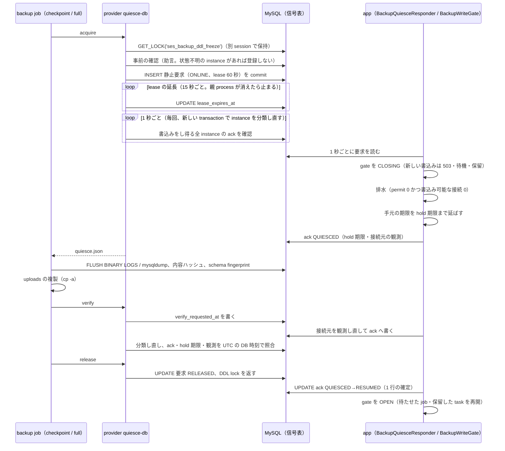

# backup の書込み静止（app 内の静止応答）設計

- 状態: **草案（第 1 段階: spec のみ。独立 review の指摘（`32733d28` に対する REQUEST CHANGES）を反映した第 2 版）**。要件は `requirements.md`、手順は `tasks.md`。
- 本書は brief の 13 の設計問題（Q1〜Q13）に答える。答えの一覧は §2、利用者の決定待ちは §16、review の指摘の対応先は §20。
- 「未決（利用者の決定待ち）」と書いた事項は、本書の推奨を前提に他の節を書いている。決定が推奨と違えば、該当する節と `tasks.md` を直す。
- 実測していない前提は §19 にまとめ、実装の時に確かめる。

## 0. 位置付け

- 本 spec は `database-backup-recovery`（HFP-03）の RQ-002（全 app replica と scheduler の書込みを静止し、DDL/change freeze を確かめてから整合点を取る）を、本番の構成で成り立たせるための部品である。HFP-03 の他の要件（manifest・PITR・restore・cutover）は変えない。
- 整合点の定義は変えない: full は mysqldump の一貫 snapshot と uploads の複製を同じ静止区間で取り、checkpoint は FLUSH BINARY LOGS の closed coordinate と uploads の複製を同じ静止区間で取る（`database-backup-recovery/design.md` §5）。本 spec が足すのは「静止区間の間、app が DB と uploads を変えないこと」の保証と、その保証が途切れたら VALID にしない仕組みである。
- 中心の保証（§6.1 の不変条件）: provider が VALID を許すのは、静止区間の終わりに、書込みをし得る全ての instance について「QUIESCED の ack が DB に確定しており、その instance が gate を開け得る時刻（手元の期限）より前である」ことを DB の時刻で確かめられた場合だけである。

## 1. 全体像



## 2. 設計問題への回答（一覧）

| # | 問題 | 結論 | 節 |
|---|---|---|---|
| Q1 | 信号表 | 3 表（要求・instance・ack）。要求は provider、instance と ack は app が書く。時刻は全て `UTC_TIMESTAMP(6)`。`active_slot` は生成列にして CHECK の NULL の穴を無くす。tenant 列なし。V202。H2 は変種 file と `engineer-schema-h2.sql`。`CONTENT_HASH_TABLES` からは除外を強制 | §3 |
| Q2 | backup account の権限 | `sys_backup_quiesce_request` への表単位の `INSERT`・`UPDATE` だけを足す。GRANT は §3 の Flyway job の後・初回 backup の前に行い、restore の cutover の後にも付け直す。writer になることの受理は **U-11** | §4 |
| Q3 | instance の識別と heartbeat | 起動ごとの UUID＋host 名＋DB から見た接続元。ECS task metadata は使わない。heartbeat 5 秒、self-fence 20 秒、状態不明 60 秒、停止済み 300 秒。provider は要求を先に登録し、待ちと verify の度に分類し直す。接続元は app が同じ account の PROCESSLIST で観測し、verify の時に観測し直させる。停止確認の processlist の扱いは **U-2** | §5 |
| Q4 | 書込み停止の意味と仕組み | HTTP の分類で 503、scheduler は ShedLock の前で待機、async は閉じた後の投入を保留（thread を待たせない）、起動時処理は permit、業務の接続は静止中に読取り専用。permit と書込み可能な接続の数は「先に増やしてから状態を読む」。uploads の変更は storage 層でも拒否する。排水の上限は **U-3**、外部 API・logout・監査・download の扱いは **U-6・U-8〜U-10** | §6 |
| Q5 | 安全 | gate を開けてよいのは「非 QUIESCED の状態を確定した」か「手元の期限に達した（手元の期限は書き得た hold 期限より前にならない）」場合だけ。ack の結果が不明なら閉じたまま。verify は整合点の採取の後・解除の前に必ず呼ぶ | §6.1、§6.9、§7 |
| Q6 | DDL 凍結 | 配備中は backup の timer を止める。加えて本番の Flyway job が callback で同じ GET_LOCK を取る。**U-5**（推奨: 両方を実装） | §8 |
| Q7 | app 停止の確認 | `quiesce-app-stopped`。保持を先に登録してから全 instance が停止済みであることを確かめる。STOPPED は業務 pool を閉じた後にだけ書く。保持中は app が起動しない。`--app-stopped` の明示の引数でだけ使う | §9 |
| Q8 | 静止時間 | 初期の checkpoint は数十秒の見込みだが、uploads の 1 件ごとの費用が大きく、決める前に staging の EFS で実測する。上限は **U-1**。超えたら自動再開・VALID にしない・RPO alert | §10 |
| Q9 | 配備手順との関係 | `APP_SCHEDULING_ENABLED=false` は ack の `scheduler_state=DISABLED`。§2 の初めに timer を止め、§2 の5 は停止確認の full、§4 の後に再開。PROD-004 は初回 backup の前（004a）と §4 の後（004b）に分ける | §11 |
| Q10 | 設定と fail-fast | `app.backup-quiesce.*`。prod の `enabled=false` の扱いは **U-7**（推奨: 変更 ticket を明示したときだけ許す）。範囲の検査・JDBC の検査・startPeriod の関係も §1.0・雛形・照合 script に入れる | §12 |
| Q11 | 可観測性 | 固定の `errorCode=BACKUP_QUIESCE_*` の日本語 log、`ses_backup_quiesce_*` の metric、自動再開・FENCED・停止確認の保持の読取りは critical | §13 |
| Q12 | 試験計画 | unit・H2・MVC・MySQL（shard に追加）・shell・CI の backup integration。結果不明の commit・連続の競合・登録の割込み・時刻帯の違いの試験を含む。integration の responder は **U-4** | §14、`tasks.md` |
| Q13 | 文書 | runbook §1.0・§1.2・§1.7・§2・§3・§4・§5、README、監視 runbook、restore-cutover（権限の付け直しを含む）、baseline PROD-004、pii-inventory | §15 |

## 3. 信号表（Q1）

### 3.1 表の定義（V202 の骨子）

実際の DDL は BWQ-001 で書く。全表 `ENGINE=InnoDB DEFAULT CHARSET=utf8mb4 COLLATE=utf8mb4_unicode_ci`、列と表に日本語の COMMENT を付ける。時刻の列は全て **UTC の値を入れる DATETIME(6)** で、COMMENT に「UTC」と書く（§3.10）。

**`sys_backup_quiesce_request`**（静止要求。1 回の backup の静止ごとに 1 行）

| 列 | 型 | 内容 |
|---|---|---|
| `id` | BIGINT AUTO_INCREMENT PK | 要求の番号。epoch として使う |
| `request_token` | CHAR(32) NOT NULL、一意 `uk_bq_request_token` | provider が作る 16 byte の乱数の hex |
| `mode` | VARCHAR(16) NOT NULL | `ONLINE` / `APP_STOPPED` |
| `job_kind` | VARCHAR(16) NOT NULL | `FULL` / `CHECKPOINT` |
| `status` | VARCHAR(16) NOT NULL | `REQUESTED` / `RELEASED` / `ABORTED` / `EXPIRED` |
| `active_slot` | TINYINT **GENERATED ALWAYS AS (CASE WHEN status = 'REQUESTED' THEN 1 ELSE NULL END) STORED**、一意 `uk_bq_request_active` | 有効な要求だけ 1。誰も書かない（status から決まる）。MySQL の一意索引は NULL を重複とみなさない |
| `lease_seconds` | INT NOT NULL | 1 回の延長で延ばす秒数 |
| `requested_by` | VARCHAR(64) NOT NULL | job 名と backup host（`^[A-Za-z0-9._:-]{1,64}$`。個人名・秘密を書かない） |
| `protocol_version` | SMALLINT NOT NULL | protocol の版（初版 1） |
| `requested_at` | DATETIME(6) NOT NULL | UTC |
| `lease_expires_at` | DATETIME(6) NOT NULL | UTC。延長ごとに provider が更新 |
| `verify_requested_at` | DATETIME(6) NULL | UTC。verify の前に provider が書き、app に接続元を観測し直させる（§5.4） |
| `released_at` | DATETIME(6) NULL | UTC |
| `release_reason` | VARCHAR(32) NULL | `COMPLETED` / `ABORTED` / `VERIFY_FAILED` / `EXPIRED` |

制約: `ck_bq_request_mode`・`ck_bq_request_kind`・`ck_bq_request_status`（値の集合）。`active_slot` を生成列にしたため、状態と有効枠の組合せは矛盾し得ない（以前の版の CHECK は `(REQUESTED, NULL)` を UNKNOWN として通してしまう穴があった）。索引 `idx_bq_request_requested_at (requested_at)`。

**`sys_backup_quiesce_instance`**（app の instance。JVM の起動ごとに 1 行）

| 列 | 型 | 内容 |
|---|---|---|
| `instance_id` | CHAR(36) PK | 起動ごとの UUID |
| `host_name` | VARCHAR(255) NOT NULL | `InetAddress.getLocalHost().getHostName()`（取れなければ `unknown`） |
| `db_client_host` | VARCHAR(255) NOT NULL | 制御用の接続の `USER()` の host 部（§5.4 の規則で解釈） |
| `db_connection_id` | BIGINT NOT NULL | 登録時の `CONNECTION_ID()`（診断用） |
| `app_commit` | VARCHAR(64) NOT NULL | build の commit（取れなければ `unknown`） |
| `protocol_version` | SMALLINT NOT NULL | |
| `poll_interval_ms` / `heartbeat_interval_ms` / `fence_after_ms` | INT NOT NULL | provider が閾値の整合を確かめる（§5.2） |
| `scheduling_enabled` | TINYINT NOT NULL | `app.scheduling.enabled` の値 |
| `status` | VARCHAR(16) NOT NULL | `STARTING` / `RUNNING` / `STOPPED` |
| `gate_state` | VARCHAR(16) NOT NULL | 診断用（判定には ack を使う） |
| `started_at` / `last_beat_at` | DATETIME(6) NOT NULL | UTC |
| `stopped_at` | DATETIME(6) NULL | UTC |

制約: `ck_bq_instance_status`・`ck_bq_instance_gate`。索引 `idx_bq_instance_last_beat (last_beat_at)`。

**`sys_backup_quiesce_ack`**（要求×instance の応答）

| 列 | 型 | 内容 |
|---|---|---|
| `request_id` | BIGINT NOT NULL | FK `fk_bq_ack_request` → `sys_backup_quiesce_request(id)` ON DELETE CASCADE |
| `instance_id` | CHAR(36) NOT NULL | FK を張らない（instance の行は先に消え得る） |
| `state` | VARCHAR(16) NOT NULL | `QUIESCED` / `REFUSED` / `RESUMED` |
| `scheduler_state` | VARCHAR(16) NOT NULL | `PAUSED` / `DISABLED` |
| `drain_millis` | INT NOT NULL | |
| `hold_until` | DATETIME(6) NULL | UTC。app が自動で再開し得る最も早い時刻（§3.3） |
| `observed_app_hosts` | VARCHAR(1024) NOT NULL | 同じ app account の接続元と件数（`host=件数` を host の昇順に `,` でつなぐ） |
| `observed_at` | DATETIME(6) NOT NULL | UTC。最後に観測した時刻 |
| `refuse_reason` | VARCHAR(64) NULL | `DRAIN_TIMEOUT` / `ERROR` / `UNSUPPORTED_PROTOCOL` |
| `acked_at` | DATETIME(6) NOT NULL | UTC |
| `resumed_at` | DATETIME(6) NULL | UTC |
| `resume_reason` | VARCHAR(32) NULL | `RELEASED` / `LEASE_EXPIRED` / `MAX_HOLD` / `REQUEST_GONE` / `SHUTDOWN` |

PK `(request_id, instance_id)`（ack の行は 1 つの要求について 1 instance 1 行。§6.9 の結果不明の解決はこの一意性に依る）。制約 `ck_bq_ack_state`・`ck_bq_ack_scheduler`。

### 3.2 書く者と状態遷移

| 表 | provider | app | backup 以外の運用者 |
|---|---|---|---|
| 要求 | INSERT・UPDATE（status・lease_expires_at・verify_requested_at・released_at・release_reason） | SELECT。保存期間を過ぎた RELEASED/ABORTED/EXPIRED の行の DELETE（ack は CASCADE） | 異常時だけ DBA が `ABORTED` にする（§9.4） |
| instance | SELECT | INSERT・UPDATE・保存期間を過ぎた行の DELETE | — |
| ack | SELECT | INSERT・UPDATE（状態の遷移は条件付きの文で、影響した行数で確定する。§6.9） | — |

要求の状態: `REQUESTED` → `RELEASED`（release）/ `ABORTED`（verify 前の失敗の cleanup）/ `EXPIRED`（次の provider が期限切れを見つけた）。app は lease を過ぎた REQUESTED を「無効」と扱い、要求の行は書き換えない。

instance の状態: `STARTING`（登録済み。起動の待機中を含む）→ `RUNNING`（起動完了）→ `STOPPED`（**業務の接続 pool を閉じた後**。§6.11）。強制終了した instance は STARTING/RUNNING のまま残り、`last_beat_at` で判定する（§5.3）。

ack の状態: なし → `QUIESCED` または `REFUSED` → `QUIESCED` から `RESUMED`。app は同じ要求について閉じ直さない。

### 3.3 epoch・lease・hold 期限（P1-1）

- epoch は要求の `id`。ack は `(request_id, instance_id)` の行なので、前の要求の ack が次の要求の ack に見えることは無い。
- lease: provider は `lease_expires_at = UTC_TIMESTAMP(6) + lease_seconds` で登録し、`QUIESCE_LEASE_RENEW_SECONDS`（既定 15 秒）ごとに `… WHERE id = ? AND status = 'REQUESTED' AND lease_expires_at > UTC_TIMESTAMP(6)` で延ばす（期限を過ぎた lease は延ばせない。§7.6）。
- hold 期限: app は要求を読むたびに `LEAST(lease_expires_at, requested_at + INTERVAL <最大保持時間(job_kind)> SECOND)` と `UTC_TIMESTAMP(6)` を同じ文で読む。
- **順序（P1-1 の修正）**: app は新しい hold 期限 H を DB へ書く**前に**、手元の期限（単調時計）を H まで延ばす。手元の期限は縮めない。書込みが失敗・結果不明でも手元の期限は H のままで、DB に確定し得る全ての `hold_until` は手元の期限より前になる。H は DB の lease と最大保持時間から決まるため上界がある。
- 手元の期限への換算: `手元の期限 = 文が返った後の単調時計 + (H − 文の中の UTC_TIMESTAMP(6))`。文の往復の時間だけ遅い側にずれる（安全側）。
- provider の verify は全ての必要な ack について `UTC_TIMESTAMP(6) <= hold_until − QUIESCE_LEASE_MARGIN_SECONDS`（既定 5 秒）を求める。app の単調時計と DB の時計の進み方の差（最大保持時間 60 分で 1 秒未満の見込み）は margin で吸収する。

### 3.4 tenant 列を持たない理由

- 静止の対象は DB と uploads の全体（全 tenant）で、tenant ごとには静止できない。表が表すのは process と DB instance の状態で、業務データではない。前例は `shedlock`（V58）と `flyway_schema_history`。
- 表に触るのは静止応答の専用 thread と制御用 pool の `JdbcTemplate` だけで、MyBatis-Plus の mapper・HTTP の request thread を通らない。`InternalTenantContextFilter`・`AccountingTenantContextHolder` は関与せず、`TENANT_CONTEXT_REQUIRED` の対象にもならない。
- API・画面・menu を作らないため、`ActionPermissionResolver.RESOURCE_NAMES`・`m_menu`・権限 group の seed も足さない。
- 単一 tenant（SRE-1）の前提は変わらない。全表に tenant 列を求める走査は現時点で無い。将来足す場合は `shedlock` と同じく理由つきで除外する。`BackupQuiesceControlPoolUsageTest`（§14）が、表を mapper・controller から参照していないことを固定する。

### 3.5 Flyway の版番号

- `db/migration` は V201 まで（V199 は意図した欠番）。`db/migration-dev` は V100・V145・V146・V172_1。`db/privacy-journal` は別の instance の別の空間。
- main（`42719b10` の時点を含む）と全 branch に V202 以上の file は無い。**V202 を使う**: `V202__backup_write_quiesce_signal.sql`。実装の着手時と統合の直前に再確認し、衝突したら後に統合する側を上の空き番号へ振り直す（空き番号を埋めない）。
- 連動して直すもの: `LatestMigrationVersion.LATEST`（`202`）、`deploy-runbook.md` §3.3 の「V1〜V202（versioned 201件。SQL 200件＋Java migration 1件）」、§3.4 の最新版と件数の照会、§4 の schema guard の log 例、§1.7 の `FLYWAY_VERSION`（`202`）。`DeployRunbookMigrationCountTest` が照合する。trigger は作らないため 67 件は変わらない。

### 3.6 H2 の同期

- V202 は MySQL 固有の句を含むため、`shedlock` と同じく H2 の変種 `src/test/resources/sql/schema-backup-quiesce-h2.sql`（`CREATE TABLE IF NOT EXISTS`、COMMENT なし、生成列は H2 の `GENERATED ALWAYS AS (CASE … END)`）を作り、`application-test.yml` の `schema-locations` の V201 の変種の後に足す。
- `src/test/resources/sql/engineer-schema-h2.sql` にも 3 表を足す（ack → instance → request の順に DROP）。
- `BackupQuiesceSchemaContractTest`（Docker 不要）が、V202 と H2 の 2 定義の列名・型・NULL 可否・生成式・一意索引の一致を固定する。
- 3 表は MyBatis-Plus の entity を持たないが、上の 2 か所は CLAUDE.md の規則どおり更新する。

### 3.7 `CONTENT_HASH_TABLES`（DBA-6）から外す理由

- 信号表は静止区間の中でも書かれる（heartbeat、観測、lease の延長、verify の要求）。checkpoint の内容ハッシュは FLUSH BINARY LOGS の後に計算するため、FLUSH の後の書込みは次の binlog に入り、復元（closed coordinate までの replay）には現れない。記録したハッシュと復元後の値が合わず、復元検証が必ず FAIL になる。内容は運用の記録で業務上の意味も無い。
- `lib/content-hash.sh` の `content_hash::collect` は名前が `sys_backup_quiesce_` で始まる表を指定されたら計算の前に失敗する。`CRITICAL_TABLES` は情報だけなので拒否しないが README で勧めない。
- 静止中に動かない表（業務の表、`shedlock`、`t_user_session`）は従来どおり指定できる。

### 3.8 restore の後の信号表と権限

- 復元した DB には checkpoint の時点の信号表が残る。restore の後に起動する app は新しい UUID で登録し、残った要求は lease の期限切れとして無視し（INFO の log に番号を出す）、残った instance は停止済みの閾値で無視される。cutover の後に最初に動く provider が残った要求を `EXPIRED` にする。手で消さない。
- **権限の付け直し（P2-5）**: `mysql.tables_priv` は dump に入らないため、復元先を新しい source にした後、backup の再開の前に DBA が backup account と表単位の権限（§4）を付け直す。`ops/backup/runbooks/restore-cutover.md` の cutover の後の手順に足し、preflight の `checks.quiesce`（§12.4）が無いことを検出する。

### 3.9 保存期間と個人データ

- 個人データは持たない（host 名・接続元の IP・job 名・時刻だけ）。`requested_by` に人の名前を書かせない。
- 保存期間は **U-12**（推奨 30 日）。app が 1 日 1 回、有効な要求が無い時に、保存期間より古い RELEASED/ABORTED/EXPIRED の要求（ack は CASCADE）と `last_beat_at` が保存期間より古い instance を消す。
- 個人データを消す経路ではないため、NF07 の保全 hold の gate（`deploy-runbook.md` §4.4）には接続しない。review で求められれば §4.4 の除外の行に理由つきで足す。
- `privacy-retention-dsar/pii-inventory.md` に DB-148〜DB-150 として 3 表を足す（構造の記録。個人データなし）。
- **privacy catalog の seed 行は足さない（P3-16 の決定）**。V198 は自由記述（個人データの可能性）を持つ NF01 の表を UNKNOWN の構造行で登録したが、この 3 表は個人データを持たず provider も無い。行を足すと catalog の未分類の件数（`unclassifiedElements`・`unknownAttributionCount`）が意味なく増える。`CATALOG_MISSING` は provider が宣言した data element だけが対象（`PrivacyCoverageReport`）なので、行が無くても欠落として報告されない。Privacy owner が登録を求めた場合は後の migration で足す。

### 3.10 時刻（P2-3）

- DATETIME 列は値をそのまま保存し、`NOW()` は session の `time_zone` に従う。app（`serverTimezone=Asia/Tokyo` だけで session の time_zone を設定しない）と provider（backup tool には `SET SESSION time_zone = '+00:00'` の前例がある。`lib/content-hash.sh:88`）で session の時刻帯が違えば、`NOW(6)` で書いた値の比較は 9 時間ずれる。
- そのため信号表の時刻は両側とも **`UTC_TIMESTAMP(6)` だけで書き、比べる**。`NOW()`・`CURRENT_TIMESTAMP`・`LOCALTIMESTAMP` と、JVM の時刻で作った値を使わない。列の DEFAULT にも `CURRENT_TIMESTAMP` を使わない。
- `quiesce.json` の時刻もこの値をそのまま UTC として書く。
- 試験: app の session と provider の session の time_zone を `+09:00` と `+00:00` の組で入れ替えて往復する MySQL の試験（前例: `PrivacyRequestApprovalMySqlTest` の時刻帯の試験）。repository の SQL に `NOW(`・`CURRENT_TIMESTAMP`・`LOCALTIMESTAMP` が無いことを静的に確かめる。

## 4. backup account の権限（Q2）

- **source 側の account に足す権限**: `GRANT INSERT, UPDATE ON ses_manager_db.sys_backup_quiesce_request TO '<backup account>'@'<host>';`（表単位）。
  - `sys_backup_quiesce_instance`・`sys_backup_quiesce_ack` の読取りは既存の schema 単位の `SELECT` で足りる。
  - 要らないもの: `DELETE`、他の表への書込み、`PROCESS`（停止確認の照合は **U-2**）、`GET_LOCK` の権限（権限不要）。
  - 影響: backup account が業務 DB の 1 表の書き手になる。PROD-002（アプリ以外の writer の有無）の記録と Security・DBA の受理が要る（**U-11**）。transaction は binlog と GTID に残り PITR で replay される（問題ない）。
- **GRANT の時期（P2-5）**: 存在しない表への表単位の GRANT は `CREATE` を含めないと通らない規則がある（MySQL の文書による。**未実測**、§19）。そのため GRANT は §3 の Flyway job の後（V202 が表を作った後）・§2 の5 の初回 backup の前に行う（初回は §3 の後に backup を取るため順序は成り立つ）。配備の前の DBA-1 の確認からは外し、§3.4 の確認に足す。restore の後は §3.8 のとおり付け直す。preflight が権限の有無を検査する。
- **app account**: 変えない。schema 単位の DML に信号表も含まれる。制御用 pool も同じ app account を使う（別の user を作ると SRE-5 の (a)・§1.2 の processlist の確認・NF06 の照合・§5.4 の観測が崩れる）。
- **app account の host の型は 1 つにする（P2-2）**: PROCESS の無い account に見えるのは「同じ account（`user@host` の組）」の thread で、同じ user 名でも host の型が違う別の account の thread は見えない。運用で app account を `ses_app@'10.0.1.%'` と `ses_app@'10.0.2.%'` のように分けない。§1.2 に書き、DBA が `SELECT user, host FROM mysql.user WHERE user = '<アプリaccount>'` が 1 行であることを確かめる。
- **直す文書**:
  - `ops/backup/README.md`「権限分離」: 「source 側の account の権限」の表に行を足す（`INSERT`・`UPDATE` / `<db>.sys_backup_quiesce_request`（表単位。§3 の後に付ける）/ full・checkpoint（`quiesce-db`・`quiesce-app-stopped`）/ 静止要求の登録・延長・verify の要求・解除）。dump role の行にも足す。「要らないもの」に `DELETE` と `PROCESS` の理由。
  - `deploy-runbook.md` §1.2「backup 用の account」: 表単位の権限、GRANT の時期、`SHOW GRANTS` の期待（要求の表への `INSERT, UPDATE` の表単位の GRANT が 1 行増える）。アプリ account の項に「制御用 pool も同じ account」「host の型は 1 つ」。
  - §1.7 DBA-1: backup account の確認のうち表単位の権限は §3.4 で行うことを書く。§3.4: GRANT と確認の SQL を足す。
- 実 MySQL の試験（BWQ-011）で、README の表と同じ権限だけを持つ user が provider の SQL を全て実行でき、業務の表への INSERT は拒否されることを確かめる。

## 5. instance の識別と heartbeat（Q3）

### 5.1 instance ID の取り方

- **採る方式**: 起動ごとに `UUID.randomUUID()` を作り、再利用しない。補助として host 名・`USER()` の host 部・`CONNECTION_ID()`・commit・設定値を記録する。
- **採らない方式**: ECS task metadata（`ECS_CONTAINER_METADATA_URI_V4` の HTTP 呼出し）。起動時に link-local への HTTP 依存が増える一方、識別には UUID で足り、task との対応は接続元の IP（awsvpc の ENI）で SRE が ECS の画面と照合できる。host 名＋起動時刻だけの ID は同じ host での再起動と区別しにくいため使わない。

### 5.2 heartbeat と閾値

| 値 | 既定 | 置き場所 | 関係 |
|---|---|---|---|
| 要求の読取り間隔 | 1 秒 | app `poll-interval` | SELECT だけ |
| heartbeat の間隔 | 5 秒 | app `heartbeat-interval` | instance の行の UPDATE |
| self-fence の閾値 | 20 秒 | app `fence-after` | 最後に heartbeat を書けてからの単調時計の経過 |
| 状態不明の閾値 | 60 秒 | provider `QUIESCE_STALE_SECONDS` | `fence_after + 2 × heartbeat_interval` 以上 |
| 停止済みの閾値 | 300 秒 | provider `QUIESCE_DEAD_SECONDS` | `QUIESCE_STALE_SECONDS` より大きい |
| lease | 60 秒 | provider `QUIESCE_LEASE_SECONDS` | `fence_after + poll_interval < QUIESCE_LEASE_SECONDS − QUIESCE_LEASE_RENEW_SECONDS`（P1-1） |

- 最後の行の理由: app が DB に届かなくなったとき、最後に読めた hold 期限は少なくとも `lease − 延長間隔 − 読取り間隔` だけ先にある。self-fence がそれより早く働けば、DB に届かない app が手元の期限で gate を開けても、FENCED が優先して書込みは止まったままになる（§6.2）。provider は instance が申告した値でこの式を確かめ、満たさなければ設定の誤りとして失敗する。既定値は 20 + 1 < 60 − 15 を満たす。
- heartbeat と要求の読取りは、静止応答が自分で持つ 1 本の thread（`ScheduledExecutorService`。bean にしない）で行う。`@Scheduled` を使わないため `APP_SCHEDULING_ENABLED=false` でも動く。`SchedulingDisabledDrainTest` の既知一覧に理由つきで載せる（BWQ-006）。
- 制御用 pool（§6.5.4）を使うため、業務の pool が満杯でも heartbeat は書ける。

### 5.3 instance の分類（P1-3）

provider は **毎回新しい transaction（autocommit の SELECT）** で instance を読み、`age = UTC_TIMESTAMP(6) − last_beat_at` で分ける。REPEATABLE READ の古い snapshot を使い回さない。

| 分類 | 条件 | 扱い |
|---|---|---|
| 必要 | status ≠ STOPPED かつ（`age ≤ QUIESCE_DEAD_SECONDS` または `last_beat_at ≥ requested_at`） | この要求の QUIESCED の ack が要る。新しい（`age ≤ QUIESCE_STALE_SECONDS`）なら待つ。ack が無く状態不明（`age > QUIESCE_STALE_SECONDS`）なら失敗 |
| 無視 | status = STOPPED、または `age > QUIESCE_DEAD_SECONDS` かつ `last_beat_at < requested_at` | 待たない。STOPPED は業務 pool を閉じた後にだけ書かれる（§6.11） |

- **順序（P1-3 の修正）**: provider は要求を INSERT して commit した**後で**分類する。app は instance を登録して commit した**後で**有効な要求を読む。どちらも commit の後に相手の行を新しい transaction で読むため、少なくとも一方は他方を見る: app が要求を見なければ、provider はその app の登録を見て ack を求める（app の thread はその後に要求を読み、排水して ack する）。
- 分類は acquire の待ちの毎回と verify で行い直す。要求の後に登録・heartbeat した instance も「必要」に入る。
- 根拠: app は heartbeat を書けない状態が 20 秒続くと自分で gate を閉じる。300 秒までの猶予は、閉じる前に始まった書込みが終わる時間と、self-fence の誤りへの余裕である。
- 前提: 1 件の書込み処理（request・job・async）は `QUIESCE_DEAD_SECONDS` より短い。超える長い job がある場合の残余は §17（ONLINE は §5.4 の観測と「必要な instance が 1 つ以上」で塞がれる。停止確認は U-2）。

### 5.4 processlist との照合（ONLINE。P2-2）

- app は ack を書く時、静止中の heartbeat ごと、要求の `verify_requested_at` が自分の最後の観測より新しくなった時に、制御用の接続で次を実行し、結果を ack の `observed_app_hosts` と `observed_at` に書く。
  ```sql
  SELECT host FROM information_schema.PROCESSLIST WHERE user = SUBSTRING_INDEX(USER(), '@', 1);
  ```
  host は Java で解釈する: 末尾の `:<数字>`（port）だけを外す（IPv6 の `:` を切らない）。port が無い値（`localhost` 等）はそのまま。`USER()` の host 部にも同じ規則を使う。
- 見える範囲: PROCESS 権限の無い account には**同じ account（`user@host` の組）**の thread だけが見える。全 instance が同じ app account（host の型も 1 つ。§4）を使うため、同じ account の全ての接続元が見える。
- provider の verify は、`verify_requested_at` を書いた後、必要な全 instance の `observed_at` が `verify_requested_at` より新しくなるまで（最長 `QUIESCE_VERIFY_OBSERVE_SECONDS`、既定 10 秒）待ってから、観測した host が全て「ack した必要な instance の `db_client_host`」に含まれることを求める。heartbeat を書かずに DB の接続を持ち続ける instance（停止に失敗した旧 task、app account を使う別の process）がいれば失敗する。
- 限界（§17）: 観測はその瞬間に在る接続だけを見る。観測の間に接続して切った短い接続は見えない。中継（RDS Proxy 等）を挟むと全接続が中継の IP に見え、照合は弱くなる（deployment owner の inventory で中継を使わないことを確かめる）。

## 6. 書込みを止める意味と仕組み（Q4）

### 6.1 不変条件

- **I-1（静止）**: ack（QUIESCED）を確定した時点から gate が開くまで、permit を持たない thread は業務の接続 pool で書けず、uploads を変えられない（§6.5・§6.12）。
- **I-2（排水）**: QUIESCED の ack を書く時点で、閉じる前に始まった書込み（permit を持つ処理）と、閉じる前に借りられた書込み可能な業務の接続は全て終わっている。
- **I-3（開け直しの規則。P1-1）**: 一度 QUIESCED の ack を書こうとした要求について、gate を開けてよいのは次のどちらかだけである。
  - (a) この instance が、その要求について非 QUIESCED の状態を確定した: `UPDATE … SET state = 'RESUMED' … WHERE request_id = ? AND instance_id = ? AND state = 'QUIESCED'` が 1 行に効いたことを確かめた、または `INSERT … state = 'REFUSED'` が成功した（PK が一意なので、QUIESCED の行は確定していないことが分かる）。
  - (b) 手元の期限に達した。手元の期限は、DB に確定し得る全ての `hold_until` より前にならない（§3.3 の順序）。
  QUIESCED を一度も書こうとしていない要求（排水の途中で上限を超えた等）は、REFUSED を書けなくても開けてよい（provider はこの instance の QUIESCED を見ることが無い）。
- **I-4（数え方。P1-2）**: permit と書込み可能な接続の数は、増やす側が「先に数を増やしてから gate の状態と permit を読む」、gate の側が「先に状態を CLOSING にしてから数を読み、CLOSED にする前にもう一度読む」。状態と数は順序が一貫する atomic（`AtomicInteger`・`AtomicLong`・volatile）で持つ。どちらの側も相手の書込みを少なくとも一方が見るため、ack の後に permit の無い書込み可能な接続が渡されることは無い。
- **I-5（停止）**: instance の行を STOPPED にするのは、業務の接続 pool を閉じた後だけである（§6.11）。
- uploads を変える経路は、HTTP の更新・scheduler・async・起動時処理のどれかに含まれ、さらに storage 層の確認（§6.12）が permit の無い変更を拒否する。GET の中で file を書く経路があっても、DB の更新が読取り専用で失敗し、storage 層も拒否する。

### 6.2 gate の状態

```text
UNARMED --登録・最初の heartbeat--> OPEN（有効な ONLINE の要求なし）/ CLOSING（あり）
OPEN    --要求を読む--> CLOSING --排水完了・QUIESCED の確定（結果不明を含む）--> CLOSED
CLOSING --排水の上限超過（REFUSED の確定、または QUIESCED を試していない）--> OPEN
CLOSED  --I-3 (a) または (b)--> OPEN
OPEN / CLOSING / CLOSED --heartbeat を fence-after 書けない--> FENCED（他の判定より優先）
FENCED  --heartbeat 回復--> 有効な要求と ack の状態に応じて OPEN / CLOSING / CLOSED
任意    --shutdown の開始--> SHUTDOWN（戻らない）
```

- OPEN 以外では新しい permit を出さず、permit の無い thread に業務の接続を読取り専用で渡す（§6.5）。
- **UNARMED**（登録の前。P3-3）: `spring.flyway.enabled=false`（prod は常にこれ。`ProductionSchemaGuardConfiguration`）なら閉じた状態と同じに扱う（permit の無い接続は読取り専用）。Flyway が起動時に migration を流す profile（dev）は、V202 の表を Flyway が作る前に登録できないため、UNARMED の間は従来どおり書ける（dev は本番の backup の対象ではない）。
- 状態は `BackupWriteGate` の 1 つの object が持つ。FENCED と手元の期限の判定は、静止応答の thread が止まっても働くよう、gate を参照する側で毎回評価する（遅延評価）。
- `app.backup-quiesce.enabled=false`（test profile。U-7 で決める prod の停止口）では gate は常に OPEN で、heartbeat も fence も無い。

### 6.3 書込み経路の一覧と静止中の扱い

| 経路 | 例 | 静止中（OPEN 以外） | 仕組み |
|---|---|---|---|
| HTTP の更新 method（GET・HEAD・OPTIONS 以外） | 画面・API・PWA の送信・`/login`・`/password/change` | 503 | `BackupWriteGateFilter`（認証より前） |
| `/logout` | | **U-8**（推奨 A: 503） | 同上 |
| 書込みを伴う既知の GET | OIDC の `/oauth2/authorization/**`・`/login/oauth2/code/**`、freee の `/integrations/freee/**` | 503 | 同上 |
| file の download（`ApiAuditFilter` の download 判定） | | **U-10**（推奨 A: 503） | 同上 |
| 外部 API `/external-api/**`（NF05。初回リリースは OFF で LB でも遮断） | | **U-6**（推奨 A: `ExternalApiErrorWriter` の 503） | 同上 |
| bootstrap・break-glass の session の要求（静的資源と error dispatch を除く） | §5 の bootstrap 作業 | 503（毎回の監査を残せないため） | 同上（session の属性で判定。認証前でも読める） |
| その他の GET・HEAD | 一覧・詳細・dashboard・通知の取得 | 継続。業務の接続は読取り専用。session の最終利用の更新は省く（§6.4）。想定外の書込みは ERROR 1792 → 503。best-effort の監査は **U-9** | §6.4・§6.5 |
| `@Scheduled`（全て `@SchedulerLock` 付き。`ScheduledMethodsHaveSchedulerLockTest`） | outbox・会計 worker・清掃・通知 | ShedLock の表へ書く前で解除まで待つ（飛ばさない） | `BackupQuiesceLockProvider`（§6.6） |
| `@Async`（`SchedulingDisabledDrainTest` の `ASYNC_INVENTORY`。全て `taskExecutor`） | 取込の解析・mail・webhook・残業の通知 | 閉じる前（または permit を持つ thread）の投入は排水の対象。閉じた後の投入は保留して開いた時に投入し直す | `BackupQuiesceTaskDecorator`（§6.7） |
| 起動時の処理（DB 書込みあり 5 件） | `LegacyUploadMigrationRunner`・`ContractDocumentBackfillRunner`・`ContractDocumentDispatchBackfill`・`ProductionSecurityConfigurationValidator`・`IntegrationHubOutboundStartupBarrier` | startup permit を持つ。有効な要求がある間は permit を取らずに待つ | §6.8 |
| uploads の変更 | 保存・公開・削除・移行・台帳 | storage 層で permit の無い変更を拒否 | §6.12 |
| 信号表 | heartbeat・ack・観測 | 継続 | 制御用 pool（§6.5.4） |
| NF07 の Journal の接続（`PrivacyJournalConnections`） | hold の journal | 対象外（P3-17） | Journal は application DB と別の MySQL instance で、application DB の restore の対象に含めず別に backup する（`privacy-retention-dsar/journal-witness-grant-design.md:58`）。本 spec の整合点（`ses_manager_db` と uploads）に入らない。初回リリースは hold の開始が未開放で使わない |

一覧の起動時処理と async は `SchedulingDisabledDrainTest` の既知一覧と同じである。新しい起動時処理・async・自前の thread を足すとその試験が失敗する。

### 6.4 HTTP

- `com.ses.backup.quiesce.BackupWriteGateFilter`（servlet filter）の順は **`Ordered.HIGHEST_PRECEDENCE + 35`**（P3-2）。`FeatureSwitchFilter`（+30）の後にする理由: OFF の機能は静止中も 404 のまま返す（機能の有無を応答から区別させない既存の規則を保つ）。Spring Security（-100）の前なので、login の POST は `LoginFailureHandler` が `failed_count` を数える前に止まる。portal と外部 API の filter chain にも効く。`+35` を使う filter が他に無いことを BWQ-005 の試験で確かめる。
- 分類は `BackupQuiesceRequestClassifier`（純粋な関数。`RequestPaths.pathWithinApplication`）で `ALWAYS`（静的資源・`/actuator/health/**`・`/actuator/prometheus`・`/actuator/metrics/**`・error dispatch）/ `READ` / `WRITE` / `EXTERNAL`（U-6）を返す。download の判定は `ApiAuditFilter.isDownloadUri` を `com.ses.common.util.AuditedDownloadPaths` へ移して共有する。
- `WRITE` は permit を取って通す（I-4 の順。取れなければ 503）。要求の終わりに返す。
- `READ` は permit を取らずに通す。
- **session の検査（P3-8）**: `PersistentSessionServiceImpl.validateAndTouch` は、gate が OPEN でなく呼び出し元が permit を持たないとき `t_user_session.touch` を省く。idle 期限の判定は「今の時刻」ではなく「gate が閉じた時刻」で行う（閉じた時点で有効だった session は、静止の間に idle 期限を過ぎても失効させない）。最長の有効期間（`expires_at`）は今の時刻で判定する。full の最大保持時間（60 分）が idle 期限（30 分。`PersistentSessionProperties`）より長くても、静止の間に使い続けた利用者が logout されない。解除の後の最初の要求で通常の touch に戻る。
- **最後の防線の変換（P3-6）**: 原因の連鎖に MySQL の ERROR 1792（SQLSTATE `25006`）があり gate が OPEN でないときは 503 にする。判定（`BackupQuiesceReadOnlyViolation.matches`）は次の全てで行う: `BackupWriteGateFilter` の chain 全体の try/catch（応答が未 commit の場合）、`GlobalExceptionHandler.handleBusinessException`（`BusinessException` に包まれた原因）、`handleException`、`handleLockConflict` の前。明示に投げる `BackupWriteQuiescedException` の handler も足す。
- **best-effort の監査**: `AuditLogService.record` は例外を握りつぶすため、静止中の READ の要求が監査を書こうとすると黙って失われる。扱いは **U-9**（推奨 A: DB へ書かず同じ内容を WARN の application log `errorCode=BACKUP_QUIESCE_AUDIT_DEFERRED` に出し、metric を数える）。必須の監査（`recordRequired`）は例外になり要求は 503 になる。

### 6.5 DataSource の最後の防線

#### 6.5.1 読取り専用の接続

- `BackupQuiesceDataSourcePostProcessor`（`BeanPostProcessor`）が業務の `DataSource` bean（Hikari）を `BackupQuiesceAwareDataSource`（`DelegatingDataSource` の派生）で包む。**static な `@Bean` method で登録し、gate・metric は `ObjectProvider` で包む時に遅れて引く**（P3-4。BPP の依存が早く作られて他の BPP の処理を受けられなくなるのを避ける）。metric の登録は `MeterBinder` の bean で後から行う。
- permit の無い thread が gate の OPEN 以外の間に借りた接続には `setReadOnly(true)` を呼ぶ。Connector/J は `readOnlyPropagatesToServer=true`（既定）で `SET SESSION TRANSACTION READ ONLY` を送り、MySQL は永続表への書込みを ERROR 1792 で拒否する。接続を返すと Hikari が既定へ戻す（§19 で確かめる）。
- 静止で読取り専用にした接続への `setReadOnly(false)` は無視する（DEBUG）。
- `readOnlyPropagatesToServer=false` ではこの防線が黙って消えるため、起動時に拒否する（§12.2）。
- **`SELECT … FOR UPDATE` / `FOR SHARE`（P3-7）**: 読取り専用の transaction では locking read も ERROR 1792 になる見込み（**未実測**。§19）。main には locking read が多数ある（review の数で約 250 か所）。GET の経路で locking read を使う処理は静止中に 503 になる。これは静止中だけの挙動として受け入れ、BWQ-004 の MySQL の試験で挙動を確かめ、metric `rejected_requests` と WARN の log（経路の型）で件数と経路を見る。多い経路が見つかれば、その GET の locking read を外すか WRITE に分類する（§17）。
- H2 は接続単位の読取り専用を強制しないため、拒否の挙動は MySQL の試験でだけ確かめる。

#### 6.5.2 書込み可能な接続の数え方（P1-2）

- 包んだ接続は「書込み可能か」を持つ。gate は「借りられていて書込み可能な業務の接続の数」を持つ。
- **借りる時**: 先に数を 1 増やし、その後で gate の状態と thread の permit を読む。OPEN でなく permit も無ければ `setReadOnly(true)` を呼び、数を 1 減らす。
- **`setReadOnly(false)`（静止以外の理由で読取り専用だった接続を書込み可能に戻す呼出し。例: 静止の前に始まった `@Transactional(readOnly = true)` の終わりに Spring が戻す）**: 借りる時と同じく、先に数を増やしてから状態を読み、OPEN でなく permit も無ければ読取り専用のまま（呼出しを無視）にして数を戻す。
- **`setReadOnly(true)`（app の code・Spring の読取り専用 transaction）**: autocommit の間に呼ばれ成功した場合だけ、書込み可能な数から外す（Spring は transaction の開始の前、autocommit の間に呼ぶ。transaction の途中の呼出しはその transaction を読取り専用にしないため数から外さない）。
- **返す時**: 書込み可能なら数を 1 減らす。
- **gate の側**: 先に状態を CLOSING にし、その後で permit と数を読む。0 になったら CLOSED にする前にもう一度読み、0 でなければ排水を続ける。
- 読取り専用の transaction を持つ長い export は数えないため、排水を止めない。

#### 6.5.3 permit

| 種類 | 取る所 | 返す所 |
|---|---|---|
| HTTP | `BackupWriteGateFilter`（WRITE） | 要求の終わり |
| scheduler | `BackupQuiesceLockProvider.lock` | `SimpleLock.unlock` の後 |
| async | `BackupQuiesceTaskDecorator` の投入時（OPEN、または permit を持つ thread の投入） | task の終わり |
| startup | 静止応答の起動の処理（§6.8） | `ApplicationReadyEvent` |

- permit は I-4 の順で取る（先に数を増やし、状態を読み直し、OPEN でなければ戻す）。thread に結び付け（`ThreadLocal` の深さで入れ子を許す）、permit を持つ thread の入れ子の要求は待たせない。async の permit は投入時に数え、task を実行する thread が引き継ぐ。
- permit ごとに取得の時刻と持ち主（HTTP は method と path の型、job は ShedLock の名前、async は method 名、startup）を記録する（P3-5。§6.9 の REFUSED の log と §13.2 の gauge に使う）。

#### 6.5.4 制御用 pool

- `BackupQuiesceControlConnectionPool`: `DataSourceProperties` から作る小さな `HikariDataSource`（pool 名 `ses-backup-quiesce-control`、最大 2、autoCommit）を内部に持つ holder の class。**`DataSource` 型の bean にしない**（Spring Boot の DataSource の自動構成が働かなくなり、注入先も曖昧になる）。
- 信号表の SQL は `BackupQuiesceSignalRepository` に集め、この pool の `JdbcTemplate` だけを使う。`BackupQuiesceControlPoolUsageTest` が、他の class から使っていないことを固定する。
- `BusinessConnectionBypassGuardTest`（P3-15）が、main の code が業務の接続を包みの外で得ないことを固定する: `DriverManager.getConnection`、`HikariDataSource`・`DriverManagerDataSource`・`SimpleDriverDataSource` の生成、`unwrap(HikariDataSource.class)` からの接続の取得を走査し、既知の例外（制御用 pool、`PrivacyJournalConnections`（別 instance）、`LifecycleAuthorizationPreflight`（読むだけの CLI））以外を拒否する。
- 接続数は 1 task あたり最大 2 増える（雛形の `DB_POOL_SIZE=10` に対して 12）。

### 6.6 scheduler

- `SchedulerLockConfig.lockProvider` が返す `JdbcTemplateLockProvider` を `BackupQuiesceLockProvider` で包む。全ての `@Scheduled` に `@SchedulerLock` があるため（`ScheduledMethodsHaveSchedulerLockTest`。programmatic な scheduling は無い）、全ての job が `lock()` を通る。
- `lock(config)`: thread が permit を持てばそのまま委譲する。持たなければ scheduler の permit を取り、取れなければ gate が OPEN に戻るまで待ってから取る（gate は手元の期限で必ず開くため、待ちは最大保持時間で終わる。それでも取れなければ委譲せずに空を返し WARN を出してその回を飛ばす。FENCED が続く場合だけ起こる）。取った後で委譲し、委譲が空なら permit を返す。`SimpleLock` は `unlock()` の後で permit を返す包みにする。
- ShedLock の表は委譲の中で書かれるため、待っている間は書かれない。cron の job は遅れて実行され、1 日分飛ばない。
- scheduler の thread は既定で 1 本なので、待っている job があると他の job も後ろに並ぶ（静止中は全ての job が止まっているので問題ない）。待つのは scheduler の thread だけで、Tomcat の thread は待たない。
- `@SchedulerLock` の method は primitive を返さない（CLAUDE.md）。包みは LockProvider で行うため method の戻り値の型には触れない。

### 6.7 async（P3-9）

- `AsyncConfig.taskExecutor` に `setTaskDecorator(BackupQuiesceTaskDecorator)` を設定する。
- `decorate()` は投入する thread で呼ばれる。gate が OPEN か、投入する thread が permit を持つなら、async の permit を数え（queue の中でも数える）、task を実行する thread が引き継ぎ、task の終わりに返す。
- 閉じた後に permit の無い thread が投入した task は、**実行の開始の時に待たない**: その時点で gate が OPEN なら I-4 の順で permit を取って実行し、OPEN でなければ元の task を gate の保留一覧へ移して直ちに戻る。gate が OPEN に戻った時に保留一覧の task を executor へ投入し直す。`CallerRunsPolicy` で Tomcat の thread が実行する場合も待たないため、Tomcat の thread が最大保持時間まで止まることは無い。
- 保留一覧は memory だけにあり、process が落ちると失われる（既存の executor の queue と同じ性質。取込の job は「取込待ち」のまま残る既存の挙動）。件数は metric `deferred_total` で見る。
- 取込の解析（CAS で状態を進める）は、始まっていれば最後まで書いてから排水が終わるため、中間の状態で止まらない。

### 6.8 起動時（P3-3・P3-14）

1. gate は UNARMED で始まる（§6.2）。
2. `BackupQuiesceResponder.afterSingletonsInstantiated()`（全 singleton の生成後、lifecycle の開始・Tomcat の port・`ApplicationRunner` より前）で、制御用 pool から instance を `STARTING` で登録し（最初の heartbeat）、commit の後に有効な要求を新しい transaction で読む。最初の heartbeat を書けなければ起動を中止する。
3. 有効な要求で分ける:
   - **APP_STOPPED**: ERROR `BACKUP_QUIESCE_STARTUP_ABORT` で起動を中止する（§9）。
   - **無し**: まだ静止応答の thread を始めていないため gate を変える者は他にいない。startup permit を取り、gate を OPEN にし、**その後で**静止応答の thread を始める（permit を取る前に thread が gate を閉じる競合が無い）。
   - **ONLINE**: startup permit を取らずに静止応答の thread を始める（gate は CLOSING）。permit も書込み可能な接続も無いため、thread はすぐ排水を終えて ack する（起動中の instance も backup を止めない）。main の thread は gate が OPEN に戻るのを `startup-wait-max`（既定 60 秒）まで待ち、I-4 の順で startup permit を取る。上限を超えたら ERROR `BACKUP_QUIESCE_STARTUP_ABORT` で中止する。
4. `ApplicationReadyEvent` で instance を `RUNNING` にし、startup permit を返す。起動中に要求が来たら、排水は startup permit を待つ（上限を超えれば REFUSED）。
- **startPeriod との関係（P3-14）**: 待つ間は Tomcat が動かず liveness が応答しない。`startup-wait-max ＋ 通常の起動時間 ＋ 余裕` を ECS の `startPeriod`（雛形 180 秒）より短くする。既定の 60 秒は、通常の起動時間（**未実測**。SRE が staging で測る）を 90 秒までと見込んだ値である。照合 script が `startPeriod >= startup-wait-max + 120` を確かめる（§12.3）。
- full（最長 60 分）の最中に task が置き換わると、新しい task は 60 秒で起動を中止し、ECS が起動し直す。中止した instance は §6.11 で STOPPED になるため backup は止まらないが、full の間は app が起動できない（§17）。

### 6.9 排水と ack（P1-1）

1. 要求を読んだら gate を CLOSING にし、I-4 の順で「permit 0 かつ書込み可能な業務の接続 0」を待つ（10 ms 間隔の確認または条件変数）。上限は job_kind で選ぶ（既定 checkpoint 30 秒・full 600 秒。**U-3**）。full の 02:00 には同じ時刻の日次 job（`DocumentArchiveFileCleanupScheduler`・`ResumeRetentionCleanupServiceImpl`・`CustomerHealthScheduler`・`TaskDueDateNotificationScheduler`）があり、先に走っていればその終わりを待つ。
2. **上限を超えた場合**: QUIESCED を一度も書こうとしていないので、`INSERT … state = 'REFUSED', refuse_reason = 'DRAIN_TIMEOUT'` を試み、成否によらず gate を OPEN に戻す（I-3 の但し書き）。待っていた permit の持ち主と、それぞれの保持の時間（P3-5。ThreadLocal の permit の漏れを見つけるため）を WARN の log に出す。
3. **排水が終わった場合**: hold 期限 H と `UTC_TIMESTAMP(6)` を DB で読み、**手元の期限を H まで延ばしてから**、PROCESSLIST を観測し、`INSERT … state = 'QUIESCED', hold_until = H` を 1 つの transaction で書く。gate はこの時点から CLOSED として扱う（書込みの結果によらない）。
   - 成功: CLOSED のまま続ける。
   - **例外（結果不明を含む）**: CLOSED のまま、手元の期限は H のまま。結果を確かめるため `INSERT … state = 'REFUSED', refuse_reason = 'ERROR'` を試みる。
     - 成功した: QUIESCED は確定していない（PK が一意で、QUIESCED が先に確定していれば重複になり、未確定のまま行の lock を持っていればその終わりを待つ）。I-3 (a) により gate を OPEN に戻す。
     - 重複で失敗した: 行を読み、QUIESCED なら ack 済みとして続け、REFUSED/RESUMED なら OPEN に戻す。
     - また例外: CLOSED のまま、間隔を置いて繰り返す。手元の期限に達したら I-3 (b) で OPEN に戻す。
4. **hold 期限の延長**: lease が延びたら新しい H' を読み、**先に手元の期限を H' まで延ばし**、その後で `UPDATE … SET hold_until = H' WHERE … AND state = 'QUIESCED' AND hold_until < H'` を書く。書けなくても手元の期限は H'（DB の値より後）なので安全側である。
5. **再開**: 解除・期限切れ・要求の消失を読んだら `UPDATE … SET state = 'RESUMED', resumed_at = UTC_TIMESTAMP(6), resume_reason = ? WHERE … AND state = 'QUIESCED'` を試みる。1 行に効いたら OPEN に戻す（I-3 (a)）。0 行なら行を読み、RESUMED/REFUSED なら OPEN に戻す。例外なら CLOSED のまま繰り返し、手元の期限で OPEN に戻す（I-3 (b)。その後に RESUMED を書けたら書く）。
6. 同じ要求を二度処理しない（`(request_id, instance_id)` の行があれば ack の手順を始めない）。

### 6.10 503 の応答と文言

- API（`/api/**`、`X-Requested-With: XMLHttpRequest`、`Accept: application/json` のいずれか）: status 503、`Retry-After`（残りの手元の期限の秒数を 5〜60 に丸めた値。CLOSING の間は 10）、`X-SES-Error-Code: BACKUP_QUIESCED`、本文 `{"code":503,"message":"<error.backup.quiesce.writeUnavailable>","data":null}`。`CorrelationContext` の ERROR_CODE は `BACKUP_QUIESCED`、分類は SYSTEM。
- 画面: `response.sendError(503)` と request 属性 `BackupWriteGate.REJECTED_ATTRIBUTE`。`CustomErrorController` は属性があれば `error.backup.quiesce.pageTitle`・`pageMessage` を `MessageSource` で引き、icon を `bi-hourglass-split` にする。`error.html` は変えない。
- 外部 API: **U-6**（推奨 A の場合は `ExternalApiErrorWriter.write(… 503, "BACKUP_QUIESCED", retryable = true, Retry-After)`。error code の allow-list に足す。監査行は書かず、`audit_suppressed_total` に新しい理由 `BACKUP_QUIESCED` を足して数える）。
- PWA の送信（POST）: 503 は `pwa-queue.js` の 5xx の経路で queue に残り、自動で再送される。client の変更は要らない。`common.js` も変えない。
- 文言（4 つの bundle に置き、それぞれ翻訳する。`MessageBundleConsistencyTest`）:

| key | 日本語（基底） | 英語の例 |
|---|---|---|
| `error.backup.quiesce.writeUnavailable` | バックアップを取得しているため、一時的に更新を受け付けていません。しばらく待ってから再度お試しください。 | A backup is in progress, so updates are temporarily unavailable. Please wait a moment and try again. |
| `error.backup.quiesce.pageTitle` | 一時的に更新を停止しています | Updates are temporarily paused |
| `error.backup.quiesce.pageMessage` | バックアップを取得しているため、更新の操作を一時的に止めています。しばらく待ってから、もう一度操作してください。 | Updates are paused while a backup is taken. Please wait a moment and try again. |

  韓国語・中国語（簡体）は実装の時に訳す。

### 6.11 停止（P2-1）

- shutdown の開始（`ContextClosedEvent`。lifecycle の停止より前）で gate を SHUTDOWN にし、以後は permit を出さず、permit の無い接続は読取り専用にする（Tomcat の graceful shutdown で排水される要求、`taskExecutor` の終了待ち（最長 30 秒）の task、`@PreDestroy` は、閉じる前の permit を持つ分だけ書ける）。
- STOPPED を書くのは、permit と書込み可能な接続が 0 になり、**業務の接続 pool（Hikari）を閉じた後**である。包みの DataSource の `close()`（Spring が destroy の時に呼ぶ）の中で Hikari を閉じ、その後に静止応答へ知らせて STOPPED を書き、最後に制御用 pool を閉じる（制御用 pool は静止応答だけが閉じる）。
- CLOSED の間に止まる場合は ack を RESUMED にしない（再開していないため）。
- 強制終了（SIGKILL）では STOPPED は書かれず、停止済みの閾値（300 秒）で判定する。
- 試験: context を閉じると、STOPPED を書いた時点で Hikari が閉じていて、`taskExecutor` の task が終わっていること（BWQ-003）。

### 6.12 uploads の最後の防線（P2-9）

- 前提の補強: `ImportStageReconciler` は台帳と stage の file を DB に書かずに消す（`ImportStageReconciler.java:136,143-144`。台帳は upload root の下。`ImportStageReconciliationLedger`）。現在は scheduler の下で動くため gate に覆われるが、permit の無い thread が uploads を変えられないことを保証する試験は無い。
- `BackupWriteGate.assertUploadsMutationAllowed(String operation)`: gate が OPEN でなく（UNARMED の扱いは §6.2 と同じ）、thread が permit を持たなければ `BackupWriteQuiescedException` を投げる。
- 呼ぶ所: upload root の下を変える storage の入口（`FileStorageServiceImpl` の保存・公開の移動・削除・再 scan の移動、`LocalDocumentStorage` の書込み・削除、`ContractDocumentServiceImpl` の PDF の書込み、`ImportStageReconciliationLedger` の書込み・削除、`LegacyUploadMigrationService` の移動、`FileCleanupServiceImpl` の削除、`DocumentServiceImpl`・`ImportCsvIngestionService`・`CloudSignArtifactService` 等のうち upload root を変えるもの）。
- `UploadsMutationInventoryTest`（`SchedulingDisabledDrainTest` と同じ bytecode の走査）: `com.ses` の main から `java.nio.file.Files` の変更系（`write`・`copy`・`move`・`delete`・`deleteIfExists`・`createDirectories`・`createDirectory`・`createFile`・`newOutputStream`・`newBufferedWriter`）、`FileOutputStream`・`RandomAccessFile` の生成、`File.delete`・`renameTo`・`mkdirs` の呼出しを列挙し、既知の一覧（「upload root の下・assert あり」か「upload root の外（一時 file 等）・理由」）と突き合わせる。一覧に無い呼出しが増えたら失敗する。

## 7. provider の手順と安全（Q5）

### 7.1 `quiesce-db`（ONLINE）の acquire（P1-3）

1. 設定を検査する（`QUIESCE_STALE_SECONDS` < `QUIESCE_DEAD_SECONDS`、lease・延長間隔・margin・verify の観測待ちが正の整数で延長間隔 < lease、`requested_by` の形式）。
2. DDL 凍結の lock を取る（既存の `quiesce_local::ddl_lock_acquire` を共通の lib へ移して使う）。取れなければ要求を登録せずに失敗する。
3. **事前の確認（助言）**: 期限切れの有効な要求を `EXPIRED` にし、instance を §5.3 で分類する（要求が無いので「必要」は `age ≤ QUIESCE_DEAD_SECONDS` だけ）。状態不明が 1 つでもある・新しい instance が 0 件・protocol の版が違う・閾値の式（§5.2）を満たさない、のどれかで失敗する（要求を登録しないので app を止めない）。新しい instance が 0 件のときは「app が停止中なら `--app-stopped` を使う」と出す。
4. 要求を INSERT して commit する。一意索引（生成列の `active_slot`）に当たれば他の要求が有効なので失敗する。
5. lease の延長を background の process で始める（§7.6）。
6. `QUIESCE_DEADLINE_SECONDS`（既定 checkpoint 90 秒・full 660 秒）まで 1 秒ごとに、**新しい transaction で instance を分類し直し**、必要な全 instance の ack を読む。全て `QUIESCED` なら成功。`REFUSED`・`RESUMED` が 1 つでも、または ack の無い状態不明の instance があれば理由を出して直ちに失敗する。手順 3 と手順 4 の間に登録された instance も「必要」に入る。
7. ack を確かめる: `scheduler_state` が `PAUSED`/`DISABLED`、必要な instance の申告値が閾値の式を満たす、観測した host が ack した必要な instance の `db_client_host` に含まれる。
8. `quiesce.json` を書く: `provider`、`mode`、`request_id`、`request_token`、`requested_at_utc`、`started_at_utc`（全 ack を確かめた時刻。既存の script が整合時刻として読む名前を保つ）、instance ごとの ID・host・`acked_at_utc`・`hold_until_utc`、`ddl_lock`、`released_at_utc: null`。
- 失敗の cleanup は要求を `ABORTED` にし、延長を止め、DDL lock を返す（app は I-3 で開く）。

### 7.2 verify

- `backup-full.sh` は schema fingerprint の採取の後、`create-checkpoint.sh` は uploads の snapshot の後（どちらも静止区間の最後の採取）で、`quiesce::release` の直前に `quiesce::verify` を呼ぶ。失敗したら `common::fail "静止が途中で途切れたため VALID にしません"` で止まり、cleanup が解除する（`release_reason=VERIFY_FAILED`）。
- 手順:
  1. `UPDATE … SET verify_requested_at = UTC_TIMESTAMP(6) WHERE id = ? AND status = 'REQUESTED'`。
  2. 必要な全 instance の `observed_at` が `verify_requested_at` より新しくなるまで、最長 `QUIESCE_VERIFY_OBSERVE_SECONDS`（既定 10 秒）待つ（P2-2）。
  3. 新しい transaction で 1 回評価する: 要求が REQUESTED、lease の延長が止まった印が無い、§5.3 で分類し直した必要な全 instance の ack が `QUIESCED` で `UTC_TIMESTAMP(6) <= hold_until − margin`、観測の host が ack した必要な instance の接続元だけ。
- STOPPED の instance は数えない（STOPPED は業務 pool を閉じた後にだけ書かれる）。要求の後に登録・heartbeat した instance も「必要」に入り、QUIESCED が無ければ失敗する。
- 1 回で足りる理由: I-3 により、ack の後に gate が開いた instance は「確定した非 QUIESCED の状態」か「hold 期限の超過」のどちらかを残す。区間の終わりにどちらも無ければ、区間の途中の採取は全て静止の中で行われている。

### 7.3 release

- 延長の process を止め、`UPDATE … SET status = 'RELEASED', released_at = UTC_TIMESTAMP(6), release_reason = ? WHERE id = ? AND status = 'REQUESTED'`（verify 済みなら `COMPLETED`、そうでなければ `ABORTED`）。0 行でも DDL lock は必ず返す。
- `QUIESCE_RESUME_CONFIRM_SECONDS`（既定 15 秒）まで、必要な全 instance の ack が `RESUMED` になるのを待つ。ならなければ「重大: app の再開を確かめられません（instance …）」を出して exit 3。app は手元の期限で必ず再開するため、更新の停止は最長でも lease の期限（と最大保持時間の早い方）で終わる。
- 解除の失敗は `database-backup-recovery/design.md:122` のとおり重大な alert とする。app 側には `errorCode=BACKUP_QUIESCE_AUTO_RESUMED`（ERROR）が残る。

### 7.4 app 側の自動再開

- app は 1 秒ごとに要求を読み、`RELEASED`/`ABORTED`/`EXPIRED`・行が無い・lease の期限切れのどれかで §6.9 の 5 の再開を行う。
- 手元の期限に達したら、要求を読めなくても再開する（I-3 (b)。理由 `LEASE_EXPIRED` または `MAX_HOLD`。RESUMED は書けるようになったら書く）。判定は gate 自身が毎回行う。FENCED はこれより優先する。
- 理由が `RELEASED` 以外なら ERROR `errorCode=BACKUP_QUIESCE_AUTO_RESUMED`（request_id・経過秒・理由）を出す。

### 7.5 静止の中断が VALID にならない理由（まとめ）

| 中断の原因 | app の挙動 | provider が気付く所 |
|---|---|---|
| backup job・host の停止 | lease の期限で再開 | job が VALID を登録しない |
| lease の延長だけが止まった | 同上 | 延長が止まった印、または `hold_until` の超過で verify が失敗 |
| ack の書込みの結果が不明 | CLOSED のまま。REFUSED を確定できたら開く、できなければ手元の期限まで閉じる | REFUSED が見えれば失敗。QUIESCED が見えても app は `hold_until` より前には開かない |
| 解除の失敗 | 手元の期限で再開 | release の exit 3（重大） |
| 最大保持時間の超過 | 再開（`MAX_HOLD`） | `hold_until` の超過で verify が失敗 |
| instance の再起動・追加（要求の前後どちらの登録も） | 新しい instance は permit を取らずに待ち、ack する | 分類し直しで「必要」に入り、QUIESCED が無ければ失敗 |
| heartbeat の停止（fence） | FENCED（閉じたまま） | ack が有効なら安全。ack が無ければ状態不明で失敗 |
| heartbeat の無い接続元 | — | verify の前に観測し直した host の照合で失敗 |

### 7.6 lease の延長の process（P3-12）

- 固定の executable の関数（`bash -c` は使わない）を background で起動し、pid を state dir に書く。
- 毎回の延長の前に、(1) 親の provider の process が生きていること（`kill -0 <親の pid>`）、(2) state dir の「延長中」の印が在ること、(3) `requested_at` から provider 側の上限（`QUIESCE_LEASE_MAX_SECONDS`。既定 checkpoint 300 秒・full 3600 秒。app の最大保持時間と同じ値にする）を超えていないこと、を確かめ、どれかを満たさなければ延長を止めて終わる。
- そのため、container の外で動かして親が消えても延長は続かず、lease は最長 60 秒で切れる。切れた要求は次の provider が `EXPIRED` にするため、`active_slot` が後の backup を塞ぎ続けることは無い。
- 延長の UPDATE が 0 行（期限切れ・解除済み）なら印の file を書いて終わり、verify はそれを見て失敗する。

## 8. DDL 凍結（Q6）

- 現状: provider は `GET_LOCK('ses_backup_ddl_freeze')` を取るが、Flyway job も DBA の手作業も同じ lock を取らない。
- **最小の方式（runbook）**: 配備の §2 の初めに backup の timer（checkpoint の 15 分ごとの起動と 02:00 の full）を止め、実行中の job の終わり（repository lock の解放、`tool-image.sh compose ps`）を待つ。§4 の readiness の UP と `FLYWAY_VERSION` の更新の後に再開する。DBA の手作業の DDL（§1.8）は、DDL の session で先に `SELECT GET_LOCK('ses_backup_ddl_freeze', 0);` が 1 を返すことを確かめてから行う。
- **実装の方式（推奨）**: `com.ses.config.ProductionBackupDdlFreezeFlywayCallback` を `ops/flyway/flyway-prod.conf` の `flyway.callbacks` の先頭に足す。
  - `BEFORE_MIGRATE`（と `BEFORE_REPAIR`）: 構成の DataSource から専用の接続を開き、`SELECT GET_LOCK('ses_backup_ddl_freeze', 120)` を実行する。1 でなければ「backup が実行中のため migration を始めません（ses_backup_ddl_freeze）。backup の timer が止まっていることを確かめて再実行してください」で失敗する。
  - `AFTER_MIGRATE`・`AFTER_MIGRATE_ERROR`（と repair の対）: `RELEASE_LOCK` を実行して接続を閉じる。process が落ちれば MySQL が lock を返す。
  - 待ち時間 120 秒は code の定数（job の環境変数は `FLYWAY_*` の 4 つに限る。§1.3）。
- provider は静止を求める前に lock を取る（§7.1 の 2）。
- **U-5**: runbook だけにするか、callback も実装するか。

## 9. app 停止の確認（Q7）

### 9.1 使う場面

- 初回 backup（`deploy-runbook.md` §2 の5。§3 の後・§4 の前で、app は一度も起動していない）。
- 2 回目以降の配備の backup（§2 の4 でアプリ接続 0 件を確かめた後）。
- app を止めて行う DB の保守（保守の前の full）。

### 9.2 判定の条件（`quiesce-app-stopped` の acquire。P1-3 と同じ順）

1. DDL 凍結の lock を取る。
2. 事前の確認（助言）: 期限切れの有効な要求を `EXPIRED` にし、有効な要求が残っていれば失敗する。STOPPED 以外で `age ≤ QUIESCE_DEAD_SECONDS` の instance が 1 つでもあれば失敗する（「app が動いている可能性があります。instance …、最終 heartbeat から N 秒」）。表が空（一度も起動していない）なら通る。
3. `APP_STOPPED` の要求を INSERT して commit し、lease の延長を始める。
4. **登録の後に新しい transaction で分類し直し**、STOPPED 以外で（`age ≤ QUIESCE_DEAD_SECONDS` または `last_beat_at ≥ requested_at`）の instance が 1 つでもあれば、`ABORTED` にして失敗する（app は登録の後に保持を読むため、登録と保持の少なくとも一方が他方を見る。§5.3）。
5. `quiesce.json` を書く（`mode: APP_STOPPED`、instance は空、`started_at_utc` は手順 4 を確かめた時刻）。

verify: 要求が有効で、手順 4 と同じ分類で該当する instance が 0 件であること。release は ONLINE と同じ（ack を待つ手順は無い）。

### 9.3 誤用の防止

- **明示の引数だけで選ぶ**: `backup-full.sh --app-stopped` と `create-checkpoint.sh --app-stopped`。`lib/quiesce.sh` は `QUIESCE_PROVIDER=quiesce-app-stopped` が環境変数から来たら拒否する。`tool-image.sh compose run --rm backup --app-stopped` は既存の「コンテナへ渡す引数」で渡せる。
- **起動の拒否**: 保持が有効な間に起動した app は port を開く前に中止する（§6.8）。
- **動いていた app が保持を読んだ場合**: gate を閉じ（FENCED と同じ扱い。ack は書かない）、ERROR `errorCode=BACKUP_QUIESCE_STOPPED_HOLD_SEEN` を出す。その instance の heartbeat で verify は失敗する。
- **STOPPED の意味（P2-1）**: STOPPED は業務 pool を閉じた後にだけ書かれるため、STOPPED の instance が書くことは無い。
- **heartbeat と self-fence**: 動いている app は 5 秒ごとに heartbeat を書き、書けなければ 20 秒で自分の書込みを止める。
- **人の確認**: runbook は従来どおり §2 の4 で DBA が PROCESS を持つ管理用の account でアプリ接続 0 件を確かめてから実行する。

### 9.4 異常時

- backup の host が落ちると、保持は lease（60 秒）で切れ、app を起動できるようになる。
- 保持を手で終わらせる必要がある場合（runbook に SQL を書く）: `UPDATE sys_backup_quiesce_request SET status = 'ABORTED', released_at = UTC_TIMESTAMP(6), release_reason = 'ABORTED' WHERE id = <番号> AND status = 'REQUESTED';`（DBA が管理用の account で行う）。

### 9.5 provider の形

- `ops/backup/providers/quiesce-db.sh`（ONLINE）と `ops/backup/providers/quiesce-app-stopped.sh`（APP_STOPPED）。共通の部分（DDL lock、要求の登録・延長・verify の要求・解除、分類、SQL の実行）は `ops/backup/lib/quiesce-db-common.sh`。どれも `set -Eeuo pipefail`、`acquire|verify|release <state_dir>` の明示の引数だけを受け付ける。
- SQL は `ops/backup/providers/quiesce-db.d/*.sql` の固定の file にし、先頭に fake の mysql が見分ける印（`-- ses-backup:quiesce-db:<名前>`）を書く。値は検査した整数・hex・列挙だけを `SET @p_… = …;` の前置きで渡す。時刻は全て `UTC_TIMESTAMP(6)`（§3.10）。Java の MySQL 契約試験（BWQ-011）が同じ file を JDBC で実行する。
- `lib/quiesce.sh` は `quiesce-local`・`quiesce-db`・`quiesce-app-stopped` の 3 つだけを振り分け、`quiesce::verify` を足す（`quiesce-local` の verify は常に成功する。隔離の試験用のまま）。
- tool image は `providers/` を丸ごと写す（`ops/backup/Dockerfile:53`）ため Dockerfile は変えないが、image の content ID が変わる。配布の手順（build-record → save → load → compose の pin のし直し）を初回 backup の前に行う。

## 10. 静止時間（Q8）

### 10.1 checkpoint の静止区間（推定。実測は未取得）

| 区間 | 推定 | 根拠 |
|---|---|---|
| 静止の取得（DDL lock、要求、排水、ack の確認） | 2〜4 秒 | 読取り 1 秒間隔×2、通常の排水は 1 秒未満 |
| FLUSH BINARY LOGS・SHOW BINARY LOGS | 1 秒未満 | |
| 内容ハッシュ（`CONTENT_HASH_TABLES`） | 1〜5 秒 | 少数の表に絞る前提（DBA-6） |
| schema fingerprint | 1〜5 秒 | 約 285 表の information_schema |
| archiver の追従と checksum | 通常 2 秒未満、最長 120 秒 | `CHECKPOINT_ARCHIVER_WAIT` |
| uploads の snapshot | 件数 F に比例する部分が大きい。F × 30〜100 ms ＋ 容量 B の 3 倍 ÷ 50〜100 MB/s | `providers/uploads-local.sh:122-136`: 1 件ごとに約 6 個の process（`find` の後の `stat`・`cp -a`・`sha256sum`・`awk` 等）と、EFS の metadata の往復（作成・書込み・属性・時刻）がかかる（P3-10。以前の版の 1 件 10〜20 ms は楽観的だった） |
| verify・release | 2〜12 秒 | verify の観測し直しの待ち（最長 10 秒）を含む |

- 初回配備の直後は uploads が空（`v0`）で、静止区間は 10〜30 秒程度と見込む。
- uploads 1,000 件で 30 秒〜2 分増え、5,000 件で 3〜8 分増える（推定）。U-1 の候補の上限（300 秒）は数千件で近づく可能性がある。**U-1 を決める前に、staging の EFS で 1,000 件・5,000 件の fixture の snapshot の時間を測る**（BWQ-014 の前に SRE が行う）。

### 10.2 full の静止区間

- 上の各区間に mysqldump の全体が加わる。初期の DB は小さく数十秒、10 GB 程度で 5〜15 分と見込む（DB の大きさは HFP-03-PROD-007 で BLOCKED）。02:00 に始まり、同じ時刻の日次 job は解除の後に遅れて走る。
- mysqldump の起点の採取（`--source-data=2` の `FLUSH TABLES` / `FLUSH TABLES WITH READ LOCK`。README「source 側の account の権限」）は、静止中も続く長い SELECT（READ の要求）の終わりを待ち、その間 lease の延長と heartbeat の UPDATE も待たされ得る（P3-11、§17）。

### 10.3 上限と超えたときの挙動

- app の最大保持時間（**U-1**）を超えると app は自動で再開し（`MAX_HOLD`）、verify が失敗し、その backup は VALID にならない。checkpoint が続けて失敗すると `check-backup.sh` の checkpoint age が 30 分を超えて CRITICAL（RPO 不達）になる。
- provider は静止区間の秒数と区間ごとの内訳を `quiesce.json`・結果の JSON・index（`quiesce.window_seconds`）に記録し、`QUIESCE_WINDOW_WARN_SECONDS`（既定 60 秒）を超えたら WARN を出す。

### 10.4 既知の制約（本 batch では方式を変えない）

- uploads の全量複製は件数と容量に比例して伸び、いずれ checkpoint の上限を超える。超えた時点で 15 分の RPO を保てなくなる。hardlink は RQ-002 が拒否する（`providers/uploads-local.sh:41-54`）。対策の候補（後の batch）: inventory の SHA-256 を解除の後に staging で計算する、1 件ごとの process をまとめる、差分の複製、volume snapshot、object storage。
- full の静止区間は mysqldump 全体を含む。対策の候補（後の batch）: uploads の複製と内容ハッシュを先に取り、dump の一貫 snapshot が始まった時点で解除する。

## 11. 配備手順との関係（Q9）

- **scheduler の drain（§2 の2）**: `APP_SCHEDULING_ENABLED=false` の instance は ack に `scheduler_state=DISABLED` を書く。provider は `PAUSED` と同じく受け入れる。
- **配備の手順**（`deploy-runbook.md` に足す）:
  - §2 の0（新）: backup の timer を止め、実行中の job の終わりを待つ（§8）。checkpoint が止まる間の RPO の alert は計画停止として抑止する。
  - §2 の2〜4: 従来どおり。graceful に止めた instance は業務 pool を閉じた後に STOPPED になる。
  - §2 の5: 初回も 2 回目以降も `tool-image.sh compose run --rm backup --app-stopped`（§9）。初回は §3 の後で、信号表が空で通る。**初回は §3.4 で backup account の表単位の権限を付けた後に行う**（§4。P2-5）。
  - §3: Flyway job が DDL 凍結の lock を取る（U-5 で実装する場合）。§3.4 に表単位の GRANT と確認を足す。
  - §4: readiness の UP の後、instance の行（1 行、`RUNNING`、heartbeat が 10 秒以内、`gate_state=OPEN`）を確かめ、`.env.backup` の `FLYWAY_VERSION` を更新してから timer を再開する。再開後の最初の checkpoint が VALID になることを確かめ、配備記録に残す（PROD-004 の 004b）。
- **PROD-004 の分割（P2-6）**: 「Backup 開始の前提」の 001〜005 は初回 backup の前に揃える条件で、初回 backup は §4 の前に取る。最初の ONLINE checkpoint は §4 の後にしか取れないため、004 を分ける。
  - **004a（初回 backup の前）**: deployment owner の inventory（ECS の desired count と deployment configuration、DB 接続が中継を経由しないこと、app account の host の型が 1 つであること、backup host の timer の止め方と再開の仕方、静止中の 503 を利用者へ伝える方法）。
  - **004b（§4 の後）**: 最初の ONLINE checkpoint が VALID になった記録（request_id・静止区間の秒数）。004b が揃うまで、本番の RPO 15 分の達成を宣言しない（DBA-5 の注記と合わせる）。
- **bootstrap mode（§5）の間**: app は `APP_SCHEDULING_ENABLED=false`・bootstrap の session で動く。checkpoint は動かす（bootstrap の結果も守る）。静止中は bootstrap の session の要求が全て 503 になるため、作業者は数十秒待って操作し直す。§5 の手順に 1 行注意を書く。
- **ECS**: readiness・liveness は静止で変わらない。`startup-wait-max` と `startPeriod` の関係は §6.8。

## 12. 設定と fail-fast（Q10）

### 12.1 app の設定（`application.yml`）

```yaml
app:
  backup-quiesce:
    enabled: ${BACKUP_QUIESCE_ENABLED:true}
    disabled-ticket: ${BACKUP_QUIESCE_DISABLED_TICKET:}                         # U-7 が B の場合だけ
    poll-interval: ${BACKUP_QUIESCE_POLL_INTERVAL:1s}
    heartbeat-interval: ${BACKUP_QUIESCE_HEARTBEAT_INTERVAL:5s}
    fence-after: ${BACKUP_QUIESCE_FENCE_AFTER:20s}
    drain-timeout-checkpoint: ${BACKUP_QUIESCE_DRAIN_TIMEOUT_CHECKPOINT:30s}   # U-3
    drain-timeout-full: ${BACKUP_QUIESCE_DRAIN_TIMEOUT_FULL:600s}             # U-3
    max-hold-checkpoint: ${BACKUP_QUIESCE_MAX_HOLD_CHECKPOINT:300s}           # U-1
    max-hold-full: ${BACKUP_QUIESCE_MAX_HOLD_FULL:3600s}                      # U-1
    startup-wait-max: ${BACKUP_QUIESCE_STARTUP_WAIT_MAX:60s}
    retention: ${BACKUP_QUIESCE_RETENTION:30d}                                # U-12
    control-pool-size: 2
```

- `BackupQuiesceProperties`（`@ConfigurationProperties`・`@Validated`）が全 profile で検査する: `poll-interval` < `heartbeat-interval` < `fence-after` ≤ 30 秒、`drain-timeout-*` < `max-hold-*`、`max-hold-checkpoint` は 30 秒〜900 秒、`max-hold-full` は 60 秒〜4 時間、`startup-wait-max` は 10 秒〜120 秒、`retention` は 1 日〜365 日。範囲外は起動を中止する（prod では fail-fast の 1 つ。§12.3 で §1.0 に載せる。P3-13）。
- `application-test.yml`: `app.backup-quiesce.enabled: false`。静止応答を確かめる試験は専用の context で明示に有効にする。

### 12.2 prod の起動時検査

- `BackupQuiesceProductionValidator`（`SmartInitializingSingleton`。port を開く前）。prod の判定は `Environment.acceptsProfiles(Profiles.of("prod"))`（CLAUDE.md）。
  - `enabled=false`: **U-7**。推奨 B の場合、`disabled-ticket` が変更 ticket の形式（例 `^[A-Z][A-Z0-9]+-[0-9]+$`。形式は U-7 の決定で確定）で無ければ中止し、あれば起動して ERROR `errorCode=BACKUP_QUIESCE_DISABLED`（ticket を含む）と gauge `ses_backup_quiesce_disabled=1` を出す（backup は全て失敗し RPO の alert になる）。A の場合は常に中止する。
  - 業務の DataSource の JDBC URL と `spring.datasource.hikari.data-source-properties` で、Connector/J の展開後の属性も含めて `readOnlyPropagatesToServer` が false なら中止する。この検査は prod 以外でも `enabled=true` なら行う。**展開後の属性を読む `ConnectorJUrl` は `ImportJdbcReconnectGuard` の package-private の入れ子の enum なので、`com.ses.common.jdbc.ConnectorJUrl`（public）へ移し、`ImportJdbcReconnectGuard` もそれを使うように直す（P3-1）**。
- prod の profile で全 context を起動する試験のうち `application-test.yml` を import するもの（2026-11-21 の grep で 5 class と数えたが漏れがあり得るため、実装の時に数え直す）は、既存の `ProductionSecurityConfigurationValidator` と同じく `@MockBean BackupQuiesceProductionValidator` を置く。
- **試験の context の一覧（P3-15）**: `application-test.yml` を import しない `@SpringBootTest`（prod の profile の一部、`PrivacyPolicy*` 等）では `enabled` の既定 true が効き、静止応答の thread が試験の DB を書く。`BackupQuiesceTestContextInventoryTest`（静的な走査）が、全ての `@SpringBootTest` が test profile か `app.backup-quiesce.enabled` の明示のどちらかを持つことを固定する。

### 12.3 同じ変更で直すもの（CLAUDE.md の規則）

- `deploy-runbook.md` §1.0:
  - 「設定してはいけない値」: `BACKUP_QUIESCE_ENABLED=false`（U-7 が B なら「`BACKUP_QUIESCE_DISABLED_TICKET` 無しの false」）、`DB_URL` の `readOnlyPropagatesToServer=false`。
  - 範囲で起動しない設定（P3-13）: `BACKUP_QUIESCE_*` の各値の範囲と相互の関係（§12.1）を表の行にする（出処は `BackupQuiesceProperties`）。
  - 雛形が `BACKUP_QUIESCE_ENABLED=true` を明示すること。
- `infra/ecs/task-definition.prod.json`: environment に `{ "name": "BACKUP_QUIESCE_ENABLED", "value": "true" }`。
- `infra/ecs/offline/validate-task-definition.ps1`: 雛形・実値の両 mode で、`BACKUP_QUIESCE_ENABLED` が environment にあり値が `true`（U-7 が B なら、実値の mode だけ `false` と ticket の組を許す）、secrets に無い、正規名（`APP_BACKUPQUIESCE_*`・`APP_BACKUP_QUIESCE_*`）や `SPRING_APPLICATION_JSON` の `app.backup-quiesce` で上書きしていないこと。`BACKUP_QUIESCE_*` の数値が §12.1 の範囲にあること。app の container の health check の `startPeriod` が `startup-wait-max`（未設定なら 60）＋ 120 秒以上であること（P3-14）。`test-validate-task-definition.ps1` に正例・負例を足し、pwsh と Windows PowerShell 5.1 の両方で `0 mismatched` を確かめる。`ProductionTaskDefinitionTemplateTest` に雛形の期待を足す。

### 12.4 backup tool の設定（`.env.backup`）

| 変数 | 既定 | 内容 |
|---|---|---|
| `QUIESCE_PROVIDER` | `quiesce-local` | 本番は `quiesce-db`。`quiesce-app-stopped` は環境変数では拒否（§9.3） |
| `QUIESCE_STALE_SECONDS` | 60 | 既存の名前。状態不明の閾値 |
| `QUIESCE_DEAD_SECONDS` | 300 | 停止済みの閾値 |
| `QUIESCE_DEADLINE_SECONDS` | checkpoint 90・full 660 | ack を待つ上限 |
| `QUIESCE_LEASE_SECONDS` | 60 | |
| `QUIESCE_LEASE_RENEW_SECONDS` | 15 | |
| `QUIESCE_LEASE_MARGIN_SECONDS` | 5 | |
| `QUIESCE_LEASE_MAX_SECONDS` | checkpoint 300・full 3600 | 延長の上限（§7.6。app の最大保持時間と同じ値） |
| `QUIESCE_VERIFY_OBSERVE_SECONDS` | 10 | verify の前の観測し直しを待つ上限 |
| `QUIESCE_RESUME_CONFIRM_SECONDS` | 15 | |
| `QUIESCE_WINDOW_WARN_SECONDS` | 60 | |
| `QUIESCE_REQUESTED_BY` | `<job>:<hostname>` | `^[A-Za-z0-9._:-]{1,64}$` |

- `backup-full.sh`・`create-checkpoint.sh` の `REPLICA_HEARTBEAT_DIR`・`SCHEDULER_ACK_DIR` の必須の検査は `QUIESCE_PROVIDER=quiesce-local` のときだけにする。
- `preflight.sh` に検査 `checks.quiesce` を足す（読むだけ）: 3 表が在ること、`SHOW GRANTS FOR CURRENT_USER()` に要求の表への表単位の `INSERT`・`UPDATE` があること（§3 の前・restore の後の付け忘れを見つける）、新しい instance の protocol の版と閾値の式。失敗は新しい exit code 19（`EXIT_QUIESCE`）。

## 13. 可観測性（Q11）

### 13.1 log（日本語。固定の `errorCode=`）

| errorCode | level | 内容 |
|---|---|---|
| `BACKUP_QUIESCE_REQUESTED` | INFO | 要求を読んだ（request_id・mode・job_kind） |
| `BACKUP_QUIESCE_ACKED` | INFO | 排水を終えて ack した（排水の ms・hold 期限） |
| `BACKUP_QUIESCE_ACK_UNKNOWN` | WARN | ack の書込みの結果が不明で、閉じたまま確かめている（§6.9） |
| `BACKUP_QUIESCE_REFUSED` | WARN | 排水の上限を超えた・エラー（待っていた permit の持ち主と保持の時間） |
| `BACKUP_QUIESCE_RESUMED` | INFO | 解除で再開した（保持の秒数、拒否・待機・保留・省略の件数） |
| `BACKUP_QUIESCE_AUTO_RESUMED` | ERROR | lease の期限切れ・最大保持時間・要求の消失で再開した |
| `BACKUP_QUIESCE_FENCED` / `UNFENCED` | ERROR / WARN | heartbeat を書けず閉じた / 戻った |
| `BACKUP_QUIESCE_STARTUP_WAIT` / `STARTUP_ABORT` | WARN / ERROR | 起動の待機 / 中止 |
| `BACKUP_QUIESCE_STOPPED_HOLD_SEEN` | ERROR | 動いている instance が APP_STOPPED の保持を読み、gate を閉じた |
| `BACKUP_QUIESCE_AUDIT_DEFERRED` | WARN | 静止中に best-effort の監査を DB へ書かなかった（U-9 が A の場合） |
| `BACKUP_QUIESCE_READONLY_REJECTED` | WARN | 最後の防線（1792）で 503 にした（経路の型。間引いて出す） |
| `BACKUP_QUIESCE_DISABLED` | ERROR | prod で静止応答を ticket つきで無効にして起動した（U-7 が B の場合） |

- 拒否した要求は 1 件ごとには INFO で出さない（DEBUG）。再開時の要約で件数を出す。
- §4 の確認の手順と障害の切分け（P3-13）: `deploy-runbook.md` §4 に、起動が止まった場合の `BACKUP_QUIESCE_STARTUP_ABORT`（有効な要求・保持の確認の SQL）、`BACKUP_QUIESCE_FENCED`（制御用 pool の接続）、`BACKUP_QUIESCE_DISABLED` の見方を足す。

### 13.2 metric（Micrometer。`/actuator/prometheus`）

| 名前 | 種類 | label |
|---|---|---|
| `ses_backup_quiesce_gate_state` | gauge（0 UNARMED・1 OPEN・2 CLOSING・3 CLOSED・4 FENCED・5 SHUTDOWN） | — |
| `ses_backup_quiesce_requests_total` | counter | `job_kind`、`result`（`acked`・`refused_drain_timeout`・`refused_error`・`ack_unknown`・`ignored_expired`） |
| `ses_backup_quiesce_drain_seconds` / `hold_seconds` | timer | `job_kind` |
| `ses_backup_quiesce_resumed_total` | counter | `reason` |
| `ses_backup_quiesce_rejected_requests_total` | counter | `kind`（`api`・`page`・`download`・`session`・`external`・`readonly_sql`・`uploads`） |
| `ses_backup_quiesce_deferred_total` | counter | `kind`（`scheduler`・`async`・`startup`） |
| `ses_backup_quiesce_skipped_writes_total` | counter | `kind`（`session_touch`・`best_effort_audit`） |
| `ses_backup_quiesce_oldest_permit_seconds` | gauge | `kind`（P3-5。permit の漏れの検出） |
| `ses_backup_quiesce_heartbeat_failures_total` | counter | — |
| `ses_backup_quiesce_heartbeat_age_seconds` | gauge | — |
| `ses_backup_quiesce_disabled` | gauge | —（U-7 が B の場合） |

health indicator は作らない（`show-details: never` で見えず、readiness・liveness の group に入れてはいけない）。

### 13.3 alert（routing は HFP-03-PROD-008 で BLOCKED。条件だけ決める）

- critical: `BACKUP_QUIESCE_AUTO_RESUMED`・`BACKUP_QUIESCE_FENCED`・`BACKUP_QUIESCE_STOPPED_HOLD_SEEN`・`BACKUP_QUIESCE_DISABLED` のどれかが 1 件でも出た、`gate_state` が CLOSING/CLOSED のまま最大保持時間＋60 秒を超えた、`oldest_permit_seconds` が最大保持時間を超えた。
- warning: `BACKUP_QUIESCE_REFUSED` が 30 分に 2 件以上、`BACKUP_QUIESCE_ACK_UNKNOWN`、静止区間の秒数が `QUIESCE_WINDOW_WARN_SECONDS` を超えた、`rejected_requests` の増加。
- 既存: checkpoint の失敗と RPO 不達は `check-backup.sh`。`backup-health-monitoring.md` に「CRITICAL: 書込み静止の自動再開・FENCED・解除の失敗」の対応手順を足す。

## 14. 試験計画（Q12）

詳細は `tasks.md` の各 task に書く。

| 区分 | 試験 |
|---|---|
| unit（Docker 不要） | `BackupWriteGateTest`（状態遷移、I-3 の開け直しの規則、I-4 の順の permit と接続の数の競合、排水の上限、手元の期限と fence の遅延評価、UNARMED・SHUTDOWN）、`BackupQuiesceRequestClassifierTest`、`BackupQuiescePropertiesTest`、`BackupQuiesceProductionValidatorTest`、`BackupQuiesceLockProviderTest`、`BackupQuiesceTaskDecoratorTest`、`BackupQuiesceResponderTest`（fake の repository。**commit の後に例外を投げる場合**、結果不明の後の REFUSED の確定・重複・繰返し、hold 期限の延長が書けない場合、起動の 3 つの分岐、停止の順）、`BackupQuiesceReadOnlyViolationTest`、`BackupQuiesceSchemaContractTest`、`BackupQuiesceControlPoolUsageTest`、`BusinessConnectionBypassGuardTest`、`BackupQuiesceTestContextInventoryTest`、`UploadsMutationInventoryTest`、`AuditedDownloadPathsTest`、`ConnectorJUrlTest`（移した後も `ImportJdbcReconnectGuard` の試験が通ること） |
| H2・MVC | `BackupWriteGateMockMvcTest`（API・画面・download・bootstrap session・login・logout の 503、GET の継続、静的資源と actuator の通過、`failed_count` が変わらない、filter の順が +35 で他と重ならない、**portal と外部 API の filter chain**）、`PersistentSessionServiceImplTest` の追加（閉じた時刻での idle 判定）、`CustomErrorControllerTest`・`GlobalExceptionHandlerTest` の追加（`BusinessException` に包まれた 1792）、`SchedulerLockProxyInvocationTest`・`SchedulingDisabledDrainTest` の更新、`MessageBundleConsistencyTest`（既存） |
| MySQL（`@Tag("mysql")`、`new MySQLContainer<>(MySqlTestImages.image())`） | `BackupWriteQuiesceMySqlTest`（読取り専用の ERROR 1792、`FOR UPDATE`・`FOR SHARE` の挙動、permit の接続は書ける、**N thread の借り返しと gate の開閉を繰り返す負荷の中で ack の後に permit の無い書込みが 1 件も commit されない**、読取り専用の transaction の終わりの `setReadOnly(false)` の競合、制御用 pool は書ける、marker の前後）、`BackupQuiesceResponderMySqlTest`（登録・heartbeat・ack・lease の期限切れの自動再開・起動の待機と中止・PROCESSLIST の観測と port の解釈・**ack の commit の後に接続を切る場合**・**app と provider の session の time_zone が違う場合**・停止の順）、`BackupQuiesceProviderContractMySqlTest`（provider の SQL file を README の権限だけの user で実行し実の responder と往復。**分類と INSERT の間に instance を登録する場合**、要求の後に登録する場合、結果不明の ack）、`ProductionBackupDdlFreezeFlywayCallbackMySqlTest`（U-5） |
| backup tool の shell | `ops/backup/tests/quiesce-db-test.sh`（新規。fake の mysql に `ses-backup:quiesce-db:*` の印の応答を足す。**事前の確認と INSERT の間に instance が増える場合**を含む）、`full-backup-test.sh`・`binlog-checkpoint-test.sh`（verify を解除の前に呼ぶ、verify の失敗で VALID にしない、`quiesce-db` では heartbeat の directory を要求しない、`--app-stopped`）、`script-contract-test.sh`（provider の列挙、`bash -c` 無し、content hash の除外、信号表の SQL に `NOW(` が無い）、`preflight-test.sh`（exit 19）、延長の process が親の消失で止まる試験 |
| CI の backup integration | **U-4**（推奨: compose の `scheduler`・`replica` の fake を DB の protocol を話す shell の `responder` に置き換え、source に V202 の file を適用し、最初の full を `--app-stopped`、checkpoint を `quiesce-db` で取る。responder を途中で止めた負例） |

- MySQL の試験は `scripts/test-suites/mysql-shard-3.txt`（2026-11-21 時点で 42 件）に足し、実行時間を見て振り分け直す。`MySqlTestShardInventoryTest` と `MySqlTestImagesTest` が通ること。
- AC-002-02（静止中の更新が成功しない・marker）は、app の側を `BackupWriteQuiesceMySqlTest`、backup の側を CI の backup integration の marker の照合で確かめる。
- 試験は各 task の対象だけを流す。全 gate（`scripts/verify-like-ci.*`）の実行は統合の時に統括が決める。

## 15. 文書（Q13）

| 文書 | 変更 |
|---|---|
| `deploy-runbook.md` 冒頭の実装の一覧 | RB-QUIESCE の項（V202、静止応答、provider、callback、試験） |
| §1.0 | 設定してはいけない値・範囲で起動しない設定・雛形の `BACKUP_QUIESCE_ENABLED=true`（§12.3） |
| §1.2 | backup account の表単位の権限と GRANT の時期、`SHOW GRANTS` の期待、制御用 pool も同じ app account、app account の host の型は 1 つ（§4） |
| §1.7「Backup 開始の前提」 | 004 を 004a（初回 backup の前）と 004b（§4 の後）に分ける（§11）。`.env.backup` に `QUIESCE_PROVIDER=quiesce-db` と閾値。tool image の content ID の pin のし直し。`FLYWAY_VERSION` を `202`。U-11 の受理（PROD-002 の記録） |
| §1.7 DBA-1 | backup account の確認のうち表単位の権限は §3.4 で行う |
| §2 | の0（timer の停止）、の5（`--app-stopped` の full。初回は §3.4 の GRANT の後） |
| §3・§3.4・§3.5 | callback の lock と失敗時の対応、表単位の GRANT と確認、版と件数（V202） |
| §4 | schema guard の log、instance の行の確認、障害の切分け（§13.1） |
| §5 | bootstrap 中の 503 の注意 |
| `ops/backup/README.md` | 「設定」（§12.4）、「実行」（`--app-stopped`）、「権限分離」（§4）、298〜299 行の静止の説明を 3 provider と protocol に書き直す（行番号は origin/main `42719b10` の値）、「テスト」 |
| `ops/backup/runbooks/backup-health-monitoring.md` | §13.3 の対応手順 |
| `ops/backup/runbooks/restore-cutover.md` | §3.8（信号表の残りと、backup account と表単位の権限の付け直し） |
| `database-backup-recovery/baseline.md` | PROD-004 を 004a・004b に分け、「実装済み（RB-QUIESCE）・inventory 待ち（BLOCKED）」にする。PROD-002 に「backup account が信号表の 1 表を書く」（U-11） |
| `database-backup-recovery/design.md` §5.1 | 静止の provider の正本が本 spec であることを 1 行で示す |
| `privacy-retention-dsar/pii-inventory.md` | DB-148〜DB-150（catalog の seed は足さない理由も書く） |

CLAUDE.md は本 batch では変えない（変える場合は統括が判断する）。

## 16. 未決事項（利用者の決定待ち）

各候補は 1 文。先頭が推奨。

### U-1 静止時間の上限（最大保持時間）

- **B（推奨）**: checkpoint 300 秒・full 60 分にする（異常時の天井として働き、初期は数十秒で終わる）。
- A: checkpoint 120 秒・full 30 分にする（利用者への影響が最小だが、uploads が少ない件数で上限に届く）。
- C: checkpoint 600 秒・full 120 分にする（長く持つが、15 分ごとに最長 10 分更新が止まり得る）。
- 決める前に staging の EFS で uploads の snapshot の時間を測る（§10.1。P3-10）。

### U-2 停止確認と processlist の照合の権限

- **A（推奨）**: PROCESS を誰にも足さず、heartbeat・self-fence・起動の拒否・verify と DBA の手の確認で判定する。
- B: backup の source account に PROCESS を与え、app account の接続 0 件を機械で確かめる（2026-11-18 の決定を変え、他の session の SQL 文も見える）。
- C: DBA が別の schema に、app account の接続元と件数だけを返す DEFINER の view を作って SELECT を与える（SQL 文を見せないが、migration の外の object を保守する）。
- D: backup account に `performance_schema.threads` の SELECT だけを与える（PROCESS 無しで全 thread が見えるかと、`PROCESSLIST_INFO` の SQL 文が見える点を確かめる必要がある）。

### U-3 排水の上限と長時間の処理

- **A（推奨）**: checkpoint 30 秒・full 600 秒で固定し、超えたら ack を拒否して待っていた処理を log に残す。
- B: checkpoint の排水を 120 秒まで待つ（欠ける checkpoint は減るが、その間更新が 503 になる）。
- C: A に加えて、長い job に協調の停止点を入れる（後の batch。A の実測で対象を選ぶ）。

### U-4 CI の backup integration の responder

- **A（推奨）**: compose の fake を DB の protocol を話す shell の responder に替え、app の側は Java の MySQL 契約試験で確かめる。
- B: integration の compose で実の app の jar を起動する（端から端まで確かめられるが、Maven の build と全 schema と設定一式が要る）。

### U-5 DDL 凍結の実装

- **A（推奨）**: runbook の timer の停止に加えて、Flyway job の callback で同じ GET_LOCK を取る。
- B: runbook の timer の停止だけにする（止め忘れを機械で防げない）。

### U-6 外部 API（NF05）の静止中の挙動（P2-7）

- **A（推奨）**: `ExternalApiErrorWriter` の 503（retryable・Retry-After）を返し、監査行は書かず抑止の metric だけを数える（NF05 の OFF の時の扱いと同じ形）。
- B: 内部と同じ `ApiResult` の 503 を返す（公開 API の error 形式の規則に反する）。
- C: 外部 API の GET は静止中も通し、書込みだけを止め、監査を書けなければ 503 にする（公開 API の GET の監査が静止中は必ず失敗する）。
- NF05 の owner の受理が要る（初回リリースは NF05 が OFF で LB でも遮断するため、開放の前に決めればよい）。

### U-7 prod の停止口（kill switch。P2-8 (a)）

- **B（推奨）**: `BACKUP_QUIESCE_ENABLED=false` を変更 ticket（`BACKUP_QUIESCE_DISABLED_TICKET`）の明示と組でだけ許し、ERROR と alert を出す（静止応答の不具合で本番の更新が止まった時に設定で抜けられる。その間 backup は全て失敗する）。
- A: prod では無効にできない（不具合の時は code の修正と再配備まで更新が止まり得る）。

### U-8 静止中の logout（P2-8 (b)）

- **A（推奨）**: logout も 503 にする（静止は数十秒で、実装が最も単純）。
- B: HTTP session だけを直ちに無効にし、`t_user_session` の失効の記録は解除の後に書く（logout できるが、遅らせた書込みの仕組みが要り、落ちた時は idle 期限まで行が残る）。

### U-9 静止中の best-effort の監査（P2-8 (c)）

- **A（推奨）**: DB へ書かず、同じ内容を WARN の application log に残す（機密の GET の失敗の監査も log にだけ残る）。
- B: best-effort の監査を書く GET を WRITE に分類して 503 にする（監査表は欠けないが、該当する GET を列挙して保守する）。
- C: 静止中の監査を memory に貯め、解除の後に監査表へ書く（ほぼ欠けないが、process が落ちると失われる）。

### U-10 静止中の file の download（P2-8 (d)）

- **A（推奨）**: download を 503 にする（download の監査を欠かさない）。
- B: download を許し、監査は U-9 の決定に従う。

### U-11 backup account が業務 DB の書き手になること（P2-8 (e)）

- **A（推奨）**: 信号表 1 表への表単位の `INSERT`・`UPDATE` を受け入れ、PROD-002 の inventory に記録し、Security と DBA が署名する。
- B: 信号表だけを書く専用の account を作り、dump の account は読取りだけのままにする（secret が 1 つ増える）。

### U-12 信号表の保存期間（P2-8 (f)）

- **A（推奨）**: 30 日（1 か月をまたぐ障害の調べに足り、量も小さい）。
- B: 7 日。
- C: 90 日。

## 17. 既知の制約・危険

| # | 内容 | 理由・扱い |
|---|---|---|
| L-1 | uploads の全量複製と full の mysqldump 全体が静止区間を決める | §10.4。方式の変更は本 batch の対象外 |
| L-2 | 静止中に書く必要がある想定外の GET（locking read を含む）は 503 になる | §6.5.1（P3-7）。metric と log で経路を見つけ、分類か query を直す |
| L-3 | best-effort の監査・logout・download の静止中の扱い | U-8〜U-10 |
| L-4 | 停止確認では「heartbeat だけが止まり長い処理を続ける instance」を機械で見つけられない（U-2 が A の場合） | 二重の故障で、DBA の手の確認で補う |
| L-5 | processlist の観測は観測の瞬間に在る接続だけを見る。中継を挟むと弱くなる | §5.4（P2-2）。verify の前に観測し直させ、中継を使わないことを PROD-004a で確かめる |
| L-6 | full の起点の採取（`FLUSH TABLES WITH READ LOCK` 等）は静止中も続く長い SELECT を待ち、その間 lease の延長と heartbeat の UPDATE も待たされる。lease が切れると full は VALID にならない | P3-11。full は 02:00 で長い SELECT は少ない。続けて起きる場合は、full の間だけ READ の要求の `max_execution_time` を短くする、または dump の前に lock の待ちを確かめる案を後の batch で検討する |
| L-7 | full の最中に task が置き換わると、新しい task は起動を中止し続ける | §6.8（P3-14）。full は 02:00 で置換えは稀。ECS が起動し直す |
| L-8 | 閉じた後に投入した async の task の保留一覧は memory にだけあり、落ちると失われる | §6.7（P3-9）。既存の executor の queue と同じ性質 |
| L-9 | 長時間の処理と重なった checkpoint は欠ける | U-3 |
| L-10 | 多 instance（sticky session 構成）でも protocol は働くが、本番は単一 task で多 instance の実測はしない | SRE-5 |
| L-11 | dev（Flyway を起動時に流す profile）は登録の前（UNARMED）に書ける | §6.2。dev は本番の backup の対象ではない |
| L-12 | NF07 の Journal の接続は gate の外 | §6.3（P3-17）。別 instance で application DB の restore の対象外 |
| L-13 | prod では登録の前（UNARMED）の書込みが読取り専用で失敗するため、context の初期化中（`@PostConstruct` 等）に DB へ書く bean があれば起動が止まる | §6.2。review の抽出（約 15 class）では書く bean は無い。止まった場合はその処理を起動時の処理（startup permit の下）へ移す。fail-closed で、黙って静止の外で書くことは無い |

## 18. 変更する file と規模（見込み）

- Java（main、新規 約 20）: `com.ses.backup.quiesce` の `BackupQuiesceProperties`・`BackupQuiesceConfiguration`・`BackupWriteGate`・`BackupWritePermit`・`BackupQuiesceResponder`・`BackupQuiesceSignalRepository`・`BackupQuiesceControlConnectionPool`・`BackupWriteGateFilter`・`BackupQuiesceRequestClassifier`・`BackupQuiesceAwareDataSource`・`BackupQuiesceDataSourcePostProcessor`・`BackupQuiesceLockProvider`・`BackupQuiesceTaskDecorator`・`BackupWriteQuiescedException`・`BackupQuiesceReadOnlyViolation`・`BackupQuiesceMetrics`・`BackupQuiesceProductionValidator`、`com.ses.config.ProductionBackupDdlFreezeFlywayCallback`、`com.ses.common.util.AuditedDownloadPaths`、`com.ses.common.jdbc.ConnectorJUrl`。
- Java（main、変更 約 18）: `SchedulerLockConfig`・`AsyncConfig`・`PersistentSessionServiceImpl`・`AuditLogServiceImpl`・`ApiAuditFilter`・`GlobalExceptionHandler`・`CustomErrorController`・`ImportJdbcReconnectGuard`・`ExternalApiErrorWriter`（U-6）・storage 層の約 9 class（§6.12）。
- resources（約 8）: V202、`application.yml`・`application-test.yml`、message bundle 4、`ops/flyway/flyway-prod.conf`。
- test（新規 約 20、変更 約 12）: §14。
- ops/backup（新規 約 13、変更 約 10）: provider 2・lib 1・SQL 約 10、`lib/quiesce.sh`・`backup-full.sh`・`create-checkpoint.sh`・`lib/content-hash.sh`・`preflight.sh`・fake の `mysql`・試験 4・integration の compose と script 2。
- infra（3）、文書（約 10）。
- 合計は約 110 file、`tasks.md` は 15 task。

## 19. 実装の時に実測で確かめる事項（未実測の前提）

| 前提 | 確かめる所 | 違った場合 |
|---|---|---|
| 存在しない表への表単位の GRANT は `CREATE` を含めないと通らない（MySQL 8.4） | BWQ-011 の MySQL 試験の準備、DBA の staging | 規則が無くても §3.4 の後に GRANT する順は変えない |
| 読取り専用の session で `SELECT … FOR UPDATE` / `FOR SHARE` が ERROR 1792 になる | BWQ-004 | 通るなら L-2 の locking read の 503 は起きない（locking read は書込みではないため I-1 は保たれる） |
| Hikari は接続を返すと read-only を既定へ戻し、Connector/J は `readOnlyPropagatesToServer=true` で `SET SESSION TRANSACTION READ ONLY` を送る | BWQ-004 | 戻らなければ包みが返す時に戻す |
| mysqldump 8.4 の `--single-transaction --source-data=2` の lock の取り方と待ち | BWQ-012・BWQ-014 | L-6 の扱いを見直す |
| Spring 6.1 の `ThreadPoolTaskExecutor` と DataSource の destroy の順 | BWQ-003 の停止の試験 | §6.11 の順を包みの close で強制する |
| `performance_schema.threads` の権限と見える範囲 | U-2 で D を選ぶ場合だけ | — |
| EFS での uploads の 1 件あたりの複製の時間 | BWQ-014 の前に SRE が staging で測る | U-1 を見直す |
| 通常の起動時間（startPeriod の余裕） | SRE が staging で測る | `startup-wait-max` と `startPeriod` を見直す |

## 20. review の指摘の対応表（`32733d28` への REQUEST CHANGES）

| ID | 対応 | 本書の場所 | tasks |
|---|---|---|---|
| P1-1 | 開け直しの規則を不変条件 I-3 にし、ack の結果が不明なら閉じたまま REFUSED の確定で解く。hold 期限は手元の期限を先に延ばす。`fence_after + poll < lease − renew` を provider が確かめる | §3.3、§5.2、§6.1、§6.9、§7.5 | BWQ-002・003・009・011 |
| P1-2 | permit と書込み可能な接続の数を「先に増やしてから読む」、gate は「先に CLOSING、CLOSED の前に読み直す」（I-4）。`setReadOnly(false)` も同じ順 | §6.1、§6.5.2 | BWQ-002・004 |
| P1-3 | 要求を先に INSERT・commit し、待ちと verify の度に新しい transaction で分類し直す。要求の後の登録も「必要」に含める | §5.3、§7.1、§7.2、§9.2 | BWQ-009・010・011 |
| P2-1 | shutdown の開始で gate を SHUTDOWN、STOPPED は業務 pool を閉じた後 | §6.11、§9.3 | BWQ-003 |
| P2-2 | `verify_requested_at` で観測し直させる、port だけを外す解釈、「同じ account」の表現と host の型を 1 つにする運用、限界を §17 | §3.1、§4、§5.4、§17 L-5 | BWQ-003・009・013 |
| P2-3 | 信号表の時刻を全て `UTC_TIMESTAMP(6)` にし、時刻帯の違う session の試験と `NOW(` の静的検査 | §3.10 | BWQ-001・003・009・011 |
| P2-4 | `active_slot` を生成列にし、`(REQUESTED, NULL)` を作れなくする | §3.1 | BWQ-001 |
| P2-5 | GRANT を §3.4 の後・初回 backup の前に、restore の後に付け直し、preflight で検査 | §3.8、§4、§11、§12.4、§15 | BWQ-009・013 |
| P2-6 | PROD-004 を 004a（初回 backup の前）と 004b（§4 の後）に分ける | §11、§15 | BWQ-013 |
| P2-7 | 利用者の決定へ | §16 U-6、§6.3、§6.10 | BWQ-005 |
| P2-8 (a)〜(f) | 利用者の決定へ | §16 U-7〜U-12 | BWQ-005・007・013 |
| P2-9 | storage 層の確認と uploads の変更の一覧の試験 | §6.12 | BWQ-015 |
| P3-1 | `ConnectorJUrl` を public の util へ移し `ImportJdbcReconnectGuard` を直す | §12.2 | BWQ-007 |
| P3-2 | filter の順を +35（`FeatureSwitchFilter` の後）にし理由を書く | §6.4 | BWQ-005 |
| P3-3 | 起動の順（UNARMED、permit を取ってから thread を始める） | §6.2、§6.8 | BWQ-003 |
| P3-4 | BPP を static な `@Bean` にし依存を `ObjectProvider` で遅れて引く | §6.5.1 | BWQ-004 |
| P3-5 | permit の保持の時間を REFUSED の log と gauge に出す | §6.5.3、§6.9、§13.2 | BWQ-002・003 |
| P3-6 | 1792 の判定を `handleBusinessException` 等にも入れる | §6.4 | BWQ-005 |
| P3-7 | locking read の 503 を受け入れ、試験と metric で見る | §6.5.1、§17 L-2、§19 | BWQ-004 |
| P3-8 | idle 期限を gate が閉じた時刻で判定する | §6.4 | BWQ-005 |
| P3-9 | 閉じた後の async は待たずに保留し、開いた時に投入し直す | §6.7、§17 L-8 | BWQ-006 |
| P3-10 | uploads の見積りを直し、U-1 の前に staging で測る | §10.1、§16 U-1、§19 | BWQ-014 |
| P3-11 | 既知の制約に記録 | §10.2、§17 L-6、§19 | — |
| P3-12 | 延長の process に親の生存・印・上限の条件 | §7.6 | BWQ-009 |
| P3-13 | 範囲の検査を §1.0 に載せ、§4 に errorCode の切分け | §12.1、§12.3、§13.1 | BWQ-007・013 |
| P3-14 | `startup-wait-max` を 60 秒にし、照合 script で startPeriod との関係を確かめる。残りを §17 | §6.8、§12.3、§17 L-7 | BWQ-007 |
| P3-15 | portal・外部 API の chain の試験、試験の context の一覧、業務の接続の迂回の静的 guard | §6.5.4、§12.2、§14 | BWQ-004・005・007 |
| P3-16 | catalog の seed 行は足さないと決め、理由を書く | §3.9 | BWQ-013 |
| P3-17 | Journal の接続を対象外にする理由を書く | §6.3、§17 L-12 | — |
| U-2 への補足 | 候補 D（`performance_schema.threads`）を足す | §16 U-2 | — |
