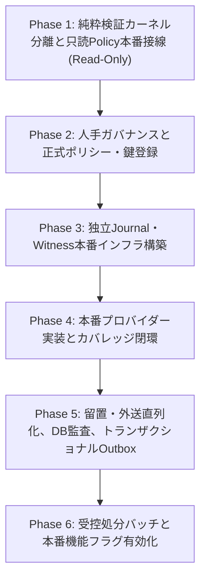

# NF07 合成基盤から本番能力への接線・意思決定契約設計書
（Production Wiring & Decision Contract）

状態: **PLAN REVISION (R3) / Astra 技術 Plan Review 待ち。設計のみ、本番削除・外送・書込操作は含まない。**
本輪基准（Base）: `b2886c47a0c20716a37a08dffcfb847f5432a1f1`
直前基准（Previous Base）: `9024f7b2e924f073ad135aa0d4420c8b39dcbcd3`
固定テスト証拠コミット: `c8b78dc3c8c3906e8ba734a2aa81037bd3a77dfb`
担当: AI-5（接線・意思決定契約設計担当）
対象ブランチ: `codex/snf-prod-nf07-evidence-contract`

---

## 1. 目的とスコープ境界

### 1.1 目的
NF07（プライバシー・データ保持・DSAR）における既存の合成検証済み能力（Envelope/Verifier、Journal CAS、Hold/Fence、Watermark Witness/Projection、Recovery、Synthetic Preview、只読Policy照会）と、将来の本番運用能力との間にある「接線（Wiring）」および「意思決定契約（Decision Contract）」を明確化する。

### 1.2 スコープ制限・安全原則
本設計は第一弾（設計フェーズ）であり、以下を厳格に順守する：
1. **本番変更操作の禁止**: 実データの削除、物理パージ、論理削除、匿名化、外部送信（Dispatch）、本番DBへの書込操作は一切実装しない。
2. **合成環境守衛の厳格維持**: `SyntheticEnvironmentGuard` による合成環境隔離・本番プロファイル（`prod`）拒絶機構は、合成資産の安全を担保する中核的防護であり、これを解除・改変・弱化しない。また、本番プロファイル下で `SyntheticEnvironmentGuard` が稼働を拒絶することは「誤動作」ではなく「意図された正常なフェイルクローズ動作」である。
3. **只読結果の権限転用禁止**: 只読 Policy 照会結果（`PolicyExplanationResult`）は説明メタデータに限定し、いかなる実行権限・認可 Capability としても扱わない。
4. **既存能力の再実装禁止**: 既存の SF-W2（Journal/Hold）、SF-W2b（Recovery/Witness）、SF-W3a（Preview）の合成能力を白紙化または再作成しない。
5. **架空承認の禁止**: 人手意思決定事項について、AIが勝手に承認日や署名を偽造・補完しない。
6. **ゼロデータベース書込（Zero DB Mutation）**: 本接線設計スライスは完全な読み取り専用であり、データベースへの書込・更新・ログ永続化を一切行わない。
7. **擬似フラグへの非依存**: `privacy.retention.enabled` および `privacy.dsar.enabled` は導入予定・未実装の設定項目であり、現行の保護根拠は「実際の `SyntheticEnvironmentGuard`」および「コード構造上の破壊的実行能力の完全欠落」に基づく。

---

## 2. 五維能力マトリクス（Five-dimensional Capability Matrix）

現状の実装・検証事実と、本番移行に向けたギャップを5つの次元で整理する。

| 機能領域 / コンポーネント | ① 現行コードベース実装 | ② 履歴固定SHA検証実績 | ③ 基准SHA未検証項目 (Base: `b2886c47`) | ④ 本番接線ギャップ（技術） | ⑤ 人工承認ギャップ（ガバナンス） |
|---|---|---|---|---|---|
| **純粋状態機械・エンベロープ検証** | `PrivacyCaseStateMachine`<br>`ApprovalEnvelopeVerifier`<br>`CaseApprovalEnvelope`<br>`PolicyApprovalEnvelope` | 固定Head `6ec4ca28`<br>Astra限定CODE PASS<br>3クラス 18/0/0/0 合格 | 基准SHAでの新規テスト実行なし（`c8b78dc3` での42件定向テスト合格を継承） | 本番PKI/HSM/KMS連携なし<br>本番Trust Anchor動的配布なし | DG-07未承認<br>署名機関責任者未選任<br>スキーマv1以降の合意なし |
| **環境隔離ガード** | `SyntheticEnvironmentGuard`<br>(active/default `prod` 拒否) | 固定Head `6ec4ca28`<br>prod混入時の即時fail-closed実証済 | 基准SHAでの新規テスト実行なし | 本番用環境ガード及び本番専用Audience（`PRODUCTION`）未分離 | 本番環境運用ポリシー未承認 |
| **独立Journal・CAS排他・留置** | `PrivacyJournalPort`<br>`JdbcPrivacyJournalAdapter`<br>`VerifiedDispatchFence`<br>`DispatchFenceVerifier` | 固定証拠 `nf07-w2a`<br>並行境界・MySQL分離確認済 | 基准SHA下での実MySQL並行・耐久性テスト未再実行（AI-1担当） | 本番独立Journal用MySQLインスタンス/クラスター不在<br>本番Flyway DDL未発行（V185未割当） | 留置（Legal Hold）権限規程未策定<br>職務分離（SoD）の法務承認なし |
| **投影・署名Watermark・リカバリ** | `PrivacyProjectionPort`<br>`JdbcPrivacyProjectionAdapter`<br>`JournalProjectionService`<br>`SignedWatermarkVerifier`<br>`LatestWitnessPort`<br>`JdbcLatestWitnessAdapter`<br>`PrivacyRecoveryService` | 固定Head `ac894ac6`<br>W2b D2b2 35/0/0/0 合格<br>(Astra限定Review) | 基准SHA下での3-MySQL隔離リカバリテスト未再実行（AI-1担当） | 本番Witness独立ストア不在<br>アプリケーションDBへの本番投影バッチ不在<br>リカバリ隔離解除APIの本番配線なし | 復旧後隔離（`READ_ONLY_QUARANTINED`）解除権限者未指定<br>災害復旧SOP未承認 |
| **合成DSARプレビュー** | `SyntheticPreviewPort`<br>`SyntheticPreviewStore`<br>`SyntheticPrivacyRequestService`<br>`SyntheticIdentityEvidenceVerifier` | 固定Head `92d91d58`<br>W3a 26/0/0/0 合格<br>(control `b6e2992b` 統合) | 基准SHA下での実MySQLプレビューテスト未再実行（AI-1担当） | 本番IdP（Keycloak/OAuth2）連携不在<br>実テーブル/ファイル用Scope Provider不在<br>同姓同名・名寄せ解決SOP不在 | DSAR受付窓口規程未策定<br>第三者マスキング基準の法務合意なし |
| **只読Policy照会・説明** | `PolicyReadonlyQueryPort`<br>`PolicyReadonlyQueryService`<br>`SyntheticPolicyCatalog`<br>`PolicyEnvelopeSource`<br>`SyntheticCallerContextProvider` | `c8b78dc3` 固定実績:<br>定向42件合格 (`targeted-01`)<br>Fast全4,292件合格 (`fast-01`) | 全MySQLテストプロファイル（Docker依存）は未実行（AI-1担当） | 本番Spring Security連携コンテキスト未配線<br>本番ポリシーカタログ未配線<br>本番失効CRL/OCSPプロバイダー未配線 | DG-07全データ保持期間未承認<br>正式Privacy Owner未選任 |
| **処分バッチ・外部送信** | なし（設計・合成インターフェースのみ） | 未実行（実装凍結） | 未実装 | 本番Outboxディスパッチャー不在<br>実外部AIアダプター配線不在<br>処分実行器（物理/論理/匿名化）不在 | 処分機能フラグ（導入予定・未実装）<br>ベンダーDPA（Google Cloud等）未合意 |

### 2.1 履歴スキャン統計の分離と将来リリースの閉環ゲート規約
過去のインベントリおよびカバレッジ統計について、測定時点およびコミットSHAを明確に分離して記録する。これらを直前基准（`9024f7b2`）や本輪基准（`b2886c47`）における新しいスキャン結果と混同してはならない。

1. **歴史的ベースライン 1（2026-08-28、コミット `b678ce98`）**:
   * 対象: マイグレーション 116 ファイル、180 テーブル、4,279 CREATE 列、153 ALTER 列、176 エンティティ、424 プロバイダー候補。
   * 結果: 構造的未分類（unclassified）は 0 であるが、法的なポリシー承認が未完了のテーブルが 78 件存在（`COVERAGE_EXPLICIT_POLICY_UNKNOWN`）。
2. **固定読取専用スキャン 2（2026-10-01、Control Head `cde61306`、証拠 `20261001-privacy-coverage-02`）**:
   * 対象: マイグレーション 183 ファイル、254 テーブル、244 エンティティ、708 プロバイダー候補。
   * 結果: プライバシーカタログ未分類 74 テーブル、インベントリ欠落 1,082 列、プロバイダー参照欠落 285 件、エンティティ未マップ 68 件で `BLOCKED`。
3. **将来リリースの閉環ゲート規約**:
   * 上記いずれの統計も本設計の基准コミットの直接スキャン結果ではない。
   * Phase 4 の実装時および将来の本番公開（Production Enablement）時には、**対象となるリリース固定コミット SHA に対してインベントリ・カバレッジの閉環スキャンを再実行し、未分類 0・欠落 0 の証拠を固定すること**を必須のゲート条件とする。

---

## 3. 最小本番接線設計スライス: 只読Policy説明照会ブリッジ

本インクリメントで選定する唯一の最小本番接線スライスは、下流業務・連携モジュール（NF03/NF08）へ向けた**「只読Policy説明照会ブリッジ（Read-only Policy Explanation Bridge）」**である。
本スライスは**完全只読（0 write, 0 delete, 0 dispatch）**であり、本番データへの副作用を一切持たず、業務機能に不可欠なポリシー状況の安全な可視化のみを提供する。

```text
[業務モジュール (NF03/NF08)]
       │  evaluate(PolicyEvaluationQuery)
       ▼
[PolicyReadonlyQueryPort]
       │
[ProductionPolicyReadonlyQueryService] (独立本番入口 / Spring Bean)
       ├── 呼び出し元検証 ────▶ [SecurityContextCallerContextProvider] (Spring Security 連携)
       ├── カタログ特定   ────▶ [ProductionPolicyCatalog] (本番カタログ)
       ├── ソース現在版取得 ──▶ [ProductionPolicyEnvelopeSource] (署名済みポリシー正本)
       └── ポリシー検証   ────▶ [ProductionApprovalEnvelopeVerifier]
                                    │  (内部で独立審査済みの純粋検証カーネルを呼び出し)
                                    ├── Trust Anchor 照合 (本番公開鍵, Audience: PRODUCTION)
                                    ├── 期間・SoD・バインディング検査
                                    └── 失効照合 ────▶ [ProductionRevocationStatusProvider]
       │
       ▼
[PolicyExplanationResult] (説明メタデータのみ返却・権限フラグなし・DB書込なし)
```

### 3.1 本番入口と検証境界の明確化（Production Entrypoint & Verification Boundary）
現行の `PolicyReadonlyQueryService` および `ApprovalEnvelopeVerifier` は、コンストラクタで `SyntheticEnvironmentGuard` を注入されており、内部で `environmentGuard.requireSyntheticAllowed(...)` を呼び出している。このガードは、`prod` プロファイルが有効な環境では例外なく `SecurityException` を送出する。
この `prod` 拒絶は合成環境保護のための**意図された正常動作**であり、これを「誤動作」と呼んだり、無効化・バイパスしてはならない。また、単に Spring Bean の定義や署名鍵を差し替えるだけでは、合成ガードによって本番実行が正しく阻害されるため成立しない。

本番配線における境界アーキテクチャとして、以下の「純粋検証カーネル分離と独立本番入口」を設計する：

1. **純粋検証カーネルの分離（要・独立審査）**:
   * 環境ガードに依存しない、純粋な暗号学的検証ロジック（正規化バイナリ生成、Ed25519 署名照合、職務分離 SoD 判定、有効期間半開区間判定、各種バインディング突き合わせ）を、副作用を持たない純粋関数的コンポーネント `PurePolicyVerificationKernel` として抽出する。
   * 本カーネルの抽出と分離は、Astra による独立した技術 PLAN/CODE Review を受けることを前提とする。
2. **合成用ラッパー（既存維持・不変）**:
   * 既存の `ApprovalEnvelopeVerifier` および `PolicyReadonlyQueryService` は、`SyntheticEnvironmentGuard` を保持したまま完全に維持する。
   * `audience = "SYNTHETIC"` のみを許可し、`prod` プロファイル検出時は直ちにフェイルクローズする既存の安全性を 100% 担保する。
3. **独立本番用ラッパー（新規設計）**:
   * 本番用の独立した検証器 `ProductionApprovalEnvelopeVerifier` および照会サービス `ProductionPolicyReadonlyQueryService` を新設する。
   * 本番ラッパーは `ProductionEnvironmentGuard`（`prod` プロファイル必須、`audience = "PRODUCTION"` 必須、テスト鍵混入の拒絶）を注入し、`PurePolicyVerificationKernel` へ検証を委任する。
   * 本番用 Trust Anchor（KMS/HSM 管理の正規ルート鍵）のみをロードし、合成用テスト鍵の混入を物理的に排除する。

### 3.2 呼び出し元身元・テナント・ロールの厳格マッピング（Caller Context Mapping）
本番環境では、Spring Security の `SecurityContextHolder` から得られる認証情報（`Authentication`）に基づき、`TrustedCallerContext` を安全に構築する。

#### 1. 認証主体ごとの詳細マッピング規則

| 認証 Principal 型 | アクターID (`actorId`) 解決 | テナントID (`tenantId`) 解決 | アクターロール (`actorRole`) 解決 | 未知・不整合時の動作 |
|---|---|---|---|---|
| **`LoginUser`**<br>(内部フォーム認証) | `String.valueOf(user.getSysUser().getId())`<br>(ID欠落時は `user.getUsername()`) | `user.getTenantId()`<br>(未設定/空白時は拒絶) | 後述の「権限マッピング規則」に基づき解決。<br>一般業務ロールは `ROLE_UNPRIVILEGED_USER` | テナント空白、または未認可ロールは即座に `ACCESS_DENIED` |
| **`OidcLoginUser`**<br>(IdP / OAuth2 連携) | `String.valueOf(user.getSysUser().getId())`<br>(または検証済み OIDC `sub` クレーム) | `oidc.getTenantId()`<br>(認証時に内部 `SysUser` へ固定束縛されたテナント。<br>トークンクレームは一致性検査のみに使用し、内部未設定時はフォールバックせず拒絶) | 後述の「権限マッピング規則」に基づき解決 | 内部テナント未設定、クレーム不一致、クレーム間衝突時は即座に `ACCESS_DENIED` |
| **`ExternalApiPrincipal`**<br>(公開APIクライアント) | `external.clientId()` | `external.tenantId()` | 原則として `ROLE_UNPRIVILEGED_USER`。<br>内部ロールへの変換は不可 | 専用のスコープ認可トークンがない限り照会不可 (`ACCESS_DENIED`) |
| **サービス内部認証**<br>(Daemon / Worker) | サービス固有識別子<br>(例: `service:privacy-outbox`) | 対象処理テナントID | 内部暗号トークンまたは mTLS で検証された場合のみ `ROLE_SYSTEM_SERVICE` | 一般ユーザーセッションからの昇格は厳格に拒絶 |
| **`AnonymousAuthenticationToken`**<br>(未認証 / ゲスト) | なし (`null`) | なし (`null`) | 解決不可 | `MISSING_CALLER_IDENTITY` により即座に `ACCESS_DENIED` |
| **未知の Principal 型** | なし (`null`) | なし (`null`) | 解決不可 | `UNAUTHORIZED_ACTOR_ROLE` により即座に `ACCESS_DENIED` |

#### 2. OidcLoginUser のテナント解決とクレーム一致性検証規約（OIDC Tenant & Claim Verification Contract）
* **可信データソースの単一性（認証バインディング優先）**:
  * `OidcLoginUser` は内部 `LoginUser` を継承しており（`OidcLoginUser extends LoginUser`）、そのテナント解決は認証時に内部 `SysUser` へ固定された `oidc.getTenantId()`（即ち `super.getTenantId()`）を唯一の正本（Single Source of Truth）とする。
  * `SecurityUtils.currentTenantId()` のような「クレーム優先（Claim-preferring）」または「クレームへのフォールバック」を行うロジックは、IdP トークン改竄や外部クレーム注入による跨テナント越境の脆弱性をもたらすため、可信テナントの導出元として使用することを厳格に禁止する。
* **クレームの役割の限定（一致性検査のみ・フォールバック禁止）**:
  * OIDC トークンに含まれる `tenant_id`、`tenantId`、`tenant` クレームは、内部バインディングの妥当性を二重確認する「整合性検査（Consistency Check）」の用途にのみ使用を許可する。
  * クレームによって内部バインディング `oidc.getTenantId()` を上書き（Override）することは不可。
  * 内部バインディングが `null` または空白の場合に、クレームの値へフォールバックしてテナントを確定することを厳格に禁止する。
* **明確な拒絶条件（Rejection Conditions）**:
  1. **不一致拒絶**: 内部バインディングがテナント A、OIDC クレームがテナント B の場合、照会クエリ（`query.tenantId()`）が B であっても A であっても、テナント不整合として直ちに `ACCESS_DENIED` (`CALLER_TENANT_MISMATCH`) を返却する。
  2. **内部欠落拒絶**: 内部バインディング `oidc.getTenantId()` が未設定・空白の場合、OIDC クレームに有効な値が存在してもフォールバックせず、直ちに `ACCESS_DENIED` (`MISSING_CALLER_IDENTITY` または `CALLER_TENANT_MISMATCH`) を返却する。
  3. **クレーム衝突拒絶**: OIDC トークン内に複数の有効なテナントクレーム（例: `tenant_id="X"` かつ `tenantId="Y"`）が存在し、それらが互いに不一致・衝突している場合、直ちに `ACCESS_DENIED` (`CALLER_TENANT_MISMATCH`) を返却する。
* **正向通過条件（Positive Acceptance Condition）**:
  * 内部バインディング `oidc.getTenantId()` が存在し、かつ
  * トークン内の全テナントクレームが存在しないか、または存在するすべてのクレームが `oidc.getTenantId()` と完全一致し、かつ
  * `query.tenantId()` が `oidc.getTenantId()` と一致し、他のアクター身元・ロール検査に合格する場合に限り、ポリシー評価処理の続行を許可する。
* **型階層と評価順序の注意（Inheritance Order Constraint）**:
  * `OidcLoginUser` は `LoginUser` のサブクラスであるため、将来の実装時（`CallerContextProvider` 等）において、`instanceof` 評価順序は必ず `OidcLoginUser` の分岐を先に評価し、その後に一般 `LoginUser` を評価しなければならない。

#### 3. 厳格なロール昇格防止と権限マッピング規約
* **同名文字列による短絡マッピングの禁止**:
  * データベース上の `sys_user.role = '管理者'` や Spring Security の `ROLE_管理者` は、**単なる同名文字列の突き合わせによって自動的に `ROLE_ADMIN` へ昇格させてはならない**。
  * `ROLE_ADMIN` へのマッピングには、システム管理権限（`ROLE_ADMIN`）に加えてプライバシー管理権限（例: `PRIVACY_ADMIN_READ` 特権）が明示的に付与されていることを検証しなければならない。
* **一般業務ロールのアクセス拒絶**:
  * 業務ロール（`営業`, `HR`, `マネージャー`, `要員`）および特権を持たない管理者は、すべて一律に `ROLE_UNPRIVILEGED_USER` にマッピングされ、照会時に直ちに `ACCESS_DENIED` となる。
* **サービスロールへの自動昇格の絶対禁止**:
  * **いかなる認証済みユーザー（`LoginUser`, `OidcLoginUser`, `ExternalApiPrincipal`, `PortalLoginUser`）も、自動的に `ROLE_SYSTEM_SERVICE` へ昇格することは構造上不可能とする**。
  * `ROLE_SYSTEM_SERVICE` は、内部マイクロサービスまたはデーモンが発行する検証済み内部サービス認証トークンを保持している場合にのみ割り当てられる。

#### 4. 呼び出し元検証の受入条件（Acceptance Criteria）
1. **跨テナント拒絶**: `caller.tenantId() != query.tenantId()` の場合、直ちに `ACCESS_DENIED` (`CALLER_TENANT_MISMATCH`) を返却すること。
2. **OIDC テナント不整合・内部欠落・衝突拒絶**:
   * 内部 A、クレーム B、クエリ B の場合に `ACCESS_DENIED` (`CALLER_TENANT_MISMATCH`) となること。
   * 内部バインディング空白でクレーム有値の場合に `ACCESS_DENIED` となること（フォールバック拒絶）。
   * 複数クレーム衝突時に `ACCESS_DENIED` となること。
3. **冒名・身元不一致拒絶**: `caller.actorId() != query.actorId()` の場合、直ちに `ACCESS_DENIED` (`CALLER_ACTOR_MISMATCH`) を返却すること。
4. **未認可ロール拒絶**: `caller.actorRole()` が `ROLE_UNPRIVILEGED_USER`（一般営業、HR、マネージャー、要員等）の場合、直ちに `ACCESS_DENIED` (`UNAUTHORIZED_ACTOR_ROLE`) を返却すること。
5. **サービス身元の非昇格検証**: 通常ログインユーザーが `ROLE_SYSTEM_SERVICE` を名乗るクエリを発行した場合、コンテキスト検証で確実に拒絶されること。

### 3.3 データソース（Data Sources）
1. **ポリシーカタログ (`ProductionPolicyCatalog`)**:
   * `(moduleCode, dataElementId, targetAction, targetProvider)` を決定論的に固定の `policyId` と `expectedScope` へ解決する。
   * カタログ未定義の組み合わせは即座に `POLICY_UNKNOWN` (`POLICY_NOT_FOUND`) とする。
2. **ポリシーソース (`ProductionPolicyEnvelopeSource`)**:
   * バージョン管理・署名された `PolicyApprovalEnvelope` の正本ストアから現在指定エンベロープを取得する。
   * 不透明 `revision` と `digest` による三点照合（`policyId`, `revision`, `digest`）を必須とし、不整合時は `POLICY_DRIFT`。
3. **失効プロバイダー (`ProductionRevocationStatusProvider`)**:
   * 署名鍵およびエンベロープごとの失効状態を照会する。

### 3.4 撤回・失効・期限・未知状態のハンドリング
判定は以下の厳格な優先度で行われ、安全側（fail-closed）に倒す：

1. **明示的失効 (`POLICY_REVOKED`)**:
   * `keyStatus == REVOKED` $\rightarrow$ `KEY_REVOKED`
   * `envelopeStatus == REVOKED` $\rightarrow$ `ENVELOPE_REVOKED`
2. **ACTIVE 許可リスト原則 (`POLICY_UNKNOWN`)**:
   * `keyStatus != ACTIVE || envelopeStatus != ACTIVE`（`UNKNOWN`、`null`、未定義状態を含む）は、明確な `REVOKED` を除きすべて `REVOCATION_STATUS_UNKNOWN` として安全に拒絶する。
   * 失効プロバイダーの通信障害・例外発生時は `REVOCATION_PROVIDER_ERROR`。
3. **時刻・期限超過 (`POLICY_EXPIRED`)**:
   * `now.isBefore(issuedAt)` $\rightarrow$ `NOT_YET_ISSUED`
   * `now.isBefore(effectiveAt)` $\rightarrow$ `NOT_YET_EFFECTIVE`
   * `!now.isBefore(expiresAt)`（半開区間境界 `now >= expiresAt`） $\rightarrow$ `EXPIRED_AT_OR_AFTER_DEADLINE`
   * `now >= authority.validUntil()` $\rightarrow$ `AUTHORITY_VALIDITY_EXPIRED`
4. **ドリフト・改竄・不整合 (`POLICY_DRIFT`)**:
   * 署名不一致、スキーマバージョン不正、未知Trust Anchor、機関管轄不一致、SoD違反（`requesterId == approverId`）、各種バインディング不一致（Tenant, Scope, DataElement, Action, Provider）。
5. **フォールバック禁止**:
   * いかなる障害・不整合・失効時も、**古いリビジョンや過去の有効エンベロープへ自動フォールバックしてはならない**。

### 3.5 異常系（Exceptions）
* 内部検証では型付け例外 `PolicySecurityException(reason, message, cause)` を使用する。
* 外部（API/呼び出し元）へ返却する `PolicyExplanationResult` の `explanationReason` には、固定の日本語説明文言のみを設定し、内部スタックトレースや `e.getMessage()` に含まれる秘密マーカー・接続情報を一切漏洩させない。

### 3.6 ゼロデータベース書込と監査証跡の境界（Zero DB Writes & Audit Boundary）
* **ゼロデータベース書込（Zero DB Mutation）**:
  * 本接線スライスは**データベースへの永続化（INSERT/UPDATE/DELETE）を一切行わない（0 DB write）**。
  * `t_audit_log` テーブルへの永続化は本スライスのスコープ外であり、後続のトランザクションおよび監査設計スライス（Phase 5）において独立して設計・審査・実装される。
  * **制限事項**: データベースへの監査ログ永続化が未実装であるため、**本スライスをもって「本番監査証跡が完備された」と宣称することは厳格に禁止される**。
* **本スライスにおけるログ証跡の扱い（本スライスはデータベース監査への書き込みを行わない）**:
  * 本接線スライスは、アプリケーションデータベース（`t_audit_log`）への書き込みを一切行わない（0 DB write）。
  * 照会実行時の証跡として、構造化セキュリティログ（SLF4J / INFO または WARN レベル）へ検証結果を出力する：
    * ログ出力項目: `timestamp`, `tenantId`, `actorId`, `actorRole`, `moduleCode`, `dataElementId`, `targetAction`, `targetProvider`, `decisionStatus`, `failureReason`。
    * 機密情報保護: 生PII、暗号鍵バイナリ、署名ペイロード本文はログへ出力しない。
  * なお、このログがファイルやログ集約プラットフォーム等で永続化されるか否かについて本スライスとして非永続性を保証するものではなく、「本スライスとしてデータベース監査への永続化を行わない」ことのみを規約とする。

---

## 4. NF03 / NF08 依存契約（Dependency Contracts）

### 4.1 NF03（スキル資格管理）依存契約
* **現状の事実**: 現時点で NF03 の `CERTIFICATION_PII` に対する DG-07 保持ポリシーは未承認（`POLICY_UNKNOWN`）である。
* **契約条項**:
  1. **日常業務の非封鎖原則**:
     `POLICY_UNKNOWN` のステータスは、「retention 期限到達に伴う自動廃棄・物理パージ等の処分ポリシーが未確定である」ことのみを意味する。
     これを**「資格登録、証明書アップロード、情報閲覧、更新といった日常の資格管理業務を停止・只読化しなければならない」と過剰拡大して解釈してはならない**。日常業務画面・APIは平常どおり稼働を継続する。
  2. **自動処分の厳格封鎖**:
     自動パージやデータ廃棄バッチの実行経路のみが `POLICY_UNKNOWN` によって厳格に封鎖（fail-closed）される。
  3. **自動処分の実施要件**:
     将来の自動処分実行には、法務承認された正式ポリシーエンベロープと、個別の廃棄ケース承認エンベロープが揃うことが必須条件となる。

### 4.2 NF08（AI要約・プロンプトログ）依存契約
* **現状の事実**: 現時点で AI プロンプトログ・要約に対する保持・外送ポリシーは未承認（`POLICY_UNKNOWN`）である。
* **契約条項**:
  1. **未承認時の外送絶対禁止**:
     ポリシー照会ステータスが `POLICY_UNKNOWN`、`POLICY_EXPIRED`、`POLICY_REVOKED`、`POLICY_DRIFT`、または `ACCESS_DENIED` である場合、外部 AI プロバイダー（Gemini Adapter 等）へのデータ送信（外送）は例外なく禁止される（fail-closed）。
  2. **フィールドホワイトリスト（許可リスト）の性質規定**:
     `g10-allowlist.json` 等に定義されるフィールドホワイトリストは、「法的に送信が許可された場合に送信してよい技術的上限（最大許容範囲）」を定めたものに過ぎない。
     **ホワイトリストへの掲載自体は、送信を認可するライセンスではない**。「ホワイトリストに含まれる項目だから未承認でも送信してよい」という解釈は重大な契約違反として厳格に排除される。
  3. **只読説明と実行認可の完全分離**:
     ポリシー照会結果が `APPROVED_ACTIVE` を返した場合であっても、それ自体は外部送信の実行許可を一切付与しない。
     実際の外部送信には、独立Journalによって直列化された `CaseApprovalEnvelope` の検証、および `VerifiedDispatchFence` の発行が不可欠である。

---

## 5. 人手意思決定チェックリスト（Manual Decision Checklist）

> [!IMPORTANT]
> **「提議は承認を意味しない（Proposal != Approval）」原則**:
> 本システムおよびAIアシスタントは、以下の人手意思決定事項について勝手に承認済みと仮定したり、架空の承認日付や署名を記入してはならない。すべての項目は正式な人間の責任者による署名・承認を経て初めて有効化される。

| 番号 | 意思決定領域 | 必須決定事項 | 正式決定権限者 | 現在の状態 | 承認日 / 署名証跡 |
|---|---|---|---|---|---|
| **D-01** | **正式責任者選任** | システム全体の正式プライバシー・データ保持責任者（DPO/統括役員）の任命 | 経営会議 / 取締役会 | **未選任**<br>(`UNASSIGNED_UNTIL_PRE_PRODUCTION`) | *未承認（記入禁止）* |
| **D-02** | **法務・ガバナンス (DG-07)** | 全データテーブル、ファイル、AIログに関する法定保持期間・起算日トリガー・法的根拠の正式承認 | 法務責任者 / コンプライアンス室長 | **未完了**<br>(DG-07 未承認) | *未承認（記入禁止）* |
| **D-03** | **暗号・鍵管理 (Security)** | 本番Ed25519 Trust Anchor（ルート公開鍵）の登録、HSM/KMS鍵管理規程、失効手順の承認 | CISO / 情報セキュリティ責任者 | **未策定**<br>(合成テスト鍵のみ存在) | *未承認（記入禁止）* |
| **D-04** | **保持・処分規程** | データ要素ごとの具体的処分方式（物理削除、論理削除、匿名化、アクセス制限）の法的採否決定 | 法務責任者 / 個人情報保護委員会対応責任者 | **未決定** | *未承認（記入禁止）* |
| **D-05** | **法的留置 (Hold)** | 法的留置（Legal Hold）の開始・解除権限者の指定、および解除時における職務分離（SoD: 申請者≠承認者）規則の承認 | 顧問弁護士 / 法務部門長 | **未承認** | *未承認（記入禁止）* |
| **D-06** | **DSAR権利行使SOP** | 本人確認基準、同姓同名・名寄せ曖昧性発生時の人手裁定手順、第三者個人情報のマスキング基準の承認 | カスタマーサクセス統括 / プライバシーオフィサー | **未策定** | *未承認（記入禁止）* |
| **D-07** | **リカバリ隔離解除** | 障害復旧・バックアップリストア後の永続隔離状態（`READ_ONLY_QUARANTINED`）を本番開放（Unquarantine）する判断基準および承認権限者 | システム運用統括 / CISO | **未承認** | *未承認（記入禁止）* |
| **D-08** | **外部委託・DPA契約** | 外部AIサービス（Google Cloud / Gemini API）および電子契約ベンダーとのデータ処理契約（DPA）締結・ログ保持規約の確認 | 法務部門 / 調達責任者 | **未確認** | *未承認（記入禁止）* |
| **D-09** | **本番機能フラグ開放** | `privacy.retention.enabled` および `privacy.dsar.enabled`（**導入予定・未実装**）の本番有効化承認（全Gate通過後） | 開発総括 / プロダクトオーナー / CISO | **BLOCKED**<br>(導入予定・未実装) | *未承認（記入禁止）* |

---

## 6. ギャップの最小実装順序と検証条件

本番能力の実現に向けた、最小限かつ安全な段階的実装順序および検証ゲートを定義する。



### Phase 1: 純粋検証カーネル分離と只読Policy本番接線（Read-Only Wiring）
* **実装内容**:
  * 純粋検証カーネル `PurePolicyVerificationKernel` の分離（Astra 独立技術レビュー必須）。
  * 既存 `ApprovalEnvelopeVerifier` / `PolicyReadonlyQueryService` の合成環境守衛を完全維持。
  * `ProductionPolicyReadonlyQueryService` および `SecurityContextCallerContextProvider` の実装。
  * `OidcLoginUser` における認証バインディング優先テナント解決およびクレーム一致性検査の実装。
* **完了・検証条件**:
  * 0 write, 0 delete, 0 dispatch, 0 DB mutation であること。
  * 未認可ロールからのアクセスが直ちに `ACCESS_DENIED` となること。
  * OIDC テナント不一致、内部欠落、クレーム衝突がすべて直ちに `ACCESS_DENIED` となること。
  * NF03 の日常資格登録業務に一切の影響を与えないこと。
  * 42件の定向テストおよび Fast スイートの回帰がないこと。

### Phase 2: 人手ガバナンスと正式ポリシー・鍵登録（Governance & Key Registration）
* **実装内容**:
  * 正式 Privacy Owner の任命。
  * DG-07 ポリシーの法務合意と、署名済み `PolicyApprovalEnvelope` の正本登録。
  * 本番 Trust Anchor（公開鍵）のセキュアストレージ登録。
* **完了・検証条件**:
  * 各種データ要素の照会において `POLICY_UNKNOWN` が解消され、正しく `APPROVED_ACTIVE` と説明されること。
  * 合成テスト鍵が混入していないこと。

### Phase 3: 独立Journal・Witness本番インフラ構築（Production Journal & Witness）
* **実装内容**:
  * 本番用独立 MySQL インスタンス（Journal用、Witness用）のプロビジョニング。
  * 本番 Flyway マイグレーション（総括による番号管理、V185は占用しない）。
  * `JdbcPrivacyJournalAdapter` および `JdbcLatestWitnessAdapter` の本番データソース配線。
* **完了・検証条件**:
  * アプリケーションDBとの物理的・論理的独立性の確認。
  * `innodb_flush_log_at_trx_commit=1` の耐久性検証。
  * リストア試験において古いスナップショットへのロールバックが検知・遮断（Quarantine）されること。

### Phase 4: 本番プロバイダー実装とカバレッジ閉環（Production Providers & Coverage Closure）
* **実装内容**:
  * 実テーブル、ファイルストレージ、AIログに対する `PrivacyProvider` 実装。
  * `DataScopeService` との厳格な連携。
  * 第三者情報の自動マスキングエンジンの実装。
  * **対象リリース SHA に対するインベントリ・カバレッジ閉環スキャンの実行**。
* **完了・検証条件**:
  * 対象リリース SHA での未分類（unclassified）0、欠落列 0 の閉環証明。
  * 検索スコープ外へのアクセスが一切発生しないこと（crossScopeAccess = 0）。
  * 同姓同名・名寄せ曖昧性のあるリクエストが自動マージされず人手待ちとなること。

### Phase 5: 留置・外送直列化、DB監査、トランザクショナルOutbox（Hold/Dispatch Linearization & DB Audit）
* **実装内容**:
  * 独立Journalによる `HOLD_STARTED` / `HOLD_RELEASED` のアトミック記録。
  * `DISPATCH_AUTHORIZED` イベントと連携したトランザクショナルOutboxワーカー。
  * `t_audit_log` への永続監査ログ書き込みの実装とトランザクション境界検証。
  * 履歴レシート検証器（`HistoricalActionReceiptVerifier`）の本番配線。
* **完了・検証条件**:
  * 留置確定後の外部呼出が0であること。
  * 外部AI送信において、未承認ポリシーまたはホワイトリスト外項目の送信が遮断されること。
  * プロバイダー障害・タイムアウト時に状態が安全に `UNKNOWN` に保持されること。
  * 監査ログの正確な記録と改竄防止の確認（本フェーズの検証をもって初めて生産監査完備とする）。

### Phase 6: 受控処分バッチと本番機能フラグ有効化（Controlled Disposition & Flag Enablement）
* **実装内容**:
  * 二者承認（Four-Eyes Principle）を要求する処分バッチの実装。
  * 処分機能フラグ（`privacy.retention.enabled` / `privacy.dsar.enabled`）のコード導入。
* **完了・検証条件**:
  * 機能フラグ既定値 OFF の確認。
  * 人手承認のないバッチ実行が拒絶されること。
  * 全ての前提 Gate（D-01 〜 D-09）の正式署名が揃っていること。
  * Astra 独立 Review の完全合格。
