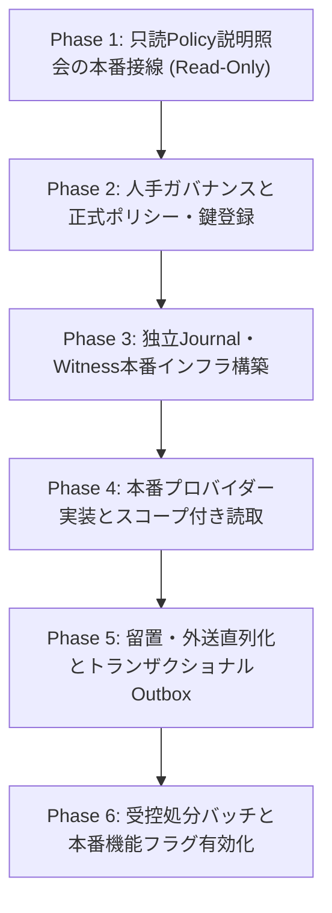

# NF07 合成基盤から本番能力への接線・意思決定契約設計書
（Production Wiring & Decision Contract）

状態: **PLAN REVISION (R1) / Astra 技術 Plan Review 待ち。設計のみ、本番削除・外送・書込操作は含まない。**  
基準コミット（Base）: `c8b78dc3c8c3906e8ba734a2aa81037bd3a77dfb`  
担当: AI-5（接線・意思決定契約設計担当）  
対象ブランチ: `codex/snf-prod-nf07-evidence-contract`

---

## 1. 目的とスコープ境界

### 1.1 目的
NF07（プライバシー・データ保持・DSAR）における既存の合成検証済み能力（Envelope/Verifier、Journal CAS、Hold/Fence、Watermark Witness/Projection、Recovery、Synthetic Preview、只読Policy照会）と、将来の本番運用能力との間にある「接線（Wiring）」および「意思決定契約（Decision Contract）」を明確化する。

### 1.2 スコープ制限・禁止事項
本設計は第一弾（設計フェーズ）であり、以下を厳格に順守する：
1. **本番変更操作の禁止**: 実データの削除、物理パージ、論理削除、匿名化、外部送信（Dispatch）、本番DBへの書込操作は一切実装しない。
2. **安全ガードの維持**: `SyntheticEnvironmentGuard` による合成環境隔離・本番プロファイル拒絶機構を解除・改変しない。
3. **只読結果の権限転用禁止**: 只読 Policy 照会結果（`PolicyExplanationResult`）は説明メタデータに限定し、いかなる実行権限・認可 Capability としても扱わない。
4. **既存能力の再実装禁止**: 既存の SF-W2（Journal/Hold）、SF-W2b（Recovery/Witness）、SF-W3a（Preview）の合成能力を白紙化または再作成しない。
5. **架空承認の禁止**: 人手意思決定事項について、AIが勝手に承認日や署名を偽造・補完しない。

---

## 2. 五維能力マトリクス（Five-dimensional Capability Matrix）

現状の実装・検証事実と、本番移行に向けたギャップを5つの次元で整理する。

| 機能領域 / コンポーネント | ① 現行コードベース実装 | ② 履歴固定SHA検証実績 | ③ 現行SHA未検証項目 (`c8b78dc3`) | ④ 本番接線ギャップ（技術） | ⑤ 人工承認ギャップ（ガバナンス） |
|---|---|---|---|---|---|
| **純粋状態機械・エンベロープ検証** | `PrivacyCaseStateMachine`<br>`ApprovalEnvelopeVerifier`<br>`CaseApprovalEnvelope`<br>`PolicyApprovalEnvelope` | 固定Head `6ec4ca28`<br>Astra限定CODE PASS<br>3クラス 18/0/0/0 合格 | 現行SHAでの隔離単体テストは通過済（42件内） | 本番PKI/HSM/KMS連携なし<br>本番Trust Anchor動的配布なし | DG-07未承認<br>署名機関責任者未選任<br>スキーマv1以降の合意なし |
| **環境隔離ガード** | `SyntheticEnvironmentGuard`<br>(active/default `prod` 拒否) | 固定Head `6ec4ca28`<br>prod混入時の即時fail-closed実証済 | 現行SHAでの隔離単体テスト通過済 | 本番環境用プロファイル識別・防護切替機構が未配線 | 本番環境運用ポリシー未承認 |
| **独立Journal・CAS排他・留置** | `PrivacyJournalPort`<br>`JdbcPrivacyJournalAdapter`<br>`VerifiedDispatchFence`<br>`DispatchFenceVerifier` | 固定証拠 `nf07-w2a`<br>並行境界・MySQL分離確認済 | 現行SHA下での実MySQL並行・耐久性テスト未再実行（AI-1担当） | 本番独立Journal用MySQLインスタンス/クラスター不在<br>本番Flyway DDL未発行（V185未割当） | 留置（Legal Hold）権限規程未策定<br>職務分離（SoD）の法務承認なし |
| **投影・署名Watermark・リカバリ** | `PrivacyProjectionPort`<br>`JdbcPrivacyProjectionAdapter`<br>`JournalProjectionService`<br>`SignedWatermarkVerifier`<br>`LatestWitnessPort`<br>`JdbcLatestWitnessAdapter`<br>`PrivacyRecoveryService` | 固定Head `ac894ac6`<br>W2b D2b2 35/0/0/0 合格<br>(Astra限定Review) | 現行SHA下での3-MySQL隔離リカバリテスト未再実行（AI-1担当） | 本番Witness独立ストア不在<br>アプリケーションDBへの本番投影バッチ不在<br>リカバリ隔離解除APIの本番配線なし | 復旧後隔離（`READ_ONLY_QUARANTINED`）解除権限者未指定<br>災害復旧SOP未承認 |
| **合成DSARプレビュー** | `SyntheticPreviewPort`<br>`SyntheticPreviewStore`<br>`SyntheticPrivacyRequestService`<br>`SyntheticIdentityEvidenceVerifier` | 固定Head `92d91d58`<br>W3a 26/0/0/0 合格<br>(control `b6e2992b` 統合) | 現行SHA下での実MySQLプレビューテスト未再実行（AI-1担当） | 本番IdP（Keycloak/OAuth2）連携不在<br>実180テーブル/ファイル用Scope Provider不在<br>同姓同名・名寄せ解決SOP不在 | DSAR受付窓口規程未策定<br>第三者マスキング基準の法務合意なし |
| **只読Policy照会・説明** | `PolicyReadonlyQueryPort`<br>`PolicyReadonlyQueryService`<br>`SyntheticPolicyCatalog`<br>`PolicyEnvelopeSource`<br>`SyntheticCallerContextProvider` | 現行Head `c8b78dc3`<br>定向42件合格 (`targeted-01`)<br>Fast全4,292件合格 (`fast-01`) | 全MySQLテストプロファイル（Docker依存）は未実行 | 本番Spring Securityコンテキスト接続不在<br>本番ポリシーカタログ（全要素網羅）不在<br>本番失効CRL/OCSPプロバイダー不在 | DG-07全データ保持期間未承認（78件UNKNOWN）<br>正式Privacy Owner未選任 |
| **処分バッチ・外部送信** | なし（設計・合成インターフェースのみ） | 未実行（実装凍結） | 未実装 | 本番Outboxディスパッチャー不在<br>実外部AIアダプター配線不在<br>処分実行器（物理/論理/匿名化）不在 | 処分機能フラグ（OFF維持）<br>ベンダーDPA（Google Cloud等）未合意 |

---

## 3. 最小本番接線設計スライス: 只読Policy説明照会ブリッジ

本インクリメントで選定する唯一の最小本番接線スライスは、下流業務・連携モジュール（NF03/NF08）へ向けた**「只読Policy説明照会ブリッジ（Read-only Policy Explanation Bridge）」**である。  
本スライスは**完全只読（0 write, 0 delete, 0 dispatch）**であり、本番データへの副作用を一切持たず、業務機能に不可欠なポリシー状況の安全な可視化のみを提供する。

```text
[業務モジュール (NF03/NF08)]
       │  evaluate(PolicyEvaluationQuery)
       ▼
[PolicyReadonlyQueryPort]
       │
[PolicyReadonlyQueryService] (Spring Bean 接線)
       ├── 呼び出し元検証 ────▶ [SecurityContextCallerContextProvider] (Spring Security 連携)
       ├── カタログ特定   ────▶ [ProductionPolicyCatalog] (本番カタログ)
       ├── ソース現在版取得 ──▶ [ProductionPolicyEnvelopeSource] (署名済みポリシー正本)
       └── ポリシー検証   ────▶ [ApprovalEnvelopeVerifier.verifyPolicyOnly]
                                    ├── Trust Anchor 照合 (本番公開鍵)
                                    ├── 期間・SoD・バインディング検査
                                    └── 失効照合 ────▶ [ProductionRevocationStatusProvider]
       │
       ▼
[PolicyExplanationResult] (説明メタデータのみ返却・権限フラグなし)
```

### 3.1 インターフェース契約
呼び出し側はクエリDTOのみを渡し、実行コンテキストの偽装を構造上防止する。

```java
package com.ses.privacy.foundation;

public interface PolicyReadonlyQueryPort {
    /**
     * 指定されたクエリに対するポリシー現状を評価・説明する。
     * 呼び出し元がアクターロール、テナント、asOf 時刻を任意に上書きすることは不可。
     * 返却値は純粋な説明メタデータであり、いかなる実行権限・Capability も含まない。
     */
    PolicyExplanationResult evaluate(PolicyEvaluationQuery query);
}
```

* **入力 (`PolicyEvaluationQuery`)**: `tenantId`, `actorId`, `moduleCode`, `dataElementId`, `targetAction`, `targetProvider`（不変レコード）。
* **出力 (`PolicyExplanationResult`)**: `status` (`PolicyDecisionStatus`), `failureReason` (`PolicyFailureReason`), `policyVersion`, `policyDigest`, `dataElementId`, `targetAction`, `targetProvider`, `scope`, `effectiveFrom`, `expiresAt`, `explanationReason`。
* **出力不変性**: `isPermitted`、`canDispatch`、`canPurge` などのブール権限フィールドを一切持たない。

### 3.2 信頼境界（Trust Boundary）
1. **呼出元身元の注入分離**:
   * 本番接線時は `SecurityContextCallerContextProvider` を提供し、`SecurityContextHolder.getContext().getAuthentication()` から検証済みのアクターID、テナントID、ロールを抽出する。
   * クライアントリクエストパラメータやHTTPヘッダーによる身元自己申告は拒絶する。
2. **テナント・ロール検査**:
   * `caller.tenantId() != query.tenantId()` $\rightarrow$ 直ちに `ACCESS_DENIED` (`CALLER_TENANT_MISMATCH`)。
   * `caller.actorId() != query.actorId()` $\rightarrow$ 直ちに `ACCESS_DENIED` (`CALLER_ACTOR_MISMATCH`)。
   * `caller.actorRole()` が許可ロール (`ROLE_SYSTEM_SERVICE`, `ROLE_PRIVACY_AUDITOR`, `ROLE_ADMIN`) 以外（例: `ROLE_UNPRIVILEGED_USER`） $\rightarrow$ 直ちに `ACCESS_DENIED` (`UNAUTHORIZED_ACTOR_ROLE`)。
3. **合成ガードの非無効化原則**:
   * 既存の `SyntheticEnvironmentGuard` は合成用アセットへの `prod` 混入を防ぐ防護壁としてそのまま維持する。
   * 本番プロファイル下での実行は、本番用に明示的に構成された Trust Anchor および本番用エンベロープソースを使用し、合成用テスト鍵を決して本番へロードさせない。

### 3.3 データソース（Data Sources）
1. **ポリシーカタログ (`PolicyCatalog`)**:
   * `(moduleCode, dataElementId, targetAction, targetProvider)` を決定論的に固定の `policyId` と `expectedScope` へ解決する。
   * カタログ未定義の組み合わせは即座に `POLICY_UNKNOWN` (`POLICY_NOT_FOUND`) とする。
2. **ポリシーソース (`PolicyEnvelopeSource`)**:
   * バージョン管理・署名された `PolicyApprovalEnvelope` の正本ストアから現在指定エンベロープを取得する。
   * 不透明 `revision` と `digest` による三点照合（`policyId`, `revision`, `digest`）を必須とし、不整合時は `POLICY_DRIFT`。
3. **失効プロバイダー (`RevocationStatusProvider`)**:
   * 署名鍵およびエンベロープごとの失効状態を照会する。

### 3.4 撤回・失効・期限・未知状態のハンドリング
判定は以下の厳格な優先度で行われ、安全側（fail-closed）に倒す：

1. **明示的失効 (`POLICY_REVOKED`)**:
   * `keyStatus == REVOKED` $\rightarrow$ `KEY_REVOKED`
   * `envelopeStatus == REVOKED` $\rightarrow$ `ENVELOPE_REVOKED`
2. **ACTIVE 許可リスト原則 (`POLICY_UNKNOWN`)**:
   * `keyStatus != ACTIVE || envelopeStatus != ACTIVE`（`UNKNOWN`、`null`、未定義状態を含む）は、明確な `REVOKED` を除きすべて `REVOCATION_STATUS_UNKNOWN` として安全に拒絶する。
   * 失効プロバイダーの通信障害・例外発生時は `REVOCATION_PROVIDER_ERROR`。
3. **時刻・期限超過 (`POLICY_EXPIRED`)**:
   * `now.isBefore(issuedAt)` $\rightarrow$ `NOT_YET_ISSUED`
   * `now.isBefore(effectiveAt)` $\rightarrow$ `NOT_YET_EFFECTIVE`
   * `!now.isBefore(expiresAt)`（半開区間境界 `now >= expiresAt`） $\rightarrow$ `EXPIRED_AT_OR_AFTER_DEADLINE`
   * `now >= authority.validUntil()` $\rightarrow$ `AUTHORITY_VALIDITY_EXPIRED`
4. **ドリフト・改竄・不整合 (`POLICY_DRIFT`)**:
   * 署名不一致、スキーマバージョン不正、未知Trust Anchor、機関管轄不一致、SoD違反（`requesterId == approverId`）、各種バインディング不一致（Tenant, Scope, DataElement, Action, Provider）。
5. **フォールバック禁止**:
   * いかなる障害・不整合・失効時も、**古いリビジョンや過去の有効エンベロープへ自動フォールバックしてはならない**。

### 3.5 異常系（Exceptions）
* 内部検証では型付け例外 `PolicySecurityException(reason, message, cause)` を使用する。
* 外部（API/呼び出し元）へ返却する `PolicyExplanationResult` の `explanationReason` には、固定の日本語説明文言のみを設定し、内部スタックトレースや `e.getMessage()` に含まれる秘密マーカー・接続情報を一切漏洩させない。

### 3.6 監査証跡（Audit）
* すべてのポリシー評価要求は、`t_audit_log` に記録される：
  * 監査項目: `timestamp`, `tenantId`, `actorId`, `actorRole`, `moduleCode`, `dataElementId`, `targetAction`, `targetProvider`, `decisionStatus`, `failureReason`。
  * 機密保護: 生PIIやエンベロープのペイロード本文、暗号鍵バイナリは監査ログへ記録しない。

---

## 4. NF03 / NF08 依存契約（Dependency Contracts）

### 4.1 NF03（スキル資格管理）依存契約
* **現状の事実**: 現時点で NF03 の `CERTIFICATION_PII` に対する DG-07 保持ポリシーは未承認（`POLICY_UNKNOWN`）である。
* **契約条項**:
  1. **日常業務の非封鎖原則**:
     `POLICY_UNKNOWN` のステータスは、「retention 期限到達に伴う自動廃棄・物理パージ等の処分ポリシーが未確定である」ことのみを意味する。
     これを**「資格登録、証明書アップロード、情報閲覧、更新といった日常の資格管理業務を停止・只読化しなければならない」と過剰拡大して解釈してはならない**。日常業務画面・APIは平常どおり稼働を継続する。
  2. **自動処分の厳格封鎖**:
     自動パージやデータ廃棄バッチの実行経路のみが `POLICY_UNKNOWN` によって厳格に封鎖（fail-closed）される。
  3. **自動処分の実施要件**:
     将来の自動処分実行には、法務承認された正式ポリシーエンベロープと、個別の廃棄ケース承認エンベロープが揃うことが必須条件となる。

### 4.2 NF08（AI要約・プロンプトログ）依存契約
* **現状の事実**: 現時点で AI プロンプトログ・要約に対する保持・外送ポリシーは未承認（`POLICY_UNKNOWN`）である。
* **契約条項**:
  1. **未承認時の外送絶対禁止**:
     ポリシー照会ステータスが `POLICY_UNKNOWN`、`POLICY_EXPIRED`、`POLICY_REVOKED`、`POLICY_DRIFT`、または `ACCESS_DENIED` である場合、外部 AI プロバイダー（Gemini Adapter 等）へのデータ送信（外送）は例外なく禁止される（fail-closed）。
  2. **フィールドホワイトリスト（許可リスト）の性質規定**:
     `g10-allowlist.json` 等に定義されるフィールドホワイトリストは、「法的に送信が許可された場合に送信してよい技術的上限（最大許容範囲）」を定めたものに過ぎない。
     **ホワイトリストへの掲載自体は、送信を認可するライセンスではない**。「ホワイトリストに含まれる項目だから未承認でも送信してよい」という解釈は重大な契約違反として厳格に排除される。
  3. **只読説明と実行認可の完全分離**:
     ポリシー照会結果が `APPROVED_ACTIVE` を返した場合であっても、それ自体は外部送信の実行許可を一切付与しない。
     実際の外部送信には、独立Journalによって直列化された `CaseApprovalEnvelope` の検証、および `VerifiedDispatchFence` の発行が不可欠である。

---

## 5. 人手意思決定チェックリスト（Manual Decision Checklist）

> [!IMPORTANT]
> **「提議は承認を意味しない（Proposal != Approval）」原則**:
> 本システムおよびAIアシスタントは、以下の人手意思決定事項について勝手に承認済みと仮定したり、架空の承認日付や署名を記入してはならない。すべての項目は正式な人間の責任者による署名・承認を経て初めて有効化される。

| 番号 | 意思決定領域 | 必須決定事項 | 正式決定権限者 | 現在の状態 | 承認日 / 署名証跡 |
|---|---|---|---|---|---|
| **D-01** | **正式責任者選任** | システム全体の正式プライバシー・データ保持責任者（DPO/統括役員）の任命 | 経営会議 / 取締役会 | **未選任**<br>(`UNASSIGNED_UNTIL_PRE_PRODUCTION`) | *未承認（記入禁止）* |
| **D-02** | **法務・ガバナンス (DG-07)** | 全180テーブル、ファイル、AIログに関する法定保持期間・起算日トリガー・法的根拠の正式承認 | 法務責任者 / コンプライアンス室長 | **未完了**<br>(全78件 UNKNOWN) | *未承認（記入禁止）* |
| **D-03** | **暗号・鍵管理 (Security)** | 本番Ed25519 Trust Anchor（ルート公開鍵）の登録、HSM/KMS鍵管理規程、失効手順の承認 | CISO / 情報セキュリティ責任者 | **未策定**<br>(合成テスト鍵のみ存在) | *未承認（記入禁止）* |
| **D-04** | **保持・処分規程** | データ要素ごとの具体的処分方式（物理削除、論理削除、匿名化、アクセス制限）の法的採否決定 | 法務責任者 / 個人情報保護委員会対応責任者 | **未決定** | *未承認（記入禁止）* |
| **D-05** | **法的留置 (Hold)** | 法的留置（Legal Hold）の開始・解除権限者の指定、および解除時における職務分離（SoD: 申請者≠承認者）規則の承認 | 顧問弁護士 / 法務部門長 | **未承認** | *未承認（記入禁止）* |
| **D-06** | **DSAR権利行使SOP** | 本人確認基準、同姓同名・名寄せ曖昧性発生時の人手裁定手順、第三者個人情報のマスキング基準の承認 | カスタマーサクセス統括 / プライバシーオフィサー | **未策定** | *未承認（記入禁止）* |
| **D-07** | **リカバリ隔離解除** | 障害復旧・バックアップリストア後の永続隔離状態（`READ_ONLY_QUARANTINED`）を本番開放（Unquarantine）する判断基準および承認権限者 | システム運用統括 / CISO | **未承認** | *未承認（記入禁止）* |
| **D-08** | **外部委託・DPA契約** | 外部AIサービス（Google Cloud / Gemini API）および電子契約ベンダーとのデータ処理契約（DPA）締結・ログ保持規約の確認 | 法務部門 / 調達責任者 | **未確認** | *未承認（記入禁止）* |
| **D-09** | **本番機能フラグ開放** | `privacy.retention.enabled` および `privacy.dsar.enabled` の本番有効化承認（全Gate通過後） | 開発総括 / プロダクトオーナー / CISO | **BLOCKED**<br>(既定値 OFF 維持) | *未承認（記入禁止）* |

---

## 6. ギャップの最小実装順序と検証条件

本番能力の実現に向けた、最小限かつ安全な段階的実装順序および検証ゲートを定義する。



### Phase 1: 只読Policy説明照会の本番接線（Read-Only Wiring）
* **実装内容**:
  * Spring Security 連携の `SecurityContextCallerContextProvider` 実装。
  * `PolicyReadonlyQueryPort` の Spring `@Service` 化（読取専用 Bean）。
  * 本番プロファイル下での合成ガード誤動作防止（本番Trust Anchor分離配線）。
* **完了・検証条件**:
  * 0 write, 0 delete, 0 dispatch であること。
  * 未認可ロールからのアクセスが直ちに `ACCESS_DENIED` となること。
  * NF03 の日常資格登録業務に一切の影響を与えないこと。
  * 42件の定向テストおよび Fast スイートの回帰がないこと。

### Phase 2: 人手ガバナンスと正式ポリシー・鍵登録（Governance & Key Registration）
* **実装内容**:
  * 正式 Privacy Owner の任命。
  * DG-07 ポリシーの法務合意と、署名済み `PolicyApprovalEnvelope` の正本登録。
  * 本番 Trust Anchor（公開鍵）のセキュアストレージ登録。
* **完了・検証条件**:
  * 各種データ要素の照会において `POLICY_UNKNOWN` が解消され、正しく `APPROVED_ACTIVE` と説明されること。
  * 合成テスト鍵が混入していないこと。

### Phase 3: 独立Journal・Witness本番インフラ構築（Production Journal & Witness）
* **実装内容**:
  * 本番用独立 MySQL インスタンス（Journal用、Witness用）のプロビジョニング。
  * 本番 Flyway マイグレーション（総括による番号管理）。
  * `JdbcPrivacyJournalAdapter` および `JdbcLatestWitnessAdapter` の本番データソース配線。
* **完了・検証条件**:
  * アプリケーションDBとの物理的・論理的独立性の確認。
  * `innodb_flush_log_at_trx_commit=1` の耐久性検証。
  * リストア試験において古いスナップショットへのロールバックが検知・遮断（Quarantine）されること。

### Phase 4: 本番プロバイダー実装とスコープ付き読取（Production Providers & Scoped Read）
* **実装内容**:
  * 実180テーブル、ファイルストレージ、AIログに対する `PrivacyProvider` 実装。
  * `DataScopeService` との厳格な連携。
  * 第三者情報の自動マスキングエンジンの実装。
* **完了・検証条件**:
  * 検索スコープ外へのアクセスが一切発生しないこと（crossScopeAccess = 0）。
  * 同姓同名・名寄せ曖昧性のあるリクエストが自動マージされず人手待ちとなること。

### Phase 5: 留置・外送直列化とトランザクショナルOutbox（Hold/Dispatch Linearization）
* **実装内容**:
  * 独立Journalによる `HOLD_STARTED` / `HOLD_RELEASED` のアトミック記録。
  * `DISPATCH_AUTHORIZED` イベントと連携したトランザクショナルOutboxワーカー。
  * 履歴レシート検証器（`HistoricalActionReceiptVerifier`）の本番配線。
* **完了・検証条件**:
  * 留置確定後の外部呼出が0であること。
  * 外部AI送信において、未承認ポリシーまたはホワイトリスト外項目の送信が遮断されること。
  * プロバイダー障害・タイムアウト時に状態が安全に `UNKNOWN` に保持されること。

### Phase 6: 受控処分バッチと本番機能フラグ有効化（Controlled Disposition & Flag Enablement）
* **実装内容**:
  * 二者承認（Four-Eyes Principle）を要求する処分バッチの実装。
  * 処分機能フラグ（`privacy.retention.enabled` / `privacy.dsar.enabled`）の導入。
* **完了・検証条件**:
  * 機能フラグ既定値 OFF の確認。
  * 人手承認のないバッチ実行が拒絶されること。
  * 全ての前提 Gate（D-01 〜 D-09）の正式署名が揃っていること。
  * Astra 独立 Review の完全合格。
