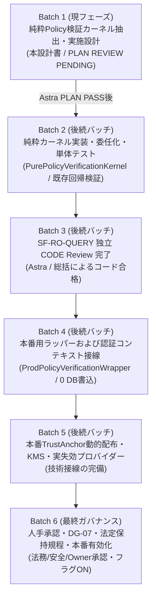

# NF07 純粋 Policy 検証カーネル抽出・実施設計書
（Pure Policy Verification Kernel Extraction Plan）

状態: **PLAN REVIEW PENDING / Astra 技術 Plan Review 待ち**<br>
対象ブランチ: `codex/snf-prod-nf07-evidence-contract`<br>
本フェーズ基準（Base）: `aad2afeec71c2cb2eaa846bf02b2da0344990180`（Astra/総括 限定 PLAN PASS 承認コミット）<br>
直前基準（Previous Base）: `b2886c47a0c20716a37a08dffcfb847f5432a1f1`<br>
固定テスト証拠コミット: `c8b78dc3c8c3906e8ba734a2aa81037bd3a77dfb`（42件定向 / 4,292件 Fast 合格の歴史的証拠）<br>
担当: AI-5（接線・意思決定契約および純粋カーネル抽出設計担当）

---

## 1. 目的と抽出範囲・責務境界（Extraction Scope & Responsibility Boundary）

### 1.1 目的
既存の `ApprovalEnvelopeVerifier`（`com.ses.privacy.foundation`）は、暗号学的なエンベロープ署名検証・属性照合・職務分離（SoD）・時間窓検査などの「純粋計算ロジック」と、`SyntheticEnvironmentGuard` による本番プロファイル（`prod`）の遮断、システム時計（`Clock`）、Trust Anchor マッピング、失効プロバイダー呼び出しなどの「環境・インフラ依存」が単一クラス内に結合している。

本設計は、本番環境への安全な段階的移行（NF07 接線）を見据え、既存の合成環境隔離ガードを一切弱化させることなく、副作用および環境依存を完全に排除した決定論的な純粋検証ロジックを **`PurePolicyVerificationKernel`** として抽出し、既存の `ApprovalEnvelopeVerifier` を委任構造へ安全にリファクタリングするための最小・具体的な実施計画を定める。

本フェーズは **設計のみ** であり、Java コードの改修・マイグレーション・本番配線・データベース書込・外部送信は一切含まない。

### 1.2 抽出範囲の厳格な分割

```mermaid
flowchart TD
    subgraph SyntheticPath["合成環境パス（既存ラッパー）"]
        AEV["ApprovalEnvelopeVerifier\n(Synthetic Wrapper)"]
        SEG["SyntheticEnvironmentGuard\n(prod即時拒絶)"]
        CLK["Clock.instant()\n(システム時刻取得)"]
        TA_LOOKUP["TrustAnchor Map Lookup\n(KeyID照合)"]
        REV_CALL["RevocationStatusProvider\n(外部例外捕捉・型変換)"]
    end

    subgraph PureKernel["純粋検証カーネル（新規抽出）"]
        PPVK["PurePolicyVerificationKernel\n(純粋関数・副作用ゼロ・ステートレス)"]
        SCHEMA["Schema Version 検証 (v1)"]
        TIME["時間窓検査 (半開区間)"]
        SCOPE["TrustAnchor Scope 照合"]
        REV_DECIDE["失効判定 (ACTIVEホワイトリスト)"]
        ED25519["Ed25519 数学署名検証"]
        SOD["職務分離 (SoD) 検査"]
        BINDING["バインディング等価性検査"]
        EXPIRY["最短失効日時計算 (min)"]
    end

    subgraph FutureProdPath["将来の本番環境パス（後続フェーズ）"]
        PEV["ProdPolicyVerificationWrapper\n(後続バッチで新規作成・本設計対象外)"]
        PROD_GUARD["Production Security Guard\n(本番用Audience/Profile防護)"]
        KMS["本番TrustAnchor / KMS\n(後続バッチで設計)"]
    end

    AEV -->|1. requireSyntheticAllowed| SEG
    AEV -->|2. now = clock.instant()| CLK
    AEV -->|3. anchor lookup| TA_LOOKUP
    AEV -->|4. query status| REV_CALL
    AEV -->|5. 純粋検証の委任\n(anchor, statuses, now)| PPVK

    PEV -.->|将来の委任| PPVK

    PPVK --- SCHEMA
    PPVK --- TIME
    PPVK --- SCOPE
    PPVK --- REV_DECIDE
    PPVK --- ED25519
    PPVK --- SOD
    PPVK --- BINDING
    PPVK --- EXPIRY
```

#### ① 純粋検証カーネル（`PurePolicyVerificationKernel`）へ抽出する責務
1. **スキーマバージョン検査**: `SUPPORTED_SCHEMA_VERSION = "1"` の固定一致検証。不一致時は `UNSUPPORTED_SCHEMA_VERSION`。
2. **時間窓の半開区間検証**（引数として与えられた不変の `Instant now` に基づく判定）:
   - Authority 有効期間: `now.isBefore(anchor.validFrom()) || !now.isBefore(anchor.validUntil())`（区間 `[validFrom, validUntil)`）→ `AUTHORITY_VALIDITY_EXPIRED`
   - エンベロープ発行日時: `now.isBefore(metadata.issuedAt())` → `NOT_YET_ISSUED`
   - エンベロープ発効日時: `now.isBefore(metadata.effectiveAt())` → `NOT_YET_EFFECTIVE`
   - エンベロープ失効期限: `!now.isBefore(metadata.expiresAt())`（区間 `[effectiveAt, expiresAt)`）→ `EXPIRED_AT_OR_AFTER_DEADLINE`
   - Case 本人確認時刻: `approval.identityVerifiedAt().isAfter(now) || approval.identityVerifiedAt().isBefore(approval.metadata().effectiveAt())` → `SecurityException`
3. **Trust Anchor スコープ適合性照合**:
   - `anchor.authorityId()`、`anchor.keyId()` の一致
   - `tenants`, `scopes`, `dataElements`, `envelopeKinds`, `audiences`, `actions`, `providers` の包含照合 → `AUTHORITY_SCOPE_MISMATCH`
4. **失効状態の純粋判定**（引数として与えられた `RevocationStatus keyStatus, RevocationStatus envelopeStatus` に基づく判定）:
   - `REVOKED` 優先検査: `keyStatus == REVOKED` → `KEY_REVOKED`、`envelopeStatus == REVOKED` → `ENVELOPE_REVOKED`
   - `ACTIVE` ホワイトリスト検査: いずれかが `ACTIVE` でない場合（`null`, `UNKNOWN`, `SUSPENDED` 等）→ `REVOCATION_STATUS_UNKNOWN`
5. **Ed25519 数学署名検証**:
   - `java.security.Signature.getInstance("Ed25519")` によるバイト列と公開鍵の数学的検証。不一致または例外時 → `SIGNATURE_INVALID`
6. **職務分離（Separation of Duties: SoD）検査**:
   - Policy: `requesterId.equals(approverId)` → `SOD_VIOLATION`
   - Case: `requesterId.equals(approverId)` → `SecurityException`
7. **バインディング等価性検査**:
   - Policy 単独: `tenantId`, `scope`, `dataElementId`, `action`, `provider` の要求値完全一致検査
   - Policy + Case: `policyDigest`, `tenantId`, `currentTenant`, `action`, `provider`, `expectedAction`, `expectedProvider`, `actualTargetVersion`, `actualTargetHash`, `scope`, `audience` の相互一致検査
8. **最短有効期限の計算**:
   - Policy: `min(metadata.expiresAt(), anchor.validUntil())`
   - Case: `min(min(policy.metadata().expiresAt(), approval.metadata().expiresAt()), min(policyAuthority.validUntil(), caseAuthority.validUntil()))`

#### ② 合成ラッパー（`ApprovalEnvelopeVerifier`）に残す責務
1. **合成環境防護の執行**: `environmentGuard.requireSyntheticAllowed(policy.metadata().audience())` の呼び出し。`prod` プロファイル検出時の即時 fail-closed 中断。
2. **システム時刻の取得**: `clock.instant()` による実行時点 `Instant now` の確定。
3. **Trust Anchor の解決**: `trustAnchors.get(anchorKey)` によるルックアップ。アンカー未登録時は直ちに `UNKNOWN_TRUST_ANCHOR` を送出。
4. **失効プロバイダーの外部呼び出し・例外ハンドリング**: `revocations.statusOf(...)` の実行。プロバイダーの実行時例外（`RuntimeException`）を捕捉し、`PolicySecurityException(REVOCATION_PROVIDER_ERROR, ...)` へ安全に変換。
5. **Audience ホワイトリスト検証**: 合成ラッパーが受け付けるエンベロープの Audience が `SYNTHETIC` に限定されていることの保証。

#### ③ 純粋カーネルの厳格な非依存保証（Invariants）
`PurePolicyVerificationKernel` は以下の依存を**絶対に持たない**：
* Spring Framework（`org.springframework.*`）のインポート禁止
* データベースアクセス（JDBC、MyBatis-Plus、Connection、DataSource）の禁止
* ネットワーク通信（HTTP、Socket、RPC）の禁止
* KMS、HSM、外部暗号プロバイダーへの動的接続の禁止
* `SyntheticEnvironmentGuard` やプロファイル判定クラスへの直接アクセスの禁止
* 可変状態（mutable state）、フィールド変数、スレッドローカルの保持禁止（純粋な static メソッド群で構成）

---

## 2. 擬似変更・新規予定ファイルとシグネチャ（Planned Files & Signatures）

### 2.1 新規作成予定ファイル: `PurePolicyVerificationKernel.java`
* **配置パス**: `src/main/java/com/ses/privacy/foundation/PurePolicyVerificationKernel.java`
* **パッケージ**: `package com.ses.privacy.foundation;`
* **クラス可視性**: `final class PurePolicyVerificationKernel`（**package-private** とし、`foundation` パッケージ外部からの直接インスタンス化・バイパス呼び出しを禁止する）

#### メソッド一覧とシグネチャ

```java
package com.ses.privacy.foundation;

import java.security.GeneralSecurityException;
import java.security.Signature;
import java.time.Instant;
import java.util.Objects;

/**
 * 外部依存・可変状態・副作用を持たない決定論的な Policy / Case エンベロープ純粋検証カーネル。
 * 本クラスの検証結果は純粋な数学的・不変条件的一致の証明であり、実行権限・認可 Capability を付与しない。
 */
final class PurePolicyVerificationKernel {

    public static final String SUPPORTED_SCHEMA_VERSION = "1";

    private PurePolicyVerificationKernel() {
        // インスタンス化禁止
    }

    /**
     * エンベロープ単体の主張（Claims）、時間窓、スコープ、失効状態、および Ed25519 署名を純粋検証する。
     *
     * @param envelopeKind    "POLICY" または "CASE"
     * @param dataElementId   データ要素ID（Case の場合は null 許容）
     * @param metadata        エンベロープメタデータ（非 null）
     * @param signature       署名バイト列（非 null）
     * @param payload         カノニカル化済みペイロードバイト列（非 null）
     * @param action          アクション名
     * @param provider        プロバイダー識別子
     * @param anchor          解決済み TrustAnchor（非 null）
     * @param keyStatus       判定済み鍵失効ステータス（非 null）
     * @param envelopeStatus  判定済みエンベロープ失効ステータス（非 null）
     * @param now             検証基準時刻（非 null）
     * @throws PolicySecurityException 検証失敗時（型付けされた理由コードを保持）
     */
    static void verifyEnvelopeClaimsAndSignature(
            String envelopeKind,
            String dataElementId,
            ApprovalEnvelopeMetadata metadata,
            byte[] signature,
            byte[] payload,
            String action,
            String provider,
            TrustedAuthority anchor,
            RevocationStatus keyStatus,
            RevocationStatus envelopeStatus,
            Instant now) throws PolicySecurityException { ... }

    /**
     * Policy 単独の読み取り専用メタデータ純粋検証。
     *
     * @return 検証済み Policy メタデータ（説明専用）
     * @throws PolicySecurityException 検証失敗時
     */
    static VerifiedPolicyMetadata verifyPolicyOnly(
            PolicyApprovalEnvelope policy,
            TrustedAuthority authority,
            RevocationStatus keyStatus,
            RevocationStatus envelopeStatus,
            String expectedTenant,
            String expectedScope,
            String expectedDataElementId,
            String expectedAction,
            String expectedProvider,
            Instant now) throws PolicySecurityException { ... }

    /**
     * Policy および Case の相互バインディング・職務分離・二者承認を純粋検証する。
     *
     * @return 検証済み承認証明情報（VerifiedApproval）
     * @throws SecurityException        Case 既存仕様に基づく検証失敗時
     * @throws PolicySecurityException  下位の型付け検証失敗時
     */
    static VerifiedApproval verifyCaseAndPolicy(
            PolicyApprovalEnvelope policy,
            CaseApprovalEnvelope approval,
            TrustedAuthority policyAuthority,
            RevocationStatus policyKeyStatus,
            RevocationStatus policyEnvelopeStatus,
            TrustedAuthority caseAuthority,
            RevocationStatus caseKeyStatus,
            RevocationStatus caseEnvelopeStatus,
            String currentTenant,
            String actualTargetVersion,
            String actualTargetHash,
            String expectedAction,
            String expectedProvider,
            Instant now) throws SecurityException, PolicySecurityException { ... }

    private static Instant min(Instant left, Instant right) {
        return left.isBefore(right) ? left : right;
    }
}
```

### 2.2 既存改修予定ファイル: `ApprovalEnvelopeVerifier.java`
* **配置パス**: `src/main/java/com/ses/privacy/foundation/ApprovalEnvelopeVerifier.java`
* **可視性**: `public final class ApprovalEnvelopeVerifier`（公開 API、既存シグネチャを 100% 維持）
* **コンストラクタ**: 完全維持
  ```java
  public ApprovalEnvelopeVerifier(Map<String, TrustedAuthority> trustAnchors,
                                  RevocationStatusProvider revocations,
                                  Clock clock,
                                  SyntheticEnvironmentGuard environmentGuard)
  ```
* **公開/パッケージメソッド**:
  - `public VerifiedApproval verify(...)`: シグネチャ完全維持。環境ガード・時刻取得・アンカー検索・失効プロバイダー実行を行い、結果を `PurePolicyVerificationKernel.verifyCaseAndPolicy(...)` へ委任。
  - `VerifiedPolicyMetadata verifyPolicyOnly(...)`: シグネチャ完全維持。環境ガード・時刻取得・アンカー検索・失効プロバイダー実行を行い、結果を `PurePolicyVerificationKernel.verifyPolicyOnly(...)` へ委任。

### 2.3 変更範囲の明示と安全原則（Security Invariants）
* **「ファイル完全無修正」の不当主張の排除**:
  `ApprovalEnvelopeVerifier` は既存の外部契約・型・例外仕様を完全に保持するが、内部実装は純粋カーネルへの委任コードへと修正される（行単位の改修が発生する）。
* **カーネル検証結果 ≠ 実行認可（Kernel Result != Execution Authorization）**:
  - `PurePolicyVerificationKernel` が返却する `VerifiedPolicyMetadata` は説明専用の DTO であり、システムに対するいかなる変更権限も表さない。
  - `VerifiedApproval` は数学的・論理的な承認エンベロープの適合を証明するだけであり、`SyntheticEnvironmentGuard` による本番拒絶、および呼び出し元の認証コンテキストによる認可を一切バイパスできない。
  - 合成ラッパー `ApprovalEnvelopeVerifier` を経由しない直接呼び出しは package-private により防止され、将来本番ラッパーが導入される場合も独立した審査・環境ガードが必須となる。

---

## 3. 行動等価性の厳格定義（Behavioral Equivalence Specification）

Policy-only 経路および Policy+Case 経路の双方について、現行実装との完全な挙動一致（Behavioral Equivalence）を保証する。

| 検証項目 | 現行 `ApprovalEnvelopeVerifier` の挙動 | 抽出後 `PurePolicyVerificationKernel` の挙動 | 等価性担保メカニズム |
|---|---|---|---|
| **カノニカルバイト列** | `ApprovalEnvelopeCanonicalizer.canonicalBytes(envelope)` による長さプレフィックス付きエンコード | 左記と全く同一のメソッドをそのまま呼び出す | バイト列生成アルゴリズム・フィールド順序・区切り文字は 100% 同一 |
| **ダイジェスト計算** | `ApprovalEnvelopeCanonicalizer.digest(canonicalBytes)` (SHA-256) | 左記と全く同一のメソッドをそのまま呼び出す | ダイジェストアルゴリズムは 100% 同一 |
| **Ed25519 署名検証** | `Signature.getInstance("Ed25519")` で公開鍵検証、失敗時は `SIGNATURE_INVALID` | 左記と全く同一の標準プロバイダー呼び出し、失敗時は `SIGNATURE_INVALID` | JRE 標準暗号実装を利用し、例外ハンドリング・理由コードも完全一致 |
| **時間窓（半開区間）** | `validFrom <= now < validUntil`<br>`issuedAt <= now`<br>`effectiveAt <= now`<br>`now < expiresAt` | 左記と全く同一の `isBefore` 境界条件判定 | 境界値（一致時）の包含・除外ロジックを完全踏襲 |
| **Case 本人確認時刻** | `effectiveAt <= identityVerifiedAt <= now` | 左記と全く同一の `isBefore` / `isAfter` 条件判定 | 境界値判定・例外メッセージを完全踏襲 |
| **失効状態判定** | `REVOKED` を優先検知（`KEY_REVOKED` / `ENVELOPE_REVOKED`）。`ACTIVE` 以外はすべて `REVOCATION_STATUS_UNKNOWN` | ラッパーが取得した `RevocationStatus` を受け取り、左記と全く同一順序で評価 | 失効優先ルールおよび `ACTIVE` ホワイトリストを完全踏襲 |
| **失効外部エラー** | `revocations.statusOf(...)` の `RuntimeException` を捕捉し `REVOCATION_PROVIDER_ERROR` 送出 | **ラッパー側で捕捉・送出**し、カーネルへは正常取得値のみ渡す | 外部 I/O 例外のハンドリング責務をラッパーに閉じ込め、カーネルを純粋化 |
| **職務分離 (SoD)** | Policy: `requesterId.equals(approverId)` → `SOD_VIOLATION`<br>Case: 同一アクター → `SecurityException` | Policy: `SOD_VIOLATION`<br>Case: `SecurityException` | 発生する例外クラス・理由コード・文言を完全踏襲 |
| **バインディング照合** | `tenant`, `scope`, `dataElement`, `action`, `provider`, `version`, `hash` の厳格完全一致 | 左記と全く同一の `Objects.equals` / 文字列一致判定 | 不一致時の理由コード（`TENANT_MISMATCH` 等）および例外文言を完全踏襲 |
| **有効期限計算** | Policy: `min(expiresAt, validUntil)`<br>Case: `min(min(policyExp, caseExp), min(pAnchor, cAnchor))` | 左記と全く同一の `min` 計算 | 最短期限の決定論的算出ロジックを完全踏襲 |

---

## 4. 等価性・負向テストマトリクス（Equivalence & Negative Test Matrix）

### 4.1 既存実在テストクラスとの対応
本カーネル抽出後も、既存のテストクラスが 1 行のテストコード変更もなく完全合格（100% 回帰パス）することを検証条件とする。

| 既存実在テストクラス | 既存テストメソッド | 検証する等価性・防護要件 | 実行環境・分類 |
|---|---|---|---|
| `ApprovalEnvelopeVerifierTest` | `acceptsSeparatelySignedSyntheticPolicyAndCase` | 正常系: 分離署名された Policy/Case の正常承認証明生成 | Fast (H2/Unit) |
| `ApprovalEnvelopeVerifierTest` | `rejectsUnknownSchemaVersionEvenWhenCorrectlySigned` | 負向系: 未知スキーマバージョン（"99"）の即時拒絶 | Fast (H2/Unit) |
| `ApprovalEnvelopeVerifierTest` | `verifiedProofExpiresAtTrustedAuthorityExpiryEvenWhenEnvelopesRemainValid` | 境界系: 最短有効期限（Authority 有効期限）の反映 | Fast (H2/Unit) |
| `ApprovalEnvelopeVerifierTest` | `signatureCoversPolicyAndCaseClaimsAndCanonicalEncodingIsLengthDelimited` | 負向系: 改竄ペイロード・別アクション/プロバイダーの署名拒絶 | Fast (H2/Unit) |
| `ApprovalEnvelopeVerifierTest` | `rejectsUnknownOrOutOfScopeTrustAnchorsAndRevocationUnknown` | 負向系: 未知アンカー、スコープ外アンカー、失効状態 UNKNOWN/REVOKED の拒絶 | Fast (H2/Unit) |
| `ApprovalEnvelopeVerifierTest` | `rejectsTenantActionProviderTargetAndPolicyBindingDrift` | 負向系: テナント・アクション・プロバイダー・ターゲットのドリフト拒絶 | Fast (H2/Unit) |
| `ApprovalEnvelopeVerifierTest` | `rejectsExpiredFutureEffectiveFutureIdentityAndSeparationOfDutiesViolations` | 負向系: 期限切れ・未来発効・未来本人確認・職務分離（SoD）違反の拒絶 | Fast (H2/Unit) |
| `ApprovalEnvelopeVerifierTest` | `runtimeProfilesAndAudienceAreTakenFromTrustedEnvironment` | **最重要環境負向系**: active/default `prod` プロファイル時の即時拒絶 | Fast (H2/Unit) |
| `ApprovalEnvelopeVerifierTest` | `signatureAndEnvelopeBytesAreDefensiveCopies` | 防御的コピー: 署名配列改変に対する不変性検証 | Fast (H2/Unit) |
| `PolicyReadonlyQueryServiceTest` | `testEnvironment_ProdProfile_ThrowsSecurityException` | **最重要環境負向系**: `prod` プロファイル混入時の即時 fail-closed 中断 | Fast (H2/Unit) |
| `PolicyReadonlyQueryServiceTest` | `testPolicy_NotYetIssued_ReturnsPolicyExpired` | 時間窓負向系: 発行日時が未来のエンベロープ拒絶 | Fast (H2/Unit) |
| `PolicyReadonlyQueryServiceTest` | `testPolicy_NotYetEffective_ReturnsPolicyExpired` | 時間窓負向系: 発効前エンベロープ拒絶 | Fast (H2/Unit) |
| `PolicyReadonlyQueryServiceTest` | `testPolicy_ExpiredAtDeadline_ReturnsPolicyExpired` | 時間窓負向系: 期限切れエンベロープ拒絶 | Fast (H2/Unit) |
| `PolicyReadonlyQueryServiceTest` | `testPolicy_AuthorityExpired_ReturnsPolicyExpired` | 時間窓負向系: Authority 期限切れ拒絶 | Fast (H2/Unit) |
| `PolicyReadonlyQueryServiceTest` | `testPolicy_AuthorityScopeMismatch_ReturnsPolicyDrift` | スコープ負向系: Authority スコープ不一致拒絶 | Fast (H2/Unit) |
| `PolicyReadonlyQueryServiceTest` | `testPolicy_KeyRevoked_ReturnsPolicyRevoked` | 失効負向系: 鍵失効時の即時拒絶 | Fast (H2/Unit) |
| `PolicyReadonlyQueryServiceTest` | `testPolicy_EnvelopeRevoked_ReturnsPolicyRevoked` | 失効負向系: エンベロープ失効時の即時拒絶 | Fast (H2/Unit) |
| `PolicyReadonlyQueryServiceTest` | `testPolicy_RevocationStatusUnknown_ReturnsPolicyUnknown` | 失効負向系: 失効状態 UNKNOWN の拒絶 | Fast (H2/Unit) |
| `PolicyReadonlyQueryServiceTest` | `testPolicy_RevocationKeyNull_ReturnsPolicyUnknown` | 失効負向系: 鍵失効状態 null の拒絶 | Fast (H2/Unit) |
| `PolicyReadonlyQueryServiceTest` | `testPolicy_RevocationEnvelopeNull_ReturnsPolicyUnknown` | 失効負向系: エンベロープ失効状態 null の拒絶 | Fast (H2/Unit) |
| `PolicyReadonlyQueryServiceTest` | `testPolicy_RevocationProviderError_ReturnsPolicyUnknown` | 外部障害負向系: 失効プロバイダー例外時の安全拒絶 | Fast (H2/Unit) |
| `PolicyReadonlyQueryServiceTest` | `testPolicy_TamperedSignature_ReturnsPolicyDrift` | 暗号負向系: 改竄署名の拒絶 | Fast (H2/Unit) |
| `PolicyReadonlyQueryServiceTest` | `testPolicy_SodViolation_ReturnsPolicyDrift` | SoD 負向系: 申請者=承認者違反の拒絶 | Fast (H2/Unit) |
| `PolicyReadonlyQueryServiceTest` | `testPolicy_MismatchedBinding_ReturnsPolicyDrift` | バインディング負向系: パラメータ不一致拒絶 | Fast (H2/Unit) |
| `PolicyReadonlyQueryServiceTest` | `testValidSyntheticPolicy_ReturnsApprovedActiveWithoutExecutionCapability` | 正常系・安全検証: 照会成功かつ実行認可なしの確認 | Fast (H2/Unit) |

### 4.2 擬似新規単体テスト計画（Planned New Unit Tests）
純粋カーネル自体の網羅的検証のため、後続の実装フェーズにおいて `PurePolicyVerificationKernelTest` を新規作成する。
**【注意: 本テストクラスは現在計画段階（未実装）であり、本設計フェーズでテスト実行は行っていない】**

```java
// 擬似コード仕様（実装フェーズにて追加予定）
package com.ses.privacy.foundation;

class PurePolicyVerificationKernelTest {
    // 1. 合法入力の純粋検証成功
    void verify_validPolicyAndCase_succeeds();
    // 2. 未知スキーマの拒絶（UNSUPPORTED_SCHEMA_VERSION）
    void verify_unsupportedSchemaVersion_throwsPolicySecurityException();
    // 3. 改竄署名の拒絶（SIGNATURE_INVALID）
    void verify_tamperedSignature_throwsPolicySecurityException();
    // 4. 不正公開鍵での検証失敗（SIGNATURE_INVALID）
    void verify_wrongPublicKey_throwsPolicySecurityException();
    // 5. 時間窓境界値の厳格検証（半開区間のエッジケース）
    //    - now == validFrom (合格)
    //    - now == validUntil (不合格: AUTHORITY_VALIDITY_EXPIRED)
    //    - now == issuedAt (合格)
    //    - now == effectiveAt (合格)
    //    - now == expiresAt (不合格: EXPIRED_AT_OR_AFTER_DEADLINE)
    void verify_timeWindowBoundaries_strictlyEnforced();
    // 6. Case 本人確認時刻の境界値検証
    void verify_identityVerifiedAt_boundariesEnforced();
    // 7. 失効状態ホワイトリスト（ACTIVE 以外は拒絶、REVOKED 優先）
    void verify_revocationStatus_whitelistEnforced();
    // 8. 職務分離違反の拒絶（SOD_VIOLATION）
    void verify_sodViolation_throwsPolicySecurityException();
    // 9. バインディング不一致の拒絶（各属性ドリフトの個別検証）
    void verify_bindingDrift_throwsPolicySecurityException();
}
```

### 4.3 テスト実行実績に関する注記（TEST NOT RUN）
* 直前固定コミット `c8b78dc3` において記録された「42件定向テスト合格」「4,292件 Fast 回帰テスト合格」は、当時のスキャン実績であり歴史的証拠である。
* **本フェーズ基準（`aad2afeec71c2cb2eaa846bf02b2da0344990180`）においては、設計文書の策定のみを行っており、新規のテスト実行（Maven、Docker、MySQL等）は一切行っていない（TEST NOT RUN）。**

---

## 5. 後続フェーズの分割と依存性（Phasing Roadmap）

本カーネル抽出計画から本番公開に至るまでの実装・審査順序を以下のように段階化する。先行フェーズの独立 Review が完了するまで、後続フェーズの実装に着手してはならない。



1. **Batch 1（現フェーズ）: 純粋 Policy 検証カーネル抽出・実施設計の策定**
   - 成果物: 本設計書（`pure-policy-verification-kernel-plan.md`）および関連仕様インデックス更新。
   - 状態: **PLAN REVIEW PENDING**（Astra 独立技術審査待ち）。
2. **Batch 2: 純粋カーネルの実装と委任化（Fast 単体テスト完備）**
   - 内容: `PurePolicyVerificationKernel.java` 実装、`ApprovalEnvelopeVerifier.java` の委任化、`PurePolicyVerificationKernelTest.java` 追加。
   - 制約: Fast 単体テストのみ実行。`SyntheticEnvironmentGuard` は 100% 維持。
3. **Batch 3: SF-RO-QUERY 独立 CODE Review の完了**
   - 内容: `PolicyReadonlyQueryService` および只読スライスに対する Astra / 総括の独立コードレビュー完了。
   - 状態: 現在の **REVIEW PENDING** 状態を正式にクローズ。
4. **Batch 4: 本番用ラッパーおよび認証コンテキスト接線の実装**
   - 内容: `ProdPolicyVerificationWrapper` の独立新設、`OidcLoginUser` の内部バインディング優先テナント解決、`ExternalApiPrincipal` マッピング。
   - 制約: データベースへの書込は行わない（0 DB mutation / DB 監査は Phase 5 以降へ延期）。
5. **Batch 5: 本番 Trust Anchor 配布・KMS/HSM 連携・実失効プロバイダーの整備**
   - 内容: 本番用鍵管理、CRL/OCSP 実プロバイダー連携、動的アンカー配布。
6. **Batch 6: 人手意思決定・ガバナンス承認および本番有効化**
   - 内容: DG-07 承認、正式 Privacy Owner 選任、法的留置規程承認、ベンダー DPA 合意、および `privacy.retention.enabled` / `privacy.dsar.enabled` の本番有効化。
