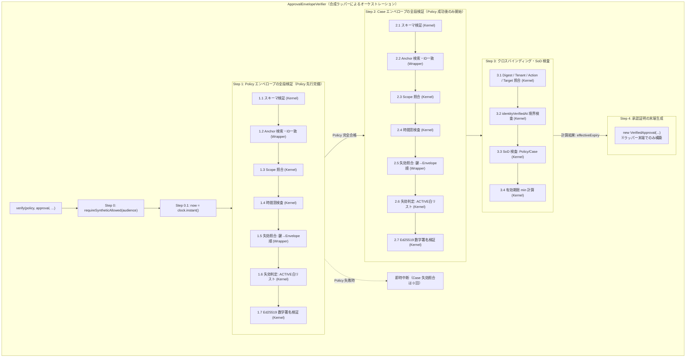
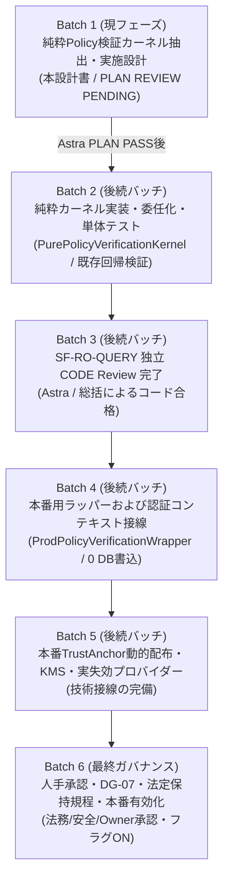

# NF07 純粋 Policy 検証カーネル抽出・実施設計書
（Pure Policy Verification Kernel Extraction Plan）

状態: **PLAN REVIEW PENDING / Astra 技術 Plan Review 待ち**<br>
対象ブランチ: `codex/snf-prod-nf07-evidence-contract`<br>
本フェーズ基準（Base）: `197386f866c834c7232590ec2f16fd13b8ac17d6`<br>
直前基準（Previous Base）: `aad2afeec71c2cb2eaa846bf02b2da0344990180`（Astra/総括 限定 PLAN PASS 承認コミット）<br>
固定テスト証拠コミット: `c8b78dc3c8c3906e8ba734a2aa81037bd3a77dfb`（42件定向 / 4,292件 Fast 合格の歴史的証拠）<br>
担当: AI-5（接線・意思決定契約および純粋カーネル抽出設計担当）

---

## 1. 目的と抽出範囲・責務境界（Extraction Scope & Responsibility Boundary）

### 1.1 目的
既存の `ApprovalEnvelopeVerifier`（`com.ses.privacy.foundation`）は、暗号学的なエンベロープ署名検証・属性照合・職務分離（SoD）・時間窓検査などの「純粋計算ロジック」と、`SyntheticEnvironmentGuard` による本番プロファイル（`prod`）の遮断、システム時計（`Clock`）、Trust Anchor マッピング、失効プロバイダー呼び出しなどの「環境・インフラ依存」が単一クラス内に結合している。

本設計は、本番環境への安全な段階的移行（NF07 接線）を見据え、既存の合成環境隔離ガードを一切弱化させることなく、副作用および環境依存を完全に排除した決定論的な純粋検証ロジックを分段階ヘルパー群（Staged Helpers）として **`PurePolicyVerificationKernel`** へ抽出し、既存の `ApprovalEnvelopeVerifier` を委任・オーケストレーション構造へ安全にリファクタリングするための最小・具体的な実施計画を定める。

本フェーズは **設計のみ** であり、Java コードの改修・マイグレーション・本番配線・データベース書込・外部送信は一切含まない。

### 1.2 抽出範囲の分割とラッパーによる分段階オーケストレーション

純粋計算ロジックを一枚岩の巨大メソッドとして抽出するのではなく、**分段階の純粋ヘルパー群（Staged Helpers）** として抽出し、合成ラッパー（`ApprovalEnvelopeVerifier`）が既存の呼び出し順序・短絡評価・例外送出契約を厳格にオーケストレーションする。



#### ① 分段階の実行順序と先行バッチ照会の禁止
1. **厳格な評価順序の維持**:
   各エンベロープの検証は、必ず以下の順序で実行され、先行ステップが失敗した場合は後続ステップを実行せず直ちに中断（Fail-Fast）する：
   `スキーマ検証` → `Anchor 検索および ID 一致検査` → `Scope 照合` → `時間窓検査` → `失効照合および判定` → `Ed25519 署名検証`。
2. **Policy 先行完備と Case 失効照会の遅延**:
   `verify(...)` において、**Policy エンベロープの全段検証が完全に合格した後にのみ、Case エンベロープの検証を開始する**。
   Policy と Case の失効状態を事前に一括取得（バッチ取得）することは厳格に禁止する。Policy がスキーマ、スコープ、時間、署名等で失敗した場合、Case の失効プロバイダー（`revocations.statusOf`）は **1 度も呼び出されてはならない（呼び出し回数 0 回）**。
3. **失効照会の順序・短絡と null の扱い**:
   失効照会は、まず署名鍵（`authorityId:keyId`）を照会し、成功した場合にのみエンベロープ（`revocationReference`）を照会する。署名鍵の照会で例外（`RuntimeException`）が発生した場合は直ちに `REVOCATION_PROVIDER_ERROR` として短絡し、エンベロープの照会は行わない。
   返却された失効状態が `null` である場合は、既有仕様通り `!= RevocationStatus.ACTIVE` 条件に合致するため、未審査の新規セマンティクスを導入することなく `REVOCATION_STATUS_UNKNOWN` として処理する。

### 1.3 2つの公開/パッケージ入口の挙動と時刻・例外契約の差異

既存の `ApprovalEnvelopeVerifier` が持つ 2 つのメソッドは、目的（状態機械遷移用承認証明の生成 vs 読み取り専用ポリシー照会）が異なるため、時刻決定および例外契約の分離を完全に保持する。

| 入口メソッド | 時刻決定メカニズム | SoD 違反時の例外契約 | 属性ドリフト時の例外契約 | 戻り値の責務 |
|---|---|---|---|---|
| **`verify(...)`**<br>（公開 API、状態機械向け） | ラッパー内部で `clock.instant()` を呼び出して `now` を確定 | Policy または Case のいずれかで `requesterId.equals(approverId)` の場合、既存の普通 **`SecurityException`**（文言: `"職務分離条件に違反しています"`）を送出 | 既存の普通 **`SecurityException`**（文言: `"tenantが一致しません"`、`"actionが一致しません"` 等）を送出 | **`VerifiedApproval`**（ラッパー末端で生成。状態機械遷移の入力証明） |
| **`verifyPolicyOnly(...)`**<br>（パッケージ private、只読照会向け） | 引数として渡された **`Instant now` をそのまま使用**（ラッパーの `clock` は呼び出さない） | Policy の `requesterId.equals(approverId)` の場合、型付けされた **`PolicySecurityException`**（理由: `SOD_VIOLATION`、文言: `"職務分離違反: 申請者と承認者は異なる必要があります"`）を送出 | 型付けされた **`PolicySecurityException`**（理由: `TENANT_MISMATCH`, `SCOPE_MISMATCH`, `ACTION_MISMATCH` 等）を送出 | **`VerifiedPolicyMetadata`**（説明専用 DTO。実行認可能力ゼロ） |

### 1.4 承認証明（`VerifiedApproval`）の生成境界と権限モデルの明確化

1. **`VerifiedApproval` は純粋カーネルから返却・構築しない**:
   - `PurePolicyVerificationKernel` は、暗号数学・属性一致・不変条件を計算する純粋関数群であり、状態機械が消費する `VerifiedApproval` を返却または構築してはならない。
   - 純粋カーネルのヘルパーメソッドは `void`（不合格時は例外送出）または状態機械に直接消費されない純計算結果（`Instant effectiveExpiry`、あるいは只読説明用 DTO `VerifiedPolicyMetadata`）のみを返却する。
2. **`VerifiedApproval` はラッパーの末端でのみ構築する**:
   - `VerifiedApproval` は、環境防護（`SyntheticEnvironmentGuard`）、Trust Anchor 解決、失効プロバイダー連携、およびすべての純粋検証（Policy、Case、バインディング、SoD）がすべて合格したことを保証できる合成ラッパー（`ApprovalEnvelopeVerifier`）の末端においてのみ構築される。
3. **承認証明の権限モデルの定義**:
   - `VerifiedApproval` は、ケース状態機械（`PrivacyCaseStateMachine.transition(...)`）が `APPROVAL_PENDING` から `APPROVED` への内部状態遷移を検証するために使用する「承認証明（Approval Proof）」である。
   - これは、システム外部へのディスパッチや物理的データ削除を無条件に許可する「完全な外発認可（Dispatch Authorization）」ではなく、また単なる只読メタデータを表す「説明専用 DTO」でもない。
4. **可視性（`package-private`）の限界と真の境界防護**:
   - `PurePolicyVerificationKernel` の可視性を `package-private`（デフォルト）とすることは、`com.ses.privacy.foundation` パッケージ外部からの直接利用や依存の混入を防ぐための境界設定である。
   - `package-private` は同パッケージ内の他クラスからの直接呼び出しをコンパイラレベルで遮断するものではない。同パッケージ内におけるバイパス防止は、アーキテクチャ規約、コードレビュー、およびオーケストレーション契約によって厳格に統制する。
   - 本バッチにおいて、`PrivacyCaseStateMachine`、`VerifiedApproval`、または認可権限アーキテクチャの変更や拡張は一切行わない。

---

## 2. 擬似変更・新規予定ファイルとシグネチャ（Planned Files & Signatures）

### 2.1 新規作成予定ファイル: `PurePolicyVerificationKernel.java`
* **配置パス**: `src/main/java/com/ses/privacy/foundation/PurePolicyVerificationKernel.java`
* **パッケージ**: `package com.ses.privacy.foundation;`
* **クラス可視性**: `final class PurePolicyVerificationKernel`（**package-private**）

```java
package com.ses.privacy.foundation;

import java.security.GeneralSecurityException;
import java.security.Signature;
import java.time.Instant;
import java.util.Objects;

/**
 * 外部依存・可変状態・副作用を持たない決定論的な Policy / Case エンベロープ純粋検証カーネル。
 * 分段階の純粋計算ヘルパー群を提供し、VerifiedApproval は構築・返却しない。
 */
final class PurePolicyVerificationKernel {

    public static final String SUPPORTED_SCHEMA_VERSION = "1";

    private PurePolicyVerificationKernel() {
        // インスタンス化禁止
    }

    // --- 第 1 段階: スキーマバージョン検査 ---
    static void verifySchemaVersion(ApprovalEnvelopeMetadata metadata) throws PolicySecurityException {
        if (!SUPPORTED_SCHEMA_VERSION.equals(metadata.schemaVersion())) {
            throw new PolicySecurityException(PolicyFailureReason.UNSUPPORTED_SCHEMA_VERSION, "未対応の承認envelope schema versionです");
        }
    }

    // --- 第 2 段階: Anchor ID 比対 ---
    static void verifyAnchorIdentity(ApprovalEnvelopeMetadata metadata, TrustedAuthority anchor) throws PolicySecurityException {
        if (!anchor.authorityId().equals(metadata.authorityId()) || !anchor.keyId().equals(metadata.keyId())) {
            throw new PolicySecurityException(PolicyFailureReason.UNKNOWN_TRUST_ANCHOR, "authorityまたはkeyが一致しません");
        }
    }

    // --- 第 3 段階: Authority Scope 適合性照合 ---
    static void verifyAuthorityScope(String envelopeKind, String dataElementId, ApprovalEnvelopeMetadata metadata,
                                     String action, String provider, TrustedAuthority anchor) throws PolicySecurityException {
        if (!anchor.tenants().contains(metadata.tenantId()) || !anchor.scopes().contains(metadata.scope())
                || (dataElementId != null && !anchor.dataElements().contains(dataElementId))
                || !anchor.envelopeKinds().contains(envelopeKind)
                || !anchor.audiences().contains(metadata.audience()) || !anchor.actions().contains(action)
                || !anchor.providers().contains(provider)) {
            throw new PolicySecurityException(PolicyFailureReason.AUTHORITY_SCOPE_MISMATCH, "authority scopeが一致しません");
        }
    }

    // --- 第 4 段階: 時間窓検査（半開区間） ---
    static void verifyTimeWindow(Instant now, TrustedAuthority anchor, ApprovalEnvelopeMetadata metadata) throws PolicySecurityException {
        if (now.isBefore(anchor.validFrom()) || !now.isBefore(anchor.validUntil())) {
            throw new PolicySecurityException(PolicyFailureReason.AUTHORITY_VALIDITY_EXPIRED, "authorityが現在有効ではありません");
        }
        if (now.isBefore(metadata.issuedAt())) {
            throw new PolicySecurityException(PolicyFailureReason.NOT_YET_ISSUED, "エンベロープ発行日時が未来です");
        }
        if (now.isBefore(metadata.effectiveAt())) {
            throw new PolicySecurityException(PolicyFailureReason.NOT_YET_EFFECTIVE, "エンベロープがまだ発効していません");
        }
        if (!now.isBefore(metadata.expiresAt())) {
            throw new PolicySecurityException(PolicyFailureReason.EXPIRED_AT_OR_AFTER_DEADLINE, "エンベロープの有効期限が切れています");
        }
    }

    // --- 第 5 段階: 失効状態判定（ACTIVE 白リスト、null は UNKNOWN） ---
    static void verifyRevocationStatus(RevocationStatus keyStatus, RevocationStatus envelopeStatus) throws PolicySecurityException {
        if (keyStatus == RevocationStatus.REVOKED) {
            throw new PolicySecurityException(PolicyFailureReason.KEY_REVOKED, "署名鍵が失効しています");
        }
        if (envelopeStatus == RevocationStatus.REVOKED) {
            throw new PolicySecurityException(PolicyFailureReason.ENVELOPE_REVOKED, "エンベロープが失効しています");
        }
        // null または UNKNOWN 等の非 ACTIVE はすべて REVOCATION_STATUS_UNKNOWN として扱う
        if (keyStatus != RevocationStatus.ACTIVE || envelopeStatus != RevocationStatus.ACTIVE) {
            throw new PolicySecurityException(PolicyFailureReason.REVOCATION_STATUS_UNKNOWN, "keyまたはenvelopeの失効状態がACTIVEではありません");
        }
    }

    // --- 第 6 段階: Ed25519 数学署名検証 ---
    static void verifySignature(TrustedAuthority anchor, byte[] payload, byte[] signature) throws PolicySecurityException {
        try {
            Signature verifier = Signature.getInstance("Ed25519");
            verifier.initVerify(anchor.publicKey());
            verifier.update(payload);
            if (!verifier.verify(signature)) {
                throw new PolicySecurityException(PolicyFailureReason.SIGNATURE_INVALID, "署名が正しくありません");
            }
        } catch (GeneralSecurityException exception) {
            throw new PolicySecurityException(PolicyFailureReason.SIGNATURE_INVALID, "承認署名を検証できません", exception);
        }
    }

    // --- Policy-only 専用ヘルパー ---
    static void verifyPolicySoD(ApprovalEnvelopeMetadata metadata) throws PolicySecurityException {
        if (metadata.requesterId().equals(metadata.approverId())) {
            throw new PolicySecurityException(PolicyFailureReason.SOD_VIOLATION, "職務分離違反: 申請者と承認者は異なる必要があります");
        }
    }

    static void verifyPolicyBindings(PolicyApprovalEnvelope policy, String expectedTenant, String expectedScope,
                                     String expectedDataElementId, String expectedAction, String expectedProvider) throws PolicySecurityException {
        if (!policy.metadata().tenantId().equals(expectedTenant)) {
            throw new PolicySecurityException(PolicyFailureReason.TENANT_MISMATCH, "テナントが一致しません");
        }
        if (!policy.metadata().scope().equals(expectedScope)) {
            throw new PolicySecurityException(PolicyFailureReason.SCOPE_MISMATCH, "スコープが一致しません");
        }
        if (!policy.dataElementId().equals(expectedDataElementId)) {
            throw new PolicySecurityException(PolicyFailureReason.DATA_ELEMENT_MISMATCH, "データ要素が一致しません");
        }
        if (!policy.action().equals(expectedAction)) {
            throw new PolicySecurityException(PolicyFailureReason.ACTION_MISMATCH, "アクションが一致しません");
        }
        if (!policy.providerId().equals(expectedProvider)) {
            throw new PolicySecurityException(PolicyFailureReason.PROVIDER_MISMATCH, "プロバイダーが一致しません");
        }
    }

    // --- Policy + Case 相互バインディング・SoD ヘルパー（VerifiedApproval は返さず、純粋な effectiveExpiry を返却） ---
    static Instant verifyCaseAndPolicyBindings(PolicyApprovalEnvelope policy, CaseApprovalEnvelope approval,
                                              TrustedAuthority policyAuthority, TrustedAuthority caseAuthority,
                                              String currentTenant, String actualTargetVersion, String actualTargetHash,
                                              String expectedAction, String expectedProvider, Instant now) throws SecurityException {
        String policyDigest = ApprovalEnvelopeCanonicalizer.digest(ApprovalEnvelopeCanonicalizer.canonicalBytes(policy));
        requireEqual(policyDigest, approval.policyDigest(), "caseがこのpolicy revisionに紐付いていません");
        requireEqual(policy.metadata().tenantId(), approval.metadata().tenantId(), "tenantが一致しません");
        requireEqual(currentTenant, approval.metadata().tenantId(), "実行tenantが一致しません");
        requireEqual(policy.action(), approval.action(), "case actionがpolicyと異なります");
        requireEqual(policy.providerId(), approval.providerId(), "case providerがpolicyと異なります");
        requireEqual(expectedAction, policy.action(), "actionが一致しません");
        requireEqual(expectedProvider, policy.providerId(), "providerが一致しません");
        requireEqual(actualTargetVersion, approval.targetVersion(), "target versionが変化しています");
        requireEqual(actualTargetHash, approval.targetHash(), "target hashが変化しています");

        if (approval.identityVerifiedAt().isAfter(now)
                || approval.identityVerifiedAt().isBefore(approval.metadata().effectiveAt())) {
            deny("本人確認時刻がcaseの有効期間外です");
        }
        if (policy.metadata().requesterId().equals(policy.metadata().approverId())
                || approval.metadata().requesterId().equals(approval.metadata().approverId())) {
            deny("職務分離条件に違反しています");
        }
        if (!policy.metadata().scope().equals(approval.metadata().scope())) deny("scopeが一致しません");
        if (!policy.metadata().audience().equals(approval.metadata().audience())) deny("audienceが一致しません");

        return min(min(policy.metadata().expiresAt(), approval.metadata().expiresAt()),
                min(policyAuthority.validUntil(), caseAuthority.validUntil()));
    }

    static Instant calculateEffectiveExpiry(Instant expiresAt, Instant validUntil) {
        return min(expiresAt, validUntil);
    }

    private static void requireEqual(String expected, String actual, String reason) {
        if (expected == null || actual == null || !expected.equals(actual)) deny(reason);
    }

    private static void deny(String reason) {
        throw new SecurityException(reason);
    }

    private static Instant min(Instant left, Instant right) {
        return left.isBefore(right) ? left : right;
    }
}
```

### 2.2 既存改修予定ファイル: `ApprovalEnvelopeVerifier.java`
* **配置パス**: `src/main/java/com/ses/privacy/foundation/ApprovalEnvelopeVerifier.java`
* **可視性**: `public final class ApprovalEnvelopeVerifier`（公開 API、既存シグネチャを 100% 維持）
* **コンストラクタ**: 完全維持
  ```java
  public ApprovalEnvelopeVerifier(Map<String, TrustedAuthority> trustAnchors,
                                  RevocationStatusProvider revocations,
                                  Clock clock,
                                  SyntheticEnvironmentGuard environmentGuard)
  ```

#### ラッパー内部のオーケストレーション実装設計

```java
    // 内部共通エンベロープ検証オーケストレーション
    private TrustedAuthority verifyEnvelopeTyped(String envelopeKind, String dataElementId, ApprovalEnvelopeMetadata metadata,
                                                 byte[] signature, byte[] payload,
                                                 String action, String provider, Instant now) {
        // Step 1: スキーマ検査 (Kernel)
        PurePolicyVerificationKernel.verifySchemaVersion(metadata);

        // Step 2: TrustAnchor 検索と ID 一致検査 (Wrapper)
        String anchorKey = metadata.authorityId() + ":" + metadata.keyId();
        TrustedAuthority anchor = trustAnchors.get(anchorKey);
        if (anchor == null) {
            throw new PolicySecurityException(PolicyFailureReason.UNKNOWN_TRUST_ANCHOR, "未知の署名authorityです");
        }
        PurePolicyVerificationKernel.verifyAnchorIdentity(metadata, anchor);

        // Step 3: Scope 照合 (Kernel)
        PurePolicyVerificationKernel.verifyAuthorityScope(envelopeKind, dataElementId, metadata, action, provider, anchor);

        // Step 4: 時間窓検査 (Kernel)
        PurePolicyVerificationKernel.verifyTimeWindow(now, anchor, metadata);

        // Step 5: 失効プロバイダー照会 (Wrapper: 鍵→Envelope順、例外ハンドリング)
        RevocationStatus keyStatus;
        RevocationStatus envelopeStatus;
        try {
            keyStatus = revocations.statusOf(metadata.authorityId() + ":" + metadata.keyId());
            envelopeStatus = revocations.statusOf(metadata.revocationReference());
        } catch (RuntimeException re) {
            throw new PolicySecurityException(PolicyFailureReason.REVOCATION_PROVIDER_ERROR, "失効確認プロバイダーでエラーが発生しました", re);
        }

        // Step 6: 失効判定 (Kernel)
        PurePolicyVerificationKernel.verifyRevocationStatus(keyStatus, envelopeStatus);

        // Step 7: 署名検証 (Kernel)
        PurePolicyVerificationKernel.verifySignature(anchor, payload, signature);

        return anchor;
    }

    public VerifiedApproval verify(PolicyApprovalEnvelope policy, CaseApprovalEnvelope approval,
                                   String currentTenant, String actualTargetVersion, String actualTargetHash,
                                   String expectedAction, String expectedProvider) {
        Objects.requireNonNull(policy, "policy承認が必要です");
        Objects.requireNonNull(approval, "case承認が必要です");
        environmentGuard.requireSyntheticAllowed(policy.metadata().audience());
        Instant now = clock.instant();

        // Policy 先行完備検証（失敗時は Case 失効照会を行わず直ちに中断）
        TrustedAuthority policyAuthority = verifyEnvelopeTyped("POLICY", policy.dataElementId(), policy.metadata(),
                policy.signature(), ApprovalEnvelopeCanonicalizer.canonicalBytes(policy),
                policy.action(), policy.providerId(), now);

        // Policy 成功後にはじめて Case 検証を開始
        TrustedAuthority caseAuthority = verifyEnvelopeTyped("CASE", null, approval.metadata(),
                approval.signature(), ApprovalEnvelopeCanonicalizer.canonicalBytes(approval),
                approval.action(), approval.providerId(), now);

        // クロスバインディング・SoD 検査（計算値 effectiveExpiry を取得）
        Instant effectiveExpiry = PurePolicyVerificationKernel.verifyCaseAndPolicyBindings(
                policy, approval, policyAuthority, caseAuthority, currentTenant,
                actualTargetVersion, actualTargetHash, expectedAction, expectedProvider, now);

        String policyDigest = ApprovalEnvelopeCanonicalizer.digest(ApprovalEnvelopeCanonicalizer.canonicalBytes(policy));

        // 承認証明（VerifiedApproval）はラッパー末端でのみ構築
        return new VerifiedApproval(currentTenant, approval.caseId(), policyDigest, expectedAction, expectedProvider,
                approval.targetId(), approval.targetVersion(), approval.targetHash(),
                approval.metadata().revision(), policy.metadata().revision(),
                effectiveExpiry);
    }

    VerifiedPolicyMetadata verifyPolicyOnly(PolicyApprovalEnvelope policy,
                                            String expectedTenant,
                                            String expectedScope,
                                            String expectedDataElementId,
                                            String expectedAction,
                                            String expectedProvider,
                                            Instant now) throws PolicySecurityException {
        Objects.requireNonNull(policy, "policy envelope must not be null");
        environmentGuard.requireSyntheticAllowed(policy.metadata().audience());

        // 引数の now をそのまま使用（clock.instant() は呼ばない）
        TrustedAuthority authority = verifyEnvelopeTyped("POLICY", policy.dataElementId(), policy.metadata(),
                policy.signature(), ApprovalEnvelopeCanonicalizer.canonicalBytes(policy),
                policy.action(), policy.providerId(), now);

        // SoD 検査（PolicySecurityException を送出）
        PurePolicyVerificationKernel.verifyPolicySoD(policy.metadata());

        // バインディング検査（PolicySecurityException を送出）
        PurePolicyVerificationKernel.verifyPolicyBindings(policy, expectedTenant, expectedScope,
                expectedDataElementId, expectedAction, expectedProvider);

        String policyDigest = ApprovalEnvelopeCanonicalizer.digest(ApprovalEnvelopeCanonicalizer.canonicalBytes(policy));
        Instant effectiveExpiry = PurePolicyVerificationKernel.calculateEffectiveExpiry(policy.metadata().expiresAt(), authority.validUntil());

        // 説明専用 DTO を生成して返却（VerifiedApproval は構築しない）
        return new VerifiedPolicyMetadata(policy.metadata().tenantId(), policy.policyId(),
                policy.policyVersion(), policyDigest, policy.dataElementId(), policy.action(),
                policy.providerId(), policy.metadata().scope(), policy.metadata().effectiveAt(),
                effectiveExpiry, policy.retentionRule(), policy.disposition());
    }
```

---

## 3. 行動等価性の厳格定義（Behavioral Equivalence Specification）

Policy-only 経路および Policy+Case 経路の双方について、現行実装との完全な挙動一致（Behavioral Equivalence）を保証する。

| 検証項目 | 現行 `ApprovalEnvelopeVerifier` の挙動 | 抽出後（Wrapper オーケストレーション + Kernel）の挙動 | 等価性担保メカニズム |
|---|---|---|---|
| **評価順序** | スキーマ → Anchor → Scope → 時間 → 失効 → 署名 | 左記と全く同一順序でヘルパーを呼び出し | 短絡評価順序・各段階のエラー優先度を 100% 保持 |
| **Policy/Case 実行順序** | Policy を完全に検証した後に Case を検証 | 左記と全く同一順序で実行 | Policy 失敗時に Case の失効照会が発生しない挙動を完全保持 |
| **時刻の取得・伝搬** | `verify`: `clock.instant()`<br>`verifyPolicyOnly`: 引数 `now` | `verify`: `clock.instant()`<br>`verifyPolicyOnly`: 引数 `now` を不変伝搬 | 入口ごとの時刻決定ソースを完全保持 |
| **SoD 違反の例外型** | Policy-only: `PolicySecurityException(SOD_VIOLATION)`<br>Policy+Case: `SecurityException` | Policy-only: `PolicySecurityException(SOD_VIOLATION)`<br>Policy+Case: `SecurityException` | 例外クラス・理由コード・文言（`"職務分離条件に違反しています"`）を完全保持 |
| **失効状態の判定** | `REVOKED` 優先。`ACTIVE` 以外（`null` 含む）は `REVOCATION_STATUS_UNKNOWN` | 左記と全く同一の条件判定 | 未審査の新セマンティクスを導入せず、既存のホワイトリスト判定を完全保持 |
| **失効プロバイダー例外** | `revocations.statusOf(...)` の `RuntimeException` を `REVOCATION_PROVIDER_ERROR` に変換 | ラッパー側で捕捉し `REVOCATION_PROVIDER_ERROR` に変換 | 外部 I/O 例外ハンドリングをラッパーに閉じ込め、純粋カーネルへの I/O 混入を防止 |
| **承認証明の生成** | `verify`: `new VerifiedApproval(...)` を末端で生成<br>`verifyPolicyOnly`: `VerifiedApproval` を生成しない | `verify`: ラッパー末端でのみ生成<br>`verifyPolicyOnly`: `VerifiedApproval` を生成しない | カーネル内に承認証明生成を持ち込まず、境界を厳格に保持 |

---

## 4. 等価性・負向テストマトリクス（Equivalence & Negative Test Matrix）

### 4.1 既存実在テストクラスとの対応
本カーネル抽出後も、既存のテストクラスが 1 行のテストコード変更もなく完全合格（100% 回帰パス）することを検証条件とする。

| 既存実在テストクラス | 既存テストメソッド | 検証する等価性・防護要件 | 実行環境・分類 |
|---|---|---|---|
| `ApprovalEnvelopeVerifierTest` | `acceptsSeparatelySignedSyntheticPolicyAndCase` | 正常系: 分離署名された Policy/Case の正常承認証明生成 | Fast (H2/Unit) |
| `ApprovalEnvelopeVerifierTest` | `rejectsUnknownSchemaVersionEvenWhenCorrectlySigned` | 負向系: 未知スキーマバージョン（"99"）の即時拒絶 | Fast (H2/Unit) |
| `ApprovalEnvelopeVerifierTest` | `verifiedProofExpiresAtTrustedAuthorityExpiryEvenWhenEnvelopesRemainValid` | 境界系: 最短有効期限（Authority 有効期限）の反映 | Fast (H2/Unit) |
| `ApprovalEnvelopeVerifierTest` | `signatureCoversPolicyAndCaseClaimsAndCanonicalEncodingIsLengthDelimited` | 負向系: 改竄ペイロード・別アクション/プロバイダーの署名拒絶 | Fast (H2/Unit) |
| `ApprovalEnvelopeVerifierTest` | `rejectsUnknownOrOutOfScopeTrustAnchorsAndRevocationUnknown` | 負向系: 未知アンカー、スコープ外アンカー、失効状態 UNKNOWN/REVOKED の拒絶 | Fast (H2/Unit) |
| `ApprovalEnvelopeVerifierTest` | `rejectsTenantActionProviderTargetAndPolicyBindingDrift` | 負向系: テナント・アクション・プロバイダー・ターゲットのドリフト拒絶 | Fast (H2/Unit) |
| `ApprovalEnvelopeVerifierTest` | `rejectsExpiredFutureEffectiveFutureIdentityAndSeparationOfDutiesViolations` | 負向系: 期限切れ・未来発効・未来本人確認・職務分離（SoD）違反の拒絶 | Fast (H2/Unit) |
| `ApprovalEnvelopeVerifierTest` | `runtimeProfilesAndAudienceAreTakenFromTrustedEnvironment` | **最重要環境負向系**: active/default `prod` プロファイル時の即時拒絶 | Fast (H2/Unit) |
| `ApprovalEnvelopeVerifierTest` | `signatureAndEnvelopeBytesAreDefensiveCopies` | 防御的コピー: 署名配列改変に対する不変性検証 | Fast (H2/Unit) |
| `PolicyReadonlyQueryServiceTest` | `testEnvironment_ProdProfile_ThrowsSecurityException` | **最重要環境負向系**: `prod` プロファイル混入時の即時 fail-closed 中断 | Fast (H2/Unit) |
| `PolicyReadonlyQueryServiceTest` | `testPolicy_NotYetIssued_ReturnsPolicyExpired` | 時間窓負向系: 発行日時が未来のエンベロープ拒絶 | Fast (H2/Unit) |
| `PolicyReadonlyQueryServiceTest` | `testPolicy_NotYetEffective_ReturnsPolicyExpired` | 時間窓負向系: 発効前エンベロープ拒絶 | Fast (H2/Unit) |
| `PolicyReadonlyQueryServiceTest` | `testPolicy_ExpiredAtDeadline_ReturnsPolicyExpired` | 時間窓負向系: 期限切れエンベロープ拒絶 | Fast (H2/Unit) |
| `PolicyReadonlyQueryServiceTest` | `testPolicy_AuthorityExpired_ReturnsPolicyExpired` | 時間窓負向系: Authority 期限切れ拒絶 | Fast (H2/Unit) |
| `PolicyReadonlyQueryServiceTest` | `testPolicy_AuthorityScopeMismatch_ReturnsPolicyDrift` | スコープ負向系: Authority スコープ不一致拒絶 | Fast (H2/Unit) |
| `PolicyReadonlyQueryServiceTest` | `testPolicy_KeyRevoked_ReturnsPolicyRevoked` | 失効負向系: 鍵失効時の即時拒絶 | Fast (H2/Unit) |
| `PolicyReadonlyQueryServiceTest` | `testPolicy_EnvelopeRevoked_ReturnsPolicyRevoked` | 失効負向系: エンベロープ失効時の即時拒絶 | Fast (H2/Unit) |
| `PolicyReadonlyQueryServiceTest` | `testPolicy_RevocationStatusUnknown_ReturnsPolicyUnknown` | 失効負向系: 失効状態 UNKNOWN の拒絶 | Fast (H2/Unit) |
| `PolicyReadonlyQueryServiceTest` | `testPolicy_RevocationKeyNull_ReturnsPolicyUnknown` | 失効負向系: 鍵失効状態 null の拒絶（既存 UNKNOWN ルール） | Fast (H2/Unit) |
| `PolicyReadonlyQueryServiceTest` | `testPolicy_RevocationEnvelopeNull_ReturnsPolicyUnknown` | 失効負向系: エンベロープ失効状態 null の拒絶（既存 UNKNOWN ルール） | Fast (H2/Unit) |
| `PolicyReadonlyQueryServiceTest` | `testPolicy_RevocationProviderError_ReturnsPolicyUnknown` | 外部障害負向系: 失効プロバイダー例外時の安全拒絶 | Fast (H2/Unit) |
| `PolicyReadonlyQueryServiceTest` | `testPolicy_TamperedSignature_ReturnsPolicyDrift` | 暗号負向系: 改竄署名の拒絶 | Fast (H2/Unit) |
| `PolicyReadonlyQueryServiceTest` | `testPolicy_SodViolation_ReturnsPolicyDrift` | SoD 負向系: 申請者=承認者違反の拒絶（PolicySecurityException） | Fast (H2/Unit) |
| `PolicyReadonlyQueryServiceTest` | `testPolicy_MismatchedBinding_ReturnsPolicyDrift` | バインディング負向系: パラメータ不一致拒絶 | Fast (H2/Unit) |
| `PolicyReadonlyQueryServiceTest` | `testValidSyntheticPolicy_ReturnsApprovedActiveWithoutExecutionCapability` | 正常系・安全検証: 照会成功かつ実行認可なしの確認 | Fast (H2/Unit) |

### 4.2 擬似新規受け入れテスト計画（Planned New Acceptance Tests）
後続の実装フェーズ（Batch 2）において、以下の受け入れシナリオを網羅するテストケースを `ApprovalEnvelopeVerifierTest` および `PurePolicyVerificationKernelTest` に追加する。
**【注意: 本テストケースは現在計画段階（未実装）であり、本設計フェーズでテスト実行は行っていない】**

| 検査シナリオ | 期待される動作・短絡評価契約 | 検証対象クラス |
|---|---|---|
| **未知スキーマかつ未知アンカー** | スキーマ検査が第1段階で実行されるため、アンカー解決を行わずに `UNSUPPORTED_SCHEMA_VERSION` で即時拒絶（`UNKNOWN_TRUST_ANCHOR` は送出されない） | `ApprovalEnvelopeVerifierTest`<br>`PurePolicyVerificationKernelTest` |
| **期限切れかつ失効プロバイダー例外** | 時間窓検査（第4段階）が失効プロバイダー呼び出し（第5段階）より先に行われるため、`EXPIRED_AT_OR_AFTER_DEADLINE` で拒絶され、失効プロバイダーの呼び出し回数は **厳格に 0 回** | `ApprovalEnvelopeVerifierTest` |
| **Policy 失敗時における Case 失効照会の不実行** | Policy が改竄・期限切れ等で失敗した場合、Case エンベロープの検証には到達せず、Case の失効プロバイダー呼び出し回数は **厳格に 0 回** | `ApprovalEnvelopeVerifierTest` |
| **失効プロバイダー呼び出し順序・回数と短絡** | 1. 署名鍵（`authorityId:keyId`）照会が先、エンベロープ（`revocationReference`）照会が後。<br>2. 鍵照会で例外発生時は即座に `REVOCATION_PROVIDER_ERROR` で短絡し、エンベロープ照会は行われない（呼び出し回数 1 回）。<br>3. 双方正常時は呼び出し回数 2 回。 | `ApprovalEnvelopeVerifierTest` |
| **传入 now と wrapper clock の乖離** | `verifyPolicyOnly` において引数 `now` が `clock.instant()` と異なる場合、引数 `now` のみが時間評価に採用され、`clock.instant()` は一切呼び出されない | `ApprovalEnvelopeVerifierTest` |
| **入口ごとの SoD 異常型および文言の厳格一致** | 1. `verifyPolicyOnly`: `PolicySecurityException`（理由: `SOD_VIOLATION`、文言: `"職務分離違反: 申請者と承認者は異なる必要があります"`）。<br>2. `verify`: `SecurityException`（文言: `"職務分離条件に違反しています"`）。Policy の違反でも Case の違反でも同一の普通 `SecurityException` が送出される。 | `ApprovalEnvelopeVerifierTest`<br>`PurePolicyVerificationKernelTest` |
| **null 失効ステータスの挙動** | 鍵またはエンベロープの失効ステータスが `null` の場合、既存ルール通り `REVOCATION_STATUS_UNKNOWN`（文言: `"keyまたはenvelopeの失効状態がACTIVEではありません"`）が送出される（NPE 発生や新規セマンティクス導入のないことを確認） | `ApprovalEnvelopeVerifierTest`<br>`PurePolicyVerificationKernelTest` |

### 4.3 テスト実行実績に関する注記（TEST NOT RUN）
* 直前固定コミット `c8b78dc3` において記録された「42件定向テスト合格」「4,292件 Fast 回帰テスト合格」は、当時のスキャン実績であり歴史的証拠である。
* **本フェーズ基準（`197386f866c834c7232590ec2f16fd13b8ac17d6`）においては、設計文書の策定のみを行っており、新規のテスト実行（Maven、Docker、MySQL等）は一切行っていない（TEST NOT RUN）。**

---

## 5. 後続フェーズの分割と依存性（Phasing Roadmap）

本カーネル抽出計画から本番公開に至るまでの実装・審査順序を以下のように段階化する。先行フェーズの独立 Review が完了するまで、後続フェーズの実装に着手してはならない。



1. **Batch 1（現フェーズ）: 純粋 Policy 検証カーネル抽出・実施設計の策定**
   - 成果物: 本設計書（`pure-policy-verification-kernel-plan.md`）および関連仕様インデックス更新。
   - 状態: **PLAN REVIEW PENDING**（Astra 独立技術審査待ち）。
2. **Batch 2: 純粋カーネルの実装と委任化（Fast 単体テスト完備）**
   - 内容: `PurePolicyVerificationKernel.java` 実装、`ApprovalEnvelopeVerifier.java` の委任化、`PurePolicyVerificationKernelTest.java` 追加、および新規受け入れテストの追加。
   - 制約: Fast 単体テストのみ実行。`SyntheticEnvironmentGuard` は 100% 維持。
3. **Batch 3: SF-RO-QUERY 独立 CODE Review の完了**
   - 内容: `PolicyReadonlyQueryService` および只読スライスに対する Astra / 総括の独立コードレビュー完了。
   - 状態: 現在の **REVIEW PENDING** 状態を正式にクローズ。
4. **Batch 4: 本番用ラッパーおよび認証コンテキスト接線の実装**
   - 内容: `ProdPolicyVerificationWrapper` の独立新設、`OidcLoginUser` の内部バインディング優先テナント解決、`ExternalApiPrincipal` マッピング。
   - 制約: データベースへの書込は行わない（0 DB mutation / DB 監査は Phase 5 以降へ延期）。
5. **Batch 5: 本番 Trust Anchor 配布・KMS/HSM 連携・実失効プロバイダーの整備**
   - 内容: 本番用鍵管理、CRL/OCSP 実プロバイダー連携、動的アンカー配布。
6. **Batch 6: 人手意思決定・ガバナンス承認および本番有効化**
   - 内容: DG-07 承認、正式 Privacy Owner 選任、法的留置規程承認、ベンダー DPA 合意、および `privacy.retention.enabled` / `privacy.dsar.enabled` の本番有効化。
